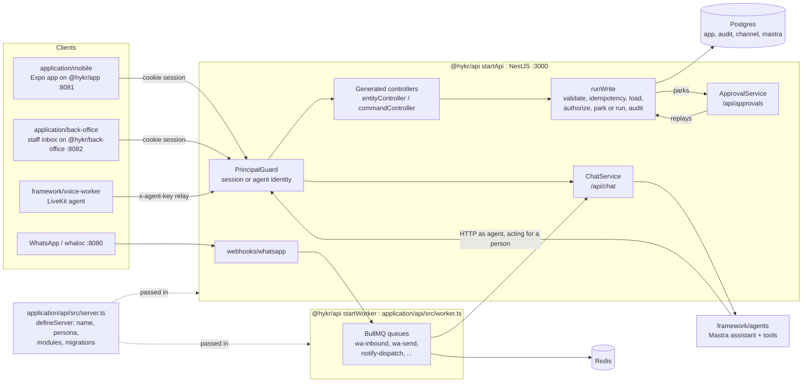

# Basecamp developer guide

**Basecamp is the agentic development stack for full-stack applications.** This guide is for developers who build a business on it. It covers how the pieces fit, where your code goes, the rules the framework enforces, and how to test and ship a feature.

To learn by doing, start with a tutorial: [Build a new application](new-application.md) builds a new product from scratch, and [Build a feature end to end: site visits](tutorial.md) adds one feature to the sample through every layer. Both use tested code. Section 5 of this guide is the reference for the same steps.

Everything here describes the code as it is in this repository. File paths are relative to the repository root. The framework lives in `framework/` as `@hykr/*` packages; the application built on it, the sample domain, lives in `application/`. If this guide and the code disagree, the code wins. Please fix the guide when that happens.

---

## 1. What this framework is

You declare your business once, in a typed spec: its records (entities), its multi-step actions (commands), who may do what, and what needs a person's approval. The framework builds the rest from that spec:

- REST routes, with validation and a list grammar (filters, search, sort, keyset pages).
- Tools for the assistant (`list-*`, `get-*`, `create-*`, `update-*`, `delete-*`, and one per command).
- Typed client methods and React data hooks for the app.
- Scoping by business (tenant), role and customer, on every read and write.
- Approvals: a write that needs a person's yes is parked, then replayed when someone approves it.
- An audit row for every write, refusal and decision.
- History lines, approval cards, and how the assistant shows results on screen, on WhatsApp and in speech.

The template ships with a sample application: meetings, notes and to-dos, as three modules in `application/`. It shows every feature. You replace it with your own (see `DOMAIN.md` at the root), or start a new application from the same sample with `npm create @hykr/basecamp <folder>`. The framework never imports the application: the application passes its modules in, through `defineServer` (`application/api/src/server.ts`) and `<AppShell>` (`application/mobile/src/app/_layout.tsx`).

### The three rules

These three rules explain almost every design choice in the codebase.

1. **One write path.** Every write goes through `runWrite` in `framework/core/src/write/pipeline.ts`: validate, idempotency, load, authorize, park or run, audit. That holds whether the write comes from the app, the assistant, WhatsApp, voice or an approval replay. No feature writes to the database any other way.
2. **The assistant is a user.** The assistant has no database access. Its tools call the same HTTP API the app calls, as an agent principal acting for a person (`x-agent-key`, `x-acting-for`). The same rules, scopes, approvals and audit apply. A dependency-cruiser rule (`agents-not-to-db`) keeps it that way.
3. **Channels are views.** The app, WhatsApp and voice all reach one chat service (`framework/api/src/modules/chat`) and one thread per person. A tool result carries a *present intent*, such as "show the `todo.list` view with this query". Each channel draws it in its own way: a component in the app, words and buttons on WhatsApp, a short sentence in voice.

---

## 2. How it fits together



Read the diagram like this:

- The API and the queue worker are `@hykr/api`. The application starts them with its own definition: `application/api/src/main.ts` calls `startApi(server)` and `worker.ts` calls `startWorker(server)`, where `server = defineServer({ ... })`. `basecamp dev` and `basecamp start api|worker` run the same thing.
- People call the API with a Better Auth session cookie. `PrincipalGuard` turns the request into a `Principal`: who is acting, for whom, in which business, with which roles and capabilities.
- The assistant runs inside the API process (`ChatService` calls Mastra), but its tools go back out over HTTP to the same API, with agent headers. That round trip is on purpose: the assistant passes through every guard, rule and audit row.
- WhatsApp messages arrive at `POST /webhooks/whatsapp`. They are stored, queued, and processed by the queue worker (`startWorker`), which runs a chat turn and queues the reply.
- The voice worker is a *relay*: it may only start chat turns (`@RelayAllowed()` routes) for the person in the call.

### What a write does

Every write, from any caller, follows these steps in `runWrite`:

| Step | What happens | Where |
|---|---|---|
| Validate | `op.input.parse(rawInput)`, again, even after the controller parsed it | `pipeline.ts` |
| Idempotency | Same `idempotency-key` and same body returns the stored answer. Same key with a different body is a 409. | `app.idempotency` table |
| Load | `op.load(tx, p, input)` through scoped repos. A row that is not yours is a 404. | entity repo |
| Authorize | Returns `allow`, `deny` or `needs_approval`. Then each write hook may refuse or park, never loosen (`strongerDecision`). | `def.decide` or your command's `authorize`, then `writeHooks` |
| Deny | The transaction rolls back. A `denied` audit row is written. The caller gets 403 `{ error: 'forbidden', rule, reason }`. | |
| Park | Inserts an `app.approvals` row (deciders from the decision's `approver`, else the rule) and a `needs_approval` audit row with the tier. Returns `{ status: 'needs_approval', approval }`. | `approvals.ts` |
| Run | `op.run(...)` inside the transaction | your command or the entity repo |
| Audit | One row per touched record, plus one for a command | `audit.events` |
| Stored events | Each `NamedEvent` (and `approval.requested`) is inserted in `app.domain_events` in the transaction, with the row before and an `available_at` held back by the decision's `undoMs` | `write/events.ts` |
| Write hooks | `afterRun` for a write that ran or parked, in the transaction. Throwing rolls it all back. | `writeHooks` |
| Events | Published in-process after commit by the CQRS handler | `NamedEvent` |

Every write answers a `WriteResult` (`framework/contracts/src/framework/write.ts`):

```ts
{ status: 'done', value } | { status: 'needs_approval', approval }
```

---

## 3. Where things live

### The application: the folders you replace

The application is `application/`. Its `package.json` (`@application/app`) holds the `"basecamp"` block (where the compiled server, the watched packages, the apps and the migrations are) and the scripts. The framework never imports any of it. The application is a list of modules, each a folder `application/domain/src/modules/<name>/` with one folder per layer. The application hands them to the framework in two places: the server definition in `application/api/src/server.ts`, and the app's settings, modules, catalog and registry in `application/mobile/src/app/_layout.tsx`. The dependency-cruiser rule `framework-never-imports-application` enforces this (`pnpm lint:deps`).

In a module (`application/domain/src/modules/<name>/`, for example `todos`):

| Path | What lives there | You edit it when |
|---|---|---|
| `contracts/` | Zod schemas, `entitySpec`s, `commandSpec`s, and `<name>Spec = moduleSpec({ name, dependsOn, entities, commands })` | You add or change a record, a field, a list filter, an approval rule or a command |
| `db/schema.ts` | Drizzle tables in the `app` schema, named after the module | You add a table or a column |
| `server/` | `defineEntity` / `defineCommand` and the module's Nest module. `public.ts`: what other modules may use | You wire a new entity or command into the API, or change who sees what |
| `notifications/` | Its templates (`defineTemplate`) and notifications (`defineNotification`) | Your business sends reminders or WhatsApp templates |
| `views/` | `<name>Views = { name, views, screens }` (`defineView`, `defineScreen`) | The assistant should show a record or a list in a new way |
| `agent/` | An `AgentModule`: rules, scripted-model scripts, eval cases and setup | You teach the assistant your business, or add evals |
| `index.ts` | `<name> = defineModule({ ...<name>Spec, server, views, screens, templates, notifications, agent, tables })` | You add a layer to the module |

Around the modules:

| Path | What lives there | You edit it when |
|---|---|---|
| `application/domain/src/modules/index.ts` | `modules`, in dependency order, one line per module | You add a module (`basecamp module add <name>` does it) |
| `application/domain/src/contracts/`, `src/views/` | Every module's specs and views for the apps (`moduleSpecs`, `moduleViews`), one line per module | You add a module (`basecamp module add` does it) |
| `application/domain/src/server/access.ts` | `BUSINESS_ACCESS`, shared by the modules | You change who sees what |
| `application/domain/drizzle/` | Generated SQL migrations and `meta/_journal.json`, one journal for every module, recorded in `drizzle.__app_migrations` | After `pnpm db:generate --name <name>`. Never edit by hand. |
| `application/api/src/server.ts` | `server = defineServer({ name, persona, help, channel, modules, migrations })`; `main.ts` and `worker.ts` start it | You change who the assistant is, or what the WhatsApp welcome and HELP say it does (`channel.does`) |
| `application/mobile/src/modules/<name>/` | The app half of each module: `index.tsx` (`defineAppModule({ name, nav, suggestions, bind, hrefFor, webmcp })` and what other modules may use), `routes.tsx`, `views.tsx`, `screens/`, `components/`. Listed in `src/modules/index.ts`, one line each | You draw a view in the app, add a screen or a nav item |
| `application/mobile/src/catalog.ts`, `settings.ts`, `home/` | `catalog = createCatalog(...moduleSpecs)`, `registry = createUiRegistry(...moduleViews)` and the `Register` declaration; `settings` (title, tagline, home); the home screen, which combines modules | You change what the app serves or its home screen |
| `application/mobile/src/app/` | Expo Router route files: one-line re-exports, each module's under `<name>/`. `index.tsx` is the home screen. `_layout.tsx` renders `<AppShell>`. | You add an app screen |
| `application/api/test/domain/`, `application/api/test/whatsapp/`, `application/domain/src/**/*.test.ts` | Your application's e2e, golden WhatsApp, view and notification tests | Always, with the feature |

### The framework: the folders you read

You should rarely need to change these. When you do, it is a framework change and needs its own tests (in `framework/api/test/framework`, against the fixture application in `framework/api/test/fixture`).

| Path | What lives there |
|---|---|
| `framework/contracts/src/framework/` | `entitySpec`, `commandSpec`, `moduleSpec` and the module id stamp (`module.ts`), the list grammar, present intents, `WriteResult` |
| `framework/contracts/src/platform/` | The framework's own entities (saved `pages`) and commands (`notify.send`, `handoff.request`) |
| `framework/contracts/src/catalog.ts` | `createCatalog(...modules)`: every module's entities and commands plus the platform's, with the collision checks and `reserveRoutes`. Tools, hooks and history read from a catalog. |
| `framework/core/src/` | `defineEntity`, `defineCommand`, `runWrite`, `ApprovalService`, guards, controller factories, list SQL. `src/tools/` builds agent tools (imported as `@hykr/core/tools`). `hooks.ts` holds the core's extension points (section 5.9). |
| `framework/policy/src/` | `accessFor`, `rowAllowed`, `DEFAULT_ACCESS`, `subjectOf`, `userIdOf` |
| `framework/db/src/schema/`, `framework/db/drizzle/` | Tenancy, approvals, idempotency, audit, channel tables and their migrations (`drizzle.__framework_migrations`); `app`, `id()`, `tenantColumn()`, `customerColumn()` for your tables |
| `framework/agents/src/` | `createAgents`, the Mastra assistant, profiles, the fake model, scorers, Studio; script helpers in `@hykr/agents/script`, the evals harness in `@hykr/agents/evals` |
| `framework/ui-registry/src/` | `defineView`, `createUiRegistry`, platform views; `react.ts` for `bindView` / `bindScreen` |
| `framework/i18n/src/` | `LANGS`, `Labels`, the framework's phrases (`messages.ts`), date and plural formatting |
| `framework/channels/src/` | WhatsApp transport only: adapter, render, split, keywords, approval tokens |
| `framework/connectors/src/` | Talking to other systems, transport only: Standard Webhooks signing, HMAC checks, the secret box, the egress guard (`safeRequest`), the `Connector` interface (section 5.12) |
| `framework/notifications/src/` | `defineTemplate`, `defineNotification`, `createNotificationCatalog`, quiet hours and marketing cap rules |
| `framework/api-client/src/` | `createApiClient`: `entity(spec)`, `command(spec, input)`, and typed calls for every framework route |
| `framework/api/src/runtime.ts`, `start.ts` | `defineServer`, `startApi`, `startWorker`, `migrate`, `runTemplates`, `runEval`, `startStudio`. `testing.ts` is `@hykr/api/testing`. `hooks.ts` holds the server's extension points (section 5.9), `module.ts` `defineModule`, and `module-checks.ts` the boot checks across modules (section 5.11). |
| `framework/api/src/channels/` | WhatsApp webhook, queues, sending, notifications dispatch, template sync, handoff, back office API, erasure |
| `framework/api/src/modules/` | Chat, threads, history, me, voice, pages |
| `framework/api/src/features/` | Framework features, one folder each (`defineFeature`): `events` (the outbox relay), `integrations` (webhooks out and in, section 5.12) |
| `framework/app/src/` | `AppShell`, `defineAppModule` and the plugin types (`framework/app-domain.ts`), their merge (`framework/compose-app.ts`) and plugin slots (`framework/plugins.ts`), data hooks (`framework/hooks.ts`), `InlineView`, chat runtime, canvas store and `PageHost`; primitives in `@hykr/app/ui` |
| `framework/cli/` | The `basecamp` command (`module-add.ts` scaffolds a module, `db-rebase.ts` regenerates migrations after a rebase), plus the `compose.yaml` and `infra/` it starts |

### Import rules

`.dependency-cruiser.cjs` holds these rules. All are errors. CI runs `pnpm lint:deps`.

| Rule | What it means for you |
|---|---|
| `framework-never-imports-application` | Nothing in `framework/` imports `application/` or `@application/*`. The application passes its domain in. |
| `application-uses-public-framework-exports` | The application imports `@hykr/*` packages by name and public subpath, as from npm: no relative paths into `framework/`, no `src/`, `dist/` or tests. |
| `framework-libraries-not-to-runtimes` | The libraries never import the runtimes (`api`, `app`, `back-office`, `voice-worker`, `cli`, `create-basecamp`). |
| `domain-specs-and-views-are-isomorphic` | A module's `contracts`, `views` and `notifications` (and the aggregates of them) are read by the server and the apps alike: no `server`, `db` or `agent` folder, no module bundle, no `@hykr/db`, `policy`, `core`, `agents` or `api`, no `@nestjs`, `drizzle-orm`, `@mastra` or `bullmq`. |
| `apps-read-only-isomorphic-domain` | The Expo apps read the modules' contracts and views only (the aggregates, or `@application/domain/modules/<name>/contracts` and `/views`), never a server, tables, assistant, notifications, module bundle or `application/api`. |
| `module-imports-public-parts`, `module-<name>-imports-its-dependencies`, `module-not-to-aggregates`, `no-module-cycles` | A module imports another only through its `contracts/` or `server/public.ts`, only if it lists it in `dependsOn` (read from its `moduleSpec`), never the modules list or the aggregates, and no cycle. |
| `contracts-stays-a-leaf`, `i18n-is-a-leaf` | `@hykr/contracts` imports no framework package except `@hykr/i18n`. `@hykr/i18n` imports nothing at all. |
| `agents-not-to-db` | The assistant never imports `@hykr/db`. It reaches data through the API. |
| `core-not-to-mastra`, `core-tools-not-to-db` | Mastra is used only in `framework/core/src/tools/`, and those tools never touch the database. |
| `db-policy-not-to-mastra` | `db` and `policy` know nothing about the model. |
| `ui-registry-no-runtime` | The registry imports only contracts and i18n. React bindings live in `@hykr/ui-registry/react`. |
| `channels-is-transport`, `notifications-are-definitions` | These packages hold no database, queue, Nest or policy code. Sending and consent live in `@hykr/api`. |
| `connectors-is-transport` | `@hykr/connectors` imports only `@hykr/i18n`, zod and Node: no database, contracts, core, Nest or queue. The clients and the isomorphic layers never import it. |
| `clients-hold-no-server-code` | `@hykr/app`, `@hykr/back-office` and `@hykr/voice-worker` talk to the API over HTTP only. |

---

## 4. Your first hour

### Setup

You need Node 24 (`.nvmrc`), pnpm 12 (`packageManager` in `package.json`) and Docker.

```bash
pnpm install
cp application/.env.example .env
```

The `.env` stays at the repository root: the `basecamp` command loads the nearest `.env` at or above the application's root (`application/`), and the tests read it too. Fill these in `.env`. Each one must be at least 32 characters. Generate each with `openssl rand -hex 32`:

- `BETTER_AUTH_SECRET`
- `AGENT_API_KEY`
- `VOICE_AGENT_KEY` (must differ from `AGENT_API_KEY`; the API refuses to start otherwise, because audit tells them apart)
- `APPROVAL_SECRET` (signs WhatsApp approval buttons; without it approvals are decided in the app only)
- `SECRETS_KEY` (seals integration credentials and webhook signing secrets; without it webhook endpoints and connections cannot be saved, section 5.12)

To run without any model or speech keys, set:

```bash
MODEL_MODE=fake     # scripted assistant, no OPENROUTER_API_KEY needed
VOICE_MODE=fake     # voice worker takes text in, gives text out
```

Then build, start the services, migrate and run:

```bash
pnpm build             # the CLI, the API and the tests run from dist/
pnpm infra:up          # docker compose: every service in framework/cli/compose.yaml
pnpm db:migrate        # the framework's migrations, then the application's
pnpm templates:sync    # sends WhatsApp templates to whaloc; needs the build and whaloc
pnpm dev               # the framework in watch mode, then basecamp dev: API + queue worker,
                       # mobile web, back office, voice worker, Studio
```

The root scripts call the `basecamp` command (`@hykr/cli`) inside `application/`. You can run it there yourself: `cd application && pnpm exec basecamp <dev | start api|worker|voice | infra up|down | db migrate | db generate | templates sync|check | eval | studio>`. `pnpm exec basecamp --help` lists them.

Check it is up:

```bash
curl http://localhost:3000/health     # {"ok":true}
```

Things that will trip you up:

- Most of `pnpm dev` reloads on save. Each framework package runs `tsc -w` into its `dist/`. `basecamp dev` (the application's `dev` script) compiles `application/domain` (every module) and `application/api` the same way, restarts the API and queue worker under `node --watch` when any module they loaded changes, and both Expo apps fast-refresh through Metro. The voice worker runs from its build (`node …/@hykr/voice-worker/dist/main.js dev`) without a watcher. An edit in `framework/*` reaches every app that imports it. `pnpm dev` passes `--concurrency=30` because turbo runs 16 persistent tasks (15 framework watchers and the application's `basecamp dev`) and its default is 10; pass it too when you run `pnpm turbo run dev` yourself.
- `basecamp dev` also starts the voice worker, which exits at startup if `VOICE_AGENT_KEY` is missing or short, or if `VOICE_MODE=live` has no `SARVAM_API_KEY` (`assertConfig()` in `framework/voice-worker/src/config.ts`). `basecamp dev` reports `voice … exited (1)`, keeps the other processes running, and does not start the worker again. `application/.env.example` ships `VOICE_AGENT_KEY=` empty and `VOICE_MODE=live`. Set `VOICE_AGENT_KEY` and `VOICE_MODE=fake`, then restart `pnpm dev`.
- Mobile web serves on 8081 and the back office on 8082. If something else holds either port, Expo cannot ask for another one (`basecamp dev` gives it no terminal), so that app exits.
- With `MODEL_MODE=live` (the default in `.env.example`) and no `OPENROUTER_API_KEY`, chat answers 503 "Set OPENROUTER_API_KEY in .env to use the assistant".
- Stop the services with `pnpm infra:down` (or `basecamp infra down`). They run as the Compose project `basecamp` from `framework/cli/compose.yaml` (an application can name its own with `"project"` in its `basecamp` block), so a plain `docker compose down` at the root finds nothing.
- `basecamp` is compiled: in this repository it works only after `pnpm build`, and says so until then. `pnpm infra:up` runs `docker compose` directly and needs no build.
- `templates:sync`, `templates:check`, `db:migrate` and `eval` load the application's compiled server (`application/api/dist/server.js`, the `server` entry of the `basecamp` block). Build first.
- Compose's Postgres runs `framework/cli/infra/postgres/init.sql` (postgis and pgcrypto extensions, and `ALTER ROLE app SET search_path = public`) only on a fresh volume. On any other Postgres, run it yourself before `pnpm db:migrate`, or Better Auth's tables land in the `app` schema.

### Local tools

| Tool | URL | What for |
|---|---|---|
| API | http://localhost:3000 | `GET /health`; `GET /me` shows the principal the API sees for you |
| Mobile app (web) | http://localhost:8081 | The product |
| Back office | http://localhost:8082 | Staff inbox for WhatsApp handoffs |
| Bull Board | http://localhost:3000/admin/queues | Queues. Sign in to the app first, with a role that has `queues.admin` (owner or admin). Not mounted in production. |
| whaloc | http://localhost:8080 | WhatsApp Cloud API emulator with a chat UI |
| Mailpit | http://localhost:8025 | Email sent by notifications |
| pgAdmin | http://localhost:5050 | `admin@example.com` / `admin`; server `app` (host `postgres`, user `app`) is preregistered |
| Mastra Studio | http://localhost:4000 | Try the assistant and its tools, and read traces. `pnpm dev` starts it once the API is up and skips it if ports 4000 or 4111 are taken; it restarts when the agent's code changes. On its own: `cd application && pnpm exec basecamp studio` (needs the API running) |
| LiveKit | ws://localhost:7880 | Voice rooms (dev keys `devkey` / `secret`) |
| MinIO | http://localhost:9001 | Runs in compose, but no code uses it yet |

Postgres is on `localhost:5432` (`app` / `app` / `app`). Redis is on `localhost:6379`.

### One feature on three channels

The sample to-do shows the whole loop. Try it before you write any code.

**1. The app.** Open http://localhost:8081, sign up, and add a to-do on the To-dos screen. That is `POST /api/todos` through `useEntityMutation('todos')`.

**2. The assistant in the app.** In the chat, type `add Call the plumber`, then `delete Call the plumber`. With `MODEL_MODE=fake` the scripted model calls `create-todo`, then `list-todos` and `delete-todo`. The delete is parked, because the spec says so:

```ts
// application/domain/src/modules/todos/contracts/todo.ts
// An agent never deletes without the person.
approval: { delete: (p) => p.actor.kind === 'agent' },
```

An approval card appears in the chat. Approve it, and the to-do is gone.

**3. The raw API.** The same calls, as a person:

```bash
# Sign up. Better Auth wants a trusted Origin.
curl -c jar -H 'origin: http://localhost:8081' -H 'content-type: application/json' \
  -d '{"name":"Ana","email":"ana@example.com","password":"password123"}' \
  http://localhost:3000/api/auth/sign-up/email

curl -b jar -H 'content-type: application/json' -d '{"title":"Order tiles"}' \
  http://localhost:3000/api/todos
# {"status":"done","value":{"id":"…","title":"Order tiles","done":false,…}}

curl -b jar 'http://localhost:3000/api/todos?done=false&sort=-createdAt'
# {"items":[…],"nextCursor":null}
```

**4. WhatsApp.** The business number must be claimed by your tenant before inbound messages are handled. Otherwise the inbound processor marks them `unknown number`:

```bash
curl -b jar -H 'content-type: application/json' -d '{}' \
  http://localhost:3000/api/channels/whatsapp/number
```

A number belongs to the first business that claims it, and is never moved to another: a second business gets 409. In development, `{}` claims `WA_PHONE_NUMBER_ID`; in production you must name the `phoneNumberId`. If another local account already holds the dev number, free it with `delete from channel.numbers where phone_number_id = '<id>';`.

Then open whaloc at http://localhost:8080 and write to the seeded number (+91 80 4000 0100) from a new phone number. You are a customer of the business now. Write `list`. The reply is the `todo.list` view's `text`, sent as WhatsApp words. You see only your customer's rows, which is none yet. To act as yourself on WhatsApp, link your number in the app (the app calls `POST /api/channels/whatsapp/code`, then `POST /api/channels/whatsapp/verify`).

### Find yourself in the audit log

Every write you just made is in `audit.events`. Open pgAdmin or `psql` and run:

```sql
SELECT at, action, outcome, actor_kind, actor_id, acting_for, channel, rule, reason, run_id
FROM audit.events
ORDER BY at DESC
LIMIT 20;
```

You will see `todo.create` rows with `actor_kind = 'user'`, the agent's `todo.delete` with `outcome = 'needs_approval'`, then `approval.approved` and the replayed `todo.delete` with `approved_by` set to you.

To follow one assistant turn, take the `x-run-id` response header from `/api/chat` (or `runId` from `/api/chat/once`):

```sql
SELECT at, action, outcome, actor_kind, acting_for, rule, reason, before, after
FROM audit.events WHERE run_id = '<run-id>' ORDER BY at;

SELECT id, action, status, summary, approver_user_id, approver_roles, expires_at, failure_reason
FROM app.approvals WHERE run_id = '<run-id>';
```

To see what an approval replay did, find rows that share the approve call's request id:

```sql
SELECT at, action, outcome, actor_kind, approved_by, rule FROM audit.events
WHERE request_id = (SELECT request_id FROM audit.events
                    WHERE action = 'approval.approved' AND resource_id = '<approval-id>')
ORDER BY at;
```

The app shows the same data per record through `GET /api/history?resourceType=todo&resourceId=<id>`.

---

## 5. Declaring your domain

Work inside a module (`application/domain/src/modules/<name>/`; `basecamp module add <name>` starts one), in this order:

1. The spec (`contracts/`)
2. The table (`db/schema.ts`)
3. The migration (`pnpm db:generate`)
4. `defineEntity` / `defineCommand` (`server/`)
5. A Nest module (`server/`)
6. Add it to the module's `index.ts` (`defineModule({ server })`)
7. Views, app bindings, assistant scripts, notifications (as needed)

`application/api/src/server.ts` already passes every module in `modules/index.ts` to `defineServer`, so a new entity needs no change there.

### 5.1 The entity spec

`entitySpec` lives in `framework/contracts/src/framework/spec.ts` (import it from `@hykr/contracts`). You give it the parts below. It fills `plural` (`${name}s`), `pascal`, `expose` (every action `'all'`, merged with yours) and `approval` (`{}`).

| Field | Meaning |
|---|---|
| `name` | Singular, lower case. Used in routes, command names (`todo.create`), tool ids and audit `resource_type`. |
| `plural`, `pascal` | Derived unless you give them. Give `plural` when "s" is wrong. |
| `label` | How people say it ("to-do"). Used in messages such as `No such to-do`. |
| `fieldLabels` | `{ field: { en, hi, te } }`. Field names in the approval preview. |
| `description` | Goes into tool descriptions. Write it for the model. |
| `schemas` | `{ read, create, update }`, all `z.object(...)` |
| `list` | The list grammar config (see 5.6) |
| `expose` | Per action: `'all'`, `'human'` or `'internal'` (see 5.7) |
| `approval` | Per write action: when it parks and who decides (see 5.8) |
| `views` | `{ list?, item? }`: registered view names the tools present results with |

The sample to-do:

```ts
// application/domain/src/modules/todos/contracts/todo.ts
export const TodoSpec = entitySpec({
  name: 'todo',
  label: 'to-do',
  description: "The user's to-dos: short tasks with an optional due date, optionally linked to a meeting.",
  schemas: { read: Todo, create: CreateTodoInput, update: UpdateTodoInput },
  fieldLabels: { title: { en: 'Title', hi: 'शीर्षक', te: 'శీర్షిక' }, /* … */ },
  list: {
    filterable: { done: 'boolean', dueOn: 'date', meetingId: 'id', title: 'text' },
    sortable: ['dueOn', 'createdAt', 'title'],
    defaultSort: [['createdAt', 'asc']],
    search: ['title'],
    pageSize: { default: 50, max: 100 },
    examples: { done: 'false', dueOn: '{ "lte": "2026-10-31" }', /* … */ },
  },
  // An agent never deletes without the person.
  approval: { delete: (p) => p.actor.kind === 'agent' },
  views: { list: 'todo.list', item: 'todo.item' },
});
```

Update schemas in the sample refuse an empty patch:

```ts
.refine((v) => Object.values(v).some((x) => x !== undefined), 'Send at least one field to change')
```

Read schemas can use the exported `CreatedBy = z.enum(['person', 'assistant'])`.

Register the spec in its module's `contracts/index.ts`. The key must be the plural, or `moduleSpec` throws at load. `moduleSpec` also stamps the spec with the module's name (`spec.module`):

```ts
// application/domain/src/modules/meetings/contracts/index.ts
export const meetingsSpec = moduleSpec({
  name: 'meetings',
  dependsOn: ['todos', 'notes'],
  entities: { meetings: MeetingSpec },
  commands: [CloseMeetingSpec, RescheduleMeetingSpec],
});
```

### 5.2 The table

Add tables to the module's `db/schema.ts`, in the `app` schema, named after the module (`todos`, or `todos_<x>`; `defineServer` refuses another name). Use the helpers `@hykr/db` exports (`app`, `id`, `tenantColumn`, `customerColumn`, `user`, and `tableRef` for a foreign key to a module that depends on this one):

```ts
export const todos = app.table('todos', {
  id: id(),
  tenantId: tenantColumn(),
  ownerId: text('owner_id').notNull().references(() => user.id),
  customerId: customerColumn(),
  title: text('title').notNull(),
  done: boolean('done').default(false).notNull(),
  dueOn: date('due_on'),
  meetingId: text('meeting_id').references(() => meetings.id, { onDelete: 'set null' }),
  createdBy: text('created_by', { enum: ['person', 'assistant'] }).notNull().default('person'),
  createdAt: timestamp('created_at', { withTimezone: true }).defaultNow().notNull(),
  updatedAt: timestamp('updated_at', { withTimezone: true }).defaultNow().$onUpdate(() => new Date()).notNull(),
}, (table) => [
  index('todos_owner_id_idx').on(table.ownerId),
  index('todos_tenant_customer_idx').on(table.tenantId, table.customerId),
]);
```

What the framework requires:

- JS keys named exactly `id` and `tenantId`, plus an owner column. Otherwise `defineEntity` throws `<name>: table needs id, tenantId and owner columns`.
- Owner and customer columns can have any key. You point at them with a function.
- `createdBy` is optional. If it exists, the framework sets it to `'assistant'` for an agent and `'person'` otherwise.
- Every field named in `list` must be a column key, or the list query throws `List config names "x", which is not a column`.
- Entity routes use `ParseUUIDPipe` for `:id`, so ids must be UUIDs. `id()` gives `gen_random_uuid()::text`.

Then generate and apply the migration:

```bash
pnpm db:generate --name <your-change>   # basecamp db generate: drizzle-kit in application/domain, every module
pnpm db:migrate                         # the framework's migrations, then the application's
```

`application/domain/drizzle.config.ts` manages only your tables in the `app` schema (every module's `db/schema.ts`, one journal), and records what ran in `drizzle.__app_migrations`. After a rebase onto a branch with new migrations, `basecamp db rebase --base <branch>` drops yours and generates them again on top. The framework's tables (`public`, `app`, `audit`, `channel`) ship with `@hykr/db` (`framework/db/drizzle`, recorded in `drizzle.__framework_migrations`) and are applied first. Mastra owns `mastra` and `mastra_obs`.

What drizzle-kit does not generate (extensions, triggers, functions, CHECK constraints) goes in SQL hook files next to the migrations: `application/domain/sql/pre/*.sql` runs before your migrations, `sql/post/*.sql` after them (the framework's are in `framework/db/sql`). They run on every migrate, in name order, one transaction per file, so each must be idempotent: `IF NOT EXISTS`, `CREATE OR REPLACE`, `DROP TRIGGER IF EXISTS` then `CREATE TRIGGER`. Use one file per feature.

`pnpm db:migrate` holds a Postgres advisory lock, so two migrates on one database wait for each other. It refuses to start when a migration was never applied but is older than the last one applied: drizzle would skip it without a word. That happens when a branch generated before another was merged. Regenerate the migration (delete it and generate again) or recreate the database.

### 5.3 defineEntity

`defineEntity` (`framework/core/src/entity/define-entity.ts`) joins the spec to its table:

```ts
// application/domain/src/modules/todos/server/todo.entity.ts
export const Todo = defineEntity(TodoSpec, {
  table: todos,
  owner: (t) => t.ownerId,
  customer: (t) => t.customerId,
  access: BUSINESS_ACCESS,
});
```

| Option | Meaning |
|---|---|
| `table` | The Drizzle table |
| `owner` | The owner column. Used for `'own'` access, and set on create. |
| `customer` | The customer column, for `'customer'` access. Optional. |
| `access` | Who reaches which rows (see 6.2). Defaults to `DEFAULT_ACCESS`. |
| `rules` | `EntityRule[]`: domain checks on writes. A deny refuses; a `needsApproval` parks a plain CRUD write (inside a command only the deny counts). |
| `summarize` | `(action, input, row) => string`: the approval card text. The default uses `title`: `Delete "Call the plumber"`. |
| `events` | Store `<entity>.created/updated/deleted` (with the row before) in the event outbox and publish them after commit. Default `true`. |

An entity rule has this shape:

```ts
type EntityRule<T> = (p, action, row, input, ctx: { via: 'crud' | string }) => AuthorizeResult | null;
```

Return `deny(rule, reason)` to refuse, `needsApproval(rule, reason, details?)` to park a CRUD write, or `null` to pass. `ctx.via` is `'crud'` for a plain route, or the command's name when a command calls the repo. The meeting uses that to force closing through its command:

```ts
// application/domain/src/modules/meetings/server/meeting.entity.ts
(_p, action, _row, input, ctx) =>
  action === 'update' && input?.status === 'closed' && ctx.via !== 'meeting.close'
    ? deny('use_close_meeting', 'Close a meeting with close-meeting, so its summary and to-dos are written')
    : null,
```

The returned `EntityDef` has a scoped `repo` for use inside commands: `get`, `find`, `list`, `insert`, `update` and `delete`. Every query is limited to the principal's tenant and grants. Someone else's id is a 404. Writes re-parse the input, run the rules, and strip `id`, owner, `createdBy`, `tenantId` and customer from the input.

A row leaves the server only through `def.toRead(row, p)`: the read schema parses it, then it is projected for that principal (fields hidden, never added). `def.readJson(row)` and `def.project(read, p)` are its two halves. Lists, gets, write results, command results, approvals and history titles all go through it.

**Entity plugins** (`EntityPlugin`, contributed as `entityPlugins`) add behaviour to every entity whose spec they apply to (`appliesTo`, usually a trait). Every hook is optional and runs after the entity's own config:

| Hook | Runs | Use it for |
|---|---|---|
| `rules` | wherever the entity's rules run | refusals (a frozen version) |
| `decide` | on CRUD writes, after the rules, before `spec.approval` | park with a tier and approver, or allow with an undo window |
| `scope` | every scoped query, read and write | narrowing reach (a parent's scope) |
| `toValues` | insert and update | server-computed columns (a version, a number). The framework's own columns still win. |
| `toJson` | reads, before the read schema parses | stored types as JSON (money as a number) |
| `updateWhere` | update and delete | a stale write: no match on a row that is still there is 409 `{ error: 'stale' }` |
| `project` | `toRead`, after parsing | hiding fields from a principal |

`entityHandlers(def)` serves the entity: it joins `entityDefs()` (`entityDef(name)`, `entityDefForSchema(schema)`), and another entity with the same name or plural throws (serving the same one again is a no-op).

### 5.4 Commands

Use a command when one action touches several records, or has rules a plain update cannot express. Declare it in contracts:

```ts
// application/domain/src/modules/meetings/contracts/commands.ts
export const CloseMeetingSpec = commandSpec({
  name: 'meeting.close',
  description: 'Close a meeting in one step: …',
  input: CloseMeetingInput,
  output: CloseMeetingResult,
  http: { method: 'POST', path: '/api/meetings/:meetingId/close' },
  tool: 'close-meeting',
  expose: 'all',
  approvalNote: 'When you call it, the whole close waits for the user to approve it.',
  view: { name: 'meeting.card', id: (input) => input.meetingId },
  verb: { do: 'close', did: 'closed' },
  touches: ['meeting', 'note', 'todo'],
});
```

| Field | Meaning |
|---|---|
| `name` | Dotted, as audited |
| `http` | Method and path. Path params (`:meetingId`) come from the input. The rest is the body. |
| `tool` | The agent's tool id. Leave it out to keep the command off the agent. |
| `expose` | `'all'` or `'human'`. There is no `'internal'` for commands. |
| `approvalNote` | Added to the tool description |
| `view` | What the tool result shows |
| `verb` | Words for approval cards and history ("Approve close", "closed it") |
| `touches` | Entity names the app refreshes after the command runs |

Then implement it in the API with `defineCommand` (`framework/core/src/command/define-command.ts`):

```ts
// application/domain/src/modules/meetings/server/close-meeting.command.ts
export const CloseMeeting = defineCommand(CloseMeetingSpec, {
  resource: { type: 'meeting', id: (input) => input.meetingId },
  load: (tx, p, input) => Meeting.repo.get(tx, p, input.meetingId), // scoped: 404 if not theirs
  authorize: (p, meeting) => {
    if (meeting.status === 'closed') return deny('already_closed', 'This meeting is already closed');
    if (p.actor.kind === 'agent') return needsApproval('agent_close', 'Closing a meeting needs your approval');
    return allow('owner_closes');
  },
  summarize: (input, meeting) =>
    `Close ${meeting.title} with 1 note and ${todosLabel(input.actionItems.length)}`,
  run: async ({ tx, principal, input, loaded: meeting, via }) => {
    const note = await Note.repo.insert(tx, principal, { /* … */ meetingId: meeting.id }, via);
    // … Todo.repo.insert(tx, principal, { ...item, meetingId: meeting.id }, via) for each item
    const closed = await Meeting.repo.update(tx, principal, meeting, { status: 'closed' }, via);
    return {
      value: { meeting: closed, note, todos },
      touched: [{ type: 'meeting', id: meeting.id, change: 'updated', before: meeting, after: closed }, /* … */],
      events: [new MeetingClosed(closed, note, todos)],
    };
  },
});
```

Points to keep in mind:

- Always pass `via` to repo calls. Entity rules see it as `ctx.via`.
- Every record you change goes into `touched`. Each entry becomes an audit row.
- `authorize` alone decides whether a command parks. The optional `approval` config (`{ by, channels, minAssurance }`) only says who decides.
- The result leaves projected for the caller. A part of `output` that reuses an entity's read schema object (`MeetingView`, `z.array(Todo)`) is read and projected as that entity. For other shapes, pass `present: (value, p) => …` to `defineCommand`.
- A domain event is a class that implements `NamedEvent` (`eventName` and `row`, optionally `before`, `resourceType` and `resourceId`). It is stored in the event outbox with the write, and notifications can schedule on it:

```ts
export class MeetingClosed implements NamedEvent {
  readonly eventName = 'meeting.closed';
  get row() { return this.meeting; }
  constructor(readonly meeting: unknown, readonly note: unknown, readonly todos: unknown[]) {}
}
```

### 5.5 Nest wiring

The controller and handler factories live in `framework/core/src/http/controller-factory.ts` and `entity/handlers.ts`:

```ts
// application/domain/src/modules/meetings/server/meetings.module.ts
@Module({
  controllers: [entityController(Meeting), commandController(CloseMeeting), commandController(RescheduleMeeting)],
  providers: [...entityHandlers(Meeting), commandHandler(CloseMeeting), commandHandler(RescheduleMeeting)],
})
export class MeetingsModule {}

// application/domain/src/modules/meetings/index.ts
export const meetings = defineModule({ ...meetingsSpec, server: MeetingsModule, /* views, agent, tables… */ });
```

`defineServer({ modules })` hands each module's Nest module to the framework, which imports them, in module order, in both the API and the queue worker. That gives you:

| Route | Status |
|---|---|
| `GET /api/<plural>` | list, with the list grammar |
| `GET /api/<plural>/:id` | get |
| `POST /api/<plural>` | create, 201 |
| `PATCH /api/<plural>/:id` | update |
| `DELETE /api/<plural>/:id` | delete |
| `spec.http.method spec.http.path` | the command, 200 |

`entityHandlers` and `commandHandler` also register each op for approval replay (`registerOp`, which refuses another definition with the same name). You need both the controller and the handler. A controller without its handler has nothing to run, and a parked op without its handler fails as "can no longer be replayed".

### 5.6 The list grammar

`ListConfig` (`framework/contracts/src/framework/list.ts`):

| Field | Meaning |
|---|---|
| `filterable` | `{ field: FieldType }`, where the type is one of `'enum'`, `'date'`, `'text'`, `'number'`, `'boolean'`, `'id'`, or a type a feature defined |
| `sortable` | Fields you may sort by |
| `defaultSort` | `[[field, 'asc' \| 'desc'], …]` |
| `search` | Columns matched by `q`, case-insensitive, OR-ed. Without it there is no `q`. |
| `pageSize` | `{ default, max }` for HTTP |
| `toolPageSize` | The agent tool's maximum rows. Default 20. |
| `examples` | Shown in the tool description |

Operators by type:

| Type | Operators |
|---|---|
| `enum`, `id` | `eq`, `ne`, `in` |
| `boolean` | `eq`, `ne` |
| `text` | `eq`, `ne`, `in`, `contains` |
| `date`, `number` | `eq`, `ne`, `in`, `lt`, `lte`, `gt`, `gte` |

The same filter in its two forms:

```text
HTTP:  GET /api/todos?done=false&dueOn[lte]=2026-10-31&sort=-dueOn&limit=20
JSON:  { done: false, dueOn: { lte: '2026-10-31' }, sort: '-dueOn', limit: 20 }
```

- The JSON form is what tools and `repo.list` take. `toQueryString(input)` turns it into the HTTP form.
- `in` takes a comma list over HTTP.
- `count: true` adds `total`.
- Unknown fields or operators are a 400. That is on purpose.

Field types are a registry. A feature adds one in two halves, each in its own file: the grammar in contracts, declared on `ListFieldTypes` (and new operators on `ListFilterOps`) and defined with `defineListFieldType({ name, ops, value, opValue? })`, which every process (server, tools, apps) loads; and the SQL in the server, `listFieldSql` (contributed as `listFieldSql`), `{ name, where({ table, field, column, op, value }) }`. A field of an undefined type fails when its schema is built, and one without SQL fails its request. Neither filters nothing.

The response is `{ items, nextCursor, total? }`. Pagination is keyset: pass `nextCursor` back as `cursor`. A cursor from a different sort is a 400 `cursor_sort_mismatch`. Sorting on a nullable column works only for dates, timestamps and numbers. A nullable text or enum column in `sortable` passes load-time checks, then throws `Sorting on nullable ... is not supported` (`framework/core/src/query/list-grammar.ts`) on the first request that sorts by it, which the client sees as a 500. Keep such columns `notNull()` or out of `sortable`.

### 5.7 Expose: who can reach an action

| `expose` | HTTP route | Agent tool | Use it for |
|---|---|---|---|
| `'all'` | yes | yes | The default |
| `'human'` | yes, with `HumanOnlyGuard` | no, and an agent call is denied `humans_only` | Irreversible actions. The meeting's `delete` is `'human'`. |
| `'internal'` | no | no | Records only commands should write, through `def.repo` |

For commands, `'human'` gives a people-only route. To keep a command off the agent, leave out `tool`.

### 5.8 Approvals: when a write parks

On an entity spec, `approval[action]` decides whether a write parks:

```ts
type ApprovalCheck = (p: Principal, ctx: { action: string; input: object | null; row: object | null }) => boolean;
type ApprovalRule =
  | 'always' | 'never'
  | ApprovalCheck
  | { when?: 'always' | ApprovalCheck; by?: string[] | 'self'; channels?: Channel[]; minAssurance?: Assurance };
```

- The function form is the common one: `(p) => p.actor.kind === 'agent'`. It also sees the payload, so
  `(p, { input }) => Number(input?.amount ?? 0) > 100_000` parks large amounts only. `input` and `row`
  are `null` when they are unknown: a tool's description is written before any call, and a create has
  no row.
- The object form also says who decides and where. For example, `{ when: (p) => p.actor.kind === 'agent', by: ['owner', 'admin'], channels: ['app'] }`. `channels: ['app']` keeps an irreversible decision off WhatsApp buttons. No sample entity uses the object form yet. The one real example is a command: `approval: { by: ['owner', 'admin'] }` in `framework/api/src/channels/notify/send-template.command.ts`.

Who decides, when `by` is not set: the person the request is for, if they are a user and not only a customer. Otherwise, the business's `owner` and `ops`.

Approvals expire after 24 hours by default (`CoreModule.forRoot({ approvalTtlMs })`). Expiry is checked when someone tries to decide.

A decision (`AuthorizeResult`) can also say what is at stake. `needsApproval(rule, reason, details)`
and `allow` / `deny` take the same optional `details`:
- `tier`: 0 a read, 1 an internal write (undoable), 2 a send to a client or vendor, 3 money, legal or
  irreversible;
- `approver`: `{ userId?, roles?, channels?, minAssurance? }`;
- `amount`: integer minor units (paise);
- `undoMs`: the undo window.

The helpers copy only these four fields. Passing an earlier decision as `details`, to keep its tier,
never changes the new decision, rule or reason.

What the write path does with them:
- A park's deciders come from `approver` when it names a person or roles, and its channels and assurance
  when it names them. The approval shows `tier` and `amount`, and the park's audit row records the tier.
- A write that runs with `undoMs` stores its events with `available_at` that much later, so nothing is
  passed on during the undo window.
- An approved replay keeps the details on the allow it becomes.
- Rules, entity plugins and write hooks combine with `strongerDecision`: deny beats needs_approval beats
  allow, the highest tier and the longest undo window survive.

### 5.9 Extension points: traits, contributions and settings sections

Shared behaviour plugs in without editing the framework's central files. There are three seams, and
each works by TypeScript declaration merging plus a registry that rejects a duplicate name
(`createHookRegistry` in `@hykr/contracts`).

- **Traits.** `entitySpec({ ..., traits: { <key>: … } })`, and the same on `commandSpec`. A feature
  declares its key on `EntityTraits` or `CommandTraits` in its own file. Its plugin then acts on the
  specs that carry the key.
- **Contributions.** `defineServer({ ..., contributes: { turnHooks: [...], deliveryChannels: [...] } })`.
  Each key is a list, collected by one registry: `roles` and `capabilities` in `@hykr/contracts`
  (section 6.4); `entityPlugins`, `writeHooks`, `readProjectors`, `listFieldSql` and
  `identityProviders` in `@hykr/core`; `toolContributions` in `@hykr/core/tools`;
  `deliveryChannels`, `turnHooks`, `inboundHooks`, `queues`, `schedules`, `subscribers`,
  `eventFeeds`, `erasureContributors`, `exportContributors`, `authPlugins`, `connectors` and
  `connectorHandlers` in `@hykr/api`.
  `@hykr/api` re-exports the core's and its own.
  - `setRuntime` installs the lists once, when the process starts serving the app. A key that no
    registry collects stops the start.
  - Registries are process-global, so read them per request, not at import.
  - To add a kind, create its registry with `{ collects: '<key>' }` and declare `<key>` on
    `Contributions` next to it.
- **Settings sections.** `defineSettingsSection('<key>', schema)` adds a per-business section. Its
  schema must have a default for every field. `parseTenantSettings(raw)` returns the base settings,
  `features` (switches by key, absent means off) and every section. Read a business's settings with
  `TenantConfigService` (`@hykr/core`, global): `get(tenantId)` caches them for 10 seconds per process
  (`CoreModule.forRoot({ tenantConfigTtlMs })`), `invalidate(tenantId)` after you change them, and
  `isEnabled(tenantId, key)` is true only for a stored `true` (no business, an unknown one or
  settings that do not parse are all off).

A framework feature also keeps its phrases, its scripted-model scripts and its fixture tables in files of its own, so parallel work never edits a shared file. One line in a barrel registers each one: `framework/i18n/src/messages/index.ts` (section 9), `framework/agents/src/fake/scripts/index.ts` (section 7.3). The fixture's per-feature migration sets need no line (section 12). These barrels merge with `merge=union` (`.gitattributes`).

The write and read path reads `entityPlugins` (section 5.3), `writeHooks` (each write: `decide` tightens,
`afterRun` runs in the transaction) and `readProjectors` (every record that leaves, by resource type:
an entity's name, a command's name, `'approval'`) on every call.

A module contributes the same way: `defineModule({ ..., contributes })`, merged before the
application's own. `DomainEventEnvelope` (`@hykr/contracts`) is the shape of a stored event:
`toEnvelope(row)` reads one from `app.domain_events`, and `eventFor(event, p)` is how one leaves for a
reader (another business's is null, fields are projected).
Stored events carry the process's queue prefix (`queues`). The fixture's
`framework/api/test/fixture/src/features/seams/` shows the seams, `features/write-path/` the write path's
hooks in use, and `features/identity/` a role, a capability, an identity provider and an auth plugin.

### 5.10 Runtime registries: queues, events, turns, tools, channels

Where each registry is read, and how to use it (`docs/decisions/F5.md` has the full API). The fixture's
`framework/api/test/fixture/src/features/runtime/` uses every one.

- **Queues and schedules.** `defineQueue({ name, concurrency, attempts, backoffMs, process(job, ctx) })`
  and `defineSchedule({ name, queue, every | cron })`, contributed as `queues` and `schedules`. Names
  are lower case words joined by `.` or `-`, prefixed by their owner (`credits.alerts`). `QueuesModule`
  registers every queue in the registry, the channel's included, under `BULL_PREFIX`. A queue with
  `process` gets a worker in the worker process (and in the API with `WORKER_INLINE=1`); the worker
  upserts each schedule at startup. Add jobs with `@Inject(JOBS) jobs: Jobs` or `ctx.jobs.add(queue, data)`.
  `ctx` (`ServerContext`) also has `db` and `get(token)` for any Nest provider.
- **Framework features.** One folder per feature in `framework/api/src/features/<x>/`, with
  `defineFeature({ name, imports, controllers, providers, processors, exports, contributes })`, and
  one export line in `features/index.ts`. `FeaturesModule.forRoot` loads controllers only in the API and
  processors only where jobs run.
- **Events and subscribers.** `defineSubscriber({ name, on: ['task.*'], when?, handle | queue })`,
  contributed as `subscribers`. Events come from the registered `eventFeeds`, which the worker polls
  each second with this process's prefix and `ctx`. The framework's `outbox` feed returns the rows of
  `app.domain_events` with this prefix that are due (`available_at` passed), not withdrawn
  (`cancelled_at`) and not yet relayed, oldest first. The relay adds one job per event and subscriber
  (id `<subscriber>--<stored event id>`, so a repeat runs once), then sets `relayed_at`. `handle`
  runs on the shared `events` queue; `queue` adds the envelope to your own queue. The envelope has
  the stored id, the actor who wrote and the row unfiltered: pass it through `eventFor(event, p)`
  (F3) before it leaves the server. The in-process `EventBus` is not relayed.
- **Turn hooks.** Every chat turn and back-office draft passes `turnHooks` in `ChatService`, after
  the framework's own `model-key` hook. `before` returns `{ refuse: { rule, reason, status?, say? } }`
  or `{ context?, model?, withoutTools? }`; a refusal is `TurnRefused` (403 unless given, nothing saved;
  on WhatsApp the person hears `say`). `after` sees the reply, the tools called and the token usage.
- **The agent per turn.** The model (`model` from a hook, else `AGENT_MODEL`), the tools (generated,
  plus `toolContributions`, minus `withoutTools`) and the instructions (plus the hooks' context lines,
  as data) are resolved from the request context. A tool id defined twice stops the start.
- **Delivery channels.** A notification's `channels` may name any registered `DeliveryChannel` beside
  `whatsapp` and `email`; add the name to `NotificationChannels` (`@hykr/notifications`) by declaration
  merging. `whatsapp` is required only when WhatsApp is a channel. `sent` ends the fallback order;
  `unavailable` or a final failure moves on; a failure for now retries that channel. A failure found
  later goes to `NotifyService.fallback(meta)`. An unregistered channel stops the start.
- **Inbound hooks.** Each WhatsApp message the code did not answer itself (buttons, keywords) passes
  `inboundHooks` before its turn: `{ handled: true }` keeps it out, `{ context }` adds lines the turn
  reads. A hook that throws is logged and skipped. A burst that says "delete my data" passes no hook:
  the erasure is queued and the rest of the burst is dropped.
- **Personal data.** "Delete my data" runs `erasureContributors` in its transaction and audits their
  counts. `exportPersonalData({ subject, db })` collects `exportContributors` by kind.
- **Hooks that need services.** Queue processors and subscriber handlers get `ctx`. A turn, inbound
  or delivery hook that needs DI is a Nest provider that registers itself in `onModuleInit`
  (`inboundHooks.register(this)`).

### 5.11 Modules: several teams, one application

An application is a list of modules (`DOMAIN.md`, "Modules"). Each is a folder with its own layers
and an `index.ts` that bundles them:

```ts
// application/domain/src/modules/todos/index.ts
export const todos = defineModule({
  ...todosSpec,                      // moduleSpec({ name: 'todos', dependsOn: [], entities, commands })
  server: TodosModule,
  views: todosViews.views,
  screens: todosViews.screens,
  templates: todosNotifications.templates,
  notifications: todosNotifications.notifications,
  agent: todosAgent,
  tables,                            // import * as tables from './db/schema.js'
});

// application/api/src/server.ts
export const server = defineServer({ name: 'Meetings', persona, help, channel, modules, migrations: [migrations] });
```

- **Start one** with `pnpm --dir application exec basecamp module add <name> [--entity <singular>]`.
  It writes both halves (one entity with a title, its table, a list view, an empty agent part) and
  one line in each list that registers modules. Then `basecamp db generate --name <name>`.
- **Depend on another** by naming it in `dependsOn`, listing it earlier in `modules/index.ts`, and
  importing only its `contracts/` (specs, types) or its `server/public.ts` (what it lets others
  call on the server, such as its entity defs, whose repos run the framework's checks inside your
  transaction). A foreign key from a module that the other depends on uses `tableRef('<table>')`.
- **Collisions fail at boot.** `defineServer` throws one `ModulesError` listing every problem: the
  same entity name or plural, command, tool id or approval op in two modules; a route another
  module or the framework serves (`reserveRoutes` holds the framework's first segments: `approvals`,
  `history`, `me` and the others); a view, screen, template or notification key declared twice;
  `touches`, views, view actions or a notification's entity events naming something that is not
  there; a table not named after its module, or one the framework has; a script that takes
  another module's eval turn. The same checks run in the app when it builds its catalog and
  registry.
- **Module ids.** Every spec carries its module (`spec.module`, 'platform' for the framework's).
  `catalog.moduleOf(name)`, `catalog.toolModule(toolId)` and `registry.moduleOf(view)` answer from
  the merged parts. Features that scope by module (MCP scopes, feature flags, grants) read these.
- **Evals** run per module: `basecamp eval --module todos` (and `voice`, `whatsapp`) creates a fresh
  user, runs only that module's `evalSetup` and cases, and fails on an unknown module or one with
  no cases.
- **A framework feature with its own routes** under `/api/<x>` calls `reserveRoutes('<x>')` from
  `@hykr/contracts` in a file `@hykr/api` loads, so no module can claim them.

**The app side.** `<AppShell app modules plugins catalog registry />` merges the application's
settings, its app modules (`defineAppModule`) and its plugins, in that order, then the framework's
own (Pages). It refuses every collision when it starts: two modules with one name, a destination
outside its module's `/<name>`, one href, suggestion, `hrefFor` record type or WebMCP screen
claimed twice, two plugins or two route shapes with one name, a view or screen bound twice
(`bindView` / `bindScreen` throw) or bound but not in the registry. Readers: `getApp()`,
`hrefFor(type, id)` (where a record opens; `AssistantActivity` links with it) and
`webMcpFor(screen)`. A framework feature plugs in as an `AppPlugin`, with optional slots:

- `Provider`: wraps the app under the shell's providers, signed in or not;
- `onSignedIn(user)`: runs once per signed-in person, after the shell mounts, and its returned
  cleanup at sign-out or when the shell installs again (Fast Refresh). Errors are logged, never
  thrown into the app;
- `routes`: screens at paths no route file claims, served by `+not-found` (`NotFoundScreen`). A
  `public` one also renders signed out, alone, without the shell;
- `nav`: destinations for its routes;
- `useNav(items)`: a hook that hides or reorders destinations (each carries its `module`), never
  adds one.

`Register` takes `{ catalog }` or `{ modules }` (isomorphic `ModuleSpec`s, entities merged).
The tests are in `framework/app/src/framework/*.test.ts` and `framework/ui-registry/src/react.test.ts`.

### 5.12 Integrations: webhooks out and in

The `integrations` feature (`framework/api/src/features/integrations/`, decisions in
`docs/decisions/B10.md`) connects a business to other systems. Which events leave, where they go
and which systems send in are the business's data; what an inbound event does is the
application's handler. Set `SECRETS_KEY` (32+ characters) first: secrets are stored only sealed
with it.

- **Who.** People with the capability `integrations.manage` (owner and admin by default) use
  `/api/integrations/*`. Agents never reach it. Every change goes through `runWrite` (audited,
  parked when a write hook asks, replayed after approval).
- **Outbound.** `POST /api/integrations/endpoints { url, events: ['task.*'], capabilities? }`
  returns the signing secret once. Each committed entity event becomes one delivery per matching
  endpoint: the record projected as the endpoint may read it (it reads as the business's system
  principal with the `capabilities` it was given, so a field that needs a capability stays
  hidden), signed the Standard Webhooks way (`webhook-id`, `webhook-timestamp`,
  `webhook-signature`), sent only to public addresses (`INTEGRATIONS_ALLOWED_HOSTS` lets a
  development host through), and retried on `INTEGRATIONS_RETRY_SCHEDULE` (checked at start).
  Every try counts when it is claimed, so a try that never finishes (a worker that died) uses up
  its place: the sweeper logs it and moves the delivery on, or ends it `failed`. The log is
  `GET /api/integrations/endpoints/:id/deliveries` and `GET /api/integrations/deliveries/:id`;
  `POST .../retry` sends one again. Each try sends the stored body projected again for the
  endpoint as it is then, so a capability taken away leaves retries and redeliveries too.
  Changing an endpoint's URL or capabilities, or retrying its delivery, needs every capability
  it reads with. An entity opts out with `traits: { webhooks: false }`.
  Receivers verify with `verifyWebhook` from `@hykr/connectors` or any Standard Webhooks library.
- **Inbound.** A connector is a kind of sender (`defineConnector`, or `hmacConnector({ name,
  header, prefix })` for one that signs the body in a header; `standard-webhooks` is built in),
  contributed as `connectors`. A business adds a connection (`POST /api/integrations/connections
  { connector, credentials? }`; credentials are checked and sealed, generated ones returned once).
  The sender posts to `/webhooks/<connector>/<connection id>`: verified with that connection's
  credentials, each event stored once (a redelivery is a no-op) and queued. In the worker, each
  `connectorHandlers` entry whose `on` matches runs as `systemPrincipal({ tenantId, job:
  'integrations.<connector>', runId: <stored event id> })`:

```ts
contributes: {
  connectorHandlers: [
    defineConnectorHandler({
      name: 'orders.paid',
      connector: 'standard-webhooks',
      on: ['payment.captured'],
      handle: async (event, ctx) => {
        const { orderId } = Paid.parse(event.data); // the sender's data is input: validate it
        await ctx.write(entityOp(Order, 'update', { id: orderId }), { paid: true });
      },
    }),
  ],
}
```

  `ctx.write(op, input)` is `runWrite` with an idempotency key per event, handler and call. A
  4xx refusal (another business's record is a 404) fails the event for good; other errors retry.
  `GET /api/integrations/connections/:id/inbound` is the log.
- **Server code** that calls a sender back opens a connection's credentials with
  `openConnection(db, tenantId, id)`, and makes any request to a business-given address with
  `safeRequest(url, init, outboundPolicy())`.

The fixture's `framework/api/test/fixture/src/features/integrations/` uses each part.

---

## 6. Principals and policy

### 6.1 The principal

Every request becomes a `Principal` (`framework/contracts/src/principal.ts`). The important fields:

| Field | Meaning |
|---|---|
| `actor` | `{ kind, id }`. `kind` is `'user'`, `'agent'`, `'system'` (the server's own work, below) or `'guest'` (a share link; not built yet). |
| `actingFor` | For an agent: the person it acts for |
| `subject` | Whose business this is: `{ kind: 'user', userId }` or `{ kind: 'contact', contactId }`. Set by the server only. |
| `tenantId`, `roles`, `customerId` | The business, your roles in it, and your customer record if you are one |
| `capabilities` | What your roles allow there, by name (`'backoffice.use'`). Worked out by the server; check it with `can(p, …)` (6.4) |
| `assurance` | `'whatsapp_number'` (a number alone) < `'otp'` (a one-time code; nothing sets it yet) < `'session'` (signed in) |
| `channel` | `'app'`, `'voice'`, `'whatsapp'`, `'mcp'`, `'webmcp'`, `'api'`, `'background'` or `'share'`. A session request has none. |
| `runId`, `agentVersion` | Set on agent calls, and written to audit |
| `approvedBy` | Set on an approval replay |

Everything comes from server data. Headers only choose: `x-tenant-id` picks among the businesses you belong to, and a WhatsApp channel lowers assurance. A role in a membership that nobody registered grants nothing (the server logs it once). Sign-up creates the person's own business, with them as `owner` (a Better Auth `user.create.after` database hook in `framework/api/src/infra/auth.ts`). If that failed, `PrincipalGuard` creates it on their first call (`ensureDefaultTenant`).

A WhatsApp customer who has not linked an account acts as `actor.kind: 'user'` with id `contact:<id>`, roles `['customer']`.

**Agents.** `PrincipalGuard` asks a chain of `AgentIdentityProvider`s who the caller is: the built-in
agent key (`x-agent-key`, `x-agent-id`, `x-acting-for`, `x-run-id`) first, then each contributed
`identityProviders` entry in order (an MCP bearer token, a run token). The first identity wins. A
provider that recognises its credential but rejects it throws 401, and nothing else is asked. No
identity: the session. A contributed provider cannot use a configured agent's id (`assistant`,
`voice`); without a run id the guard makes one. When the credential fixes a business (its
`tenantId`) or the request sends `x-tenant-id`, the principal acts in that business or not at all:
a different header, a person who is not a member, or a contact of another business is 403
(`tenant_mismatch` or `not_a_member`). The assistant may forward only a turn's channel in
`x-channel` (`app`, `voice`, `whatsapp`). The identity is on the request as `req.agent`; relay checks
read `req.agent.relay`.

**The system principal.** Background work (a sweeper, a timer, an inbound webhook's job) writes
through `runWrite` as `systemPrincipal({ tenantId, job, capabilities? })` from `@hykr/core`. It reaches
every row of its one business, still passes entity rules and approval rules, and is audited as actor
`system` with channel `background`. Only server code makes one; no header does. It cannot create an
entity row (no owner) or park (nobody to ask) yet.

Read `p` in your rules with the helpers in `@hykr/policy`: `subjectOf(p)`, `userIdOf(p)`, `subjectKeyOf(p)`.

### 6.2 Access

`Access` (`framework/policy/src/access.ts`) says, per role name, which rows a read or write reaches:

| Grant | Rows |
|---|---|
| `'own'` | `owner = you`. Only for a user subject. |
| `'customer'` | `customer_id = your customer`. Only when you are a customer. |
| `'tenant'` | Every row in the business |

The sample's rules:

```ts
// application/domain/src/server/access.ts
export const BUSINESS_ACCESS: Access = {
  read:  { owner: 'own', admin: 'tenant', ops: 'tenant', staff: 'own', customer: 'customer' },
  write: { owner: 'own', admin: 'tenant', ops: 'tenant', staff: 'own', customer: 'customer' },
};
```

Ask for a signed-in session on a write with `{ grant: 'customer', minAssurance: 'session' }`. A WhatsApp-only customer is then refused with rule `needs_assurance`.

When a customer creates a row, the row is owned by the business's default owner (`tenants.default_owner_id`) and gets the customer's id.

### 6.3 The order of checks on an entity write

`def.decide` checks in this order. The first one that refuses wins.

1. Write access needs more assurance: deny `needs_assurance`.
2. No grant, or the row is outside your grants: deny `no_access`.
3. An agent, and the action is not exposed `'all'`: deny `humans_only`.
4. Your entity `rules`, then the entity plugins' rules: the first deny wins; a park waits.
5. The entity plugins' `decide`: the first deny wins; a park waits.
6. `spec.approval[action]` parks: `needs_approval`, rule `<name>_<action>_needs_approval`.
7. A park from 4 to 6 parks (the first one's rule, the highest tier). Otherwise allow, rule `scoped_access`,
   with any undo window an allowing rule or plugin gave.

Then `runWrite` asks the write hooks, which may only tighten it.

### 6.4 Roles and capabilities

A role (`owner`, `site_lead`) is a name in the role registry. A capability (`backoffice.use`,
`orders.cost.read`) is something a role may do that is not an entity's rows: a screen, a feature, a
hidden field. Code checks capabilities, never role names:

```ts
import { can } from '@hykr/policy';
import { requireCapability } from '@hykr/core';

if (!can(p, 'orders.cost.read')) …                    // false when absent; throws if nobody defines it
requireCapability(p, 'orders.cost.read', { rule: 'cost_hidden' });   // or a 403 with that rule
```

`can` reads `p.capabilities`, which the server works out from the roles when it resolves a request.
`GET /api/me` returns the same list, so a client checks `me.capabilities` (the back office does).

The framework registers five roles (`owner`, `admin`, `ops`, `staff`, `customer`) and five
capabilities, with the roles that hold them by default:

| Capability | Roles | What it opens |
|---|---|---|
| `backoffice.use` | owner, admin, ops, staff | The back office |
| `customers.message` | owner, admin, ops, staff | `notify.send`: a template to a customer |
| `history.all` | admin, ops | The whole business's history |
| `channels.manage` | owner, admin | Setting the business's WhatsApp number |
| `queues.admin` | owner, admin | Bull Board |

An application or module adds its own through `contributes`. A capability can name its roles, and a
role its capabilities, so neither has to edit the other's list:

```ts
import { defineCapability, defineRole } from '@hykr/contracts';

contributes: {
  capabilities: [defineCapability({ name: 'orders.cost.read', label, roles: ['owner'] })],
  roles: [defineRole({ name: 'manager', label, capabilities: ['backoffice.use', 'orders.cost.read'] })],
}
```

A role name is lower case (`[a-z][a-z0-9_]`, at most 32). A capability name is dotted (`<area>.<action>`).
The API refuses to start when a role names a capability nobody defines. A role by itself grants nothing:
give it rows in an entity's `access` and capabilities here.

---

## 7. The assistant and how it shows things

### 7.1 Tools come from specs

You do not write tools for entities or commands. `toolsFor` in `framework/core/src/tools` builds them from `entities` and `commands` in the catalog (`createCatalog(...modules)`, built by `defineServer`). Tool ids are unique across modules (`defineServer` refuses a second `create-todo`), and `catalog.toolModule(id)` says which module a tool belongs to:

| Spec | Tools |
|---|---|
| Entity, action exposed `'all'` | `list-<plural>`, `get-<name>`, `create-<name>`, `update-<name>`, `delete-<name>` |
| Command with `tool` and `expose: 'all'` | `spec.tool` |
| Profile `app` only | `canvas-open`, `canvas-compose`, `canvas-patch` |

Tool descriptions are built from the spec's `description`, the list grammar and `examples`. A tool whose write would park says so in its description.

A tool never throws a refusal at the model. It returns `{ ok: false, status, error }` and the model explains it.

### 7.2 Teaching the assistant your business

Who the assistant is belongs to the application: `persona` and `help` in `defineServer` (`application/api/src/server.ts`). What it knows about each module is that module's `agent/index.ts` (the `AgentModule` type comes from `@hykr/agents/script`):

```ts
// application/domain/src/modules/meetings/agent/index.ts
export const meetingsAgent: AgentModule = {
  rules: [ /* this module's rules, one sentence each */ ],
  scripts: meetingsScripts,
  evalCases,
  evalSetup: async (api) => { await api('POST', '/api/meetings', { /* … */ }); },
};
```

`defineServer` merges them (`mergeAgentModules`): the rules and scripts in module order, and one eval suite per module. A module may give a one-line `help`; the application's `help` wins when it has one.

The framework adds its own rules before yours (`FRAMEWORK_RULES` in `framework/agents/src/version.ts`). Among them: look up before you change, never invent ids, and do not retry after a refusal.

On WhatsApp, the welcome and the HELP reply say what the assistant does in one sentence per language. That sentence is `channel.does` in `defineServer` (`application/api/src/server.ts`), not part of any module. Without it, WhatsApp uses the framework's generic `channel.does` phrase from `framework/i18n/src/messages.ts`.

### 7.3 The scripted model

With `MODEL_MODE=fake`, `fakeModel` in `framework/agents/src/fake/engine.ts` answers with scripts instead of an LLM. Tests, evals and CI use it. A script matches the user's text, calls a tool, and then speaks once the result is back:

```ts
// application/domain/src/modules/todos/agent/scripts.ts
defineScript({
  name: 'add',
  match: (text) => command(VERBS.add, text),
  step: (title, turn) => {
    const r = turn.result('create-todo');
    if (!r) return [call('create-todo', { title })];
    const added = (t: { title: string }) =>
      ({
        en: `Added ${quoted(t.title)}.`,
        hi: `${quoted(t.title)} जोड़ दिया।`,
        te: `${quoted(t.title)} జోడించాను.`,
      })[turn.lang];
    return [say(written(r, added, turn))];
  },
}),
```

`VERBS`, `command` and `quoted` are local helpers in `application/domain/src/modules/todos/agent/scripts.ts`, not exports. Put a module's scripts in its own `agent/scripts.ts`, and copy the helpers you need.

The first script that matches runs, and earlier modules' scripts come first. `defineServer` runs every module's eval inputs through all the modules' scripts and refuses to boot when another module's script would take one (`todos`'s `add` would take `add order 5` from an `orders` module listed after it). Give each module verbs of its own.

Helpers you will use, all from `@hykr/agents/script`: `call`, `say`, `sayIn(turn, { en, hi, te })`, `verbs(...)`, `items(outcome)`, `written(...)`.

The framework's own scripts (saved pages, handoff, the failing turn) run before the domain's. Each feature keeps them in `framework/agents/src/fake/scripts/<feature>.ts` as `defineScriptSet({ name, order, scripts })`, with one line in `scripts/index.ts`. The first script that matches runs, so `order` places the set: pages 100, handoff 200, testing 900. A set or script name used twice throws. A new framework tool gets its script there.

The fake model reads the language, surfaces and canvas from the system prompt with regular expressions. If you change the wording of `buildInstructions` in `framework/agents/src/version.ts`, scripted tests can break silently.

### 7.4 Views and present intents

A tool result carries a `present` intent (`framework/contracts/src/framework/present.ts`): `inline`, `open`, `page`, `patch` or `text`. Each channel draws it differently:

| Surface | Where | What it draws |
|---|---|---|
| `inline` | App chat | The view's bound React component |
| `canvas` | App, wide pane | Screens and saved pages of blocks |
| `text` | WhatsApp | `view.text(props, ctx)`, with buttons or lists for choices |
| `speech` | Voice | `view.speak(props, ctx)` |

Define a view in the module's `views/`, with `defineView` from `@hykr/ui-registry`:

```ts
export const TodoListView = defineView({
  name: 'todo.list',
  description: '…', // the agent reads it; say when not to use it
  surfaces: ['inline', 'canvas', 'text', 'speech'],
  props: z.object({ title: z.string().max(60).optional(), items: z.array(Todo) }),
  source: { entity: TodoSpec, into: 'items' }, // fetched by query; the agent never writes `items`
  actions: { toggle },                         // action<Todo>({ command: 'todo.update', args: (t) => ({ id: t.id, done: !t.done }) })
  labels,                                      // { title, empty } as { en, hi, te }; noun as { en: ['to-do', 'to-dos'], hi: [...], te: [...] }
  text: (p, ctx) => /* WhatsApp words */,
  speak: (p, ctx) => spokenList(p.items.map((t) => t.title), labels, ctx),
});
```

Add it to the module's `<name>Views.views`. `createUiRegistry` refuses a spoken list view without `labels.noun` and `labels.empty`, and a view or screen name another module (or the framework) already has.

Bind it to a component in the app, in its app module's `bind` (`application/mobile/src/modules/todos/index.ts`):

```ts
bind: () => {
  bindView(TodoListView, TodoListComponent); // bindView from @hykr/ui-registry/react
},
```

A view has one component: binding it twice throws, naming both modules.

The component gets the props, plus `act(actionName, item)` and `words`:

```tsx
export function TodoListComponent({ title, items, act, words }: ViewProps<typeof TodoListView>) {
  return (
    <ViewCard title={title ?? words.title} count={items.length}>
      <Rows items={items} empty={words.empty}>
        {(t) => <TodoLine todo={t} onToggle={() => act('toggle', t)} />}
      </Rows>
    </ViewCard>
  );
}
```

`act` runs through `useAct`. It calls the entity or the command as the person, shows a toast when a write is parked, and refreshes queries.

---

## 8. Channels, notifications and voice

### 8.1 WhatsApp

You do not write WhatsApp code for a feature. Inbound messages become chat turns on the `text` surface. Your views' `text` decides the words. Approvals become signed buttons when `APPROVAL_SECRET` is set and the approver is the person writing. The framework handles keywords (STOP, START, HELP, talk to a person, delete my data, link my account) in English, Hindi and Telugu, plus consent, the 24-hour window, handoff to a person and erasure.

### 8.2 Templates and notifications

Anything your business sends on its own goes through a template and a notification, declared in the module's `notifications/index.ts` with `defineTemplate` and `defineNotification` from `@hykr/notifications`:

```ts
export const MeetingReminder = defineTemplate({
  name: 'meeting_reminder_v1',
  category: 'utility',
  params: z.object({ title: z.string().max(60), time: z.string().max(60) }),
  body: {
    en: 'Reminder: {{title}} at {{time}}.',
    hi: 'रिमाइंडर: {{title}} {{time}} पर है।',
    te: 'రిమైండర్: {{title}} {{time}}కి ఉంది.',
  },
  buttons: [{ type: 'quick_reply', id: 'snooze_15', text: { en: 'Snooze 15 min', hi: '15 मिनट बाद', te: '15 నిమిషాల తర్వాత' } }],
  example: { title: 'Site visit', time: '4:30 pm' },
});
```

`defineTemplate` checks the template when it loads:

- The name must match `/^[a-z][a-z0-9_]*_v\d+$/`.
- Every language needs a body, and each body's `{{placeholders}}` must equal the param keys.
- At most three quick replies.
- A marketing template needs an opt-out button or footer.
- The example must parse.

`defineNotification` says when, to whom and on which channels:

| Field | Meaning |
|---|---|
| `key` | e.g. `'meeting.reminder'` |
| `topic` | `'service'`, `'reminders'` or `'marketing'` (consent and quiet hours follow the topic) |
| `schedule` | `{ on: [events], at: (row) => Date \| null, cancelOn?: [events] }` |
| `send` | `{ on: [events] }`: send now |
| `when` | `(row) => boolean`: checked at send time |
| `to` | `(row) => [{ userId } \| { customerId } \| { contactId } \| { roles }]` |
| `channels` | Fallback order, e.g. `['whatsapp', 'email']`, or a registered delivery channel (section 5.10) |
| `whatsapp` | `{ template, params(row, reader) }`. Required when `'whatsapp'` is a channel (and for `onButton`, `approval`). |
| `email` | `{ subject, body }`. Required when `'email'` is in `channels`. |
| `onButton` | `{ [buttonId]: (row) => { reschedule?: Date; reply?: Labels } \| undefined }` |
| `approval` | `(row) => approvalId`: the quick replies `approve` and `reject` decide that approval |
| `dedupe` | Required. `(row) => string`: one pending schedule per key |

Event names are `<entity>.created|updated|deleted`, your commands' `NamedEvent`s, and `approval.requested` / `approval.decided`.

Add the template and notification to the module's `<name>Notifications` (the module's `index.ts` passes them to `defineModule`). Template names and notification keys are unique across modules. Then run:

```bash
pnpm build
pnpm templates:sync     # creates new templates at the provider (whaloc locally)
pnpm templates:check    # passes once every template a notification uses is approved in English
```

Never edit an approved template's words. `templates:sync` fails with "bump the version". Make `_v2` instead.

The usual way to send is an event plus `schedule` or `send.on`. `NotifyService.notify(def, row, tx)` (`framework/api/src/channels/notify/notify.service.ts`) is an instance method inside `@hykr/api`, not an export; a `defineCommand` `run` gets only `{ tx, principal, input, loaded, via }` and has no service to call. To send from inside a command, insert into the outbox with the command's transaction, as `framework/api/src/channels/notify/send-template.command.ts` does (`schema` from `@hykr/db`):

```ts
await tx.insert(schema.outbox).values({
  tenantId: principal.tenantId ?? '',
  key: def.key,
  payload: { row, dedupe: def.dedupe(row) },
});
```

Either way the send is part of the write, so a rollback sends nothing. The outbox relay runs only in the queue worker, or in the API with `WORKER_INLINE=1`.

### 8.3 Voice

Voice is a framework channel. The worker (`@hykr/voice-worker`, started by `basecamp dev` or `basecamp start voice`) calls `/api/chat` as a relay for the person in the call. Surfaces are forced to `['inline', 'canvas', 'speech']`. A feature needs only:

- `speak` on its views.
- `labels` with `noun` and `empty` on spoken lists.
- Optionally `voiceEvalCases`.

---

## 9. Languages

The product speaks English, Hindi and Telugu (`LANGS` in `framework/i18n/src/lang.ts`). `Labels` is `Readonly<Record<Lang, string>>`, so a missing translation does not compile.

| Words | Where they go |
|---|---|
| Framework phrases ("Waiting for your approval") | `framework/i18n/src/messages/<feature>.ts`: `defineMessages({ en, hi, te })`, where `hi` and `te` must have exactly `en`'s keys or it does not compile. A new file gets one line in `messages/index.ts`. A key in two files throws. The test checks the placeholders match. |
| View titles, empty lines, nouns | View `labels` |
| Field names in approval previews | Entity `fieldLabels` |
| Scripted answers | `sayIn(turn, { en, hi, te })`, and `VERBS` with `verbs(...)` |
| Template bodies | `defineTemplate` `body` |
| What the assistant does, in the WhatsApp welcome and HELP | `channel.does` in `defineServer` |

Some app copy is still English only: toasts in `useAct`, tool-line labels in `ToolPart`, and the `text` of `approval.card` and `kpi.row`.

---

## 10. Recipes: how do I…

**…add a field to an existing entity?**
Add it to the read, create and update schemas. Add the column to the table. Run `pnpm db:generate --name <change>` and `pnpm db:migrate`. If people filter on it, add it to `list.filterable`, and to `list.examples` so the assistant learns it. Add a `fieldLabels` entry.

**…add an entity?**
Follow section 5.

**…make the assistant ask before it does something?**
On an entity, set `approval: { <action>: (p) => p.actor.kind === 'agent' }` on the spec. On a command, return `needsApproval('<rule>', '<reason>')` from `authorize`.

**…make something people-only?**
On an entity, set `expose: { delete: 'human' }`. On a command, set `expose: 'human'`, or leave out `tool`.

**…enforce a business rule ("a closed meeting cannot reopen")?**
Add an entity `rule` that returns `deny(rule, reason)`. It runs on every path, including inside commands. Use `ctx.via` to allow a path only through one command.

**…let ops and admins see the whole business?**
Give the entity `access` with `'tenant'` for those roles, like `BUSINESS_ACCESS`.

**…let customers reach their own rows from WhatsApp?**
Add `customerColumn()` to the table, pass `customer: (t) => t.customerId` to `defineEntity`, and give the `customer` role the `'customer'` grant.

**…read other records inside a command?**
Use `OtherEntity.repo.get(tx, p, id)` or `OtherEntity.repo.list(tx, p, { …filters, limit: 100 })`. Both are scoped. Inside a command `list` allows up to 1000 rows.

**…change how a result looks in chat, on WhatsApp or in speech?**
Change the view's component (app), its `text` (WhatsApp) or its `speak` (voice). Point the spec's `views` or the command's `view` at it.

**…send a reminder?**
Define a template and a notification (section 8.2), then run `templates:sync`.

**…call the API from a script or another service?**
Use `createApiClient({ baseUrl, headers: () => ({ cookie }) })` from `@hykr/api-client`. `headers` is a function, `() => Record<string, string> | Promise<Record<string, string>>`, called on every request; web callers may pass `credentials: 'include'` instead. Then call `api.entity(TodoSpec).list({ done: false })` or `api.command(CloseMeetingSpec, input)`. Writes send a fresh idempotency key unless you pass one. A server-side sign-in through Better Auth also needs an `origin` header. To act as the assistant, send `x-agent-key`, `x-agent-id: assistant`, `x-acting-for` and an `x-run-id` matching `/^[A-Za-z0-9_-]{1,64}$/` (`framework/core/src/http/identity.ts`).

**…see why something was refused?**
The 403 body has `rule` and `reason`. The `audit.events` row with `outcome = 'denied'` has the same.

**…run the assistant without a model key?**
Set `MODEL_MODE=fake`. Add a script in the module's `agent/scripts.ts` for any new phrase you want covered.

**…add a business member?**
There is no invitation flow yet. Tests insert into `app.memberships` directly (`addMember` in `@hykr/api/testing`). Do the same with SQL locally.

---

## 11. Rules of the road

| Do | Don't | Why |
|---|---|---|
| Write through repos, commands and generated routes | Write to tables with Drizzle in a controller or service | You would skip rules, approvals, idempotency and audit |
| Pass `via` to every repo call inside a command | Call repos without it | Entity rules use `ctx.via` to tell paths apart |
| List every changed record in `touched` | Leave out records the command changed | Audit and history would miss them |
| Return `deny(...)` with a stable `rule` and a plain `reason` | Throw generic errors for business refusals | Refusals are audited, shown to people, and explained by the assistant |
| Keep specs pure: Zod, `@hykr/contracts` and `@hykr/i18n` | Import Node, Nest or Drizzle in a module's `contracts/` | The server and the apps load the same specs. `domain-specs-and-views-are-isomorphic` blocks Nest, Drizzle, Mastra, BullMQ and the server-only `@hykr/*` packages; Node built-ins are kept out by convention only. |
| Give the assistant data through the API | Import `@hykr/db` in `framework/agents` | `agents-not-to-db`. The assistant is a user. |
| Mark irreversible agent actions for approval | Trust the model to ask first | The prompt is advice. The spec is enforced. |
| Write `description`s and `examples` for the model | Leave them vague | They are the tool descriptions the model reads |
| Add a new version of a template (`_v2`) | Edit an approved template | Providers re-review templates; `templates:sync` refuses the edit |
| Add words in all three languages | Hard-code English in views | `Labels` will not compile without them; the channels speak three languages |
| Use the outbox to send from a write (events plus `schedule`/`send.on`, or `tx.insert(schema.outbox)` inside a command) | Call WhatsApp or SMTP directly | A rollback must send nothing, and a crash after commit must still send |
| Let 404 mean "not yours" | Return 403 for someone else's id | No hint that a record exists |

---

## 12. Testing your feature

| Layer | What it proves | Where | Run |
|---|---|---|---|
| Lint and format | Style | whole repo | `pnpm lint` |
| Types | Specs, tables and handlers agree | whole repo | `pnpm typecheck` |
| Dependency rules | The boundaries in section 3 | `framework`, `application` | `pnpm lint:deps` |
| Package unit tests | List grammar, policy, views, i18n, templates, channels | `framework/*/src/**/*.test.ts` | `pnpm test` |
| View and notification tests | `text` and `speak` output, your templates | `application/domain/src/views/views.test.ts`, `application/domain/src/modules/notifications.test.ts` | `pnpm --filter @application/domain test` |
| Framework e2e | Platform features, on a fixture application (tasks and visits) | `framework/api/test/framework/*.e2e.test.ts`, fixture in `framework/api/test/fixture` | `cd framework/api && pnpm test` |
| API e2e | Your routes, scoping, approvals, chat with the fake model | `application/api/test/domain/*.e2e.test.ts` | `cd application/api && pnpm vitest run test/domain` |
| Golden WhatsApp | Full conversations against whaloc-test | `application/api/test/whatsapp/conversations/*.yaml` | whaloc-test runs with `pnpm infra:up`; then `cd application/api && pnpm vitest run test/whatsapp` |
| Assistant evals | The right tools in the right order, and good replies | `application/domain/src/modules/<name>/agent/evals.ts` | `pnpm eval`; in `application/`, `pnpm exec basecamp eval voice` or `eval whatsapp`, `--module <name>` for one module (`--live` for the real model) |
| Native UI | App flows | `application/mobile/maestro/*.yaml` | `maestro test maestro/demo.yaml -e EMAIL=… -e PASSWORD=…` |

API e2e tests boot the compiled app, against real Postgres and Redis, with the fake model. The helpers are in `@hykr/api/testing` (`framework/api/src/testing.ts`), imported compiled, and a test boots the application's compiled server (`application/api/dist/server.js`), because Vitest's esbuild emits no decorator metadata. They need `pnpm build` first and a migrated database. `pnpm test` does the build for you through turbo.

```ts
import { boot, Person, shutdown } from '@hykr/api/testing';
import { afterAll, beforeAll, expect, it } from 'vitest';
import { server as application } from '../../dist/server.js';

const alice = new Person('Alice');
beforeAll(() => boot(application));
afterAll(shutdown);

it('the agent asks before deleting', async () => {
  await alice.signUp();
  await alice.call('POST', '/api/todos', { title: 'Call the plumber' });
  const del = await alice.chat('delete Call the plumber');
  expect(del.body.toolCalls.map((c: { tool: string }) => c.tool)).toEqual(['list-todos', 'delete-todo']);
  const [approval] = (await alice.call('GET', '/api/approvals')).body;
  expect(approval.summary).toBe('Delete "Call the plumber"');
});
```

Both Vitest configs copy the `.env` into `process.env` when they load (the shell and CI win), so `globalSetup`, which migrates, uses the same database as the tests. Turbo runs test tasks uncached (`cache: false`: they depend on the database) and passes them every environment variable, so a new variable needs no `turbo.json` line. Add it to `ci.yml` only if CI needs a value other than the default.

**Fixture tables for a framework feature.** Don't add to the fixture's `src/schema.ts` and its single journal. Give the feature its own migration set: tables in `framework/api/test/fixture/src/features/<f>/schema.ts` (import `app` from `@hykr/db`, don't export it), then `FIXTURE_FEATURE=<f> pnpm --filter @hykr/api fixture:generate --name <f>`, which writes `src/features/<f>/migrations/`. SQL hooks go in `src/features/<f>/sql/{pre,post}`. `migrationSetsIn` (`@hykr/db`) finds the folder, the e2e `globalSetup` applies it after the fixture's own tables, and it is recorded in `drizzle.__fixture_<f>_migrations`. Commit it with the feature. `src/features/par/` and `test/framework/migrations.e2e.test.ts` are the example.

Other helpers: `me(person)`, `addMember(person, tenantId, roles)`, `seedContact(tenantId, name, address)`, `asAssistant(actingFor)` (agent headers), `eventually(check)`, `pool` (direct SQL) and `server` (the running Nest app). `@hykr/api/testing/internals` gives a test the services it drives directly: `NotifyService`, `TemplateSync`, `WHATSAPP` and `DB`.

An eval case lists the tools that must run, in order:

```ts
{ why: 'a delete is parked for approval, and says so',
  input: 'delete Order tiles',
  expect: { must: ['list-todos', 'delete-todo'], replyIncludes: 'approv' } },
```

Evals need the API running and are not in CI.

**What CI runs** (`.github/workflows/ci.yml`): install, apply `framework/cli/infra/postgres/init.sql` (extensions and search path), `pnpm lint`, `pnpm build`, `pnpm typecheck`, `pnpm lint:deps`, `pnpm db:migrate`, `pnpm test`. It runs against Postgres, Redis and Mailpit only. Compose runs `init.sql` automatically, but only on a fresh volume. Golden WhatsApp conversations skip themselves without whaloc-test. Evals and Maestro are not run. A second job, `consumer`, packs every `@hykr/*` package, scaffolds an application with `create-basecamp`, installs it from the tarballs, and builds and typechecks it.

---

## 13. Definition of done

A feature is done when every box is ticked:

- [ ] Spec in the module's `contracts/`, registered in its `moduleSpec`. `description`, `label`, `fieldLabels` and list `examples` are written for the model.
- [ ] Table in the module's `db/schema.ts`, named after the module, with `id`, `tenantColumn()`, an owner column, `createdBy`, `createdAt`, `updatedAt`, and `customerColumn()` if customers have rows. Indexes match your filters and sorts.
- [ ] A migration generated with `pnpm db:generate` and committed under `application/domain/drizzle/`.
- [ ] `defineEntity` / `defineCommand` with the right `access`, `rules` and `authorize`. Every command passes `via` and lists everything it changes in `touched`.
- [ ] Nest module with controllers *and* handlers, passed to the module's `defineModule({ server })`.
- [ ] Every action the agent should not do alone has an approval rule, or is `expose: 'human'`.
- [ ] Views for list and item, with `text`, `speak` and `labels` in `en`, `hi` and `te`. They are bound in the app (the app module's `bind`, in `application/mobile/src/modules/<name>/index.tsx`).
- [ ] Scripts for the fake model, and eval cases for new phrases.
- [ ] Templates and notifications, if the feature sends anything. `pnpm templates:check` passes.
- [ ] An e2e test in `application/api/test/domain/` covering: a stranger gets 404, a denied rule gets 403 with its `rule`, and a parked agent write shows up in approvals.
- [ ] `pnpm lint`, `pnpm typecheck`, `pnpm lint:deps` and `pnpm test` pass. `pnpm eval` passes.
- [ ] You found your feature's rows in `audit.events`.

---

## 14. Not ready yet

These are not built. Each has a workaround for now.

| Missing | What to do now |
|---|---|
| Invitations to a business | Insert into `app.memberships` with SQL, as `addMember` in `@hykr/api/testing` does |
| Seed data | Create data through the API or the app. Maestro's demo assumes data exists. |
| File uploads | MinIO runs in compose, but no code uses it. There is no upload API yet. |
| OpenAPI | Nothing generates or serves an OpenAPI document. `@nestjs/swagger` is not a dependency; only a comment in `spec.ts` mentions it. |
| Production deploy | No Dockerfile, deploy workflow or `eas.json`. Only `ci.yml`. |
| Packages installed but not used yet | `@mastra/mcp`, `@better-auth/oauth-provider`, the S3 client, `pdfkit` with `harfbuzzjs` and the Noto fonts, `expo-server-sdk` (in `@hykr/api`), `@mastra/memory` and `@ai-sdk/openai-compatible` (in `@hykr/agents`), the React Query persister (in `@hykr/app`), and `expo-notifications`, `expo-device`, `expo-location`, `expo-image-picker` and `expo-document-picker` (in the mobile app). Each feature that uses one adds its code. The Expo modules' config plugins are not in `app.json` yet: add the plugin with the feature, then rebuild the dev client. Versions and reasons: `docs/decisions/F6.md`. |
| More Postgres connections in CI | Compose allows 400. GitHub's service containers cannot take a command, so CI keeps the default 100, enough for one suite at a time. |
| System writes that create or park | `systemPrincipal()` updates and deletes rows of its business, but cannot create one (a row needs an owner) or park (nobody decides). Maintenance jobs still write their audit rows directly. An inbound webhook's handler that creates a row fails with `no_access` until then. |
| Integration screens | Endpoints, connections and the delivery log have an HTTP API only (`/api/integrations/*`): no app or back-office screen, and no typed `@hykr/api-client` methods. |
| Webhooks for approvals and other non-entity records | Only entity events are sent (their read schema projects them). |
| Webhook delivery order, auto-pause, alerts | Deliveries of one record can arrive out of order; an endpoint that keeps failing is not paused and nobody is told. |
| One inbound URL per connector | Each connection has its own URL. Routing a provider's single URL by its account id is not built (decisions B10, 20). |
| Integration log retention | Deliveries, attempts and inbound events stay until their endpoint or connection is deleted. |
| OAuth connectors | Credentials are stored as given; no OAuth flow or token refresh yet (B17 adds the first). |
| Per-business roles | Roles and capabilities are registered in code, per process. A business cannot add or edit roles, and an application cannot remove a built-in one. |
| Identity provider scopes | `scopes` from an identity provider are copied into the principal but nothing enforces them. |
| Guest principals and `otp` | `actor.kind: 'guest'` and assurance `otp` exist in the contract; nothing produces them yet. |
| Read models or custom queries (`defineQuery`) | Use `list` with the grammar, or a command that loads through repos. |
| Filtering for null (`dueOn is null`) | The grammar does not accept `null`. Add a boolean column, or filter in a command. |
| Hooks that run | Every registry of section 5.9 is read. Entity plugins, write hooks, read projectors and list field SQL run (F3); `roles`, `capabilities`, identity providers and auth plugins are read and run (F4); queues, schedules, subscribers, event feeds, turn, inbound and tool hooks, delivery channels and the personal-data contributors run (F5, section 5.10). |
| Approval tiers | Deciders follow a decision's `approver`, the approval shows `tier` and `amount`, and `undoMs` holds events back. There are no multi-step tiers, no undo action and no rule against approving your own request. |
| Withdrawing a stored event | Nothing sets `app.domain_events.cancelled_at` yet (there is no undo action). The outbox feed skips such rows, so the undo action only has to set it before `available_at`. |
| Notifications from stored events | `NotifyService` still schedules notifications from the in-process `EventBus` after commit, so a crash between commit and scheduling loses a reminder. Subscribers get stored events (section 5.10). |
| Per-turn agent version | A turn hook can pick the model, but audit rows' `agentVersion` still names `AGENT_MODEL`. |
| Removing stale schedules | A schedule taken out of the code keeps its job scheduler in Redis. Remove it with Bull Board or `queue.removeJobScheduler(name)`. |
| Tool descriptions for added list field types and plugin parks | A tool lists an added type by name only, and says a write may wait only when `spec.approval` says so. |
| App modules without a server module | Nothing checks that each app module (`defineAppModule`) has a server module of the same name. |
| Module boundaries in the app | Nothing enforces that a module imports another only through its `index.tsx`. Keep to it by hand (the meetings module uses the notes and to-dos rows through their `index`). |
| Plugin slots in use | `AppPlugin` slots exist and work (provider, sign-in effect, routes, nav, nav filter), but no framework feature fills them yet, and WebMCP declarations (`webmcp`) are not registered with the browser. |
| Tool ids from `toolContributions` | `defineServer`'s `ModulesError` checks only the catalog's tool ids (entities, commands, canvas). A contributed tool's id that repeats another is caught later, when the API starts (section 5.10). |
| Per-module tools for the assistant | The assistant sees every module's tools on every turn. |
| An approval sweeper | Expiry is checked when someone decides. Expired rows stay `pending` in `GET /api/approvals` until then. |
| Concurrent duplicate requests | Two requests with the same idempotency key at the same moment can both run. Only the first answer is stored. |
| Opt-out from a marketing quick reply | The `stop_offers` button is not handled. The STOP keyword is the only working opt-out. |
| Clearing "unreachable" on WhatsApp | Only the START keyword clears it. |
| Other channels (SMS, Telegram) | `ChannelAdapter.channel` is `'whatsapp'` only. |
| Time zone in `TodoDueNotification` | It hard-codes IST (`+05:30`). Use the tenant's `timeZone` in your own notifications. |
| Root `seed`, `start`, `infra:down`, `studio` scripts | Create data through the API; in `application/`, use `pnpm exec basecamp start api` (and `start worker`, `start voice`), `basecamp infra down` and `basecamp studio`. |
| Web e2e (Playwright) | Use API e2e tests. Maestro covers native flows, outside CI. |
| Voice tests without a key | `pnpm test` runs `framework/api/test/framework/voice.e2e.test.ts` and `application/api/test/voice/say.e2e.test.ts`. They need `VOICE_AGENT_KEY` (worker calls send `x-agent-key: process.env.VOICE_AGENT_KEY ?? ''`) and have no skip guard. CI sets the key in `ci.yml`; locally, set it in `.env` or these tests fail. |

---

## 15. If you read an older design doc

An earlier outline described an API that was never built. Map it like this:

| You may have read | What exists |
|---|---|
| `packages/domain` | `application/domain` (`@application/domain`): one folder per module under `src/modules/`, one folder per layer in each (section 3), listed in `DOMAIN.md` |
| `defineEntity('SiteVisit', { scope: … })` | `entitySpec({ name: 'siteVisit', … })` in the domain's contracts, then `defineEntity(Spec, { table, owner, customer, access, rules })` in its server folder |
| `scope: 'tenant'` | `access: { read: { … }, write: { … } }` with grants `own`, `customer`, `tenant` per role |
| `ruleTable()` | `rules: EntityRule[]` on `defineEntity`, and `authorize` on `defineCommand`, using `allow` / `deny` / `needsApproval` |
| `pnpm gen:client` | Nothing to generate. `@hykr/api-client` builds typed methods from the spec at runtime: `api.entity(Spec)`, `api.command(Spec, input)`. The app uses `useEntityList` / `useEntity` / `useEntityMutation` / `useCommand`. |
| `pnpm infra:up` | Exists: `docker compose up -d` on `framework/cli/compose.yaml` (project `basecamp`); `basecamp infra up` does the same in an application |
| `packages/evals` | `framework/agents/src/evals/` (harness, `@hykr/agents/evals`) and each module's `agent/evals.ts` (cases). Run with `pnpm eval`, or `basecamp eval --module <name>`. |
| `messages/*.json` | TypeScript: framework phrases in `framework/i18n/src/messages.ts`, and domain words as `Labels` next to the domain code |
| `defineQuery` | Not built. Use the list grammar or a command. |
| A seed command | Not built |

---

## 16. Glossary

| Term | Meaning |
|---|---|
| **Domain** | Your business's records, commands, views, words and notifications: `application/domain`, one folder per module. |
| **Module** | One part of the application, built on its own: `application/domain/src/modules/<name>/`, one folder per layer, merged by `defineServer({ modules })`. |
| **Application** | `application/`: a domain, plus the server definition, app and back office that run it on the framework |
| **Framework** | Everything in `framework/`: the `@hykr/*` packages. It never imports an application. |
| **Entity** | A record type with CRUD, declared with `entitySpec` and `defineEntity` |
| **Command** | A named, audited write that may touch several records: `commandSpec` and `defineCommand` |
| **Spec** | The pure declaration in `@hykr/contracts` that routes, tools, hooks and views are built from |
| **Principal** | Who is acting, for whom, in which business, with which roles and assurance |
| **Actor** | Who makes the call: a `user`, an `agent`, the `system` (background work) or a `guest` |
| **Subject** | Whose behalf the call is on: a user or a WhatsApp contact |
| **Tenant** | A business. Every row has a `tenant_id`. |
| **Membership** | A person's roles in a tenant (`app.memberships`) |
| **Customer** | A record of a business's customer (`app.customers`). It is not a login. |
| **Contact** | A WhatsApp number known to a business (`channel.contacts`) |
| **Grant** | `own`, `customer` or `tenant`: which rows a role reaches |
| **Capability** | Something a role may do besides reaching rows (`backoffice.use`), checked with `can(p, …)` |
| **Assurance** | How sure we are of who it is: `whatsapp_number` < `otp` < `session` |
| **Expose** | Who can reach an action: `all`, `human` or `internal` |
| **Rule** | A named check that allows, denies or parks a write. Its name is audited. |
| **Approval** | A parked write, waiting for a person's yes. It is replayed when approved. |
| **Relay** | An agent that may only start chat turns for a person (the voice worker) |
| **Run** | One assistant turn. Its `run_id` ties together its tool calls and audit rows. |
| **Present intent** | What a tool result asks a channel to show: `inline`, `open`, `page`, `patch` or `text` |
| **Surface** | Where a result can be drawn: `inline`, `canvas`, `text` or `speech` |
| **View** | A registered way to show data on some surfaces (`defineView`), bound to a component in the app |
| **Screen** | A full canvas destination (`defineScreen`), such as `meeting.detail` |
| **Canvas** | The app's side pane for screens and saved pages of view blocks |
| **Profile** | Which tool set the assistant gets: `app` (with canvas), `inline` or `text` |
| **Scripted model** | The fake LLM (`MODEL_MODE=fake`) that tests and evals use |
| **Template** | A pre-approved WhatsApp message (`defineTemplate`), versioned by name |
| **Notification** | When and to whom a template or email goes (`defineNotification`) |
| **Outbox** | The table that makes a notification part of a write's transaction |
| **Handoff** | A WhatsApp conversation passed to a person in the back office. The assistant stays silent until it is given back. |
| **Audit** | `audit.events`: one row per write, refusal, park and decision |
