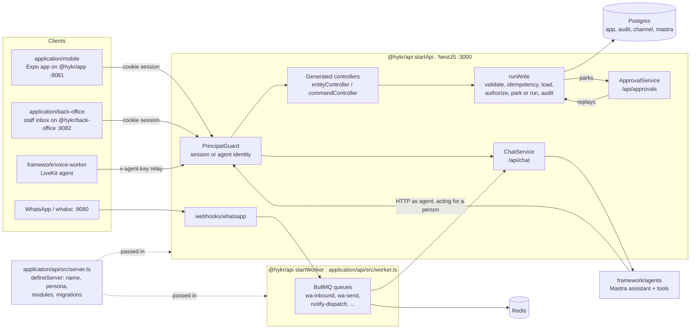

# Basecamp developer guide

**Basecamp is the agentic development stack for full-stack applications.** This guide is for developers who build a business on it. It covers how the pieces fit, where your code goes, the rules the framework enforces, and how to test and ship a feature.

To learn by doing, start with a tutorial: [Build a new application](new-application.md) builds a new product from scratch, and [Build a feature end to end: site visits](tutorial.md) adds one feature to the sample through every layer. Both use tested code. Section 5 of this guide is the reference for the same steps, and section 10 has a short recipe for each primitive. [Working on modules in parallel](modules.md) is the procedure when several people build modules at once.

Everything here describes the code as it is in this repository. File paths are relative to the repository root. The framework lives in `framework/` as `@hykr/*` packages; the application built on it, the sample domain, lives in `application/`. If this guide and the code disagree, the code wins. Please fix the guide when that happens.

---

## 1. What this framework is

You declare your business once, in a typed spec: its records (entities), its multi-step actions (commands), who may do what, and what needs a person's approval. The framework builds the rest from that spec:

- REST routes, with validation and a list grammar (filters, search, sort, keyset pages).
- Tools for the assistant (`list-*`, `summarize-*`, `get-*`, `create-*`, `update-*`, `delete-*`, `transition-*` for a record with states, and one per command), and the same over MCP for outside AI clients.
- Typed client methods and React data hooks for the app.
- Scoping by business (tenant), role and customer, on every read and write.
- Approvals: a write that needs a person's yes is parked, then replayed when someone approves it.
- An audit row for every write, refusal and decision.
- History lines, approval cards, and how the assistant shows results on screen, on WhatsApp and in speech.

The template ships with a sample application: meetings, notes, to-dos and orders, plus `account` (it words the credits and privacy notices) and `briefs` (a public form), as six modules in `application/`. It shows every feature. You replace it with your own (see `DOMAIN.md` at the root), or start a new application from the same sample with `npm create @hykr/basecamp <folder>`. The framework never imports the application: the application passes its modules in, through `defineServer` (`application/api/src/server.ts`) and `<AppShell>` (`application/mobile/src/app/_layout.tsx`).

### The three rules

These three rules explain almost every design choice in the codebase.

1. **One write path.** Every write goes through `runWrite` in `framework/core/src/write/pipeline.ts`: validate, idempotency, load, authorize, park or run, audit. That holds whether the write comes from the app, the assistant, WhatsApp, voice or an approval replay. No feature writes to the database any other way.
2. **The assistant is a user.** The assistant has no database access. Its tools call the same HTTP API the app calls, as an agent principal acting for a person (`x-agent-key`, `x-acting-for`). The same rules, scopes, approvals and audit apply. A dependency-cruiser rule (`agents-not-to-db`) keeps it that way.
3. **Channels are views.** The app, WhatsApp and voice all reach one chat service (`framework/api/src/modules/chat`) and one thread per person. A tool result carries a *present intent*, such as "show the `todo.list` view with this query". Each channel draws it in its own way: a component in the app, words and buttons on WhatsApp, a short sentence in voice.

---

## 2. How it fits together



Read the diagram like this:

- The API and the queue worker are `@hykr/api`. The application starts them with its own definition: `application/api/src/main.ts` calls `startApi(server)` and `worker.ts` calls `startWorker(server)`, where `server = defineServer({ ... })`. `basecamp dev` and `basecamp start api|worker` run the same thing.
- People call the API with a Better Auth session cookie. `PrincipalGuard` turns the request into a `Principal`: who is acting, for whom, in which business, with which roles and capabilities.
- The assistant runs inside the API process (`ChatService` calls Mastra), but its tools go back out over HTTP to the same API, with agent headers. That round trip is on purpose: the assistant passes through every guard, rule and audit row.
- WhatsApp messages arrive at `POST /webhooks/whatsapp`. They are stored, queued, and processed by the queue worker (`startWorker`), which runs a chat turn and queues the reply.
- The voice worker is a *relay*: it may only start chat turns (`@RelayAllowed()` routes) for the person in the call.

### What a write does

Every write, from any caller, follows these steps in `runWrite`:

| Step | What happens | Where |
|---|---|---|
| Validate | `op.input.parse(rawInput)`, again, even after the controller parsed it | `pipeline.ts` |
| Idempotency | Same `idempotency-key` and same body returns the stored answer, also for two at the same moment (an advisory lock per key). Same key with a different body is a 409. Kept `IDEMPOTENCY_KEEP_DAYS`. | `app.idempotency` table |
| Load | `op.load(tx, p, input)` through scoped repos. A row that is not yours is a 404. | entity repo |
| Authorize | Returns `allow`, `deny` or `needs_approval`. Then each write hook may refuse or park, never loosen (`strongerDecision`). Then the application's level rules, and the level's policy: a level that waits parks the write, one that runs gives it an undo window (section 5.8.1). | `def.decide` or your command's `authorize`, then `writeHooks`, then `levelRules` |
| Deny | The transaction rolls back. A `denied` audit row is written. The caller gets 403 `{ error: 'forbidden', rule, reason }`. | |
| Park | Inserts an `app.approvals` row (who decides: the decision's `approver`, else the operation's `approval`, else the level's policy) and a `needs_approval` audit row with the level. Returns `{ status: 'needs_approval', approval }`. | `approvals.ts` |
| Run | `op.run(...)` inside the transaction | your command or the entity repo |
| Audit | One row per touched record, plus one for a command | `audit.events` |
| Stored events | Each `NamedEvent` (and `approval.requested`) is inserted in `app.domain_events` in the transaction, with the row before, and held back (`available_at`) for the write's undo window when it has one | `write/events.ts` |
| Undo window | A write that ran with `undoMs`, for a person, touching only entities, records an `app.undo_windows` row; the result carries `undo: { id, until }` | `write/undo.ts` |
| Write hooks | `afterRun` for a write that ran or parked, in the transaction. Throwing rolls it all back. The framework's `notify.held-sends` holds the write's outbox sends for its undo window. | `writeHooks` |
| Events | Published in-process after commit by the CQRS handler. The worker relays the stored ones to subscribers, notifications among them (section 5.10). | `NamedEvent` |

Every write answers a `WriteResult` (`framework/contracts/src/framework/write.ts`):

```ts
{ status: 'done', value } | { status: 'needs_approval', approval }
```

---

## 3. Where things live

### The application: the folders you replace

The application is `application/`. Its `package.json` (`@application/app`) holds the `"basecamp"` block (where the compiled server, the watched packages, the apps and the migrations are) and the scripts. The framework never imports any of it. The application is a list of modules, each a folder `application/domain/src/modules/<name>/` with one folder per layer. The application hands them to the framework in two places: the server definition in `application/api/src/server.ts`, and the app's settings, modules, catalog and registry in `application/mobile/src/app/_layout.tsx`. The dependency-cruiser rule `framework-never-imports-application` enforces this (`pnpm lint:deps`).

In a module (`application/domain/src/modules/<name>/`, for example `todos`):

| Path | What lives there | You edit it when |
|---|---|---|
| `contracts/` | Zod schemas, `entitySpec`s, `commandSpec`s, and `<name>Spec = moduleSpec({ name, dependsOn, entities, commands })` | You add or change a record, a field, a list filter, an approval rule or a command |
| `db/schema.ts` | Drizzle tables in the `app` schema, named after the module | You add a table or a column |
| `server/` | `defineEntity` / `defineCommand` and the module's Nest module. `public.ts`: what other modules may use | You wire a new entity or command into the API, or change who sees what |
| `notifications/` | Its templates (`defineTemplate`) and notifications (`defineNotification`) | Your business sends reminders or WhatsApp templates |
| `views/` | `<name>Views = { name, views, screens }` (`defineView`, `defineScreen`) | The assistant should show a record or a list in a new way |
| `agent/` | An `AgentModule`: rules, scripted-model scripts, eval cases and setup | You teach the assistant your business, or add evals |
| `index.ts` | `<name> = defineModule({ ...<name>Spec, server, views, screens, templates, notifications, agent, tables, contributes })` | You add a layer to the module, or something it contributes (a capability, a queue, a document, a flag) |

Around the modules:

| Path | What lives there | You edit it when |
|---|---|---|
| `application/domain/src/modules/index.ts` | `modules`, in dependency order, one line per module | You add a module (`basecamp module add <name>` does it) |
| `application/domain/src/contracts/`, `src/views/` | Every module's specs and views for the apps (`moduleSpecs`, `moduleViews`), one line per module | You add a module (`basecamp module add` does it) |
| `application/domain/src/server/` | What no one module owns: `access.ts` (`BUSINESS_ACCESS`, shared by the modules), `approval-levels.ts` (the approval levels, section 5.8.1), `privacy.ts` (processors, request policy, retention periods, section 5.27), and `index.ts`, which gathers them as `contributions` for `defineServer` | You change who sees what, what an approval level means, or the privacy policy |
| `application/domain/src/languages.ts` | `languages = defineLanguages(...)`, given to the server and the app (section 9) | You add or drop a language |
| `application/domain/drizzle/` | Generated SQL migrations and `meta/_journal.json`, one journal for every module, recorded in `drizzle.__app_migrations` | After `pnpm db:generate --name <name>`, or `basecamp db rebase` after a rebase. Never edit by hand. |
| `application/domain/sql/pre/`, `sql/post/` | Idempotent SQL around the migrations: extensions, triggers, CHECK constraints (section 5.2) | One file per module and purpose (`orders-states.sql`) |
| `application/api/src/server.ts` | `server = defineServer({ name, persona, help, languages, channel, modules, migrations, contributes })`; `main.ts` and `worker.ts` start it | You change who the assistant is, or what the WhatsApp welcome and HELP say it does (`channel.does`) |
| `application/mobile/src/modules/<name>/` | The app half of each module: `index.tsx` (`defineAppModule({ name, nav, suggestions, bind, hrefFor, webmcp })` and what other modules may use), `routes.tsx`, `views.tsx`, `screens/`, `components/`. Listed in `src/modules/index.ts`, one line each | You draw a view in the app, add a screen or a nav item |
| `application/mobile/src/catalog.ts`, `settings.ts`, `home/` | `catalog = createCatalog(...moduleSpecs)`, `registry = createUiRegistry(...moduleViews)` and the `Register` declaration; `settings` (title, tagline, home); the home screen, which combines modules | You change what the app serves or its home screen |
| `application/mobile/src/app/` | Expo Router route files: one-line re-exports, each module's under `<name>/`. `index.tsx` is the home screen. `_layout.tsx` renders `<AppShell>`. | You add an app screen |
| `application/api/test/domain/`, `application/api/test/whatsapp/`, `application/domain/src/**/*.test.ts` | Your application's e2e, golden WhatsApp, view and notification tests | Always, with the feature |

### The framework: the folders you read

You should rarely need to change these. When you do, it is a framework change and needs its own tests (in `framework/api/test/framework`, against the fixture application in `framework/api/test/fixture`).

| Path | What lives there |
|---|---|
| `framework/contracts/src/framework/` | `entitySpec`, `commandSpec`, `moduleSpec` and the module id stamp (`module.ts`), the list grammar, present intents, `WriteResult` |
| `framework/contracts/src/platform/` | The framework's own entities (saved `pages`) and commands (`notify.send`, `handoff.request`) |
| `framework/contracts/src/catalog.ts` | `createCatalog(...modules)`: every module's entities and commands plus the platform's, with the collision checks and `reserveRoutes`. Tools, hooks and history read from a catalog. |
| `framework/core/src/` | `defineEntity`, `defineCommand`, `runWrite`, `ApprovalService`, guards, controller factories, list SQL. `src/tools/` builds agent tools (imported as `@hykr/core/tools`). `hooks.ts` holds the core's extension points (section 5.9). |
| `framework/policy/src/` | `accessFor`, `rowAllowed`, `DEFAULT_ACCESS`, `can`, `subjectOf`, `userIdOf` |
| `framework/db/src/schema/`, `framework/db/drizzle/` | Tenancy, approvals, idempotency, audit, channel tables and their migrations (`drizzle.__framework_migrations`); `app`, `id()`, `tenantColumn()`, `customerColumn()` for your tables |
| `framework/agents/src/` | `createAgents`, the Mastra assistant, profiles, the model registry and gateways (`models/`), durable runs, the fake model, scorers, Studio; script helpers in `@hykr/agents/script`, the evals harness in `@hykr/agents/evals` |
| `framework/ui-registry/src/` | `defineView`, `createUiRegistry`, platform views; `react.ts` for `bindView` / `bindScreen` |
| `framework/i18n/src/` | `defineLanguages` and the process's languages (`lang.ts`), `Labels`, the framework's phrases (`messages/<feature>.ts`), date, money and plural formatting |
| `framework/channels/src/` | WhatsApp transport only: adapter, render, split, keywords, approval tokens |
| `framework/connectors/src/` | Talking to other systems, transport only: Standard Webhooks signing, HMAC checks, the secret box, the egress guard (`safeRequest`), the `Connector` interface (section 5.14) |
| `framework/notifications/src/` | `defineTemplate`, `defineNotification`, `createNotificationCatalog`, quiet hours and marketing cap rules |
| `framework/api-client/src/` | `createApiClient`: `entity(spec)`, `command(spec, input)`, and typed calls for every framework route |
| `framework/api/src/runtime.ts`, `start.ts` | `defineServer`, `startApi`, `startWorker`, `migrate`, `runTemplates`, `runEval`, `startStudio`. `testing.ts` is `@hykr/api/testing`. `hooks.ts` holds the server's extension points (section 5.9), `module.ts` `defineModule`, and `module-checks.ts` the boot checks across modules (section 5.11). |
| `framework/api/src/channels/` | WhatsApp webhook, queues, sending, notifications dispatch, template sync, handoff, back office API, erasure |
| `framework/api/src/modules/` | Chat, threads, history, me, voice, pages |
| `framework/api/src/features/` | Framework features, one folder each (`defineFeature`), among them `events` (the outbox relay), `files`, `money`, `push`, `approvals`, `integrations` (webhooks out and in, section 5.14), `mcp` (outside AI clients, section 7.8) and `share` (share links and public forms, section 5.28) |
| `framework/app/src/` | `AppShell`, `defineAppModule` and the plugin types (`framework/app-domain.ts`), their merge (`framework/compose-app.ts`) and plugin slots (`framework/plugins.ts`), data hooks (`framework/hooks.ts`), `InlineView`, chat runtime, canvas store and `PageHost`; framework features as plugins in `features/<x>/` (live, push, WebMCP, settings, offline, share, inbox, agents, credits, calendar, export, privacy, businesses, connections); primitives in `@hykr/app/ui` |
| `framework/cli/` | The `basecamp` command (`module-add.ts` scaffolds a module, `db-rebase.ts` regenerates migrations after a rebase), plus the `compose.yaml` and `infra/` it starts |

### Import rules

`.dependency-cruiser.cjs` holds these rules. All are errors. CI runs `pnpm lint:deps`.

| Rule | What it means for you |
|---|---|
| `framework-never-imports-application` | Nothing in `framework/` imports `application/` or `@application/*`. The application passes its domain in. |
| `application-uses-public-framework-exports` | The application imports `@hykr/*` packages by name and public subpath, as from npm: no relative paths into `framework/`, no `src/`, `dist/` or tests. |
| `framework-libraries-not-to-runtimes` | The libraries never import the runtimes (`api`, `app`, `back-office`, `voice-worker`, `cli`, `create-basecamp`). |
| `domain-specs-and-views-are-isomorphic` | A module's `contracts`, `views` and `notifications` (and the aggregates of them) are read by the server and the apps alike: no `server`, `db` or `agent` folder, no module bundle, no `@hykr/db`, `policy`, `core`, `agents` or `api`, no `@nestjs`, `drizzle-orm`, `@mastra` or `bullmq`. |
| `apps-read-only-isomorphic-domain` | The Expo apps read the modules' contracts and views only (the aggregates, or `@application/domain/modules/<name>/contracts` and `/views`), never a server, tables, assistant, notifications, module bundle or `application/api`. |
| `module-imports-public-parts`, `module-<name>-imports-its-dependencies`, `module-not-to-aggregates`, `no-module-cycles` | A module imports another only through its `contracts/` or `server/public.ts`, only if it lists it in `dependsOn` (read from its `moduleSpec`), never the modules list or the aggregates, and no cycle. |
| `contracts-stays-a-leaf`, `i18n-is-a-leaf` | `@hykr/contracts` imports no framework package except `@hykr/i18n`. `@hykr/i18n` imports nothing at all. |
| `agents-not-to-db` | The assistant never imports `@hykr/db`. It reaches data through the API. |
| `core-not-to-mastra`, `core-tools-not-to-db` | Mastra is used only in `framework/core/src/tools/`, and those tools never touch the database. |
| `db-policy-not-to-mastra` | `db` and `policy` know nothing about the model. |
| `ui-registry-no-runtime` | The registry imports only contracts and i18n. React bindings live in `@hykr/ui-registry/react`. |
| `channels-is-transport`, `notifications-are-definitions` | These packages hold no database, queue, Nest or policy code. Sending and consent live in `@hykr/api`. |
| `connectors-is-transport` | `@hykr/connectors` imports only `@hykr/i18n`, zod and Node: no database, contracts, core, Nest or queue. The clients and the isomorphic layers never import it. |
| `clients-hold-no-server-code` | `@hykr/app`, `@hykr/back-office` and `@hykr/voice-worker` talk to the API over HTTP only. |

---

## 4. Your first hour

### Setup

You need Node 24 (`.nvmrc`), pnpm 12 (`packageManager` in `package.json`) and Docker.

```bash
pnpm install
cp application/.env.example .env
```

The `.env` stays at the repository root: the `basecamp` command loads the nearest `.env` at or above the application's root (`application/`), and the tests read it too. Fill these in `.env`. Each one must be at least 32 characters. Generate each with `openssl rand -hex 32`:

- `BETTER_AUTH_SECRET`
- `AGENT_API_KEY`
- `VOICE_AGENT_KEY` (must differ from `AGENT_API_KEY`; the API refuses to start otherwise, because audit tells them apart)
- `APPROVAL_SECRET` (signs WhatsApp approval buttons; without it approvals are decided in the app only)
- `SECRETS_KEY` (seals integration credentials and webhook signing secrets; without it webhook endpoints and connections cannot be saved, section 5.14)

To run without any model or speech keys, set:

```bash
MODEL_MODE=fake     # scripted assistant, no model or key needed
VOICE_MODE=fake     # voice worker takes text in, gives text out
```

Then build, start the services, migrate and run:

```bash
pnpm build             # the CLI, the API and the tests run from dist/
pnpm infra:up          # docker compose: every service in framework/cli/compose.yaml
pnpm db:migrate        # the framework's migrations, then the application's
pnpm templates:sync    # sends WhatsApp templates to whaloc; needs the build and whaloc
pnpm dev               # the framework in watch mode, then basecamp dev: API + queue worker,
                       # mobile web, back office, voice worker, Studio
```

The root scripts call the `basecamp` command (`@hykr/cli`) inside `application/`. You can run it there yourself: `cd application && pnpm exec basecamp <dev | start api|worker|voice | infra up|down | db migrate|generate|rebase | module add | import | templates sync|check | operator add|remove|list | eval | studio>`, or from the root with `pnpm --dir application exec basecamp …`. `pnpm exec basecamp --help` lists them with their options.

Check it is up:

```bash
curl http://localhost:3000/health     # {"ok":true}
```

Things that will trip you up:

- Most of `pnpm dev` reloads on save. Each framework package runs `tsc -w` into its `dist/`. `basecamp dev` (the application's `dev` script) compiles `application/domain` (every module) and `application/api` the same way, restarts the API and queue worker under `node --watch` when any module they loaded changes, and both Expo apps fast-refresh through Metro. The voice worker runs from its build (`node …/@hykr/voice-worker/dist/main.js dev`) without a watcher. An edit in `framework/*` reaches every app that imports it. `pnpm dev` passes `--concurrency=30` because turbo runs 16 persistent tasks (15 framework watchers and the application's `basecamp dev`) and its default is 10; pass it too when you run `pnpm turbo run dev` yourself.
- `basecamp dev` also starts the voice worker, which exits at startup if `VOICE_AGENT_KEY` is missing or short, or if `VOICE_MODE=live` has no `SARVAM_API_KEY` (`assertConfig()` in `framework/voice-worker/src/config.ts`). `basecamp dev` reports `voice … exited (1)`, keeps the other processes running, and does not start the worker again. `application/.env.example` ships `VOICE_AGENT_KEY=` empty and `VOICE_MODE=live`. Set `VOICE_AGENT_KEY` and `VOICE_MODE=fake`, then restart `pnpm dev`.
- Mobile web serves on 8081 and the back office on 8082. If something else holds either port, Expo cannot ask for another one (`basecamp dev` gives it no terminal), so that app exits.
- An API on another port (`PORT`, a second checkout) also needs `API_INTERNAL_URL` (the assistant's tools call it) and `BETTER_AUTH_URL` (the evals sign up with it as their origin) set to that address. Give each checkout its own database and `BULL_PREFIX` too ([Working on modules in parallel](modules.md), section 7).
- With `MODEL_MODE=live` (the default in `.env.example`) and no model configured (no `OPENROUTER_API_KEY` for `AGENT_MODEL`'s OpenRouter model, no `MODEL_PROVIDERS`), chat answers 503 `model_not_configured` "Set MODEL_PROVIDERS (or OPENROUTER_API_KEY in development) in .env to use the assistant". Section 7.5 says how models are configured.
- Stop the services with `pnpm infra:down` (or `basecamp infra down`). They run as the Compose project `basecamp` from `framework/cli/compose.yaml` (an application can name its own with `"project"` in its `basecamp` block), so a plain `docker compose down` at the root finds nothing.
- `basecamp` is compiled: in this repository it works only after `pnpm build`, and says so until then. `pnpm infra:up` runs `docker compose` directly and needs no build.
- `templates:sync`, `templates:check`, `db:migrate` and `eval` load the application's compiled server (`application/api/dist/server.js`, the `server` entry of the `basecamp` block). Build first.
- Compose's Postgres runs `framework/cli/infra/postgres/init.sql` (postgis and pgcrypto extensions, and `ALTER ROLE app SET search_path = public`) only on a fresh volume. On any other Postgres, run it yourself before `pnpm db:migrate`, or Better Auth's tables land in the `app` schema.

### Local tools

| Tool | URL | What for |
|---|---|---|
| API | http://localhost:3000 | `GET /health`; `GET /me` shows the principal the API sees for you |
| Mobile app (web) | http://localhost:8081 | The product |
| Back office | http://localhost:8082 | Staff inbox for WhatsApp handoffs |
| Bull Board | http://localhost:3000/admin/queues | Queues of every business. Sign in to the app first as a platform operator holding `platform.queues` (`pnpm --dir application exec basecamp operator add <email>`, section 6.6). Not mounted in production. |
| whaloc | http://localhost:8080 | WhatsApp Cloud API emulator with a chat UI |
| Mailpit | http://localhost:8025 | Email sent by notifications |
| pgAdmin | http://localhost:5050 | `admin@example.com` / `admin`; server `app` (host `postgres`, user `app`) is preregistered |
| Mastra Studio | http://localhost:4000 | Try the assistant and its tools, and read traces. `pnpm dev` starts it once the API is up and skips it if ports 4000 or 4111 are taken; it restarts when the agent's code changes. On its own: `cd application && pnpm exec basecamp studio` (needs the API running) |
| LiveKit | ws://localhost:7880 | Voice rooms (dev keys `devkey` / `secret`) |
| MinIO | http://localhost:9001 | File storage (`STORAGE_DRIVER=s3`); the `basecamp` bucket is created when the API starts |

Postgres is on `localhost:5432` (`app` / `app` / `app`). Redis is on `localhost:6379`.

### One feature on three channels

The sample to-do shows the whole loop. Try it before you write any code.

**1. The app.** Open http://localhost:8081, sign up, and add a to-do on the To-dos screen. That is `POST /api/todos` through `useEntityMutation('todos')`.

**2. The assistant in the app.** In the chat, type `add Call the plumber`, then `delete Call the plumber`. With `MODEL_MODE=fake` the scripted model calls `create-todo`, then `list-todos` and `delete-todo`. The delete is parked, because the spec says so:

```ts
// application/domain/src/modules/todos/contracts/todo.ts
// An agent never deletes without the person.
approval: { delete: (p) => p.actor.kind === 'agent' },
```

An approval card appears in the chat. Approve it, and the to-do is gone.

**3. The raw API.** The same calls, as a person:

```bash
# Sign up. Better Auth wants a trusted Origin.
curl -c jar -H 'origin: http://localhost:8081' -H 'content-type: application/json' \
  -d '{"name":"Ana","email":"ana@example.com","password":"password123"}' \
  http://localhost:3000/api/auth/sign-up/email

curl -b jar -H 'content-type: application/json' -d '{"title":"Order tiles"}' \
  http://localhost:3000/api/todos
# {"status":"done","value":{"id":"…","title":"Order tiles","done":false,…}}

curl -b jar 'http://localhost:3000/api/todos?done=false&sort=-createdAt'
# {"items":[…],"nextCursor":null}
```

**4. WhatsApp.** The business number must be claimed by your tenant before inbound messages are handled. Otherwise the inbound processor marks them `unknown number`:

```bash
curl -b jar -H 'content-type: application/json' -d '{}' \
  http://localhost:3000/api/channels/whatsapp/number
```

A number belongs to the first business that claims it, and is never moved to another: a second business gets 409. In development, `{}` claims `WA_PHONE_NUMBER_ID`; in production you must name the `phoneNumberId`. If another local account already holds the dev number, free it with `delete from channel.numbers where phone_number_id = '<id>';`.

Then open whaloc at http://localhost:8080 and write to the seeded number (+91 80 4000 0100) from a new phone number. You are a customer of the business now. Write `list`. The reply is the `todo.list` view's `text`, sent as WhatsApp words. You see only your customer's rows, which is none yet. To act as yourself on WhatsApp, link your number in the app (the app calls `POST /api/channels/whatsapp/code`, then `POST /api/channels/whatsapp/verify`).

### Find yourself in the audit log

Every write you just made is in `audit.events`. Open pgAdmin or `psql` and run:

```sql
SELECT at, action, outcome, actor_kind, actor_id, acting_for, channel, rule, reason, run_id
FROM audit.events
ORDER BY at DESC
LIMIT 20;
```

You will see `todo.create` rows with `actor_kind = 'user'`, the agent's `todo.delete` with `outcome = 'needs_approval'`, then `approval.approved` and the replayed `todo.delete` with `approved_by` set to you.

To follow one assistant turn, take the `x-run-id` response header from `/api/chat` (or `runId` from `/api/chat/once`):

```sql
SELECT at, action, outcome, actor_kind, acting_for, rule, reason, before, after
FROM audit.events WHERE run_id = '<run-id>' ORDER BY at;

SELECT id, action, status, summary, level, approver_user_id, approver_capability, expires_at,
       failure_reason
FROM app.approvals WHERE run_id = '<run-id>';
```

To see what an approval replay did, find rows that share the approve call's request id:

```sql
SELECT at, action, outcome, actor_kind, approved_by, rule FROM audit.events
WHERE request_id = (SELECT request_id FROM audit.events
                    WHERE action = 'approval.approved' AND resource_id = '<approval-id>')
ORDER BY at;
```

The app shows the same data per record through `GET /api/history?resourceType=todo&resourceId=<id>`.

---

## 5. Declaring your domain

Work inside a module (`application/domain/src/modules/<name>/`; `basecamp module add <name>` starts one, and [Working on modules in parallel](modules.md) covers several at once), in this order:

1. The spec (`contracts/`)
2. The table (`db/schema.ts`)
3. The migration (`pnpm db:generate`)
4. `defineEntity` / `defineCommand` (`server/`)
5. A Nest module (`server/`)
6. Add it to the module's `index.ts` (`defineModule({ server })`)
7. Views, app bindings, assistant scripts, notifications (as needed)

`application/api/src/server.ts` already passes every module in `modules/index.ts` to `defineServer`, so a new entity needs no change there.

### 5.1 The entity spec

`entitySpec` lives in `framework/contracts/src/framework/spec.ts` (import it from `@hykr/contracts`). You give it the parts below. It fills `plural` (`${name}s`), `pascal`, `expose` (every action `'all'`, merged with yours) and `approval` (`{}`).

| Field | Meaning |
|---|---|
| `name` | Singular, lower case. Used in routes, command names (`todo.create`), tool ids and audit `resource_type`. |
| `plural`, `pascal` | Derived unless you give them. Give `plural` when "s" is wrong. |
| `label` | How people say it ("to-do"). Used in messages such as `No such to-do`. |
| `fieldLabels` | `{ field: { en, …the application's other languages } }`. Field names in the approval preview. |
| `description` | Goes into tool descriptions. Write it for the model. |
| `schemas` | `{ read, create, update }`, all `z.object(...)` |
| `list` | The list grammar config (see 5.6) |
| `expose` | Per action: `'all'`, `'human'` or `'internal'` (see 5.7) |
| `approval` | Per write action: when it parks and who decides (see 5.8) |
| `views` | `{ list?, item? }`: registered view names the tools present results with |

The sample to-do:

```ts
// application/domain/src/modules/todos/contracts/todo.ts
export const TodoSpec = entitySpec({
  name: 'todo',
  label: 'to-do',
  description: "The user's to-dos: short tasks with an optional due date, optionally linked to a meeting.",
  schemas: { read: Todo, create: CreateTodoInput, update: UpdateTodoInput },
  fieldLabels: { title: { en: 'Title', hi: 'शीर्षक', te: 'శీర్షిక' }, /* … */ },
  list: {
    filterable: { done: 'boolean', dueOn: 'date', meetingId: 'id', title: 'text' },
    sortable: ['dueOn', 'createdAt', 'title'],
    defaultSort: [['createdAt', 'asc']],
    search: ['title'],
    pageSize: { default: 50, max: 100 },
    examples: { done: 'false', dueOn: '{ "lte": "2026-10-31" }', /* … */ },
  },
  // An agent never deletes without the person.
  approval: { delete: (p) => p.actor.kind === 'agent' },
  views: { list: 'todo.list', item: 'todo.item' },
});
```

Update schemas in the sample refuse an empty patch:

```ts
.refine((v) => Object.values(v).some((x) => x !== undefined), 'Send at least one field to change')
```

Read schemas can use the exported `CreatedBy = z.enum(['person', 'assistant'])`.

Register the spec in its module's `contracts/index.ts`. The key must be the plural, or `moduleSpec` throws at load. `moduleSpec` also stamps the spec with the module's name (`spec.module`):

```ts
// application/domain/src/modules/meetings/contracts/index.ts
export const meetingsSpec = moduleSpec({
  name: 'meetings',
  dependsOn: ['todos', 'notes'],
  entities: { meetings: MeetingSpec },
  commands: [CloseMeetingSpec, RescheduleMeetingSpec],
});
```

### 5.2 The table

Add tables to the module's `db/schema.ts`, in the `app` schema, named after the module (`todos`, or `todos_<x>`; `defineServer` refuses another name). Use the helpers `@hykr/db` exports (`app`, `id`, `tenantColumn`, `customerColumn`, `user`, and `tableRef` for a key to a module that depends on this one):

```ts
export const todos = app.table('todos', {
  id: id(),
  tenantId: tenantColumn(),
  ownerId: text('owner_id').notNull().references(() => user.id),
  customerId: customerColumn(),
  title: text('title').notNull(),
  done: boolean('done').default(false).notNull(),
  dueOn: date('due_on'),
  meetingId: text('meeting_id'), // a reference: declared on the spec, keyed with its business (below)
  createdBy: text('created_by', { enum: ['person', 'assistant'] }).notNull().default('person'),
  createdAt: timestamp('created_at', { withTimezone: true }).defaultNow().notNull(),
  updatedAt: timestamp('updated_at', { withTimezone: true }).defaultNow().$onUpdate(() => new Date()).notNull(),
}, (table) => [
  index('todos_owner_id_idx').on(table.ownerId),
  index('todos_tenant_customer_idx').on(table.tenantId, table.customerId),
]);
```

**A field that holds another record's id is a reference.** Declare it on the spec, naming the
target entity: `traits: { references: { meetingId: 'meeting' } }`. The name is resolved at run
time, so a reference to a module that depends on yours imports nothing. Every insert and update
that sets or changes it (CRUD, commands, the assistant's tools, MCP, imports, offline creates,
approved replays) loads the record through the target's own scoped repository, as the writer.
An unknown id, another business's record and one the writer cannot read all get the same 404
`{ error: 'not_found', message: 'No such meeting', field: 'meetingId' }`; null always passes, and
so does an update that keeps the stored id. A CRUD write checks before it can park.
`defineServer` refuses a reference to an entity that does not exist, from a field no write sets,
or on a record with a parent (check a line's references in the parent's command).

Back it in the database with a key that keeps the business: `(tenant_id, meeting_id)` →
`meetings (tenant_id, id)`, with a unique `(tenant_id, id)` on the target. A plain
`.references(() => meetings.id)` only checks that the id exists in some business, and its
`ON DELETE SET NULL` would let another business's delete change your rows. `tableRef('meetings')`
has `id` and `tenantId` for a `foreignKey({ columns, foreignColumns })` down the graph. Unlinking
one column on delete (`ON DELETE SET NULL (meeting_id)`; drizzle would null `tenant_id` too) is a
SQL hook: the sample's `application/domain/sql/post/meeting-references.sql`. A key no spec
declares is checked by the database alone: a write naming a missing record is 404 `It names a
record that does not exist`, and a delete such a key blocks is 409 `in_use`, without the
database's detail. `docs/decisions/V2.md`.

What the framework requires:

- JS keys named exactly `id` and `tenantId`, plus an owner column. Otherwise `defineEntity` throws `<name>: table needs id, tenantId and owner columns`.
- Owner and customer columns can have any key. You point at them with a function.
- `createdBy` is optional. If it exists, the framework sets it to `'assistant'` for an agent and `'person'` otherwise.
- Every field named in `list` must be a column key, or the list query throws `List config names "x", which is not a column`.
- Entity routes use `ParseUUIDPipe` for `:id`, so ids must be UUIDs. `id()` gives `gen_random_uuid()::text`.

Then generate and apply the migration:

```bash
pnpm db:generate --name <your-change>   # basecamp db generate: drizzle-kit in application/domain, every module
pnpm db:migrate                         # the framework's migrations, then the application's
```

`application/domain/drizzle.config.ts` manages only your tables in the `app` schema (every module's `db/schema.ts`, one journal), and records what ran in `drizzle.__app_migrations`. After a rebase onto a branch with new migrations, `basecamp db rebase --base <branch>` drops yours and generates them again on top. The framework's tables (`public`, `app`, `audit`, `channel`) ship with `@hykr/db` (`framework/db/drizzle`, recorded in `drizzle.__framework_migrations`) and are applied first. Mastra owns `mastra` and `mastra_obs`.

What drizzle-kit does not generate (extensions, triggers, functions, CHECK constraints) goes in SQL hook files next to the migrations: `application/domain/sql/pre/*.sql` runs before your migrations, `sql/post/*.sql` after them (the framework's are in `framework/db/sql`). They run on every migrate, in name order, one transaction per file, so each must be idempotent: `IF NOT EXISTS`, `CREATE OR REPLACE`, `DROP TRIGGER IF EXISTS` then `CREATE TRIGGER`. Use one file per module and purpose, named after the module (`orders-states.sql`): a hook that names a module's table fails once that module is removed.

`pnpm db:migrate` holds a Postgres advisory lock, so two migrates on one database wait for each other. It refuses to start when a migration was never applied but is older than the last one applied: drizzle would skip it without a word. That happens when a branch generated before another was merged. Regenerate the migration (delete it and generate again) or recreate the database.

### 5.3 defineEntity

`defineEntity` (`framework/core/src/entity/define-entity.ts`) joins the spec to its table:

```ts
// application/domain/src/modules/todos/server/todo.entity.ts
export const Todo = defineEntity(TodoSpec, {
  table: todos,
  owner: (t) => t.ownerId,
  customer: (t) => t.customerId,
  access: BUSINESS_ACCESS,
});
```

| Option | Meaning |
|---|---|
| `table` | The Drizzle table |
| `owner` | The owner column. Used for `'own'` access, and set on create. |
| `customer` | The customer column, for `'customer'` access. Optional. |
| `access` | Who reaches which rows (see 6.2). Defaults to `DEFAULT_ACCESS`. |
| `rules` | `EntityRule[]`: domain checks on writes. A deny refuses; a `needsApproval` parks a plain CRUD write (inside a command only the deny counts). |
| `summarize` | `(action, input, row) => string`: the approval card text. The default uses `title`: `Delete "Call the plumber"`. |
| `events` | Store `<entity>.created/updated/deleted` (with the row before) in the event outbox and publish them after commit. Default `true`. |

An entity rule has this shape:

```ts
type EntityRule<T> = (p, action, row, input, ctx: { via: 'crud' | string }) => AuthorizeResult | null;
```

Return `deny(rule, reason)` to refuse, `needsApproval(rule, reason, details?)` to park a CRUD write, or `null` to pass. `ctx.via` is `'crud'` for a plain route, or the command's name when a command calls the repo. The meeting uses that to force closing through its command:

```ts
// application/domain/src/modules/meetings/server/meeting.entity.ts
(_p, action, _row, input, ctx) =>
  action === 'update' && input?.status === 'closed' && ctx.via !== 'meeting.close'
    ? deny('use_close_meeting', 'Close a meeting with close-meeting, so its summary and to-dos are written')
    : null,
```

The returned `EntityDef` has a scoped `repo` for use inside commands: `get`, `find`, `list`, `insert`, `update` and `delete`. Every query is limited to the principal's tenant and grants. Someone else's id is a 404. Writes re-parse the input, run the rules, and strip `id`, owner, `createdBy`, `tenantId` and customer from the input.

A row leaves the server only through `def.toRead(row, p)`: the read schema parses it, then it is projected for that principal (fields hidden, never added). `def.readJson(row)` and `def.project(read, p)` are its two halves. Lists, gets, write results, command results, approvals and history titles all go through it.

**Entity plugins** (`EntityPlugin`, contributed as `entityPlugins`) add behaviour to every entity whose spec they apply to (`appliesTo`, usually a trait). Every hook is optional and runs after the entity's own config:

| Hook | Runs | Use it for |
|---|---|---|
| `rules` | wherever the entity's rules run | refusals (a frozen version) |
| `decide` | on CRUD writes, after the rules, before `spec.approval` | park at a level with an approver, or allow with a level or an undo window |
| `scope` | every scoped query, read and write | narrowing reach (a parent's scope) |
| `toValues` | insert and update | server-computed columns (a version, a number). The framework's own columns still win. |
| `toJson` | reads, before the read schema parses | stored types as JSON (money as a number) |
| `updateWhere` | update and delete | a stale write: no match on a row that is still there is 409 `{ error: 'stale' }` |
| `project` | `toRead`, after parsing | hiding fields from a principal |
| `query` | a list request (HTTP or a tool), before it runs | refusing a filter or sort (a hidden field) |

`entityHandlers(def)` serves the entity: it joins `entityDefs()` (`entityDef(name)`, `entityDefForSchema(schema)`), and another entity with the same name or plural throws (serving the same one again is a no-op).

### 5.4 Commands

Use a command when one action touches several records, or has rules a plain update cannot express. Declare it in contracts:

```ts
// application/domain/src/modules/meetings/contracts/commands.ts
export const CloseMeetingSpec = commandSpec({
  name: 'meeting.close',
  description: 'Close a meeting in one step: …',
  input: CloseMeetingInput,
  output: CloseMeetingResult,
  http: { method: 'POST', path: '/api/meetings/:meetingId/close' },
  tool: 'close-meeting',
  expose: 'all',
  approvalNote: 'When you call it, the whole close waits for the user to approve it.',
  view: { name: 'meeting.card', id: (input) => input.meetingId },
  verb: { do: 'close', did: 'closed' },
  touches: ['meeting', 'note', 'todo'],
});
```

| Field | Meaning |
|---|---|
| `name` | Dotted, as audited |
| `http` | Method and path. Path params (`:meetingId`) come from the input. The rest is the body. |
| `tool` | The agent's tool id. Leave it out to keep the command off the agent. |
| `expose` | `'all'` or `'human'`. There is no `'internal'` for commands. |
| `approvalNote` | Added to the tool description |
| `view` | What the tool result shows |
| `verb` | Words for approval cards and history ("Approve close", "closed it") |
| `touches` | Entity names the app refreshes after the command runs |

Then implement it in the API with `defineCommand` (`framework/core/src/command/define-command.ts`):

```ts
// application/domain/src/modules/meetings/server/close-meeting.command.ts
export const CloseMeeting = defineCommand(CloseMeetingSpec, {
  resource: { type: 'meeting', id: (input) => input.meetingId },
  load: (tx, p, input) => Meeting.repo.get(tx, p, input.meetingId), // scoped: 404 if not theirs
  authorize: (p, meeting) => {
    if (meeting.status === 'closed') return deny('already_closed', 'This meeting is already closed');
    if (p.actor.kind === 'agent') return needsApproval('agent_close', 'Closing a meeting needs your approval');
    return allow('owner_closes');
  },
  summarize: (input, meeting) =>
    `Close ${meeting.title} with 1 note and ${todosLabel(input.actionItems.length)}`,
  run: async ({ tx, principal, input, loaded: meeting, via }) => {
    const note = await Note.repo.insert(tx, principal, { /* … */ meetingId: meeting.id }, via);
    // … Todo.repo.insert(tx, principal, { ...item, meetingId: meeting.id }, via) for each item
    const closed = await Meeting.repo.update(tx, principal, meeting, { status: 'closed' }, via);
    return {
      value: { meeting: closed, note, todos },
      touched: [{ type: 'meeting', id: meeting.id, change: 'updated', before: meeting, after: closed }, /* … */],
      events: [new MeetingClosed(closed, note, todos)],
    };
  },
});
```

Points to keep in mind:

- Always pass `via` to repo calls. Entity rules see it as `ctx.via`.
- Every record you change goes into `touched`. Each entry becomes an audit row.
- `authorize` alone decides whether a command parks. The optional `approval` config (`{ by, channels, minAssurance }`) only says who decides.
- The result leaves projected for the caller. A part of `output` that reuses an entity's read schema object (`MeetingView`, `z.array(Todo)`) is read and projected as that entity. For other shapes, pass `present: (value, p) => …` to `defineCommand`.
- A domain event is a class that implements `NamedEvent` (`eventName` and `row`, optionally `before`, `resourceType` and `resourceId`). It is stored in the event outbox with the write, and notifications can schedule on it:

```ts
export class MeetingClosed implements NamedEvent {
  readonly eventName = 'meeting.closed';
  get row() { return this.meeting; }
  constructor(readonly meeting: unknown, readonly note: unknown, readonly todos: unknown[]) {}
}
```

### 5.5 Nest wiring

The controller and handler factories live in `framework/core/src/http/controller-factory.ts` and `entity/handlers.ts`:

```ts
// application/domain/src/modules/meetings/server/meetings.module.ts
@Module({
  controllers: [entityController(Meeting), commandController(CloseMeeting), commandController(RescheduleMeeting)],
  providers: [...entityHandlers(Meeting), commandHandler(CloseMeeting), commandHandler(RescheduleMeeting)],
})
export class MeetingsModule {}

// application/domain/src/modules/meetings/index.ts
export const meetings = defineModule({ ...meetingsSpec, server: MeetingsModule, /* views, agent, tables… */ });
```

`defineServer({ modules })` hands each module's Nest module to the framework, which imports them, in module order, in both the API and the queue worker. That gives you:

| Route | Status |
|---|---|
| `GET /api/<plural>` | list, with the list grammar |
| `GET /api/<plural>/:id` | get |
| `POST /api/<plural>` | create, 201 |
| `PATCH /api/<plural>/:id` | update |
| `DELETE /api/<plural>/:id` | delete |
| `spec.http.method spec.http.path` | the command, 200 |

`entityHandlers` and `commandHandler` also register each op for approval replay (`registerOp`, which refuses another definition with the same name). You need both the controller and the handler. A controller without its handler has nothing to run, and a parked op without its handler fails as "can no longer be replayed".

### 5.6 The list grammar

`ListConfig` (`framework/contracts/src/framework/list.ts`):

| Field | Meaning |
|---|---|
| `filterable` | `{ field: FieldType }`, where the type is one of `'enum'`, `'date'`, `'text'`, `'number'`, `'boolean'`, `'id'`, or a type a feature defined |
| `sortable` | Fields you may sort by |
| `defaultSort` | `[[field, 'asc' \| 'desc'], …]` |
| `search` | Columns matched by `q`, case-insensitive, OR-ed. Without it there is no `q`. |
| `pageSize` | `{ default, max }` for HTTP |
| `toolPageSize` | The agent tool's maximum rows. Default 20. |
| `examples` | Shown in the tool description |

Operators by type:

| Type | Operators |
|---|---|
| `enum`, `id` | `eq`, `ne`, `in` |
| `boolean` | `eq`, `ne` |
| `text` | `eq`, `ne`, `in`, `contains` |
| `date`, `number` | `eq`, `ne`, `in`, `lt`, `lte`, `gt`, `gte` |
| `money` | the same, in minor units (section 5.13) |
| `geo` | `near` (`{ lat, lng, radiusM }`), `within` (`{ south, west, north, east }`) (section 5.15) |

The same filter in its two forms:

```text
HTTP:  GET /api/todos?done=false&dueOn[lte]=2026-10-31&sort=-dueOn&limit=20
JSON:  { done: false, dueOn: { lte: '2026-10-31' }, sort: '-dueOn', limit: 20 }
```

- The JSON form is what tools and `repo.list` take. `toQueryString(input)` turns it into the HTTP form.
- `in` takes a comma list over HTTP.
- `count: true` adds `total`.
- Unknown fields or operators are a 400. That is on purpose.
- The query string's keys are the sender's. `nestBrackets` builds the nested objects with no
  prototype, and a key nested under a name every object has (`__proto__[x]`, `constructor[x]`)
  stays flat, so the strict schema refuses that request alone (docs/decisions/V1.md).

Field types are a registry. A feature adds one in two halves, each in its own file: the grammar in contracts, declared on `ListFieldTypes` (and new operators on `ListFilterOps`) and defined with `defineListFieldType({ name, ops, value, opValue?, summary? })`, which every process (server, tools, apps) loads; and the SQL in the server, `listFieldSql` (contributed as `listFieldSql`), `{ name, where({ table, field, column, op, value }), order? }`. `order({ field, column, dir, filters })` is how a field of the type sorts when it is in `sortable` (a point: by distance to its `near` point); it returns `{ expr, at(value), check?(value) }`, where `expr` is never null so cursors neither skip nor repeat rows, and `check` says whether a cursor could hold that value (the row's field, or null). `summary` says what the type's fields do in a summary (section 5.16). A field of an undefined type fails when its schema is built, and one without SQL fails its request. Neither filters nothing. `toQueryString` sends an operator whose value is an object (`near`) as JSON, which the type reads back.

The response is `{ items, nextCursor, total? }`. Pagination is keyset: pass `nextCursor` back as `cursor`. A cursor from a different sort is a 400 `cursor_sort_mismatch`. A cursor is the client's to send back, so each value it holds is checked against its sort column's type (exactly what the server emits for it) before any SQL is built; one that does not fit, or a cursor of the wrong shape, is a 400 `bad_cursor`. As a backstop, a Postgres data exception from a list query with a cursor is `bad_cursor` too (`listQuery`). Sorting on a nullable column works only for dates, timestamps and numbers. A nullable text or enum column in `sortable` passes load-time checks, then throws `Sorting on nullable ... is not supported` (`framework/core/src/query/list-grammar.ts`) on the first request that sorts by it, which the client sees as a 500. Keep such columns `notNull()` or out of `sortable`.

### 5.7 Expose: who can reach an action

| `expose` | HTTP route | Agent tool | Use it for |
|---|---|---|---|
| `'all'` | yes | yes | The default |
| `'human'` | yes, with `HumanOnlyGuard` | no, and an agent call is denied `humans_only` (so is a page's WebMCP call) | Irreversible actions. The meeting's `delete` is `'human'`. |
| `'internal'` | no | no | Records only commands should write, through `def.repo` |

For commands, `'human'` gives a people-only route. To keep a command off the agent, leave out `tool`.

### 5.8 Approvals: when a write parks

On an entity spec, `approval[action]` decides whether a write parks:

```ts
type ApprovalCheck = (p: Principal, ctx: { action: string; input: object | null; row: object | null }) => boolean;
type ApproverBy = 'requester' | { capability: string } | { userId: string } | { band: string };
type ApprovalRule =
  | 'always' | 'never'
  | ApprovalCheck
  | { when?: 'always' | ApprovalCheck; by?: ApproverBy; channels?: Channel[]; minAssurance?: Assurance; level?: string };
```

- The function form is the common one: `(p) => p.actor.kind === 'agent'`. It also sees the payload, so
  `(p, { input }) => Number(input?.amount ?? 0) > 100_000` parks large amounts only. `input` and `row`
  are `null` when they are unknown: a tool's description is written before any call, and a create has
  no row.
- The object form also says who decides and where. For example, `{ when: (p) => p.actor.kind === 'agent', by: { capability: 'orders.approve' }, channels: ['app'] }`. `channels: ['app']` keeps an irreversible decision off WhatsApp buttons. An operation's `approval` decides every park of it, including one an approval level makes. When only one reason should go to someone else, name the decider on that decision instead: `framework/api/src/channels/notify/send-template.command.ts` parks a marketing send with `needsApproval('marketing_send', reason, { approver: { by: { capability: 'marketing.approve' } } })`, so a service send that the application's level parks still goes to the person it is for.

`by` chooses people by capability, never by role name:
- `'requester'`: the person the request is for (their own assistant's request);
- `{ capability }`: anyone in the business holding it, except the requester;
- `{ userId }`: one named person, a member of the business's team who is not the requester: their
  membership's roles, as the business has them (its own roles and edits; a name it lacks counts for
  nothing), include one beyond a contact's and a participant's (otherwise the holders of
  `approvals.decide` decide instead);
- `{ band }`: the approver the business's settings name for the amount's band (below).

Who decides, when nothing sets `by`: the person the request is for, if they are on the business's
team: a member (`standing: 'member'`, set by the server) holding a role beyond the ones the framework
hands outsiders (`givenRoles('contact')` and `givenRoles('participant')`; `teamRoles` in
`@hykr/contracts`). Anyone outside it (a contact, a participant, support access, an operator, a member
holding only the contact's role) asks the holders of `approvals.decide` (by default the `owner` and
`ops` roles; an application gives its own roles the capability, or names its own capability on its
levels). No role name decides it, so an application that renames its outsider role keeps the rule. Nobody
decides their own request unless the policy sends it back to them: a request decided by a capability
is never decidable by its requester. The requester can still open it (`GET /api/approvals/:id`, with
`canDecide: false`); `POST .../approve` answers 403 `own_request`.

A request someone else decides reaches its deciders through the framework's `approval.request`
notification (section 8.2): by push, else on WhatsApp with signed Approve and Reject buttons (only
where the request may be decided there, with `APPROVAL_SECRET` set and the decider's number
linked), else by email, and always in their in-app inbox. Each opens `/approvals/<id>`. A person's
own assistant asks them in the conversation instead.

Approvals expire after 24 hours by default (`CoreModule.forRoot({ approvalTtlMs })`), or after their
level's `expiresInMs`. The framework's `approvals` feature runs a sweeper every minute
(`approvals.expire`): what nobody decided in time becomes `expired`, audited as the system, and
`approval.decided` is stored and published, so a customer who asked hears it.

A decision (`AuthorizeResult`) can also say what is at stake. `needsApproval(rule, reason, details)`
and `allow` / `deny` take the same optional `details`:
- `level`: the name of an approval level the application declares (section 5.8.1);
- `approver`: `{ by?, channels?, minAssurance? }`;
- `amount`: `Money`, `{ minor, currency }` (whole minor units and an ISO currency);
- `undoMs`: the undo window.

The helpers copy only these four fields. Passing an earlier decision as `details`, to keep its level,
never changes the new decision, rule or reason. `atLevel(level, rule, reason, details?)` is an allow
that names a level: the level's policy then says whether it waits.

What the write path does with them:
- A park's deciders come from `approver`, then the operation's `approval`, then the level's policy:
  the first that sets `by` decides who, likewise `channels`; `minAssurance` is the strongest asked.
  The operation's `approval.by` applies to every park, so a decider for one reason belongs on that
  decision's `approver`.
  The approval shows `level` (`{ name, rank, label }`), `amount`, `decider` and `canDecide`, and the
  park's audit row records the level.
- A write that runs with `undoMs` can be undone (section 5.8.2), and its events wait that long.
- An approved replay keeps the level and the amount, and fails (status `failed`) when it now needs
  more: a higher level, or a larger amount, than was approved. It opens no undo window.
- Rules, entity plugins, write hooks and level rules combine with `strongerDecision`: deny beats
  needs_approval beats allow; the higher-ranked level and the longest undo window survive, and between
  two decisions of the same kind the one at the higher level gives the rule and reason.

#### 5.8.1 Approval levels

What each level means is the application's, never the framework's. An application declares its
levels and contributes them (`contributes: { approvalLevels }`):

```ts
defineApprovalLevel({
  name: 'irreversible',      // what decisions name
  rank: 3,                   // 0 to 99, unique: higher means more at stake
  label: { en: 'Money or irreversible', hi: '…', te: '…' },
  policy: {
    parks: true,             // or (p) => boolean. Default: rank 0 runs, any higher rank parks
    undoMs: 0,               // a write that runs can be undone this long
    approver: { by: { band: 'money' }, channels: ['app'], minAssurance: 'session' },
    expiresInMs: 72 * 3600_000,
    tenantMayLoosen: false,  // may a business switch parking off for it?
  },
});
```

Which writes reach which level is declared too, by level rules (`@hykr/core`, contributed as
`levelRules`). They see the operation, its input, the row it changes and the business's settings, and
run in `runWrite` after the write hooks, for entity CRUD and commands alike (approved replays included):

```ts
defineLevelRule({
  name: 'orders.levels',
  on: ['order.*'],           // operation names, prefixes, or '*'
  decide: ({ op, input, row, settings }) => {
    const amount = { minor: Number(input?.totalMinor ?? row?.totalMinor), currency: 'EUR' };
    return overThreshold(settings, 'orders.limit', amount)
      ? atLevel('irreversible', 'order_over_limit', 'Above your limit', { amount })
      : atLevel('internal', 'order_within_limit', 'Within your limit', { amount });
  },
});
```

A business adjusts this in its settings, section `approvals` (`@hykr/contracts`):
- `levels[name]`: `parks: true` makes a level always wait; `parks: false` lets it run only when the
  level says `tenantMayLoosen`; `undoMs` and `expiresInMs` replace the level's;
- `thresholds[key]`: `Money` that rules compare with `overThreshold(settings, key, amount)`, which
  counts a missing threshold, or one in another currency, as exceeded (it fails closed);
- `bands[key]`: who decides each amount, first match first: `[{ upTo?: Money, approver: { userId } |
  { capability } }]`, read by `{ by: { band: key } }`. No band fits: holders of `approvals.decide`.

Its owners and admins change them with `PATCH /api/settings/sections/approvals` (section 5.18),
which refuses a level nobody declares, `parks: false` on a level without `tenantMayLoosen`, a
band capability nobody defines, a named approver who is not on the business's team, and a band no
amount reaches. Approvals read the settings in the write's own transaction, so a new threshold
applies to the very next write.

A decision that names a level nobody declared ranks above every level and always parks. Without any
levels, everything works as before: decisions without a level, and `needsApproval` parks as it did.
The sample declares `read`, `internal`, `external` and `irreversible` in
`application/domain/src/server/approval-levels.ts`; the to-dos module maps its writes to `internal`,
and the orders module names `irreversible` on its own decision for an order above the business's limit
(`orders/server/policy.ts`), with the order's total as the amount and `orders.approve` as the decider.

#### 5.8.2 Undo

A write that runs with an undo window (its level's `undoMs`, or the decision's own) answers
`{ status: 'done', value, undo: { id, until } }` when it was for a person and touched only entities.
Its events wait in the outbox until `until`, and so does every send it wrote to `app.outbox` (the
`notify.held-sends` write hook sets `available_at` and `undo_id` on its transaction's rows).
Notifications are scheduled from the stored events, so nothing is scheduled or sent before the window
closes. `POST /api/undo/:id` (people only, the person it was for;
`api.undo(id)`, `useUndo()` in the app) reverses it through `runWrite`: a created row is deleted, an
updated one gets its changed fields back, a deleted one is put back as it was (same id). Every row is
audited (`rule: 'undo_own_write'`), the held events and sends get `cancelled_at`, and the reversal
stores no events, so subscribers and recipients never see the write. It refuses when the row changed
since (409 `changed_since`), when an event or a send was already passed on (409 `too_late`), after the
window (403 `undo_window_closed`) and the second time (409 `already_undone`); another person's or
business's undo is a 404. A command can be undone only when its `touched` rows carry `before` and
`after`.

#### 5.8.3 Durable runs: the assistant waits, then goes on

When a write the assistant makes parks, its run is suspended, not ended (`docs/decisions/A7.md`):

1. The tool gets `needs_approval` from the API. `safely` (`@hykr/core/tools`, which every generated
   tool uses) calls Mastra's `suspend()` with a `ParkedCall`: the approval's id and summary, what the
   tool shows while it waits (its approval card), and how to rebuild the turn (whom it acts for, the
   business, channel, language, time zone, surfaces, the record on screen). Mastra stores the run in
   its `mastra` schema under the turn's run id, which is also the approval's `run_id`.
2. The turn still answers as a parked one (`durableAgent` in `@hykr/agents`, used by `agentFor`): the
   parked call is a tool result with its card, and the reply ends with "I've asked for your
   approval: …" (the framework's line, in the turn's language). The chat, WhatsApp's buttons and
   voice are unchanged.
3. The decision (app, WhatsApp button, or the expiry sweeper) stores `approval.decided`. The
   `resume.approvals` subscriber puts it on the `agent-resume` queue. `ResumeService` finds the run,
   checks the business, the requester, that they still belong, and the thread, passes the turn hooks
   (`TurnInfo.kind` `'resume'`: credits and the model policy apply), and resumes it. One resume
   runs per run at a time (a Redis lock; a second decision waits on its queue). Hold no database
   transaction open around a model run: Mastra's first use of its storage builds indexes
   concurrently, which waits for every open transaction.
4. The tool does not call the API again (the approval's replay already wrote, or nothing did). It
   answers `{ ok: true, result: { status: 'approved' | 'rejected' | 'expired', approval } }`, or a
   refusal for `failed`. The model says what happened and carries on with the rest of the request,
   under the same run id, so every follow-on write is audited under it.
5. The continuation is a new assistant message in the person's thread. The app reloads its
   conversation on the live event `thread.continued`; a run from WhatsApp sends it to the same
   number while the 24-hour window is open.

In a script for the scripted model, `decided(outcome)` says how a resumed call was decided, and
`written(outcome, done, turn)` already says the framework's line for each decision:

```ts
// application/domain/src/modules/meetings/agent/scripts.ts
const r = turn.result('close-meeting');
if (r && decided(r) === 'approved') {
  const todos = turn.result('list-todos');
  if (!todos) return [call('list-todos', { meetingId, done: false })]; // the run goes on
  return [say(`Closed ${name}. ${plural(items(todos).length, 'to-do')} to follow up.`)];
}
if (r) return [say(written(r, () => `Closed ${name}.`, turn))]; // rejected, expired
```

A tool contributed outside `tool-factory.ts` suspends too when it calls `safely`. One that calls the
API itself returns the parked result and its run ends there, as before.

### 5.9 Extension points: traits, contributions and settings sections

Shared behaviour plugs in without editing the framework's central files. There are three seams, and
each works by TypeScript declaration merging plus a registry that rejects a duplicate name
(`createHookRegistry` in `@hykr/contracts`).

- **Traits.** `entitySpec({ ..., traits: { <key>: … } })`, and the same on `commandSpec`. A feature
  declares its key on `EntityTraits` or `CommandTraits` in its own file. Its plugin then acts on the
  specs that carry the key (`memory`, section 7.7, is one).
- **Contributions.** `defineServer({ ..., contributes: { turnHooks: [...], deliveryChannels: [...] } })`.
  Each key is a list, collected by one registry: `roles` and `capabilities` (section 6.4), with
  `roleOverrides` and `roleDefaults`, `approvalLevels` (section 5.8.1), `featureFlags` (section
  5.18), `shareables` and `publicForms` (section 5.28), `participantRoles` (section 6.5) and
  `operatorCapabilities` (section 6.6) in `@hykr/contracts`;
  `entityPlugins`, `writeHooks`, `readProjectors`, `listFieldSql`, `levelRules`, `grantKinds`,
  `identityProviders`, `standingProviders` (section 6.6) and `numberSeries` (section 5.13) in
  `@hykr/core`; `toolContributions` in `@hykr/core/tools`; `documents` (section 5.19),
  `deliveryChannels`, `turnHooks`, `inboundHooks`, `queues`, `schedules`, `subscribers`,
  `eventFeeds`, `erasureContributors`, `exportContributors`, `authPlugins`, `liveResources`,
  `fileHolders` (section 5.12), `connectors` and `connectorHandlers` (section 5.14), `meters` and
  `creditPurchaseProviders` (section 7.6), `jobs` (section 5.17), `mentionKinds` (section 5.21),
  `dataExportSources` (section 5.22), `uploadTargets` (section 5.23), `telephonyProviders`
  (section 5.24), `acceptances` and `esignProviders` (section 5.25), `agentTemplates` (section
  5.26), `processors`, `privacyPolicies`, `retentionTargets`, `retentionPeriods`,
  `personalDataParts` and `recordCopies` (section 5.27), and `inboundRouters` and
  `supportWithheld` (section 6.6) in `@hykr/api`.
  `@hykr/api` re-exports the core's and its own.
  - `setRuntime` installs the lists once, when the process starts serving the app. A key that no
    registry collects stops the start.
  - Registries are process-global, so read them per request, not at import.
  - To add a kind, create its registry with `{ collects: '<key>' }` and declare `<key>` on
    `Contributions` next to it.
- **Settings sections.** `defineSettingsSection('<key>', schema, { editable? })` adds a
  per-business section. Its schema must have a default for every field. With `editable: true`
  (`settings.manage`) or `editable: { capability }` the business changes it with the generic writer
  (section 5.18); a `settingsChecks` contribution (`defineSettingsCheck({ name, section, check })`,
  `@hykr/api`) refuses what the schema cannot see. `parseTenantSettings(raw)` returns the base settings,
  `features` (switches by key, absent means off) and every section. Read a business's settings with
  `TenantConfigService` (`@hykr/core`, global): `get(tenantId)` caches them for 10 seconds per process
  (`CoreModule.forRoot({ tenantConfigTtlMs })`), `invalidate(tenantId)` after you change them, and
  `isEnabled(tenantId, key)` is true only for a stored `true` (no business, an unknown one or
  settings that do not parse are all off). `get` throws when any part does not parse;
  `section(tenantId, key)` reads one section, parsed alone in that case, so another feature's
  broken section does not stop yours. A test changes settings with `setTenantSettings(tenantId,
  patch)` (`@hykr/api/testing`), which drops the cached copy: the server reads them on every
  request (section 12).

A framework feature also keeps its phrases, its scripted-model scripts and its fixture tables in files of its own, so parallel work never edits a shared file. One line in a barrel registers each one: `framework/i18n/src/messages/index.ts` (section 9), `framework/agents/src/fake/scripts/index.ts` (section 7.3). The fixture's per-feature migration sets need no line (section 12). These barrels merge with `merge=union` (`.gitattributes`).

The write and read path reads `entityPlugins` (section 5.3), `writeHooks` (each write: `decide` tightens,
`afterRun` runs in the transaction) and `readProjectors` (every record that leaves, by resource type:
an entity's name, a command's name, `'approval'`) on every call.

A module contributes the same way: `defineModule({ ..., contributes })`, merged before the
application's own. `DomainEventEnvelope` (`@hykr/contracts`) is the shape of a stored event:
`toEnvelope(row)` reads one from `app.domain_events`, and `eventFor(event, p)` is how one leaves for a
reader (another business's is null, fields are projected).
Stored events carry the process's queue prefix (`queues`). The fixture's
`framework/api/test/fixture/src/features/seams/` shows the seams, `features/write-path/` the write path's
hooks in use, and `features/identity/` a role, a capability, an identity provider and an auth plugin.

### 5.10 Runtime registries: queues, events, turns, tools, channels

Where each registry is read, and how to use it (`docs/decisions/F5.md` has the full API). The fixture's
`framework/api/test/fixture/src/features/runtime/` uses every one.

- **Queues and schedules.** `defineQueue({ name, concurrency, attempts, backoffMs, process(job, ctx) })`
  and `defineSchedule({ name, queue, every | cron })`, contributed as `queues` and `schedules`. Names
  are lower case words joined by `.` or `-`, prefixed by their owner (`credits.alerts`). `QueuesModule`
  registers every queue in the registry, the channel's included, under `BULL_PREFIX`. A queue with
  `process` gets a worker in the worker process (and in the API with `WORKER_INLINE=1`); the worker
  upserts each schedule at startup. Add jobs with `@Inject(JOBS) jobs: Jobs` or `ctx.jobs.add(queue, data)`.
  `ctx` (`ServerContext`) also has `db` and `get(token)` for any Nest provider.
- **Framework features.** One folder per feature in `framework/api/src/features/<x>/`, with
  `defineFeature({ name, imports, controllers, providers, processors, exports, contributes })`, and
  one export line in `features/index.ts`. `FeaturesModule.forRoot` loads controllers only in the API and
  processors only where jobs run.
- **Events and subscribers.** `defineSubscriber({ name, on: ['task.*'], when?, handle | queue })`,
  contributed as `subscribers`. Events come from the registered `eventFeeds`, which the worker polls
  each second with this process's prefix and `ctx`. The framework's `outbox` feed returns the rows of
  `app.domain_events` with this prefix that are due (`available_at` passed), not withdrawn
  (`cancelled_at`) and not yet relayed, oldest first. The relay adds one job per event and subscriber
  (id `<subscriber>--<stored event id>`, so a repeat runs once), then sets `relayed_at`. `handle`
  runs on the shared `events` queue; `queue` adds the envelope to your own queue. The envelope has
  the stored id, the actor who wrote and the row unfiltered: pass it through `eventFor(event, p)`
  (F3) before it leaves the server. The in-process `EventBus` is not relayed. Notifications are one
  of these subscribers (`notify.events`, on its own queue, one event at a time per worker): an event
  some notification names schedules, sends or cancels it.
- **Turn hooks.** Every chat turn, back-office draft, resumed run (`kind: 'resume'`, section
  5.8.3) and agent run (`kind: 'agent'`, section 5.26) passes `turnHooks` (`gateTurn`): first a check that the deployment has a model (503
  `model_not_configured`), then the hooks, then the business's model policy chooses the turn's model
  (section 7.5). `before` returns `{ refuse: { rule, reason, status?, say? } }` or
  `{ context?, model?, withoutTools? }`; a refusal is `TurnRefused` (403 unless given, nothing saved;
  on WhatsApp the person hears `say`). A hook's `model` is a ref (`<provider>/<model>`) that the
  policy checks like any other. `after` sees the reply, the tools called, the token usage and
  `turn.model`, the model the turn ran on.
- **The agent per turn.** The model (the one the policy chose, `model` in the request context; the
  scripted one in fake mode), the guardrail (on the same model), the tools (generated, plus
  `toolContributions`, minus `withoutTools`) and the instructions (plus the hooks' context lines, as
  data) are resolved from the request context. A business's turn without a chosen model throws
  (`ModelNotChosen`). The agent version on every audit row is `assistant@<the turn's model>#<prompt
  hash>`. A tool id defined twice stops the start.
- **Delivery channels.** A notification's `channels` may name any registered `DeliveryChannel` beside
  `whatsapp` and `email`; add the name to `NotificationChannels` (`@hykr/notifications`) by declaration
  merging. `whatsapp` is required only when WhatsApp is a channel. `sent` ends the fallback order;
  `unavailable` or a final failure moves on; a failure for now retries that channel. A failure found
  later goes to `NotifyService.fallback(meta)`. An unregistered channel stops the start. A channel
  gets `req.row` as the recipient may read it (build the words from it) and `req.meta.row` as stored.
- **Push.** `push` is the framework's own delivery channel (`features/push`, decisions in
  `docs/decisions/A9B15.md`). A notification that lists it needs `push: { title, body, url? }`. The
  app's `pushPlugin()` registers the device's Expo token (`POST /api/push/tokens`) for the person and
  business. Push reaches only devices registered in the notification's business. No device, or Expo
  refusing every device, moves on at once; a receipt error on every device (polled each minute by the
  `push.receipts` schedule) moves on later through `NotifyService.fallback`. A gone device is forgotten.
- **In-app inbox.** `inapp` is the framework's in-app delivery channel (`features/inbox`, decisions in
  `docs/decisions/B16.md`). A notification that lists it needs `inapp: { title, body, url?, record? }`.
  It keeps one item per person and dedupe key in `channel.inbox_items`, in the reader's language, and
  announces it on the live stream to that person only. A contact without an account has no inbox (the
  next channel is tried). People read theirs with `GET /api/inbox` and mark items read with
  `POST /api/inbox/read` (`{ ids }` or `{ all: true }`); the app's `inboxPlugin()` adds the `/inbox`
  screen.
- **Live updates.** `GET /api/live` (server-sent events, people only) sends `{ name, type, id }` for
  each committed event about a record the person may read now: an entity's record through its scoped
  read (as `GET`), any other type through a contributed `liveResources` check (`approval` and `job`
  are the framework's, and `thread` from the `resume` feature: only the thread's owner). The
  `live.relay` subscriber publishes events on Redis per business, ids only. A record that is gone
  reaches only streams already told about it and the person who changed it. The app's
  `livePlugin()` invalidates the matching queries, and everything after a reconnect.
- **Inbound hooks.** Each WhatsApp message the code did not answer itself (buttons, keywords) passes
  `inboundHooks` before its turn: `{ handled: true }` keeps it out, `{ context }` adds lines the turn
  reads. A hook that throws is logged and skipped. A burst that says "delete my data" passes no hook:
  the erasure is queued and the rest of the burst is dropped.
- **Personal data.** A person's erasure (section 5.27) runs `erasureContributors` in its
  transaction and records their counts; their copy of their data takes `exportContributors` by
  kind (`exportPersonalData({ subject, db })`). A feature that keeps something about a person
  contributes both.
- **Hooks that need services.** Queue processors and subscriber handlers get `ctx`. A turn, inbound
  or delivery hook that needs DI is a Nest provider that registers itself in `onModuleInit`
  (`inboundHooks.register(this)`).

### 5.11 Modules: several teams, one application

An application is a list of modules (`DOMAIN.md`, "Modules"). Each is a folder with its own layers
and an `index.ts` that bundles them. [Working on modules in parallel](modules.md) is the procedure
for teams: what a module owns, the shared lists, the one journal, per-module tests and evals.
The sample's to-dos:

```ts
// application/domain/src/modules/todos/index.ts
export const todos = defineModule({
  ...todosSpec,                      // moduleSpec({ name: 'todos', dependsOn: [], entities, commands })
  server: TodosModule,
  views: todosViews.views,
  screens: todosViews.screens,
  templates: todosNotifications.templates,
  notifications: todosNotifications.notifications,
  agent: todosAgent,
  tables,                            // import * as tables from './db/schema.js'
});

// application/api/src/server.ts
export const server = defineServer({ name: 'Meetings', persona, help, channel, modules, migrations: [migrations] });
```

- **Start one** with `pnpm --dir application exec basecamp module add <name> [--entity <singular>]`.
  It writes both halves (one entity with a title, its table, a list view, an empty agent part) and
  one line in each list that registers modules. Then `basecamp db generate --name <name>`.
- **Depend on another** by naming it in `dependsOn`, listing it earlier in `modules/index.ts`, and
  importing only its `contracts/` (specs, types) or its `server/public.ts` (what it lets others
  call on the server, such as its entity defs, whose repos run the framework's checks inside your
  transaction). A reference to a module that depends on yours names its entity on the spec
  (`traits.references: { meetingId: 'meeting' }`) and its table with `tableRef('<table>')` or a
  SQL hook (section 5.2).
- **Collisions fail at boot.** `defineServer` throws one `ModulesError` listing every problem: the
  same entity name or plural, command, tool id or approval op in two modules; a route another
  module or the framework serves (`reserveRoutes` holds the framework's first segments: `approvals`,
  `history`, `me` and the others); a view, screen, template or notification key declared twice;
  `touches`, views, view actions or a notification's entity events naming something that is not
  there; a table not named after its module, or one the framework has; a script that takes
  another module's eval turn. The same checks run in the app when it builds its catalog and
  registry.
- **Module ids.** Every spec carries its module (`spec.module`, 'platform' for the framework's).
  `catalog.moduleOf(name)`, `catalog.toolModule(toolId)` and `registry.moduleOf(view)` answer from
  the merged parts. Features that scope by module (MCP scopes, feature flags, grants) read these.
- **Evals** run per module: `basecamp eval --module todos` (and `voice`, `whatsapp`) creates a fresh
  user, runs only that module's `evalSetup` and cases, and fails on an unknown module or one with
  no cases.
- **A framework feature with its own routes** under `/api/<x>` calls `reserveRoutes('<x>')` from
  `@hykr/contracts` in a file `@hykr/api` loads, so no module can claim them.

**The app side.** `<AppShell app modules plugins catalog registry />` merges the application's
settings, its app modules (`defineAppModule`) and its plugins, in that order, then the framework's
own (Pages). It refuses every collision when it starts: two modules with one name, a destination
outside its module's `/<name>`, one href, suggestion, `hrefFor` record type or WebMCP screen
claimed twice, two plugins or two route shapes with one name, a view or screen bound twice
(`bindView` / `bindScreen` throw) or bound but not in the registry. Readers: `getApp()`,
`hrefFor(type, id)` (where a record opens; `AssistantActivity` links with it) and
`webMcpFor(screen)`. A framework feature plugs in as an `AppPlugin`, with optional slots:

- `Provider`: wraps the app under the shell's providers, signed in or not;
- `onSignedIn(user)`: runs once per signed-in person, after the shell mounts, and its returned
  cleanup at sign-out or when the shell installs again (Fast Refresh). Errors are logged, never
  thrown into the app;
- `onSignOut(user)`: runs at sign-out, before the session ends: forget what the plugin kept on
  the device for that person;
- `Banner`: a strip above the screen while someone is signed in (offline, changes waiting);
- `routes`: screens at paths no route file claims, served by `+not-found` (`NotFoundScreen`). A
  `public` one also renders signed out, alone, without the shell (`standalone`: no shell either
  way);
- `nav`: destinations for its routes;
- `Brand`: the mark in the rail and the phone's top bar (the first plugin with one draws it);
- `useNav(items)`: a hook that hides or reorders destinations (each carries its `module`), never
  adds one;
- `useRedrawKey()`: a hook naming what the signed-in screens are drawn with (the business's
  colours and words). A new key makes the shell draw its layout again from scratch, so values
  read once (StyleSheet colours) are read again; the person stays where they were (the link they
  opened is kept and returned to), and the plugins stay signed in. Keep the key the same while
  nothing visible changes.

The framework's plugins use them: `offlinePlugin()` the provider, sign-in, sign-out, route and
banner slots; `livePlugin()`, `pushPlugin()` and `webMcpPlugin()` the provider and sign-in;
`settingsPlugin()` the provider, sign-in, nav filter, brand and redraw key; `inboxPlugin()`, `exportPlugin`
and `privacyPlugin` routes and nav; `creditsPlugin`, `businessesPlugin` and `agentsPlugin()`
routes, nav and nav filters; `sharePlugin()` a public, standalone route. A module may bring
plugins of its own (`defineAppModule({ plugins })`).

`Register` takes `{ catalog }` or `{ modules }` (isomorphic `ModuleSpec`s, entities merged).
The tests are in `framework/app/src/framework/*.test.ts` and `framework/ui-registry/src/react.test.ts`.

**WebMCP.** A screen's `webmcp` declaration (`{ [screen]: { reads: ['todos'] } }`, keyed by its
`useScreenContext({ screen })` name, on a module or on the app's settings) lists the entities a
browser agent may read while that screen is open. `webMcpPlugin()` from `@hykr/app`, listed in
`<AppShell plugins>`, offers them to the browser (`document.modelContext`, or the older
`navigator.modelContext`; a browser or a native app without one gets nothing) for a signed-in person
only, and takes them back when the screen changes or the person signs out. Each entity gives the
assistant's own read tools, `list-<plural>` and `get-<name>` (`entityReadTools(spec)` in
`@hykr/contracts`: same ids, wording and input, only actions exposed `'all'`), marked read-only.
A screen that reads an entity with neither stops the app at startup. A call runs through the API
client with the person's session (`runReadTool` in `@hykr/api-client`) and `x-channel: webmcp`, so
the API applies their business, access and field hiding. The server treats that channel as
read-only (anything but GET or HEAD is 403 `read_only_channel`) and agent-driven (people-only
routes, approvals and chat turns are 403). The header is not a security boundary: any script on the
page holds the same session. Decisions: `docs/decisions/A2.md`.

### 5.12 Files on records

A record keeps files (photos, documents, voice notes) by id, in **file fields** (`docs/decisions/B1.md`).
The framework's `files` feature stores the bytes and decides who reaches them.

```ts
// contracts: the field is a FileRef (one file, nullable) or fileRefs(max) (a list); the trait
// says what each file field accepts.
schemas: { read: z.object({ …, photos: fileRefs(10) }), create: z.object({ …, photos: fileRefs(10).optional() }), … },
traits: { files: { photos: { accept: ['image/*'], maxBytes: 10 * 1024 * 1024, max: 10 } } },
// db: a column under the field's key
photos: fileColumns('photos'),   // text[]; fileColumn('cover') for one file
```

- **Uploading** is three steps: `POST /api/files { name, mime, size, for: { entity, field, id? } }`
  (people only), a `PUT` of exactly those bytes to the URL it returns (with its headers), then
  `POST /api/files/:id/confirm`. Presign checks the field's `accept` (`image/*` never matches SVG) and
  size, then the person's reach: they may update that record now, or create one. Confirm checks the
  size, and that an image or a PDF starts like one. `api.files.upload(blob, { name, mime, for })` in
  `@hykr/api-client` does all three; `<FileField entity field value onChange />` in `@hykr/app` picks
  from the library, the camera or the file picker, and `<FileThumbs ids />` shows a record's files.
- **Attaching is the record's write.** Put the new id in the field with the entity's create or update
  (or a command that lists the record in `touched`): the `files` write hook claims each new id in the
  write's transaction (it must be the writer's own upload, or one this field let go of, and fit the
  field), lets go of ids that left the field, and of every file of a deleted record. A file that does
  not fit refuses the whole write: 403 `file_unavailable`, audited as denied. A parked write checks its
  new ids at once and claims them when the approved write runs.
- **Reaching a file.** `GET /api/files/:id` and `GET /api/files?ids=a,b` answer only for a file on a
  record the caller reaches, whose field they still see once the record is projected for them (a hidden
  field hides its files), or for their own upload not on a record yet. Anything else is 404. The answer
  carries a download URL valid for `FILES_URL_TTL_S`; the assistant gets none.
- **Storage.** `STORAGE_DRIVER`: `s3` (MinIO in development; the bucket is created at startup;
  `S3_PUBLIC_ENDPOINT` is what URLs name, so a phone on the LAN can reach it), `fs` (`STORAGE_DIR`) or
  `memory` (one process: tests and CI force it). The local drivers' URLs are the API's own
  (`/api/files/blob/<signed token>`, relative: the client resolves them).
- **Server code** stores bytes it has with `FilesService.storeBytes(...)` (`@hykr/api`), a ready file on
  no record, which its uploader (or a system principal, for `uploader: { kind: 'server' }`) attaches.
- **Files kept on something else.** A feature whose own resource keeps files (a job's results,
  section 5.17) contributes a `fileHolders` entry `{ type, reaches({ p, resourceId, field, fileId, db }) }`:
  the files service asks it whenever a file's resource type is no entity.
- **WhatsApp.** A photo, document or video someone sends is stored as their file by the `files` inbound
  hook (a business turns it off with the `files.keepInboundMedia` setting), the message row becomes
  `media`, and the turn reads a line with the file's id, so the assistant can put it on a record with a
  write. Voice notes are still turned into words and not kept. `POST /api/files/:id/transcribe` (and the
  assistant's `transcribe-file`) keeps an audio file's words on it.
- **Personal data and sweeping.** "Delete my data" erases every file the person sent (contributor
  `files`); the `files.sweep` schedule deletes erased files, uploads never confirmed (a day), and files
  never put on a record or taken off one (after `FILES_DETACHED_GRACE_H`).

### 5.13 Money, number series and records with a parent

The framework moves money one way and keeps documents numbered without gaps; what the money is,
how numbers read and how tax is worked out are the application's (`docs/decisions/B3B5.md`). The
sample's `orders` module uses every part.

- **Money.** `Money = { minor, currency }` (`@hykr/contracts`): whole minor units of an ISO 4217
  currency. Store an amount in a `minorUnits('total')` column (`bigint`, read as a number) beside a
  `currencyColumn()` (`@hykr/db`), and give the spec the trait `money: { fields: ['total'] }`: reads
  carry `Money`, writes take `MoneyInput` (`{ minor }`, or a decimal string such as `"1500.00"` read
  with the currency's exponent), and a record keeps one currency (`currency_mismatch`,
  `currency_fixed`, `currency_required`, `money_invalid`). Filter a money field with the `money`
  list type, in minor units. Arithmetic is exact: `mulDiv`, `scaleMoney`, `allocateMinor`,
  `sumMoney`, with the rounding you name. `moneyText(m, lang)` and `spokenMoney` (`@hykr/i18n`) and
  `useMoneyText()` (`@hykr/app`) format through Intl.
- **A business's money.** The `money` settings section: `currency`, `fyStartMonth`, and named
  `amounts` and `bands` the application reads in its own rules (`moneyAmount`, `exceeds`,
  `moneyBand`), changed with `PATCH /api/settings/sections/money` (a currency the runtime knows,
  bands that go up). `tenantMoney(conn, tenantId)` resolves the currency: the business's, else
  `DEFAULT_CURRENCY`, else `XXX`. `GET /api/money` gives clients the currency, its exponent and the
  financial year, never the amounts.
- **Tax.** `defineTaxFunction({ name, compute(lines, { currency, at }) })` is your computation;
  `applyTax(fn, lines, { currency })` checks its lines (`TaxLine`: code, label, basis, `rateBp`,
  amount, `included`) and returns the subtotal, tax lines, tax total and total.
- **Number series.** `defineNumberSeries({ name, format: 'ORD/{fy}/{seq:4}', reset: 'fiscal' })`,
  contributed as `numberSeries`. In a command's `run`, `nextNumber(tx, p, series)` takes the next
  number in the write's own transaction: a write that fails gives it back, and a parked write takes
  none until it is approved. Periods follow the business's time zone (`tenantZone`, below) and
  `fyStartMonth`. Never delete a numbered record: cancel it.
- **Records with a parent.** Give a child spec `traits.parent: { entity, field, nest?, position? }`
  (`nest`: its own field pointing at the node above, for groups and lines to any depth), list its
  `field` as filterable `'id'`, put `nest` and `position` in its update schema, and serve it with
  `defineChildEntity(spec, { table, owner, customer, access, parent: { def, owner, customer } })`,
  giving it the parent's `access`. Each child carries its parent's owner, customer and currency, so
  it is reached exactly when its parent is (the `parent` plugin also checks the parent exists in the
  same business). In a command, `Child.children.replace(tx, p, parentRow, nodes, via)` makes the
  children exactly a tree of nodes (`{ id?, ...fields, children? }`): new nodes in a few multi-row
  inserts, changed ones updated, missing ones deleted, each audited. `children.insert` appends;
  `children.list` reads them in tree order; `buildTree` (`@hykr/contracts`) builds the tree on a
  client. Plain CRUD never adds, moves or deletes a node of a tree. Add composite foreign keys
  `(tenant_id, parent_id) → parent (tenant_id, id)` and `(parent_id, nest) → child (parent_id, id)`
  so the database also refuses a row that points elsewhere.
- **Large writes.** `runWrite` audits a write's rows in one statement, the JSON body limit is
  `JSON_BODY_LIMIT` (1 MB), and a tree holds at most 1000 nodes and 8 levels (`maxNodes`,
  `maxDepth` on the trait). The approval card sums up long lists.

### 5.14 Integrations: webhooks out and in

The `integrations` feature (`framework/api/src/features/integrations/`, decisions in
`docs/decisions/B10.md`) connects a business to other systems. Which events leave, where they go
and which systems send in are the business's data; what an inbound event does is the
application's handler. Set `SECRETS_KEY` (32+ characters) first: secrets are stored only sealed
with it.

- **Who.** People with the capability `integrations.manage` (owner and admin by default) use
  `/api/integrations/*`. Agents never reach it. Every change goes through `runWrite` (audited,
  parked when a write hook asks, replayed after approval).
- **Outbound.** `POST /api/integrations/endpoints { url, events: ['task.*'], capabilities? }`
  returns the signing secret once. Each committed entity event becomes one delivery per matching
  endpoint: the record projected as the endpoint may read it (it reads as the business's system
  principal with the `capabilities` it was given, so a field that needs a capability stays
  hidden), signed the Standard Webhooks way (`webhook-id`, `webhook-timestamp`,
  `webhook-signature`), sent only to public addresses (`INTEGRATIONS_ALLOWED_HOSTS` lets a
  development host through), and retried on `INTEGRATIONS_RETRY_SCHEDULE` (checked at start).
  Every try counts when it is claimed, so a try that never finishes (a worker that died) uses up
  its place: the sweeper logs it and moves the delivery on, or ends it `failed`. The log is
  `GET /api/integrations/endpoints/:id/deliveries` and `GET /api/integrations/deliveries/:id`;
  `POST .../retry` sends one again. Each try sends the stored body projected again for the
  endpoint as it is then, so a capability taken away leaves retries and redeliveries too.
  Changing an endpoint's URL or capabilities, or retrying its delivery, needs every capability
  it reads with. An entity opts out with `traits: { webhooks: false }`.
  Receivers verify with `verifyWebhook` from `@hykr/connectors` or any Standard Webhooks library.
- **Inbound.** A connector is a kind of sender (`defineConnector`, or `hmacConnector({ name,
  header, prefix })` for one that signs the body in a header; `standard-webhooks` is built in),
  contributed as `connectors`. A business adds a connection (`POST /api/integrations/connections
  { connector, credentials? }`; credentials are checked and sealed, generated ones returned once).
  The sender posts to `/webhooks/<connector>/<connection id>`: verified with that connection's
  credentials, each event stored once (a redelivery is a no-op) and queued. An event is stored
  under its id only when the connector says its ids are signed (`inbound.signedIds`); otherwise
  under a hash of the signed body (`bodyKey`, `sha256:<hex>`), so a captured request posted
  again under a fresh id is still one event. The id it came with is kept as `senderId`
  (unverified, for the log). For a sender that signs its id and a timestamp, `hmacConnector`
  takes `idHeader`, `timestampHeader`, `signedIds: true` and `signedContent(req, { id, timestamp
  })` (what it signs, such as `<timestamp>.<id>.<body>`); it then refuses a fresh id under an old
  signature and a request more than `toleranceSec` (300) from now. In the worker, each
  `connectorHandlers` entry whose `on` matches runs as `systemPrincipal({ tenantId, job:
  'integrations.<connector>', runId: <stored event id> })`:

```ts
contributes: {
  connectorHandlers: [
    defineConnectorHandler({
      name: 'orders.paid',
      connector: 'standard-webhooks',
      on: ['payment.captured'],
      handle: async (event, ctx) => {
        const { orderId } = Paid.parse(event.data); // the sender's data is input: validate it
        await ctx.write(entityOp(Order, 'update', { id: orderId }), { paid: true });
      },
    }),
  ],
}
```

  `ctx.write(op, input)` is `runWrite` with an idempotency key per event, handler and call. A
  4xx refusal (another business's record is a 404) fails the event for good; other errors retry.
  `GET /api/integrations/connections/:id/inbound` is the log. A connector whose sender posts
  no body (Google Calendar's push notices) sets `inbound.bodyless`; its `verify` reads headers,
  and it must set `signedIds` (there is no body to key by).
- **Server code** that calls a sender back opens a connection's credentials with
  `openConnection(db, tenantId, id)`, and makes any request to a business-given address with
  `safeRequest(url, init, outboundPolicy())`.

The fixture's `framework/api/test/fixture/src/features/integrations/` uses each part. So does the
sample's `orders` module (`docs/decisions/H5.md`): accepting an order stores `order.placed`, the
order with its lines, and its read projector `costHidden` takes each line's cost out for an
endpoint not given `orders.cost.read`; its connector `orders-supplier` (`server/connector.ts`,
HMAC-signed, credentials `{ secret, partyId }` with the party public) takes a supplier's
`order.fulfilled` and fulfils the accepted order that party supplies, as the system principal.

### 5.15 Places: points, addresses and geofences

Records can have a place on the map (`docs/decisions/B13B14.md`). The sample's meetings keep one
and take check-ins there.

- **Columns.** `geoPoint('location')` (`@hykr/db`) is a PostGIS `geography` column read and
  written as `GeoPoint = { lat, lng }` (`@hykr/contracts`, WGS84 degrees). Index it with
  `geoIndex('<table>_location_gist', t.location)`. `addressColumn('address')` is a jsonb
  `Address` (`line1`, `line2?`, `locality?`, `region?`, `postalCode?`, `country?` as ISO
  3166-1 alpha-2); `addressText(a)` puts it on one line. PostGIS is created by
  `framework/db/sql/pre/10-postgis.sql` when it is missing (a role that may not create it gets
  Postgres's error; `init.sql` creates it for Compose).
- **Lists.** List the point as `location: 'geo'` in `filterable`: `location[near]=lat,lng,metres`
  (`ST_DWithin`) and `location[within]=south,west,north,east` (a box; one across the antimeridian
  is refused). With `location` in `sortable`, `sort=location` is nearest first to the `near`
  point (`-location` farthest first); without a `near` filter it is a 400 `sort_needs_near`.
- **Geofences.** `withinMeters(tx, at, center, radiusM)` → `{ inside, distanceM }` and
  `metersBetween(tx, a, b)` (`@hykr/core`) measure with PostGIS on the spheroid, as `near` does.
  Measure in a command's `load` and decide in `authorize` (the sample's `meeting.check-in`:
  `no_place`, `imprecise_location`, `outside_geofence`). `distanceMeters(a, b)` (contracts) is a
  sphere's distance for showing, never for deciding.
- **The app.** `currentLocation({ accuracy })` asks for permission and returns
  `{ point, accuracyM, at }`; `addressOf(point)` and `pointOf(text)` use the phone's geocoder
  (none on the web); `useCurrentLocation()` and `<LocationField>` ("Use my location", the address
  found, clear) are in `@hykr/app`. Add the `expo-location` plugin to `app.json` and rebuild the
  dev client. A position is what the device says: keep its accuracy, and refuse a fix less precise
  than your radius.

### 5.16 Summaries: counts and totals

Every entity whose list has a route has a summary (`docs/decisions/B13B14.md`):

```text
GET /api/orders/summary?status=submitted&groupBy=createdAt:month&sum=total&sort=-key&limit=4
{ groups: [{ key: { createdAt: '2026-11', currency: 'INR' }, count: 3, sum: { total: { minor, currency } } }],
  totals: [{ key: { currency: 'INR' }, count: 3, sum: { total: … } }], more: false }
```

- **Grammar** (`summaryInputSchema`, `summaryQuerySchema` in contracts): the list's filters and
  `q`, `groupBy` (at most two; a date needs a period, `createdAt:day|week|month|quarter|year`),
  `sum`, `avg`, `min`, `max` (lists of fields, at most six measures), `sort` (`count`, `key` or
  `sum:total`; `-` for descending) and `limit` (groups, default 50, at most 200). The count is
  always there. What a field can do comes from its list field type: `enum`, `id`, `boolean` and
  `text` group by value, `date` by period, `number` and `money` are measured. Only filterable
  fields are summarized.
- **Results.** Money is summed per currency (the currency joins each key, and `totals` has one
  bucket per currency), an average of money is whole minor units, rounded half up. Periods are
  in the business's time zone (`timeZone` setting); a week is keyed by its Monday. No rows: one
  zero bucket with the measures `null`. `more` says groups were cut at `limit`.
- **Scope and hiding.** A summary covers exactly the rows the list would for the reader (the
  list's own WHERE). A field the reader cannot see in a filter, a group or a measure is a 403
  `field_hidden`: one the spec's `fieldPolicy` hides from them (even when they reach no record),
  one a plugin's `query` hook refuses (the summary is asked as a list sorted by every field it
  names), or one missing from their projection of a record (a plugin's `project`, a read
  projector). The route follows the list's `expose`.
- **Clients.** `api.entity(spec).summary(q)` and `api.summary(plural, q)` (`@hykr/api-client`);
  `useEntitySummary(plural, q)` (`@hykr/app`), refreshed with the entity's lists.
- **Tiles.** `kpi.row` takes `of: { entity: '<plural>', query, labels? }` instead of `items`:
  its tiles are computed from the summary wherever it is shown (the chat, a saved page,
  WhatsApp text and speech), with the reader's session, so a saved page never keeps numbers. The
  registry checks `of` against the entity's summary grammar. A view of your own can be filled with
  a summary: `source: { entity, into, by: 'summary' }`.

### 5.17 Long-running jobs

Work that takes minutes and runs elsewhere (a render, a plan read by a model, an optimiser) or in
the worker (a large export) is a **job** (`docs/decisions/B11.md`). A module declares each kind
once and starts one inside a write; the framework submits it, follows it and keeps its results.

```ts
// server: the kind, contributed by the module (defineModule({ ..., contributes: { jobs: [RenderJob] } }))
export const RenderJob = defineJob({
  name: 'drawings.render',                       // '<owner>.<what>'
  description: 'Renders a drawing on the rendering service.',
  input: z.object({ drawingId: z.uuid() }),
  output: z.object({ pages: z.number().int() }),  // checked on success
  about: { entity: 'drawing', id: (i) => i.drawingId }, // who reaches the record reaches the job
  timeoutMs: 15 * 60_000,                         // no default: past it, `timed_out`
  submit: async (ctx) => ({ externalId: await service.start(ctx.job.input, ctx.callback) }),
  poll: async (ctx) => service.status(ctx.job.externalId),   // optional: the fallback
  cancel: async (ctx) => service.stop(ctx.job.externalId),   // optional
  complete: async (ctx) => {                                 // optional: write results back
    await ctx.write(entityOp(DrawingDef, 'update', { id: ctx.job.input.drawingId }), { pages: ctx.job.output.pages });
  },
});

// in a command's run: the job exists exactly when the write commits
run: async ({ tx, principal, loaded }) => ({
  value: await startJob(tx, principal, RenderJob, { drawingId: loaded.id }),
  touched: [],
}),
```

- **Starting** is the application's command: its `expose`, `authorize` and `approval` decide who may
  start a job and whether the assistant's start waits for a person. `startJob` checks the input, that
  `p` reaches the `about` record (404) and every file `inputFiles(input)` names (`file_unavailable`),
  audits `job.start` and stores `job.queued`.
- **Submitting.** The worker calls `submit(ctx)` once per job (leased), with `ctx.callback` (`url`,
  this job's own `secret`, `header`), `ctx.signal`, `ctx.fileUrl` / `ctx.fileBytes` for input files and
  `ctx.progress(percent, message)`. It returns `{ externalId?, update? }`. Work done in `submit` itself
  (an export, an import) returns its finished update, with the files it made as bytes (`files`), and
  can act as whoever started it: `ctx.starter()` (refreshed, as an approval's replay) and `ctx.db`. A
  throw is retried (`submitAttempts`, `submitBackoffMs`), then the job fails `submit_failed`. A job
  stays unsubmitted until `submit` returns, even once its progress says `running`: a throw after
  `ctx.progress`, or a worker that stopped mid-way, is submitted again (the tick picks up the latter
  once its lease runs out), so `submit` must be safe to run twice.
- **Callbacks.** The service posts a `JobUpdate` to `POST /api/jobs/:id/callback`, signed
  `x-job-signature: t=<unix seconds>,v1=<hex HMAC-SHA256(secret, "<t>.<raw body>")>`
  (`signJobCallback`). A wrong or stale signature is 401; each post is kept once (a repeat is 200
  `duplicate`) and applied in the worker. A provider that signs its own way gives `callback.verify`,
  `callback.parse` and `callback.dedupe`; `callback: false` refuses callbacks.
- **Polling.** With `poll`, the `jobs.tick` schedule asks every `pollEveryMs` (30 s) after the last
  update. The tick also fails jobs past their deadline and asks their service to stop.
- **Updates.** `running` with `progress` (0–100, only goes up) and `message`; `succeeded` with
  `output` and `files` (`{ name, mime, data }` in base64, or `{ name, mime, url }`, fetched by the
  kind's `download` or by a guarded fetch: https, public addresses only, unless
  `JOBS_ALLOW_PRIVATE_URLS=1` in development); `failed` with `{ code?, message }`; `cancelled`.
  The first finishing update wins. Each change is an event: `job.queued`, `job.running`,
  `job.progress`, `job.succeeded`, `job.failed`, `job.cancelled` (the row is the `JobInfo`).
- **Results.** Files are stored as server files and kept on the job (`resource_type 'job'`, a
  `fileHolders` entry), so `GET /api/files/:id` serves them to whoever reaches the job. `complete`
  runs after the success, at least once, as `systemPrincipal({ job: <kind> })`; `ctx.write` is
  `runWrite` with an idempotency key per write, and `ctx.copyFile(id)` gives a copy a system write
  can put on a record.
- **Reading.** `GET /api/jobs/:id`, `GET /api/jobs?entity=&id=` (a record's) or `GET /api/jobs` (the
  caller's own), through the read projectors as resource type `job`; the service's id and the secret
  never leave. People cancel with `POST /api/jobs/:id/cancel`. The assistant has `get-job` and
  `list-jobs`. In the app: `useJob(id)`, `useJobs({ entity, id })`, `useCancelJob()` and
  `<JobProgress job />`. A job's events reach the live stream (`GET /api/live`) of whoever reaches
  the job (a `liveResources` check), and `livePlugin()` refreshes every jobs query on them; the hooks
  also ask every 2 s until the job finishes, for apps without the live plugin.
- **Configuration.** `JOBS_PUBLIC_URL` (where services post; default `BETTER_AUTH_URL`),
  `JOBS_SECRET` (derived from `BETTER_AUTH_SECRET` when unset), `JOBS_CALLBACK_TOLERANCE_S` (300),
  `JOBS_ALLOW_PRIVATE_URLS`. The fixture's `features/jobs` and `test/framework/jobs.e2e.test.ts`
  show a callback job and a polled one against a stand-in service.

### 5.18 A business's setup: flags, custom fields, white label, shared records, wording

The `settings` feature (`framework/api/src/features/settings/`, `docs/decisions/A11.md`). Every
change to a business's setup goes through `runWrite` (validated, idempotent, audited) and needs the
capability `settings.manage` (owners and admins). None of these commands is a tool: the assistant
does not change a business's setup.

- **Feature flags, failing closed.** A module declares its flags and what each gates, and
  contributes them: `defineFeatureFlag({ key: 'todos.clear-done', label, description?, managedBy?,
  gates: { modules?, entities?, commands?, tools?, nav? } })` in `contributes: { featureFlags }`.
  A flag is on for a business only when its settings store `features[key] === true`; no business,
  an unknown key or settings that do not parse are off. Something gated by several flags needs all
  of them on. What is off:
  - its routes answer 404 `not_found`, like a missing record (a global interceptor);
  - every write that runs it or touches its records rolls back with 404, on every path (another
    module's command, an approval approved after the flag went off, a system job);
  - its tools are taken from the assistant for the turn (a turn hook's `withoutTools`);
  - the app hides its destinations (`settingsPlugin`, by the item's `module` or href); `useFeature(key)`
    hides anything else.
  A flag that names a module, entity, command or tool the application does not have stops the start.
  `managedBy: 'platform'` (the default) is switched by the platform's operators
  (`PUT /api/platform/tenants/:id/features/:key`, section 6.6) or from server code
  (`FeatureFlagsService.set(tenantId, key, on)`, as the system principal); `managedBy: 'tenant'` by
  the business: `PUT /api/features/:key { on }`. `GET /api/features` lists every flag and its
  state; `GET /api/me` and `GET /api/settings` list the ones that are on.
- **Custom fields.** An entity opts in: the trait `customFields: {}`, `custom: CustomFieldValues`
  in the read schema, `custom: CustomFieldsInput.optional()` in create and update, `custom:
  'custom'` in `list.filterable`, and `custom: customFieldsColumn()` on the table (`@hykr/db`). A
  business defines its fields at `/api/custom-fields` (`{ entity, key, type, label, options?,
  required?, filterable? }`; key, type and entity never change). Types are a registry
  (`defineCustomFieldType`); the framework's are `text`, `number`, `boolean`, `date` and `select`.
  Values are checked in the write's transaction on every path (400 `custom_field_invalid`, rolled
  back; a parked write when it parks). An update merges its patch in SQL, into the row as it is
  when the update runs, so two updates that set different keys both keep theirs; `null` removes a
  key. Only the values a write sets are checked, so a value kept from a removed field stays until
  changed. A required field binds the entity's own create and any write that sets or changes
  custom values; a record a command makes without any (a meeting's close making to-dos) is made
  with the field unset, since the command cannot know the business's fields.
  Filters: `custom[priority]=high` or `custom={"estimate":{"gte":3}}` (`eq`, `ne`, `in`, `lt`,
  `lte`, `gt`, `gte`, `contains`), compared by the stored JSON type; a key the business has not
  made filterable is a 400. The assistant gets the business's fields as turn context.
- **White label.** The settings section `branding` (`name`, `logoUrl` (https), `colors.primary`,
  `primaryText`, `rail`): `PATCH /api/settings/branding`. Custom domains:
  `POST /api/settings/domains { origin }` returns a token; the business publishes it as a TXT record
  at `_basecamp-verify.<host>`, then `POST /api/settings/domains/:id/verify`. Only a verified origin
  is trusted, for CORS (`AuthPlugin.originAllowed`) and Better Auth (a dynamic `trustedOrigins`), and
  `GET /api/branding/public?origin=` (no session; `api.settings.publicBranding(origin)`) returns its
  name, logo and colours, which both sign-in screens show (the back office's, and the app's
  `SignIn`). One origin belongs to one business (409). Anyone can ask about an origin, so each
  process holds a copy of every verified origin (loaded at most every 30 seconds, and again after a
  domain changes here) and never looks up anything that is not an exact https origin: a question
  costs no query and keeps nothing.
- **Shared records.** An entity opts in with the trait `shared: {}`, `...SharedFields` in its read
  schema, `...SharedFromInput` in create, `sharedId: sharedFromColumn()` with a unique index on
  `(tenant_id, shared_id)`, and `defineSharedEntity(spec, config)` instead of `defineEntity`. Rows of
  the platform's business (`PLATFORM_TENANT_ID`, deployment configuration; unset: nothing is shared)
  are read by every business with its own (`list`, `get`, tools), each through `toRead(row, p)`, and
  are read-only to them (403 `shared_read_only`). A business overrides one by creating its own row
  with `sharedId` (once: 409 `shared_override_exists`), and then reads its own instead. What is
  shared (a catalog) is application data.
- **Time zone.** A business's periods (number series years, credit periods and caps, summary
  buckets), business and quiet hours, document dates, invites and agent schedules are in its time
  zone: its own `timeZone` setting, else the deployment's `DEFAULT_TIME_ZONE`, else UTC. The
  framework assumes no zone of its own. A zone is `UTC` or an IANA Area/Location name that Intl
  and Postgres both read the same way (`isTimeZone`, then `zoneName` against
  `pg_timezone_names`), never an offset or an abbreviation: Postgres reads `+05:30` as UTC-05:30
  and `IST` as Israel's, so periods computed in SQL would disagree with those computed in JS.
  `DEFAULT_TIME_ZONE` is checked at start, against Postgres too. Read a business's zone with
  `tenantZone(settings)` or `tenantZoneOf(conn, tenantId)` (`@hykr/core`), never
  `settings.timeZone` directly: a stored name the process cannot use falls back instead of
  failing. `PUT /api/settings/time-zone { timeZone }` (`settings.timeZone`,
  `api.command(SetTimeZoneSpec, …)`) sets it, stored as Postgres spells it (400
  `time_zone_invalid` otherwise; null goes back to the deployment's), and answers
  `{ timeZone, effective }`; `GET /api/money` gives the effective zone. The `general` settings
  section (`PATCH /api/settings/sections/general { value: { timeZone } }`, below) sets it too,
  with the same checks (`isTimeZone` in its schema, then the `general.timeZone` settings check
  against Postgres), and stores it as given.
  Periods already started (a number taken, a credit period, an SLA clock) keep theirs. A WhatsApp
  contact the framework makes starts in its business's zone, and a chat turn or a linking code
  that names no zone uses it too.
- **Settings sections** (`docs/decisions/H2.md`). Every section declared `editable` (the
  framework's `approvals`, `money`, `businessHours`, `sla`, `memory`, `shares`, `files`, `parties`
  and `members`, and an application's own) and `general` (the base settings `timeZone`,
  `quietHours`, `replyTime`, `marketingPerWeek`) are changed by one command, `settings.section`:
  `PATCH /api/settings/sections/:section { value }`, a JSON merge patch of what the business stored
  (an object changes key by key, `null` restores a key's default, a list is replaced). The merged
  value must parse with the section's schema; a key the schema does not know is refused, not
  dropped; then the section's settings checks run in the transaction (400 `settings_invalid` with
  `problems`, one per path). It needs the section's capability (403 `needs_settings_manage`,
  audited; `members`, how long an invitation lasts, needs `members.manage`: 403
  `needs_members_manage`), a person signed in, or the system principal; the assistant has no tool
  for it. The business's row is locked, only the section's keys change (what the business set is
  stored, not the defaults), the touched `tenant` row carries the section before and after, and
  `settings.changed` drops this process's cached copy. A module's level rule on `settings.section`
  can make a change wait; the check runs when it is asked for and again when it runs.
  `GET /api/settings/sections` lists the sections the person may change with their values (or,
  for a stored value that no longer parses, `value: null` and its `problems`), and
  `GET /api/settings/sections/:section` reads one. Credits, models, privacy, roles, support,
  branding and wording keep their own writers (404 here). Client:
  `api.settings.sections()`, `section(key)`, `updateSection(key, patch)`; the back office's
  Settings screen edits each one as JSON and sends `patchBetween(before, after)`.
- **Wording.** The application rewords framework phrases and notifications without declaring them
  again: `defineServer({ wording: { phrases: { en: { 'channel.handoff': '…' } }, notifications:
  [overrideNotification('approval.request', { channels, whatsapp, email })] } })`. A phrase must
  exist and keep its `{placeholders}`; an unknown or twice-overridden key stops the start; a
  replacement template must be in the catalog. A business words phrases and notification emails
  its own way in the settings section `wording` (`PATCH /api/settings/wording`): the app shows its
  phrases (`setTenantPhrases`), `tenantPhrase(settings, lang, key)` reads them on the server, and its
  email subject and body (`{field}` from the record) replace the application's at send time.
- **The apps.** `<AppShell plugins={[settingsPlugin()]} />` (`@hykr/app`) applies the business's
  colours to the theme, its phrases, and hides what is off (a business that sets no colour or
  phrase of its own redraws nothing; one that does redraws the screens once, keeping the person's
  place); `useFeature`, `useBranding`,
  `<BrandMark>`, `useCustomFields(entity)`, `<CustomFieldValues>` and `<CustomFieldInputs>` are for
  screens. `<CustomFieldInputs>` reports patches (`null` clears a value): a create form sends
  `customForCreate(collected)` (`@hykr/contracts`, the cleared ones left out) and remounts the
  inputs with a new `key` to start again; an edit sends the patch as `custom`. The shell's rail and phone bar still show the product's `title` (section 14), so a
  screen shows the business's logo and name with `<BrandMark>`: the sample's Today does. The back
  office's header shows them, its sign-in shows a verified domain's, and its `SettingsScreen` edits
  branding, flags, custom fields, web addresses and the settings sections. The sample's to-dos screen sets a business's
  fields (such as `priority`) in its add form and each row's editor, filters on a filterable
  select field, and honours the business-managed flag `todos.clear-done`. Tests: `framework/api/test/framework/settings{,.e2e}.test.ts` on the fixture's
  `features/settings/`, `settings-sections{,.e2e}.test.ts` on its `claims` module (a threshold, a
  band approver, SLA durations and business hours changed through the writer), and
  `application/api/test/domain/todo-settings.e2e.test.ts`.

### 5.19 Documents (PDFs)

A module turns a record into a PDF by declaring a document (`docs/decisions/B2.md`). The
framework draws it in the worker, stores it as a file and sends it; the template, its words
and its languages are the module's.

```ts
// a module's server/document.ts, contributed in its index.ts: contributes: { documents: [OrderDocument] }
export const OrderDocument = defineDocument<Data>({
  name: 'orders.order',                 // <owner>.<kind>
  label: { en: 'Order', hi: 'ऑर्डर', te: 'ఆర్డర్' },
  entity: 'order',                      // the record it is about
  capabilities: [],                     // what changes what it shows ([]: nothing restricted)
  load: async ({ record, children }) => ({ order: record, items: await children(OrderItem) }),
  render: (data, ctx) => ({ title, header, footer: { right: 'Page {page} of {pages}' }, blocks: [ … ] }),
  fileName: (data) => data.order.number,
  send: { whatsapp: { template: OrderDocumentTemplate, params }, email: { subject, body } },
});
```

- **Asking for one** is a command: `POST /api/documents { document, id, lang? }`
  (`document.render`, tool `render-document`). `load` runs in its transaction as the person: the
  record (and `ctx.read`, `ctx.children`) arrive through the scoped repositories, projected for
  them, so a hidden field never reaches a PDF. Its result is stored on the new version (1, 2, …)
  and the stored event `document.requested` sends it to the worker's `documents.render` queue.
  Nothing re-reads live rows: version N shows what was true when it was asked for.
- **The layout** `render` returns: `heading`, `text`, `fields` (label and value, one or two
  columns), `table` (weighted columns, rows of kind `line`, `group` or `subtotal` with an
  indent; its header repeats on each page), `totals`, `spacer`, `rule`, `pageBreak`, plus a
  header and footer on every page (`{page}`, `{pages}`). `ctx.label`, `ctx.money` and `ctx.date`
  (the business's time zone) write in the document's language. It is checked when asked, so a
  template's mistake fails the request.
- **The engine** (`DOCUMENTS_ENGINE`): `pdf` is pdfkit with HarfBuzz shaping and the Noto fonts
  (Latin, Devanagari, Telugu; regular and bold). A line may mix scripts: each run is set in its
  own font. `fake` writes the layout's lines as plain text in a small PDF: both Vitest configs
  and CI use it, and tests search the bytes. Production refuses it.
- **Stored and reached.** The PDF is a server file held by the document (`FilesService.storeBytes`),
  served only by `GET /api/documents/:id` (with its sends, and a short-lived URL for people).
  Whoever reaches the record reaches its documents, if they see at least what the requester saw:
  every role and capability the requester held, or only the definition's `capabilities`. Other
  businesses, and readers who see less, get 404. `GET /api/documents?entity=&id=` lists a
  record's; `GET /api/documents/kinds?entity=` names the kinds.
- **Sending** is a command too: `POST /api/documents/:documentId/send { to, channel? }`
  (`document.send`, tool `send-document`). `to` is `{ self: true }`, a `customerId`, a
  `contactId`, a member's `userId` or an `email`. To yourself: allowed. To others:
  `customers.message`, and the assistant's send waits for approval (`authorize.send` replaces
  the default). The worker tries the document's channels in order: WhatsApp (the PDF uploaded as
  media, then the template with a document header, approved in the reader's language or
  English; inside the 24-hour window without one, a document message), then email with the PDF
  attached. A send asked before the document is made waits for it. Each send leaves at most
  once: the job that claims it (`sending`) delivers it; a try that stopped part way ends it
  `failed` with `interrupted` rather than send it twice.
- **Who sees the sends.** `GET /api/documents/:id` shows every send only to people with
  `customers.message`; anyone else sees the sends they asked for or that went to them. Each one
  passes the read projectors as resource type `documentSend`.
- **Events** `document.requested`, `document.rendered`, `document.failed`,
  `document.send_requested`, `document.sent` and `document.send_failed` carry ids and status,
  never the data a document shows.
- **In the app** `<RecordDocuments entity id />` (`@hykr/app`) makes each kind, lists every
  version with its state, opens one with a fresh link and sends it to the person; the hooks
  are `useDocuments`, `useDocumentKinds`, `useDocument`, `useRenderDocument`, `useSendDocument`.

### 5.20 States, SLAs, versions and revisions

A record's life is declared on its spec; the framework enforces it on every write
(`docs/decisions/B6B4.md`). Which states exist, who may move a record, how long it may wait and
who hears about it are the application's. The sample's `orders` module uses every part.

- **States.** `traits.states: { field, initial, states: { <name>: { label?, terminal? } },
  transitions, slas? }`. The field is a text column in the read and update schemas. A transition
  is `{ name, from, to, label?, expose?, can?, requires?, fields?, guard?, approval?, level?,
  event? }`: `expose` is `all` (default), `human` or `system` (only the server's own work); `can`
  a capability; `requires` the fields the request must carry (a reason), listed in `fields`, the
  update-schema fields it may set; `guard(row, input, p)` returns `{ rule, reason }` to refuse;
  `approval` says when it waits and who decides (its object form's `level` names the level a
  park is at); `level` puts the move at one of your approval levels, whose policy decides
  (section 5.8). A level rule on `<entity>.transition` can read `input.transition` too. The
  server checks the machine at start (`checkStates`): an unknown state or level, a terminal state
  with a way out or a duplicate SLA name stops it.
- **Moving a record.** `POST /api/transitions/<plural>/:id/<transition>` with the transition's
  fields (anything else is a 400), `api.transition(spec, id, name, input)`, the assistant's
  `transition-<plural>` tool, or `useTransition(spec)` and `<TransitionBar>` in the app (with `<StateBadge>`). It is one
  write, `<entity>.transition`: loaded and locked, refused as 404 when the caller may not write
  the record, checked (`not_from_state`, `system_only`, `humans_only`, `transition_not_allowed`,
  `transition_requires`, the guard's rule), parked when its approval says so, audited, and it
  stores `<entity>.<transition>` (or the transition's `event`) with the row before and after.
  Plain CRUD never moves the field (`state_through_transition`), and a create starts in the
  initial state (`state_initial`). Inside a command, `transition(tx, p, def, row, name, { via })`
  makes the same move (who may run it and whether it waits are the command's `authorize`); list
  its `touched` and `events` in your result. Entity rules see `via: '<entity>.transition'`.
- **SLAs.** `slas: [{ name, state, within: '24h', hours?: 'business', escalate?: { notify?,
  transition? } }]`. Entering the state starts a clock (`app.sla_timers`) in the write's
  transaction; leaving it ends it (`met`, or `breached` when it was late). The `sla.sweep` queue
  (every minute) breaches clocks that ran out: it stores `<entity>.sla.breached` (the row with
  `sla: { name, state, startedAt, dueAt, escalate }`) for your notification to send to
  the holders of the `escalate.notify` capabilities, then runs `escalate.transition` as `systemPrincipal({ job: 'sla.escalate' })`.
  A refused escalation is kept on the clock (`escalationError`). A business's `businessHours`
  settings (`week`, `holidays`, in its `timeZone`) decide what `hours: 'business'` counts; its
  `sla` settings override a duration by name (`within: { 'orders.decision': '36h' }`) or switch
  one off (`off`). It changes them with `PATCH /api/settings/sections/businessHours` (open
  intervals of a day may not overlap), `…/sla` (only declared SLA names) and its time zone with
  `…/general`; a clock started after the change counts with them. `GET /api/sla/<plural>/:id` and `GET /api/sla?status=breached` read clocks on
  records the caller reads (`&open=true`: only those whose record is still in the state, i.e.
  still late); `<SlaBadge>` shows a record's, `<OverdueList>` the late ones (Today). The list is
  a keyset page, `{ items, nextCursor }` (pass `cursor` for the next), earliest due first. Which
  records are readable is decided in SQL, from each entity's own list scope (`listWhere`): a
  reader who reaches at most 1,000 records of an entity reads only their timers, one who reaches
  more walks the timers in due order with one primary-key probe each. A clock is shown only where its
  record is: the assistant sees none on an entity whose `get` is not exposed to it, nobody sees an
  `internal` entity's, and a reader who cannot see the state field (field policy, a read
  projector) sees none of that record's (docs/decisions/S3.md).
- **Versions.** `traits.versioned: { field?, frozenWhen?, editableWhenFrozen?, revisions? }` and
  a `versionColumn()` (`@hykr/db`). Every update bumps the version; an update carrying `version`
  (put it in the update schema) or a write whose row moved since it was loaded answers 409
  `{ error: 'stale' }`. A parked write keeps the version it loaded (`onPark`), and its approval
  fails if the record changed since (`onReplay`). A command does the same for what its
  `pin(loaded)` returns. A record matching `frozenWhen` refuses deletes and changes but its state
  field, its transitions' fields and `editableWhenFrozen` (`record_frozen`); its children refuse
  tree writes and are not reachable one by one.
- **Revisions.** With `revisions: {}` and `...revisionColumns()` (`seriesId`, `revision`), call
  `reviseWithChildren(tx, p, def, row, { via, values })` in a command: it copies the record (in
  its initial state, version 1, the next revision number of its series) and every child tree
  under it, audited, then you freeze the old one (a `system` transition such as `supersede`).
  `GET /api/history/versions?resourceType&resourceId` lists a series as the caller may read it
  (`<VersionList>`); `diffFields` and `diffLists` compare two revisions.

### 5.21 Comments and mentions

Every record a person can read takes comments (`docs/decisions/B16.md`). The framework's `comments`
feature keeps them in `app.comments`, keyed by the record's entity and id, and reaches them only
through that record: whoever may read it now (its entity's scoped read, as `GET`; the assistant also
needs the entity's `get` exposed) reads its comments, and anyone else gets 404.

- **Writing** is three platform commands, through `runWrite`: `comment.add` (`POST /api/comments
  { entity, recordId, body, internal?, anchor? }`, the assistant's `add-comment`), `comment.edit`
  (`PATCH /api/comments/:commentId`, the author only) and `comment.remove` (`DELETE`, the author or
  `comments.moderate`). Each command's audit row and approval name the record, so its history shows
  "commented on"; the comment itself is audited as `comment`. Only people with an account comment.
- **Reading.** `GET /api/comments?entity=&id=` (newest first, `nextCursor` for older ones), each with
  `can: { edit, remove }` for the caller; the assistant's `list-comments`.
- **Per entity**, the `comments` trait: `false` turns comments off (`comments_off`); its object form
  gives an `approval` rule (checked with the action `comment`, the comment as it would be, `{ entity,
  recordId, body, internal, anchor }` plus `commentId` on an edit, and the record; its object form
  also names who decides and the approval `level`) and an `anchor` schema (a JSON object: a version,
  a point) without which a comment carries no anchor.
- **Edits pass the same gates as adds**: an edit publishes new text to the same readers, so the
  trait's rule and the level rules decide it too, and a parked edit changes nothing until it is
  approved (its new mentions are told then). Across the application, a level rule lists both
  operations, `on: ['comment.add', 'comment.edit']`, and reads `commentWriteOf(args)` (`@hykr/contracts`:
  `{ action, on: { entity, id }, body, mentions, internal, anchor, commentId }`), not `input`, which
  an edit only has the new text in. The sample's orders module puts comments a customer could read,
  and their edits, at its `external` level (section 5.8.1). Removing never parks.
- **Mentions** are tokens in the text, `@[Name](user:<id>)`. The server checks each one: a member
  of the business who may read the record now (and, for an `internal` comment, holds
  `comments.internal`). Anyone else refuses the comment (`mention_not_allowed`), so nobody is told of
  a record they cannot open. Labels become the names the server knows. `GET
  /api/comments/mentionable?entity=&id=&q=` (and the assistant's `list-mentionable`) offers who may
  be named. A feature adds a kind of target with `mentionKinds` (`MentionKind`: `resolve`, and
  `suggest` for the picker); the agents feature adds `agent`.
- **Events.** `comment.added`, `comment.edited`, `comment.removed`, and one `comment.mentioned` per
  newly named target (never the author), all in the outbox with the write. A `comment.mentioned`
  row is `{ id, tenantId, commentId, on: { entity, id }, target: { kind, id, label }, author: { id,
  name }, internal, excerpt }` (`CommentMentionRow` in `@hykr/notifications`): subscribe to it
  (`defineSubscriber({ on: ['comment.mentioned'] })`) to act on a mention, or declare a notification
  on it. The framework's own, `comment.mention`, puts it in the person's in-app inbox; push, email
  or WhatsApp is the application's own notification (the sample's orders module pushes, then emails).
- **Team-only comments** (`internal: true`) are written, read and named only by holders of
  `comments.internal` (the built-in team roles; give your own roles the capability).
- **Live and erasure.** Comment events reach the streams of people who may read the comment; inbox
  items, their owner's. Erasing a person deletes their comments and inbox items and turns tokens
  naming them into `@—`. A record deleted through its entity leaves its comments unreachable.
- **The app.** `<Comments entity="order" id={id} />` (`@hykr/app`) is the discussion: oldest first,
  edit and remove where allowed, a composer whose `@` offers the people to name, and a "Team only"
  switch for those who may. `inboxPlugin()` adds `/inbox`; `<InboxBell />` shows the unread count.

### 5.22 Exporting a business's data

A person who may (`data.export`, held by `owner` unless the application or the business grants it
to another role) exports the business's data as one zip archive (`docs/decisions/A11X.md`).

```ts
// app, back office or any client
const started = await api.command(StartExportSpec, { formats: ['json', 'csv'], only: ['todo'] });
const job = await api.jobs.get(started.value.id);          // then the archive: api.files.get(job.files[0])

// server: data that no entity serves joins the export (contributes: { dataExportSources: [...] })
export const AuditSource: DataExportSource = {
  name: 'audit-log',                                       // its files: audit-log.json, audit-log.csv
  async *rows({ principal, tenantId, db }) { /* yield only what principal may read */ },
};
```

- **Starting** is a command, `export.start` (`POST /api/exports { formats?, only? }`), for people
  only (no assistant tool). It needs `data.export` (403 `needs_data_export`, audited as denied),
  refuses a second export while one of the business runs (409 `export_running`) and an unknown
  name in `only` (400 `unknown_export_part`), and starts a job of the kind `export.data` (section
  5.17). Its audit row is `export.start` on the business (`resource_type 'tenant'`).
- **What is read.** Every served entity, through its scoped repository and `toRead(row, p)`, as the
  person who asked, as they stand when it runs: their access, record grants and hidden fields apply
  exactly as on `GET /api/<plural>`. The export never widens anyone's reach (the sample's owners read
  their own records, so that is what an owner exports). Left out, and named in the manifest's
  `skipped`: entities whose list is `expose: 'internal'`, entities a feature flag switches off for
  the business, and entities whose plugins refuse the person's list. Platform-shared rows (section
  5.18) are not the business's and stay out. Then each export source's rows, through the read
  projectors with the source's name as the resource type.
- **The archive.** `export-<date>.zip`: `<plural>.json` (an array, one record per line) and
  `<plural>.csv` per entity (UTF-8 with a byte-order mark, CRLF, a header of the read schema's
  fields the person sees, objects as JSON, a leading `'` on text a spreadsheet would run as a
  formula), the same per source, and `manifest.json` (`ExportManifest`: who, when, the parts and
  their row counts, what was skipped). It is kept on the job as a server file: only its person
  reaches it (`GET /api/jobs/:id`, `GET /api/files/:id`), and only while they hold `data.export`.
  Past `FILES_MAX_BYTES` (compressed) the job fails `too_large`. `readZip(bytes)` (`@hykr/api`)
  reads one back.
- **In the app** list `exportPlugin` in `<AppShell plugins>`: an "Export data" destination and
  `/export` screen for holders of `data.export` (`useExports()`, `useStartExport()`,
  `useCanExport()` for your own screen). The back office's Settings screen has a "Data export"
  section for them.
- The fixture's `features/export` and `test/framework/export.e2e.test.ts` show a switched-off
  module, a hidden field, an export source and a business role that may export.

### 5.23 Bulk import

Records from another system (a spreadsheet, another product's export) come in through the
**imports** feature (`docs/decisions/B20.md`): a CSV, JSON or NDJSON file of one entity's records,
written row by row **through the write path**, as the person who imports it. Nothing to declare:
every served entity can be imported, unless its spec says `traits: { imports: false }` (a record
with a parent is saved through its parent's command and is never imported on its own).

```bash
# From application/, once built, with the worker running (basecamp dev, or basecamp start worker):
pnpm exec basecamp import todo domain/src/modules/todos/import/todos.csv \
  --as owner@example.com --key legacy_id --source legacy --dry-run
# Options: --tenant <id>, --format csv|json|ndjson, --existing update|skip, --empty omit|null,
# --map <column>=<field> (or <column>= to leave it out), --ref <field>=<entity>, --report <path>
```

- **Who.** A person holding `imports.run` (owners and admins; re-grant it with `roleOverrides` or
  a business role) who may create the entity. The assistant cannot start one. Starting is the
  command `import.start` (`POST /api/imports`), so it is audited and an application's level rule
  on `import.start` can make imports wait for someone.
- **The file.** Upload it with `for: { entity: 'import', field: 'file' }` (`IMPORT_UPLOAD`; CSV,
  JSON, NDJSON or plain text), then start: `api.imports.upload(bytes, { name, mime })` and
  `api.imports.start({ entity, file, key, source, ... })` in `@hykr/api-client`. The CLI stores the
  file itself. Non-entity upload targets like this one are an `uploadTargets` contribution.
- **The job.** An import is a job of kind `imports.records` (section 5.17) that the worker runs as
  its starter. Rows are written in batches (`IMPORTS_BATCH_SIZE`, 100 per transaction, one savepoint
  per row): each is the entity's own `create` (then an `update` for fields only the update schema
  has, such as a to-do's `done`) or `update` through `runWrite`, so access, rules, plugins, field
  policy, feature flags, level rules, undo windows and audit all apply. Each record's audit row
  carries the job's id as its run id. A row whose write would wait for an approval is not written
  (`needs_approval`): an import never parks rows, and an approved import does not approve them.
- **Keys.** Every row needs its id in the other system (the `key` column, default `id`). Which record
  each key became is kept per business, entity and `source` (`app.import_keys`), so running the same
  import again updates those records (`existing: 'update'`), or leaves them (`'skip'`), and a row
  that would change nothing counts as `unchanged`. A key whose record was deleted is `not_found`: a
  re-run never brings it back. `refs: { shelfId: 'shelf' }` says a column holds another entity's
  keys in the same source; each becomes that record's id. A row naming a record the importer
  cannot reach, by key or by a raw id in a declared reference (unknown, another business's, or
  one it cannot read), is `unknown_reference`, the same code each way (section 5.2).
- **Values.** Columns are fields by name, or by `columns: { 'Old name': 'field' }` (`null` leaves a
  column out); columns starting with `_` are ignored; any other unknown column fails the import
  before it writes anything. A CSV cell is given to the field's schema as text, or as the number,
  `true`/`false` or JSON it spells when the schema refuses the text. An empty cell leaves the field
  out (`empty: 'null'` sets null).
- **The result.** The job's output is the counts (`ImportResult`: created, updated, unchanged,
  skipped, failed, errors by code). Rows not written are in the job's result file
  `<name>.errors.csv` (or `.ndjson`): `_row`, `_code`, `_field`, `_message`, then the row as given.
  Fix the rows in the report and import the report itself. A **dry run** (`dryRun: true`,
  `--dry-run`) does everything in transactions it rolls back: the counts and the report say what a
  real run would do. Its refusals are still audited as refused writes.
- **In the app.** `<ImportRecords entity="todo" options={{ key: 'legacy_id' }} />` (people with
  `imports.run` only): check a file, import it, follow `<JobProgress>`. `useStartImport()` and
  `useCanImport()` under it. The sample's to-dos screen shows it; `import/todos.csv` is its file.
- **Limits.** `IMPORTS_MAX_ROWS` (50 000), `IMPORTS_BATCH_SIZE` (100), `IMPORTS_REPORT_ROWS`
  (10 000), `IMPORTS_TIMEOUT_S` (14 400); the file's size is `FILES_MAX_BYTES`.

### 5.24 Calendars and calls

Records with a time reach people's calendars, and calls are logged on records
(`docs/decisions/B17.md`). Which entities are events, whose calendars they go on and what a
move in a calendar means are the application's. The sample's `meetings` module uses them.

- **The trait.** `traits.schedulable: { title, startsAt, endsAt, location?, description?,
  people?, hiddenWhen? }` names read-schema fields (`location` is text or an `Address`),
  `people` the table's columns holding user ids (one or a list; default the owner column), and
  `hiddenWhen: { field, in }` the values that take a record off every calendar. The server
  checks it at start: a field or column that does not exist stops it.
- **Google Calendar** (`@hykr/connectors/google-calendar`, transport only). Each person
  connects their own account: `POST /api/calendar/connections { provider: 'google', returnTo? }`
  returns the authorization URL (PKCE, offline access, scopes `calendar.events` and
  `calendar.freebusy`). The `state` is a random token; the server keeps who started the sign-in,
  in which business, and the PKCE verifier (sealed), for ten minutes. Google returns to
  `GET /api/calendar/google/callback`, which exchanges nothing: it sends the browser on to the
  app (`CALENDAR_RETURN_URL`, or `CALENDAR_APP_RETURN_URL` for `returnTo: 'app'`) with `code`
  and `state`, and the app calls `POST /api/calendar/google/complete { code, state }` under its
  session. Only the person who started it, in that business, finishes it; anyone else's try is
  403 (`calendar_sign_in_not_yours`, `calendar_sign_in_other_business`) and uses the sign-in up,
  so a consent link sent to someone else connects nothing. Tokens are stored sealed; a refused
  refresh marks the connection `needs_reauth`. People only (the assistant cannot connect).
  `connectGoogleCalendar(person)` (`@hykr/api/testing`) does the round trip on the fake.
  `GET /api/calendar/connections`
  lists yours; `DELETE /api/calendar/connections/:id` takes our events out of Google and revokes
  the grant.
- **Sync** is one way, records to Google. The subscriber `calendar.records` queues
  `calendar.sync` for every stored event about a schedulable record; the job reads the record
  **as each person** it belongs on (scoped repository, `toRead`): reachable and not hidden →
  upsert, otherwise → delete. A field hidden from them never reaches their calendar, and someone
  who loses access loses the event. Google reports changes through a watch channel that posts
  to the B10 inbound webhook (`/webhooks/google-calendar/:connection`; it needs an https
  `CALENDAR_PUBLIC_URL`, elsewhere `calendar.maintain` polls every 10 minutes). A change to one
  of our events stores `calendar.event_moved` or `calendar.event_removed`
  (`CalendarEventChange`: the entity, record, person and times); the framework writes nothing
  back. A module that wants the move subscribes and writes as the person: the sample's
  `meetings.calendar-moved` runs `meeting.reschedule` with `writeAs(ctx, { principal, requestId,
  idempotencyKey }, op, input)`, the principal from `memberPrincipal(ctx.get, { userId,
  tenantId })` (both from `@hykr/api`).
- **Free time.** `GET /api/calendar/busy?from&to[&userId]` (busy intervals, no titles) and
  `GET /api/calendar/free?from&to&minutes[&step&hoursFrom&hoursTo&userId]` (slots, in the
  business's time zone; `freeSlots` in `@hykr/contracts` is the pure version). With
  `hoursFrom`/`hoursTo`, slots keep inside those local hours. Without them, slots keep to the
  business's `businessHours` week and holidays (section 5.20; a slot may run past midnight where
  it stays open), and to every hour when it has none: the framework has no working day of its
  own. Another member's needs `calendar.availability.read`. The assistant's tool is
  `find-free-time`. Not connected: `{ connected: false }`.
- **Invites.** `POST /api/calendar/invites { entity, id, to: [{ email, name? } | { userId }],
  lang? }` (`calendar.invite`, tool `send-calendar-invite`) emails an `.ics` (METHOD:REQUEST,
  also as the mail's calendar part). To yourself: allowed; to others: `customers.message`, and
  the assistant's invite waits for approval. The record is read as the person who invites.
  Later changes send an update (SEQUENCE + 1), a deleted or hidden record a CANCEL, from the
  worker, one send of an invite at a time. Each outcome is audited and stored as
  `calendar.invite_sent`, `calendar.invite_cancelled` or `calendar.invite_failed` (resource type
  `calendarInvite`, row `CalendarInviteOutcome`, as the system principal `calendar.invites`): a
  module subscribes to act on one. `GET /api/calendar/invites?entity&id` lists a record's.
- **One job at a time.** Every job that sends a record's events holds an advisory lock on the
  record, and every send of an invite one on the invite, so the last change wins. The locks have
  their own small pool (4 connections per process; a job waits 60 s for one, then 60 s for the
  lock, then fails and retries), so holders never starve the main pool. The main pool fails a
  query that waits 30 s for a connection.
- **Feeds.** `POST /api/calendar/feeds { label? }` returns a private URL once
  (`/api/calendar/feed/<token>.ics`; only the token's hash is stored); `DELETE
  /api/calendar/feeds/:id` revokes it. A feed lists the person's own records (the trait's
  `people`) from 90 days back to a year ahead, each read as them now.
- **Calls** (`features/calls`). `POST /api/calls` logs one (`call.log`, tool `log-call`; on a
  record or about none), `PATCH /api/calls/:callId` changes its notes, status or times, and
  `GET /api/calls?entity&id` lists a record's (whoever reads the record reads its calls; a call
  about no record: who logged it, the member on it and `calls.read_all`). `POST /api/calls/dial
  { to, entity?, id? }` (`call.dial`, tool `dial-call`; the assistant's dial waits for approval)
  asks the business's telephony provider, from the worker, to connect it. Each step of the dial
  (`started`, once; `placed`; `failed`) is the system op `call.dial_outcome` through `runWrite`:
  audited on the call, with `call.updated` stored. `GET /api/calls/provider` says whether the
  business has one it may use.
- **A telephony provider** is the application's: `defineTelephonyProvider({ name, label,
  connector?, dial(request, { credentials }) })` (`@hykr/connectors`), contributed as
  `telephonyProviders`. With `connector`, it gets the business's active B10 connection's
  credentials. None ships: without one, `call.dial` is refused with `no_telephony_provider`.
  The provider's status webhook is a B10 connector handler that calls
  `ctx.write(callProviderUpdate(), { provider, externalId, status, … })`.
- **In the app** `calendarPlugin()` adds `/calendar` (connect or disconnect Google; make, copy
  and revoke feeds), `<RecordInvites entity id />` a record's invites and `<RecordCalls entity
  id />` its calls (log one; "Call" when the business has a provider). The hooks are
  `useCalendarConnections`, `useConnectCalendar`, `useCompleteCalendar` (the `/calendar` screen
  finishes a sign-in it is handed), `useDisconnectCalendar`, `useCalendarFeeds`,
  `useCreateFeed`, `useRevokeFeed`, `useInvites`, `useSendInvite`, `useCalls`,
  `useCallProvider`, `useLogCall` and `useDialCall`.
- **Configuration**: `GOOGLE_CLIENT_ID` and `GOOGLE_CLIENT_SECRET` (unset: Google is not
  offered), `GOOGLE_CALENDAR_TRANSPORT=fake` (the in-memory Google, `fakeGoogle()` in
  `@hykr/api/testing`; production refuses it), `CALENDAR_PUBLIC_URL`, `CALENDAR_RETURN_URL`,
  `CALENDAR_APP_RETURN_URL` (a native app's link, such as `agenticstack://calendar`) and
  `CALENDAR_SYNC_DAYS` (`application/.env.example`).

### 5.25 Acceptance: one-time codes and evidence

A person accepts one PDF of a record with a one-time code sent to their own WhatsApp number or
email (`docs/decisions/B8.md`). What can be accepted, by whom and what follows is the module's;
the framework sends and checks the code, binds the acceptance to the PDF and the record's
version, and keeps append-only evidence.

```ts
// a module's server/acceptance.ts, contributed in its index.ts: contributes: { acceptances: [OrderAcceptance] }
export const OrderAcceptance = defineAcceptance<OrderDocumentData>({
  name: 'orders.order',
  document: 'orders.order',             // the declared document whose PDF is accepted
  label: { en: 'Accept the order', … },
  statement: ({ order }, ctx) => `I accept order ${order.number} for ${ctx.money(order.total)}, as shown in this PDF.`,
  by: 'customer',                       // or { capability: '…' }, or (p, row) => boolean
  channels: ['whatsapp', 'email'],      // where codes may go, in order
  when: (row) => (row.status === 'approved' ? null : { rule: 'order_not_approved', reason: '…' }),
  transition: 'accept',                 // optional: the record's move when accepted (expose: 'system')
  accepted: async ({ tx, row }) => ({ events: [await orderPlaced(tx, row)] }), // optional: more work
});
```

- **What it binds.** The PDF's id and SHA-256 and the record's version when the PDF was made
  (`documents.record_version`), so the entity must be versioned (checked at start). A PDF not
  made yet is `document_not_ready`; one made before the record's last write is
  `document_stale` (make it again). If the record or the PDF moved after the code was sent, the
  acceptance is refused (`record_changed`, `document_changed`).
- **The calls**, people only (the assistant is refused `humans_only`):
  `GET /api/acceptances/documents/:documentId` (the statement, where a code would go, masked,
  and `can`), `POST /api/acceptances/challenges { documentId, channel?, lang? }` and
  `POST /api/acceptances { challengeId, code, device? }`. Both writes go through `runWrite`
  (`acceptance.challenge`, `acceptance.accept`), are audited, never park and open no undo
  window. Refusals: `not_signer`, `no_whatsapp_number`, `no_email`, `channel_unavailable`,
  `already_accepted`, the transition's own (`not_from_state`). `api.acceptances.*` in the client.
- **Codes** (`OtpService`, `channel.otp_challenges`, which WhatsApp linking also uses): 6 digits,
  only their hash stored, 10 minutes, 5 attempts spent before each guess is compared, used once, 5 an hour per person and per
  address for each purpose (429 `too_many_codes`). A code goes only to an address the business
  holds for the signer: their contact's number, the number linked to their account here, or
  their account email. It is made and sent in the worker (`otp.requested`, the subscriber
  `acceptance.otp`): WhatsApp's `verification_code_v1` authentication template, or the
  `otp.email.*` phrases by email. `otp: { ttlMinutes, attempts }` changes the defaults.
- **A guess is spent before the write.** The controller reads the challenge and spends the
  attempt on the pool (`guessCode`), with no transaction open, and refuses a wrong code there
  (`wrong_code`), so it counts. Only a right one reaches `runWrite`, which uses the code in its
  transaction. Never call `OtpService.spend`, `guess` or `verify` inside a transaction: they run
  on the pool, so they would wait for a second connection while the transaction holds one, and
  enough of them at once leave the pool empty and the API answering nobody.
- **When accepted**, in one transaction: the code is used, the evidence row written, the record
  moved along `transition` (as the business's system principal, with `via: '<entity>.transition'`)
  and `accepted(ctx)` runs (more work of the module's, returning touched rows and events). The
  stored events are `acceptance.recorded` (ids, the PDF's version and hash) and the transition's.
  Without a transition, a signer accepts a PDF once. The sample's orders move to `accepted`
  (frozen), and `accepted` stores `order.placed`, the order with its lines, for the business's
  webhook endpoints (section 5.14).
- **Evidence** (`audit.acceptances`): who signed, the code's challenge, channel, address, sent
  and verified times, the request's IP (`req.ip`), `x-forwarded-for` as sent, user agent and the
  device the client reports, the record and its version, the PDF's id, version, hash and file
  name, and the words agreed to. A trigger (`framework/db/sql/post/acceptances.sql`) refuses
  UPDATE, DELETE and TRUNCATE; each row is chained to the business's previous one by hash
  (`GET /api/acceptances/:id` says `verified`; `AcceptanceService.verifyChain(tenantId)` checks
  all). "Delete my data" keeps it.
- **Who reads it.** `GET /api/acceptances?entity=&id=` and `/:id`, for people who reach the
  record (404 otherwise). The full address, the request and an e-sign certificate are for holders
  of `acceptances.evidence` (owner and admin); others see the address masked. Read projectors
  run with resource type `acceptance`.
- **E-sign.** `ESignProvider { name, start(request) }` (contributed as `esignProviders`; none
  ships). An acceptance with `esign: '<provider>'` is signed there: `POST /api/acceptances/esign
  { documentId }` starts a signing (the provider gets the PDF's bytes, the signer and the
  statement) and answers with where to sign; the provider's verified webhook calls
  `AcceptanceService.completeESign({ provider, ref, status, certificate? })`, which records the
  evidence (method `esign`) after the same checks.
- **In the app** `<RecordAcceptance entity id />` (the newest made PDF of the record's
  acceptance) or `<AcceptDocument documentId />`: the statement, a button per channel, the code
  entry, then who accepted when. Hooks: `useAcceptanceStatus`, `useAcceptances`,
  `useRequestAcceptanceCode`, `useAccept`, `useStartESign`.

### 5.26 Agents a business makes

People make their own agents (`docs/decisions/A6.md`): a job in plain words that runs on its own
when a trigger fires, acting for the person who made it. The framework's `agents` feature
(`framework/api/src/features/agents/`) runs them; which agents a business is offered ready-made is
the application's.

- **The definition** is the platform entity `agent` (`/api/agents`, `AgentSpec` in
  `@hykr/contracts`): `name`, `instructions`, `triggers`, `scope: { tools }` (the assistant's tool
  ids it may use), `budget` and `status` (`active`, `paused`). Its owner is whoever made it and never
  changes. Making one needs `agents.create`; `agents.manage` (owner and admin by default) sees every
  agent and run log and pauses, runs or deletes them, but only the owner changes what an agent does.
  Each write is checked against the server (unknown tools, cron patterns, entities, connections):
  400 `invalid_agent` lists every problem. The assistant drafts one from a line ("create an agent to
  …"), and the person approves the card.
- **Triggers**, at most ten: `once { at }`, `recurring { cron, timeZone? }` (five fields, the
  business's zone by default, at most every 5 minutes), `event { on, where? }` (stored events of
  records the owner may read, `where` on the record as they see it), `condition { entity, where,
  everyMinutes }` (the entity's list filters, `$now` and `$today` move; each record that newly
  matches runs once), `message { contains? }` (WhatsApp messages to the business, for owners who
  work in the back office; the assistant still answers), `mention {}` (`@[Name](agent:<id>)` in a
  comment) and `webhook { connectionId, on }` (an `agent-webhooks` connection, section 5.14). The
  `agents.tick` schedule fires time triggers and conditions; subscribers and an inbound hook the rest.
- **A run** (`agents.run` queue, in the worker) passes the turn hooks (credits, the model policy),
  then runs the assistant once on one message: the instructions, then what started it as data. Its
  model gets only the scope's tools. Its tools call the API with a run token (`x-agent-run`, an HMAC
  of the run id with `AGENT_API_KEY`): the API sees `agent:<id>` acting for the owner, with the
  owner's roles as they are now, on the `background` channel. A write outside the scope is 403
  `agent_scope` (audited), and so is a read of an entity outside it; an agent run never reaches the
  agents' own routes. The token's identity carries this as `narrowing` (the feature enforces it), not
  as route `scopes`. Every audit row carries the run id and `agent:<id>@<model>#<hash>`.
- **Waiting.** A write that waits for approval suspends the run (section 5.8.3); the owner decides
  it, and the run goes on in the agent's thread (`threads.kind: 'agent'`, never the person's
  conversation). It is `running` while it resumes and `waiting` again while another of its
  approvals is pending.
- **Budgets and guards.** `budget: { period, runs?, tokens?, credits?, maxSteps }`: at 100% a run is
  refused (`agent_budget_exhausted`). An agent's own events never start it again, a chain of agents
  stops at depth 3, and an agent has at most 10 runs open.
- **The run log**: `GET /api/agent-runs?agentId=&status=` and `GET /api/agent-runs/:id` (with its
  messages), for the owner and managers; anyone else gets 404. `agent.run.finished` and
  `agent.run.waiting` are stored events (live type `agent_run`). Run now: `POST
  /api/agents/:agentId/run` (`run-agent`), with an optional `note` the run gets as data: only the
  owner's (403 `agent_note_owner_only` for a manager), since the run acts with the owner's rights.
- **Editing** keeps each unchanged trigger's row (its id, when it fires next, a condition's records
  seen), compared key by key and wherever it moved: a rename, a pause, a resume, a new order or a
  removal fires nothing again. A past time is refused only for a `once` the edit adds or changes,
  so an agent whose time fired can still be edited.
- **Templates** are the application's: `defineAgentTemplate({ key, name, description,
  instructions, triggers, scope, budget })`, contributed as `agentTemplates`, listed at `GET
  /api/agent-templates` (with the tools an agent may use here). The sample's meetings module offers
  a Monday summary of open to-dos and a follow-up note when a meeting closes, with the scripted
  model's scripts for their runs (`runData(text)` from `@hykr/agents/script` reads what started a
  run).
- **Your own connector** can start agents too: contribute `agentWebhookHandler('<connector>')`.
- **The app.** `agentsPlugin()` (`@hykr/app`) adds `/agents`: the list, ready-made ones, the editor
  and the run log. The back office has an Agents screen. `api.agents` in `@hykr/api-client`.

### 5.27 Personal data: requests, erasure, retention, the register

The **privacy** feature (`framework/api/src/features/privacy`, `docs/decisions/B18.md`) answers
what a data protection law such as DPDP asks of a business: a person may ask for a copy of what it
keeps about them, or to be forgotten, within a deadline; personal data is kept no longer than a
period; and the business can say who processes it. The framework has no period, purpose,
processor or legal wording of its own: modules declare their personal data, the application its
policy, processors and periods, and each business's privacy team overrides them (settings
`privacy`, `PATCH /api/privacy/settings`).

```ts
// contracts: which records are someone's personal data, and what forgetting them does
traits: {
  privacy: {
    subject: { customer: ['customerId'] },   // table keys holding a user, customer or contact id
    fields: ['title', 'body', 'photos'],     // what a copy carries and erasure removes
    erase: 'delete',                         // or 'anonymise' (replace: { title: '—' }), or 'keep'
                                             // with keepReason: 'legal_hold'
    retention: { name: 'notes.personal', days: 730, from: 'updatedAt', action: 'delete' },
    purpose: { en: 'Notes about a customer', hi: '…', te: '…' },
  },
},

// the application (defineServer contributes)
processors: [defineProcessor({ name: 'Email provider', purpose: { … }, data: ['email address'] })],
privacyPolicies: [definePrivacyPolicy({ name: 'app', respondWithinDays: 30 })],
retentionPeriods: [{ target: 'channel.inbound-payloads', days: 30 }],
```

- **Requests.** `POST /api/privacy/requests { kind: 'export' | 'erase', for?, intake?, note? }`
  (`privacy.request`, people only). A person files for themselves; someone with `privacy.manage`
  (owners and admins) for anyone the business knows (`for: { email }`, `{ address }` (WhatsApp),
  `{ userId }`, `{ contactId }`; anyone else is 404). A second open request of the same kind is
  409 `request_open`; the business's default owner cannot be erased (`default_owner`). On WhatsApp,
  "delete my data" files one (intake `whatsapp`) and carries it out there and then. Each request
  has its due time: the business's `privacy.respondWithinDays`, else the policy's, else none.
- **Review.** A person's own request runs at once unless its kind is in the business's
  `privacy.review` (or the policy's `review`): then it waits (`received`, event
  `privacy.request.received`) until `POST /api/privacy/requests/:id/process` or `/refuse
  { reason }` (`privacy.manage`). A request the team files runs at once. These are ordinary
  writes: a level rule on `privacy.process` or `privacy.request` can make them wait for an
  approval (the sample sends the team's erasures to `irreversible`).
- **Reading.** `GET /api/privacy/requests` (yours; the business's with `privacy.manage`;
  `?mine=true`, `status`, `kind`) and `/:id`; anything else, another business's included, is 404.
  The assistant gets no privacy tool.
- **A copy** is made in the worker: one zip kept on the request (`api.files.get(request.files[0])`),
  reached by the person and the privacy team. It holds `manifest.json` and a JSON file per part:
  the account, memberships, customer records, contacts, consents and messages, threads and their
  messages, saved pages, approvals asked, the activity audit names them in, their assistant runs,
  the outside clients (MCP) they allowed here (`mcp-connections`: the client, its scopes, when),
  `records/<plural>` (each declared entity's records, **personal fields only**, with ids and dates),
  `features/<kind>` (every export contributor) and their earlier requests. Among the features'
  parts: `calendarConnections`, `calendarEvents`, `calendarFeeds` and `calendarInvites` (never
  a sealed token), `calls` (the calls they were on: as the member, or by their contact's number),
  `acceptances` (their evidence, in full), `otpChallenges` (the codes sent to them, never a
  code's hash) and `invites` (the business's invitations to them, never a token's hash). Stored webhook bodies and inbound payloads are not in a copy (section 14).
- **Erasure** is one transaction, through `runWrite` as the system principal (audited
  `privacy.erase` and `privacy.erased`): declared records deleted, anonymised or counted as kept;
  every erasure contributor (files, comments, memory, documents, jobs, parties, push, inbox,
  calendars, calls, the integration bus, acceptance, the WhatsApp channel's trail); threads, pages,
  links, pending approvals, the outside clients (MCP) the person allowed here, the membership,
  customer records and contacts; the `mastra` and `mastra_obs` rows of their runs (the scorers'
  results in `mastra.mastra_scorers` and the scorers' own traces included); their earlier
  archives. A contributor returns `{ count, erased?, kept?, runs?, afterCommit? }`
  (`ErasureResult`): records whose copies are redacted like declared ones (named by the resource
  type their audit rows and events use), data it keeps on purpose (`outcome.kept`, with a
  `keepReason` code), assistant runs whose turns it erased (their Mastra rows go too), and work
  outside the database once the erasure has committed (a calendar's grant revoked at Google;
  best effort). Every framework feature's contributor returns its sets (`docs/decisions/V8.md`),
  with the records of its type the person created and deleted before (`createdBy`, from their
  `<type>.create` audit rows) and those about them that were removed or edited before
  (`auditedWith`, from audit rows whose before or after contains them), whose copies would stay
  otherwise:
  - Comments: the person's comments are deleted, and their copies lose the words and the author;
    a comment that named them is rewritten (`@—`), and its copies lose its words and mentions
    (a token and a mention carry the name they were written with), as do the copies of a
    comment that named them and was deleted or edited since.
  - Parties: their memberships and the invitations to join sent to their email go, and a person
    party left empty with its participations; the copies lose the name, number and email, those
    of a member taken off before too (`removeMember` keeps `before: toMember(...)`).
  - Share links: links made for a contact or sent to a person's email are revoked and lose the
    recipient and their label, in the copies too.
  - Memory: their business memories go, with the text of their copies.
  - Jobs: a job about no record started for them loses its input and output, and its files are
    erased with their names in the `file.*` audit rows. A job's result files (a business
    export's archive, an import's error report) copy other people's records: they are on the
    register as kept (`jobs.files`, `business_copy`) until the `jobs.files` retention period.
  - Agents: their agents go, with their runs and threads, and the copies lose the instructions
    and what the runs said; a run of someone else's agent that carried them (a contact's
    message, a person's @-mention, an event naming them) stays without its input, reply,
    label, tool calls and reason, and its turns and Mastra rows go. So does a run of any agent
    whose input holds a record erased or blanked (an event or condition trigger's `record`, a
    mention's `comment`), by an erasure or a retention rule: the agents' `recordCopies`
    (`eraseRunTraces` for its Mastra rows).
  - Inbox and push: other people's inbox items about an erased record are deleted, and push
    tickets lose its fields from `meta` (`recordCopies`).
  The later features (`docs/decisions/H4.md`) do the following:
  - Calendars: the person's connections and their tokens, event links and push channel (its
    inbound connection's label too), their feeds, their sign-ins and the invites sent to them are
    deleted, then cleaned up at Google.
  - Members: the business's invitations to the person's email, or accepted by them, are deleted
    (`members.invites` on the register).
  - Files: what they sent is erased, and the `file.*` audit rows lose its name.
  - Calls: a contact's number, the call's notes and its error leave each call with them; a member
    is unlinked from their calls and loses their own number on them.
  - The integration bus: stored webhook bodies and inbound payloads lose values that are the
    person's email or number.
  - Acceptance: their one-time codes go; the evidence stays (append-only), counted as kept.
  - MCP: their consents and tokens for the business are deleted, or all of them when the account
    goes.
  **Audit redaction** then takes the erased records' personal fields out of `audit.events`
  before and after, `app.domain_events`, `app.approvals` (and its summary), `app.outbox` and
  `channel.messages` copies, keeping every row and id, and erases their files (whose names leave
  the files' own audit rows) and memory vectors. A copy is found by the record's id at any depth
  (a reply's nested record, a notification's rows, an order's lines). An approval is about the
  record when it is on it or its input names it (by `id`, `<type>Id`, or the set's `refs`: a
  comment's commands park on the record the comment is on); it loses its summary and the input's
  fields in every copy (its audit rows and stored events, its notification, its parked reply and
  its park's row). A record that only references an erased one keeps its own fields.
  Each feature's own copies follow (`recordCopies`): the integration bus takes the fields out of
  the records' stored webhook bodies, drops the receivers' answers to them, and empties an
  inbound event whose handler wrote one of them. Retention redacts the same way.
  The replies kept for idempotent retries (`app.idempotency`) lose them too. The privacy filings
  about the person (the approvals that held one, their audit rows, kept replies) lose their note,
  and name the person by id instead of the email or number they were filed with; a filing that
  waits for an approval names them by id from the start. A person in no business and no party any
  more loses their login too (name, email, sessions). The request's `outcome` holds the counts,
  never the data.
  **Redis.** BullMQ keeps each queue's finished jobs whole (an event's envelope with its row, a
  notification's row). Once the erasure commits, `forgetJobs` removes every completed or failed
  job, in every registered queue, whose data or failure names the person (their account,
  contacts and customer records, by id; their emails and numbers) or a record erased with them,
  and the entries of the queues' event streams that do (the ids go to the script in temporary
  sets, so their number is not bounded by the script's arguments). It is not limited to the
  erasure's business: only the person's own id and emails can match another's jobs, and a
  finished job is history. Jobs still waiting, delayed or running finish first, with the row
  they were queued with: a scheduled notification about an erased record is still delivered
  (section 14). Finished jobs are kept at most 24 hours (completed) and 7 days (failed) and 1,000 and
  5,000 per queue (`JOBS_KEEP_COMPLETED_HOURS`, `JOBS_KEEP_FAILED_DAYS`, `JOBS_KEEP_COMPLETED`,
  `JOBS_KEEP_FAILED`); BullMQ applies the age when the queue next finishes a job. What a
  registry queue's job returns is not kept.
- **Deadlines.** A sweeper (every 5 minutes) marks open requests past due once (`overdueAt`,
  audited, event `privacy.request.overdue`). The application's notifications say what that means
  to whom (the sample's account module tells holders of `privacy.manage` in the inbox).
- **Retention.** A daily runner (`PrivacyService.runRetention()`) applies every target with a
  period: each entity's trait rule (records that are someone's whose date passed, deleted or
  anonymised, then redacted) and the framework's targets, which have no period until the
  application gives one: `chat.messages`, `events.relayed`, `outbox.relayed` and
  `privacy.archives` (per business), and `channel.inbound-payloads` (raw WhatsApp payloads,
  emptied) and `assistant.traces` (Mastra) for the whole deployment. A business changes a
  per-business period by name (its settings, below: `retention: { 'notes.personal': 365 }`,
  `null` keeps the data); the deployment's periods are the application's. Each run that changes
  something is audited (`privacy.retention.applied`, event of the same name). A module's own table
  is a `retentionTargets` entry `{ name, label, scope, action, apply({ tenantId, before, tx }) }`.
- **The business's settings.** `PATCH /api/privacy/settings` (`privacy.configure`, people with
  `privacy.manage`; `api.privacy.configure`) changes its deadline (`respondWithinDays`, null for
  the application's), the kinds it reviews (`review`), its own periods (`retention`, every one it
  sets; a name that no rule or target has, or a deployment one, is 400 `privacy_settings_invalid`),
  its own processors (`processors`) and its contact as fiduciary (`grievanceContact`,
  `privacyUrl`; null for the default: the deployment's `DEFAULT_GRIEVANCE_CONTACT`, else none). A field left out stays; a list replaces the stored one. It
  is audited with the business's before and after, and `settings.changed` drops every cached copy.
  `GET /api/privacy/settings` reads them (`privacy.manage`, people only).
- **The register.** `GET /api/privacy/register?lang=hi`, for anyone in the business: the business as
  fiduciary (name, `grievanceContact`, `privacyUrl`; the contact is the business's, else the
  deployment's, else null, and WhatsApp's HELP then says no contact is named), how requests are
  answered, the processors
  (the application's and the business's own), every entity's personal data and what erasure does
  to it, the framework features' own (`parts`, contributed as `personalDataParts` with
  `definePersonalDataPart`: calendars, calls, webhooks, acceptance evidence and codes, MCP
  grants), and every retention rule with its period here (`days`) and the application's
  (`defaultDays`). What stays on erasure carries its `keepReason` code and, when the
  application's policy gives words for it (`definePrivacyPolicy({ keepReasons: { <code>: Labels }
  })`), its `keepBasis`: acceptance evidence is `acceptance_evidence`.
- **Screens.** The back office's Privacy screen (`/privacy`, with `privacy.manage`): requests with
  their deadlines, process, refuse, download, file one received by email or phone, the business's
  privacy settings (deadline, review, periods, processors, contact), the register.
  In the app, `privacyPlugin` gives everyone "Your data" (`/privacy`): a copy, erasure (asked
  twice), their requests. `api.privacy.*` in `@hykr/api-client`.
- The fixture's `features/privacy` (a module whose records are deleted, kept and anonymised) and
  `test/framework/privacy.e2e.test.ts` show every part; the sample's notes and
  `application/domain/src/server/privacy.ts` its configuration.

### 5.28 Share links and public forms

A business shows a record, a saved page or a form to someone without an account, by a link
(`docs/decisions/B9.md`). What may be shared, and what a form asks and creates, is the module's;
the framework makes the links, turns each into a guest, and reads and writes as that guest
through the usual path.

```ts
// a module's index.ts: contributes: { shareables: [OrderShare], publicForms: [BriefForm] }
import { definePublicForm, defineShareable } from '@hykr/contracts';

export const OrderShare = defineShareable({
  entity: 'order',
  children: ['orderItem'],          // child entities that come with it
  documents: ['orders.order'],      // made PDFs a guest may open
  acceptances: true,                // and accept (section 5.25), as the link's WhatsApp contact
  // view: 'order.card',            // default: the spec's item view
  // pages: false,                  // keep its lists off shared pages
  // otp: 'required', maxDays: 30,  // every link asks for a code; a shorter limit
});

export const BriefForm = definePublicForm({
  name: 'briefs.brief',
  entity: 'brief',                  // needs a customer column
  label: { en: 'Tell us what you need', … },
  fields: ['name', 'phone', 'summary', 'budget', 'neededBy', 'notes'],
  customerName: 'name',             // names the customer an anonymous answer creates
  fixed: { source: 'form' },        // set by the server, never asked
  // custom: false,                 // default: also ask the business's custom fields
});
```

- **Links** (`app.share_links`): `POST /api/shares { target: { entity, id } | { page } | { form },
  expiresInDays?, otp?: 'whatsapp' | 'email', to?, maxUses?, label? }` answers the token, the
  path `/share/<token>` and the URL (`APP_URL`) once; only the token's SHA-256 is kept (no
  idempotency key, so no stored answer holds it). People only, with `shares.create` (owner,
  admin, ops, staff), for a target they reach. `GET /api/shares?entity&id | page | form` lists a
  target's links; `POST /api/shares/:id/revoke` (its maker, or `shares.manage`). A link always
  ends: `shares.defaultDays` (7) unless asked, at most `shares.maxDays` (90) or the declaration's
  `maxDays`. Deleting a record revokes its links in the same write. Every write is audited
  (`share.create`, `share.revoke`). A link made through the platform keeps its standing
  (`onBehalfOf`, `support:<grantId>`). It never outlives that support access: it ends with it at
  the latest, it is revoked when the access is, and it opens nothing (410 `link_revoked`) while
  that standing is not in force (section 6.6).
- **Recipients.** `to: { contactId } | { customerId } | { email } | { recordCustomer: true }`
  (the record's own customer, when it has one). It is where the link's code goes, and who the
  guest is: a contact recipient is the guest's subject, and its customer record the guest's.
- **The guest.** `ShareGuard` (`@hykr/core`) turns `/api/share/:token/…` into a principal:
  actor `guest` (the link's id), channel `share`, no roles, no capabilities, assurance
  `whatsapp_number` (`otp` once the link's code is entered). Unknown token: 404; revoked or
  ended: 410 (`link_revoked`, `link_expired`). It never reaches the generated routes, which still
  need a session.
- **The `share` grant.** `accessFor` gives a guest, to read, only the `share` grant, whatever the
  access map says; it reaches the record its link names, and its declared children, while the
  link is live (checked in SQL on every query). Field policy and read projectors apply: a guest
  holds no capability, so every restricted field stays hidden. A guest writes nothing, except a
  form's answer.
- **A gated link** (`otp`) shows only its gate (the business's branding, where the code goes,
  masked) until `POST /api/share/:token/code` (`share.code`: the code is made and sent in the
  worker, as for acceptances) and `POST /api/share/:token/verify { challengeId, code }`, which
  spends the attempt on the pool first, then opens a session (`app.share_sessions`, hash only)
  for `shares.sessionHours` (12) or until the link ends. The client sends it as
  `x-share-session`.
- **What a guest sees.** `GET /api/share/:token`: the link, the business's branding, the gate,
  and a record (its view, the record, each child entity's rows, its made PDFs and whether each
  can be accepted), a page, or a form. `GET /api/share/:token/documents/:id` opens a declared PDF
  (a short-lived URL). The acceptance routes (`/api/share/:token/acceptances/…`) are B8's own
  operations, run as the guest: the signer is the link's contact, the code goes to their number,
  and the evidence records channel `share` and the guest's assurance.
- **A shared page** shows its blocks as the link's maker sees them, without their capabilities
  (`share.reach: 'sharer'`): the stored queries only, read only. Blocks with no data source, over
  an entity with no shareable, or that fail (a filter on a hidden field) are left out. When the
  maker leaves the business, the link reaches nothing (410).
- **A form's answer** (`POST /api/share/:token/submit { values, custom? }`) is the entity's own
  create (`<entity>.create`) in `runWrite`, as the guest with `share.reach: 'form'`: only the
  form's fields are read from `values`, `fixed` is added, and amounts are in the business's
  currency. The record is owned by the business's default owner and belongs to the link's
  customer, or to a new customer record (named by `customerName`). Rules, plugins, approval and
  level rules, write hooks and audit apply as to any create; it answers the new record's id only.
  `maxUses` counts accepted answers (410 `link_used` after).
- **A guest never waits.** A guest's write that would park is refused `guest_cannot_wait`
  (audited): nobody could be asked on its behalf (the `share-guests` write hook).
- **In the app.** List `sharePlugin()` in `<AppShell plugins>`: `/share/:token` is drawn on its
  own, signed in or not, before the shell looks for a session (a `public`, `standalone` route).
  The share page renders the module's own views from the link's data (`ViewDataProvider`, read by
  `InlineView` through `dataKey`; actions off), a record's children as labelled lines, its PDFs,
  and `AcceptDocument` bound to the share routes (`AcceptanceClientProvider`); a page through
  `PageHost`; a form through `<PublicForm>`. `<ShareLinks target to? maxUses? />` (hooks
  `useShares`, `useCreateShare`, `useRevokeShare`, `useCanShare`) is the team's side. A guest's
  client: `createShareClient({ baseUrl, token, session })` (`@hykr/api-client`).
- **Privacy.** A contact's "delete my data" revokes the links made for them and forgets where
  their code went; their data export lists those links.
- **No SSR or SEO.** Share pages are the single-page web app: not indexed, no link previews.

### 5.29 Offline capture

People on weak networks keep working (`docs/decisions/B12.md`). A module marks the writes the app
may keep on the device and send later; the framework queues them with their idempotency key,
sends them in order through the usual write path, and stops two phones from silently
overwriting each other.

```ts
// contracts: an entity whose writes may be made offline (every write, or some)
traits: { offline: {}, versioned: {} },        // offline: { writes: ['create', 'update'] }
// a command too: commandSpec({ ..., traits: { offline: {} } })

// the app's root _layout: list the plugin
<AppShell plugins={[..., offlinePlugin()]} … />   // offlinePlugin({ maxAgeMs, cacheVersion })
```

- **Client ids.** An entity with the trait takes a client-chosen `id` (a UUID) on create, so a
  record made offline has its id before it syncs and later writes can name it. The framework adds
  `id` to the create input (`createInputOf(spec)`); the spec's schemas, the assistant's tools and
  MCP stay without it. Only a person's request may choose one (400 `client_id_people_only`); an
  id the entity has ever used, in any business, is 409 `id_taken`, the same for everyone. That
  includes a deleted record's id (a committed audit row names it): its comments, call logs and
  acceptances outlive it, and a new record must not inherit them. Without the trait an `id` in
  the body is dropped. A parked create names its id as the approval's `resourceId`, and the
  approved replay makes the record with it.
- **`If-Match`.** `PATCH` and `DELETE /api/<plural>/:id` take `If-Match: "<version>"` (also
  `W/"3"`, a bare `3`, a list, or `*`): for a versioned entity (section 5.20) the record must have
  one of those versions, or the write is 409 `stale` and nothing changes. A tag on an entity
  without versions, on a create, a command or any other route is 400 `if_match_unsupported`: a
  precondition the server cannot check is never ignored. `*` only says the record exists.
- **One write per key.** `runWrite` takes an advisory lock on (principal, `idempotency-key`) in
  the write's transaction and looks for the stored reply again: two requests with one key at the
  same moment run once, and both answer the first reply.
- **Replies are kept** for `IDEMPOTENCY_KEEP_DAYS` (default 30); the `idempotency.purge` schedule
  forgets older ones every hour (`IdempotencyService.purge`). A key reused later runs again.
- **The outbox** (`@hykr/app`, `features/offline`). `useEntityMutation`, `useCommand` and a
  view's actions hand a write on a marked spec to the outbox: it is stored first (SQLite on iOS
  and Android, IndexedDB on the web, memory where neither works), then sent with a key fixed when
  it was queued, its business (`x-tenant-id` as captured) and, for a versioned entity, the
  version it was based on: the freshest cached copy of the record (the highest version among the
  lists and gets that hold it, `cachedRecord`). Online, the screen gets the server's answer as
  before (a refusal is an error, and nothing is kept), and the record it returns replaces every
  cached copy (`cacheWritten`), so the next write is based on its new version. Without a network
  the write resolves `{ status: 'queued' }` and waits; a queued update shows in the cached lists
  at once (`writeEntity`, `writeCommand` for code outside the hooks).
- **Syncing.** First in, first out, on reconnect and with back-off. A network failure keeps the
  item; a 5xx or 429 is tried 5 times; a 401 pauses until the person signs in again; a refusal
  (400, 403, 404, 409) keeps the item with the server's reason and the next one goes on. A write
  that parks when it syncs leaves the outbox and is told ("Synced. Waiting for approval: …"); the
  approval card shows it. After a `stale` conflict the person discards their change or saves it
  over the other one (a new key, no `If-Match`).
- **Reads offline.** The query cache is kept per person and business (7 days by default, only
  answers that succeeded) and removed at sign-out; queries pause offline (`EntityList.offline`).
  The shell opens on the last signed-in person when the session cannot be checked for want of a
  network, and checks again when it is back. Whenever the person shown changes (a refused
  re-check shows the sign-in screen, or the server knows someone else), the query client is
  cleared first, so nothing the last person read reaches the next one or is kept under their name.
- **On screen.** The plugin's strip (`AppPlugin.Banner`) says when the device is offline or
  changes wait, and links to `/offline` (`OfflineScreen`: each change, its state, Try again or
  Discard). `usePendingWrites(plural, actions?)` and `<PendingWriteRow>` list a screen's own (the
  sample's to-dos screen lists to-dos not synced yet); `useOutbox()` and `useOnline()` for more.
- **Not queued**: files (a photo needs the network to upload), and writes on specs without the
  trait, which fail at once offline ("You're offline…").

---

## 6. Principals and policy

### 6.1 The principal

Every request becomes a `Principal` (`framework/contracts/src/principal.ts`). The important fields:

| Field | Meaning |
|---|---|
| `actor` | `{ kind, id }`. `kind` is `'user'`, `'agent'`, `'system'` (the server's own work, below) or `'guest'` (a share link's holder, the link's id; section 5.28). |
| `actingFor` | For an agent: the person it acts for |
| `subject` | Whose business this is: `{ kind: 'user', userId }` or `{ kind: 'contact', contactId }`. Set by the server only. |
| `tenantId`, `roles`, `customerId` | The business, your roles in it, and your customer record if you are one. No `tenantId`: a person in no business yet (section 6.5) |
| `standing` | `'member'` (a membership of the team) or `'participant'` (a member of one of its parties, never of the team; section 6.5). Absent for a contact |
| `capabilities` | What your roles allow there, by name (`'backoffice.use'`). Worked out by the server; check it with `can(p, …)` (6.4) |
| `assurance` | `'whatsapp_number'` (a number alone) < `'otp'` (a one-time code: a gated share link's guest, section 5.28; an acceptance's code proves the act, not the session, section 5.25) < `'session'` (signed in) |
| `channel` | `'app'`, `'voice'`, `'whatsapp'`, `'mcp'`, `'webmcp'`, `'api'`, `'background'` or `'share'`. A session request has none, unless it names `app` or `webmcp` in `x-channel` (any other value is 400 `bad_channel`). `webmcp` (a page's WebMCP tools) only reads and is refused on people-only routes. |
| `runId`, `agentVersion` | Set on agent calls, and written to audit |
| `approvedBy` | Set on an approval replay |
| `share` | A guest's link and reach (`link`, `sharer` for a shared page, `form` for an answer), set by `ShareGuard` only |

Everything comes from server data. Headers only choose: `x-tenant-id` picks among the businesses you are in (as a member, or as a participant), and a WhatsApp channel lowers assurance. A role in a membership that neither the application declared nor the business defined grants nothing (the server logs it once). Sign-up creates the person's own business, with them holding the creator's roles (`owner` unless the application's `roleDefaults` say otherwise; a Better Auth `user.create.after` database hook in `framework/api/src/infra/auth.ts`). If that failed, `PrincipalGuard` creates it on their first call (`ensureDefaultTenant`). An application where people sign up without running a business (clients, outside organisations) turns this off with `defineServer({ signUp: { createBusiness: false } })` (section 6.5).

A WhatsApp customer who has not linked an account acts as `actor.kind: 'user'` with id `contact:<id>`, with the contact's roles (`['customer']` unless `roleDefaults` say otherwise).

**Agents.** `PrincipalGuard` asks a chain of `AgentIdentityProvider`s who the caller is: the built-in
agent key (`x-agent-key`, `x-agent-id`, `x-acting-for`, `x-run-id`) first, then each contributed
`identityProviders` entry in order (an MCP bearer token, a run token). The first identity wins. A
provider that recognises its credential but rejects it throws 401, and nothing else is asked. No
identity: the session. A contributed provider cannot use a configured agent's id (`assistant`,
`voice`); without a run id the guard makes one. When the credential fixes a business (its
`tenantId`) or the request sends `x-tenant-id`, the principal acts in that business or not at all:
a different header, a person who is not a member, or a contact of another business is 403
(`tenant_mismatch` or `not_a_member`). The assistant may forward only a turn's channel in
`x-channel` (`app`, `voice`, `whatsapp`). The identity is on the request as `req.agent`; relay checks
read `req.agent.relay`. An identity's `scopes` and its `narrowing` both go into the principal's
`scopes`; `narrowing` is what the provider's own feature enforces (an agent run's scope, section
5.26) and is never checked against a route.

**The system principal.** Background work (a sweeper, a timer, an inbound webhook's job) writes
through `runWrite` as `systemPrincipal({ tenantId, job, capabilities? })` from `@hykr/core`. It reaches
every row of its one business, still passes entity rules and approval rules, and is audited as actor
`system` with channel `background`. Only server code makes one; no header does. A row it creates is
owned by the business's default owner, for the customer `systemPrincipal({ customerId })` names
(when the table has a customer column). It cannot park (nobody to ask) yet.

Read `p` in your rules with the helpers in `@hykr/policy`: `subjectOf(p)`, `userIdOf(p)`, `subjectKeyOf(p)`.

### 6.2 Access

`Access` (`framework/policy/src/access.ts`) says, per role name or per capability, which rows a read or write reaches:

| Grant | Rows |
|---|---|
| `'own'` | `owner = you`. Only for a user subject. |
| `'customer'` | `customer_id = your customer`. Only when you are a customer. |
| `'tenant'` | Every row in the business |
| `{ grant: 'granted', of?, via? }` | The rows granted to you one by one (`POST /api/grants`, section 6.4). With `via: 'projectId', of: 'project'`, the rows whose project is granted to you. Only for a user subject. |
| `{ grant: 'participant', as?, of?, via? }` | The rows a party you are a member of participates in (`POST /api/participants`, section 6.5), in the participant roles `as` names (default any). `of` and `via` as for `granted`. For a person and for a WhatsApp contact. |
| `share` | Never written in a map: what a guest's share link names (the record and its declared children, while the link is live). `accessFor` gives it to guests itself (section 5.28). |

The sample's rules:

```ts
// application/domain/src/server/access.ts
export const BUSINESS_ACCESS: Access = {
  read:  { owner: 'own', admin: 'tenant', ops: 'tenant', staff: 'own', customer: 'customer' },
  write: { owner: 'own', admin: 'tenant', ops: 'tenant', staff: 'own', customer: 'customer' },
};
// application/domain/src/modules/todos/server/todo.entity.ts: buyers reach granted to-dos only
read: { ...BUSINESS_ACCESS.read, buyer: { grant: 'granted' } },
```

- A key may be a capability (a dotted name): `{ 'orders.read_all': 'tenant' }` reaches every row for anyone holding it. That is how a role a business made itself reaches rows (access maps are code; its roles are data). A capability key nobody defines throws.
- A rule may be a list, ORed: `{ buyer: ['own', { grant: 'granted' }] }`.
- Under `granted` alone a person cannot create a top-level row; a child row (`via` a parent's column) only under a parent granted to them, and they own it. A write on a row outside the grant is refused by the write's own query (404).
- Don't give `'own'` on a child entity whose parent is limited: anyone could add a child to a parent they cannot see. Use `{ grant: 'granted', of: '<parent>', via: '<parentId>' }`.
- `participant` works like `granted` for creating: a person may add a child under a record they participate in (in a role `as` names), never a top-level row; a WhatsApp contact creates nothing under it. A participant role named in `as` that nobody declares throws.
- More kinds plug in: declare the name on `GrantKinds` (`@hykr/policy`) and contribute a `GrantKind` (`grantKinds`, `@hykr/core`): `where(p, rule, target)` gives its rows as SQL, ORed with the others; `creates(...)` may let a person create a row under it.

Ask for a signed-in session on a write with `{ grant: 'customer', minAssurance: 'session' }`. A WhatsApp-only customer is then refused with rule `needs_assurance`.

When a customer creates a row, the row is owned by the business's default owner (`tenants.default_owner_id`) and gets the customer's id.

### 6.3 The order of checks on an entity write

`def.decide` checks in this order. The first one that refuses wins.

1. Write access needs more assurance: deny `needs_assurance`.
2. No grant, or the row is outside your grants: deny `no_access`.
3. An agent, and the action is not exposed `'all'`: deny `humans_only`.
4. Your entity `rules`, then the entity plugins' rules: the first deny wins; a park waits.
5. The entity plugins' `decide`: the first deny wins; a park waits.
6. `spec.approval[action]` parks: `needs_approval`, rule `<name>_<action>_needs_approval`.
7. A park from 4 to 6 parks (the first one's rule, the highest level). Otherwise allow, rule `scoped_access`,
   with any level or undo window an allowing rule or plugin gave.

Then `runWrite` asks the write hooks, which may only tighten it, then the level rules and the level's
policy (section 5.8.1).

### 6.4 Roles and capabilities

A role (`owner`, `site_lead`) is a name in the role registry. A capability (`backoffice.use`,
`orders.cost.read`) is something a role may do that is not an entity's rows: a screen, a feature, a
hidden field. Code checks capabilities, never role names:

```ts
import { can } from '@hykr/policy';
import { requireCapability } from '@hykr/core';

if (!can(p, 'orders.cost.read')) …                    // false when absent; throws if nobody defines it
requireCapability(p, 'orders.cost.read', { rule: 'cost_hidden' });   // or a 403 with that rule
```

`can` reads `p.capabilities`, which the server works out from the roles when it resolves a request.
`GET /api/me` returns the same list, so a client checks `me.capabilities` (the back office does).

The framework registers five roles (`owner`, `admin`, `ops`, `staff`, `customer`) and these
capabilities, with the roles that hold them by default (its features add their own, such as
`models.manage` and the `memory.*` ones):

| Capability | Roles | What it opens |
|---|---|---|
| `backoffice.use` | owner, admin, ops, staff | The back office |
| `customers.message` | owner, admin, ops, staff | `notify.send`: a template to a customer |
| `history.all` | admin, ops | The whole business's history |
| `channels.manage` | owner, admin | Setting the business's WhatsApp number |
| `members.read` | owner, admin, ops, staff | The member list and the business's roles |
| `members.manage` | owner, admin | Invitations, members' roles, the business's roles |
| `records.grant` | owner, admin, ops | Giving a member access to one record (`granted`) |
| `models.manage` | owner, admin | Setting the business's model policy, and seeing what models cost (section 7.5) |
| `credits.view` | owner, admin, ops, staff | Whether the business is paused, and how much of each cap it used (section 7.6) |
| `credits.manage` | owner, admin | Credit amounts, the ledger, buying credits, the alert threshold (section 7.6) |
| `memory.read` | owner, admin, ops, staff | Reading the business's memory, and having it recalled (section 7.7) |
| `memory.write` | owner, admin, ops, staff | Adding to the business's memory, and changing your own |
| `memory.manage` | owner, admin | Changing or deleting anyone's memories |
| `data.export` | owner | Exporting the business's data, and keeping one's export archives (section 5.22) |
| `acceptances.evidence` | owner, admin | An acceptance's full evidence: where the code went, the IP, user agent and device (section 5.25) |
| `support.consent` | owner | Letting the platform's operators in: support access requests, consent, ending it (section 6.6) |
| `shared.publish` | none | Held only by an operator at platform scope (not grantable, section 6.6) |
| `privacy.manage` | owner, admin | The business's privacy requests: reading, filing for someone, processing, refusing (section 5.27) |
| `shares.create` | owner, admin, ops, staff | Sharing a record, page or form one reaches by link, and seeing its links (section 5.28) |
| `shares.manage` | owner, admin | Revoking anyone's share link |

An application or module adds its own through `contributes`. A capability can name its roles, and a
role its capabilities, so neither has to edit the other's list:

```ts
import { defineCapability, defineRole } from '@hykr/contracts';

contributes: {
  capabilities: [defineCapability({ name: 'orders.cost.read', label, roles: ['owner'] })],
  roles: [defineRole({ name: 'manager', label, capabilities: ['backoffice.use', 'orders.cost.read'] })],
}
```

A role name is lower case (`[a-z][a-z0-9_]`, at most 32). A capability name is dotted (`<area>.<action>`).
The API refuses to start when a role names a capability nobody defines. A role by itself grants nothing:
give it rows in an entity's `access` and capabilities here.

**Overriding what you did not declare.** `roleOverrides: [{ role, label?, capabilities? }]` relabels a
role (the framework's or another module's) or replaces its whole capability set. `roleDefaults:
[{ name: 'creator' | 'contact', roles }]` names the roles the framework hands out: to whoever creates a
business (`owner` by default; sign-up and `ensureDefaultTenant`) and to a WhatsApp contact without an
account (`customer`). A capability with `grantable: false` is given only by code. One with
`supportable: true` may be held by a platform operator's support access when a business consents
(section 6.6). The default is false. Say true only for reading, or for writing the business's own
records: never for what changes who reaches the business, lets its data leave, or acts after the
access ends. Of the table above, `backoffice.use`, `customers.message`, `history.all`,
`members.read`, `credits.view`, `memory.*` and `acceptances.evidence` are supportable.

**A business's own roles.** Each business shapes its roles from the registered capabilities, without a
deploy, in its `roles` settings section: `defined` (roles it made: name, label, capabilities) and `edits`
(its label or capabilities for a declared role, which win over the application's). The resolver reads
them per request (cached 10 seconds per process); a name nobody has grants nothing. A `roles` section
that does not parse leaves members their roles' rows but no capability (fail closed); another section
that does not parse does not touch capabilities, so its owner can still repair it. `standingIn(names,
settings)` and `rolesOfBusiness(settings)` (`@hykr/contracts`) resolve them. The `members` feature
serves them, people only, every write audited:

| Route | Needs | Does |
|---|---|---|
| `GET /api/members` | `members.read` | The members and their roles |
| `PATCH /api/members/:userId` `{ roles }`, `DELETE …` | `members.manage` | Change a member's roles; remove them (and their grants) |
| `GET /api/members/roles` | `members.read` | Every role here (source, label, capabilities) and every capability |
| `POST /api/members/roles`, `PATCH /api/members/roles/:name`, `DELETE …` | `members.manage` | Define, edit (`null` resets a declared role's part), delete or reset |
| `GET/POST /api/members/invites`, `DELETE /api/members/invites/:id` | `members.manage` | Invitations by email with roles; the code is returned once |
| `PATCH /api/settings/sections/members` `{ value: { inviteDays } }` | `members.manage` | How long an invitation (a member's or a party's) can be accepted, 1 to 90 days (default 7; section 5.18) |
| `POST /api/members/invites/accept` `{ token }` | signed in, same email | Join; that business becomes the default |
| `GET/POST /api/grants`, `DELETE /api/grants/:id` | `records.grant` | Who holds a grant on a record you reach; give or take one |

A change that would leave nobody with `members.manage` is refused (`last_manager`). The back office has
a Members screen (`MembersScreen`, route `/members`).

**Fields only some capabilities read.** Put `traits: { fieldPolicy: { cost: 'orders.cost.read' } }` on
an entity spec (or `{ cost: { read, write } }`; writing needs the read capability unless `write` says
otherwise). The `field-policy` entity plugin removes the field wherever the record leaves for someone
without it (list, get, write and command results, approvals, history, events, so tools and WhatsApp
text too), refuses a filter or sort on it (403 `field_hidden`) and refuses a write to it on every path.
Declare the field optional in the read schema, and keep it out of `search` and `defaultSort`: the API
refuses to start otherwise. The same trait on a `commandSpec` hides its own output fields and its
parked input. A module's notification parameters come from the raw row: don't put a hidden field in a
template another role receives.

---

### 6.5 Participants: people outside the team

A business works with people who are not on its team: several people of a client's household,
an outside organisation it reaches on WhatsApp. They are **participants**, never members. The
framework holds the mechanism (`features/parties`, `framework/db/src/schema/parties.ts`); what
kinds of participant exist and what each may do is the application's.

- **Parties.** A party is a `person` or an `organisation` of one business (`POST /api/parties`),
  optionally belonging to a customer record (`customerId`: a household is several person parties
  of one customer). Its **members** are how it is reached: `{ address }` (a WhatsApp number: the
  business's contact for it, made without a customer record) or `{ email }` (an invitation: the
  answer carries a token once; `POST /api/parties/join { token }`, signed in with that email,
  within `members.inviteDays`). Reading needs `parties.read` (the team), changing `parties.manage`
  (owner, admin, ops); both are overridable like any capability.
- **Participant roles** are declared by a module: `defineParticipantRole({ name, label, kinds?,
  on? })`, contributed as `participantRoles`. `kinds` says which parties may hold it, `on` which
  entities it applies to (checked at start). The sample's: `household` (meetings) and `supplier`
  (orders).
- **Participations.** `POST /api/participants { resourceType, resourceId, partyId, role }` puts a
  party on a record you reach; `GET /api/participants?resourceType&resourceId` lists them
  (`parties.read`); `DELETE /api/participants/:id`. Deleting the record deletes them.
- **Reach.** Give the participant grant in the entity's access, under the role outsiders hold
  (the framework's `customer`, section 6.2):

  ```ts
  // application/domain/src/server/access.ts: read by the household, write as before
  read: { ...BUSINESS_ACCESS.read, customer: ['customer', { grant: 'participant', as: ['household'] }] },
  // a child follows its record (orders' lines)
  customer: ['customer', { grant: 'participant', of: 'order', via: 'orderId', as: ['supplier'] }],
  ```

  Field policy, rules and approvals apply to participants like anyone else: a supplier never
  reads an order line's cost.
- **Who a participant is.** A person who is no member of a business but a member of one of its
  parties (by account, or by a WhatsApp number linked to their account there) works there with
  the roles `roleDefaults` gives `participant` (unset: the contact's, `customer`), their customer
  record there if one is theirs, and `standing: 'participant'`. A WhatsApp contact keeps the
  contact's roles and reaches through its own party memberships.
- **Businesses per person.** `GET /api/me` lists `businesses`: each one the person is in, `as`
  member (roles, default) or participant (participant roles there). A client sends `x-tenant-id`
  to work in another; `PUT /api/me/default { tenantId }` makes one of their memberships the
  default. In the app, list `businessesPlugin` first in `<AppShell plugins>`: a Businesses screen
  (in the navigation when there are several, or none), the choice kept per person on the device
  and sent on every call, and everything under it started again on a switch.
- **Joining in the app.** The Businesses screen ends with "Join a business": the person pastes
  the invitation link or code they were sent. An invitation link is
  `<app>/businesses/join?token=<token>` (the plugin's `JOIN_PATH`; on a phone, the app's scheme),
  which opens the same form filled in. Joining tries the token as a party's invitation
  (`parties.join`: a participant) and, when no party invitation has it (404), as the team's
  (`members.acceptInvite`: a member). Any other refusal (another email's invitation) is shown as
  it is. Then the app works in the business joined. `JoinForm` is exported for a screen of your
  own. The inviter shares the link: nothing emails it yet.
- **No business on sign-up.** With `signUp: { createBusiness: false }`, a new account is in no
  business: `/api/me` answers with `tenantId: null` (and no feature flags), scoped routes and
  chat answer 403 `no_tenant`, and invitations (members or parties) can be accepted. In the app
  such a person sees the Businesses screen in the navigation, to join one.
- **Channels.** A notification can go to `{ partyId }` (every joined member of the party) or
  `{ participantsOf: { type, id }, as? }` (everyone on a record), each person once. A business's
  `parties.unknownSenders` setting (`'customer'`, the default, or `'contact'`) says whether a
  new WhatsApp sender becomes a customer. "Delete my data" removes a contact's party memberships,
  and a person party left with nobody; the data export lists them.
- **Application data.** KYC details, agreed rates and the like are the application's tables (or
  files) keyed by the party id (`parties.id` in `@hykr/db`). The framework stores a party's kind,
  name and customer only.

### 6.6 The platform: operators above the businesses

The people who run a deployment are its **operators** (`features/platform`,
`framework/db/src/schema/platform.ts`, `docs/decisions/B19.md`). An operator is a signed-in person
listed in `app.platform_operators` with operator capabilities (`platform.*`), never a role in a
business. The first one comes from the command line, `pnpm --dir application exec basecamp operator
add <email> [--capabilities a,b]` (every capability by default; `operator remove`, `operator list`);
after that, operators holding `platform.operators` add and disable others (`/api/platform/operators`,
never themselves). `GET /api/platform/me` tells anyone signed in whether they are one. Operator
routes refuse the assistant and a page's WebMCP tools (403 `humans_only`).

| Capability | Opens |
|---|---|
| `platform.tenants` | `GET/POST /api/platform/tenants`, `GET/PATCH …/:id`, `PUT …/:id/features/:key` |
| `platform.support` | Asking a business for support access, and using it (`/api/platform/support`) |
| `platform.usage` | `GET /api/platform/usage`: every business's meters and wallet over a range |
| `platform.routing` | `GET /api/platform/routing`: what happened to routed requests |
| `platform.credits` | A business's credits (section 7.6) |
| `platform.queues` | Bull Board |
| `platform.shared` | Platform scope: publishing the shared records |
| `platform.operators` | The operators |

An application adds its own (`defineOperatorCapability`, contributed as `operatorCapabilities`)
and guards its routes with `@UseGuards(OperatorGuard) @OperatorCan(cap)`. An operator's action in a
business runs through `runWrite` as `operatorPrincipal(tenantId, job, operator)`: the system job,
audited there with `on_behalf_of = operator:<id>`.

- **Making a business.** `POST /api/platform/tenants { name, owner: { email } }` makes one for a
  person who has an account: they own it (default owner, the creator's roles), and it is their
  default only if they had none. It is audited in the new business (`tenant.provision`) and
  stores the event `tenant.provisioned` (`{ id, name, ownerId, operatorId }`): subscribe to it to
  set a new business up. A retry with the same `idempotency-key` answers the first answer and
  makes no second business (the new id is derived from the operator and the key). An application
  whose businesses operators make sets `signUp: { createBusiness: false }` (section 6.5).
- **Support access.** An operator asks one business: `POST /api/platform/support { tenantId,
  reason, roles, capabilities?, access?: 'read' | 'write', minutes }`. Nothing is reached until a
  person there holding `support.consent` (the owner, by default) consents:
  `GET /api/support-access`, `POST …/:id/consent { minutes?, access? }` (shorter, or read only),
  `…/decline`, `…/revoke`; the operator ends it with `DELETE /api/platform/support/:id`. While it
  lasts, the operator sends `x-tenant-id` and stands there as `support` (`/api/me`'s `as`): the
  roles named decide which rows, only the capabilities named are held, and only those declared
  `supportable: true` (section 6.4; 400 `capability_withheld` otherwise, and never one an
  application lists as `supportWithheld`), read-only access answers GET only (403
  `support_read_only`), it never decides
  an approval (403 `support_cannot_decide`), and it ends at once when revoked, ended, expired or
  the operator is disabled. Every write is audited as the operator with `on_behalf_of =
  support:<grant>`; every request, reads included and refusals too (a write a guard refused under
  read-only access is logged with its 403), is logged for the business
  (`GET /api/support-access/:id/activity`). A business says whether operators may ask, and for how
  long at most, in its `support` settings (`PUT /api/support-access/settings`). Nothing made under
  it outlasts it: a standing provider's `stillStands` says whether the standing a thing was made
  under is still in force, and a share link made under support reaches nothing once it is not.
- **Platform scope.** An operator holding `platform.shared` who asks for the platform's business
  (`PLATFORM_TENANT_ID`, section 5.18) without being its member works there with the capability
  `shared.publish` only. A shared entity lets operators maintain its rows by naming it in its
  access (`{ 'shared.publish': 'tenant' }`), and `traits: { shared: { publishers: 'operators' } }`
  keeps its platform rows written only at platform scope (403 `platform_scope_only` for the
  platform business's members, on every path).
- **Routing inbound requests.** The application decides which business takes a request no
  business owns yet; the framework holds no rule:

  ```ts
  export const ByArea = defineInboundRouter({
    name: 'by-area',
    route: async (req, ctx) => ({ tenantId: await areaOwner(ctx.db, req.text) }), // or null
    deliver: async (req, target) => {
      const who = await target.contact(); // the sender, as that business's customer
      const made = await target.write(entityOp(LeadDef, 'create', null), { title: req.text },
        { customerId: who?.customerId });
      return { resourceType: 'lead', resourceId: made.id };
    },
  });
  defineServer({ ..., contributes: { inboundRouters: [ByArea] } });
  ```

  Messages to the platform's own business (a WhatsApp number it claimed) are routed; any server
  code (a connector's webhook handler, a form) calls `PlatformRoutingService.route({ source, ref,
  from?, text?, data? })`. `deliver` runs in one transaction as the system principal
  `platform.route` in the chosen business; a request is routed once per `(source, ref)`; a routed
  WhatsApp message is not answered by the platform's assistant, an unrouted one is.
- **Usage.** `GET /api/platform/usage?from&to&tenantId&after&limit` sums each business's meters
  (quantities and credits as recorded) and its wallet's top-ups, grants and debits over UTC days
  (the current month by default, a year at most). No plan or price is read.
- **The back office.** An operator signs in even without a business: the Operator screen
  (`OperatorScreen`, route `/operator`) has businesses, support access ("Work here" sends the
  business's id until "Stop"), usage, routed requests and operators. A business's people get the
  Support access screen (`SupportAccessScreen`, route `/support`).

## 7. The assistant and how it shows things

### 7.1 Tools come from specs

You do not write tools for entities or commands. `toolsFor` in `framework/core/src/tools` builds them from `entities` and `commands` in the catalog (`createCatalog(...modules)`, built by `defineServer`). Tool ids are unique across modules (`defineServer` refuses a second `create-todo`), and `catalog.toolModule(id)` says which module a tool belongs to:

| Spec | Tools |
|---|---|
| Entity, action exposed `'all'` | `list-<plural>` and `summarize-<plural>` (counts and totals, shown as `kpi.row` tiles), `get-<name>`, `create-<name>`, `update-<name>`, `delete-<name>` |
| Command with `tool` and `expose: 'all'` | `spec.tool` |
| Profile `app` only | `canvas-open`, `canvas-compose`, `canvas-patch` |

Tool descriptions are built from the spec's `description`, the list grammar and `examples`. A tool whose write would park says so in its description.

A tool never throws a refusal at the model. It returns `{ ok: false, status, error }` and the model explains it.

### 7.2 Teaching the assistant your business

Who the assistant is belongs to the application: `persona` and `help` in `defineServer` (`application/api/src/server.ts`). What it knows about each module is that module's `agent/index.ts` (the `AgentModule` type comes from `@hykr/agents/script`):

```ts
// application/domain/src/modules/meetings/agent/index.ts
export const meetingsAgent: AgentModule = {
  rules: [ /* this module's rules, one sentence each */ ],
  scripts: meetingsScripts,
  evalCases,
  evalSetup: async (api) => { await api('POST', '/api/meetings', { /* … */ }); },
};
```

`defineServer` merges them (`mergeAgentModules`): the rules and scripts in module order, and one eval suite per module. A module may give a one-line `help`; the application's `help` wins when it has one.

The framework adds its own rules before yours (`FRAMEWORK_RULES` in `framework/agents/src/version.ts`). Among them: look up before you change, never invent ids, and do not retry after a refusal.

On WhatsApp, the welcome and the HELP reply say what the assistant does in one sentence per language. That sentence is `channel.does` in `defineServer` (`application/api/src/server.ts`), not part of any module. Without it, WhatsApp uses the framework's generic `channel.does` phrase from `framework/i18n/src/messages/channels.ts`.

### 7.3 The scripted model

With `MODEL_MODE=fake`, `fakeModel` in `framework/agents/src/fake/engine.ts` answers with scripts instead of an LLM. Tests, evals and CI use it. A script matches the user's text, calls a tool, and then speaks once the result is back:

```ts
// application/domain/src/modules/todos/agent/scripts.ts
defineScript({
  name: 'add',
  match: (text) => command(VERBS.add, text),
  step: (title, turn) => {
    const r = turn.result('create-todo');
    if (!r) return [call('create-todo', { title })];
    const added = (t: { title: string }) =>
      pick(
        {
          en: `Added ${quoted(t.title)}.`,
          hi: `${quoted(t.title)} जोड़ दिया।`,
          te: `${quoted(t.title)} జోడించాను.`,
        },
        turn.lang,
      );
    return [say(written(r, added, turn))];
  },
}),
```

`VERBS`, `command` and `quoted` are local helpers in `application/domain/src/modules/todos/agent/scripts.ts`, not exports. Put a module's scripts in its own `agent/scripts.ts`, and copy the helpers you need.

The first script that matches runs, and earlier modules' scripts come first. `defineServer` runs every module's eval inputs through all the modules' scripts and refuses to boot when another module's script would take one (`todos`'s `add` would take `add order 5` from an `orders` module listed after it). Give each module verbs of its own.

Helpers you will use, all from `@hykr/agents/script`: `call`, `say`, `sayIn(turn, { en, … })` (the turn's language, else English), `verbs(...)`, `items(outcome)`, `written(...)`, `decided(outcome)`. For other words by language use `pick({ en, … }, turn.lang)` from `@hykr/i18n`, never `{ … }[turn.lang]`.

A write that waits for approval suspends the run: the script's next step runs when the request is decided, with the tool's result saying `approved`, `rejected` or `expired` (section 5.8.3). The steps before the park are still in `turn.steps`.

The framework's own scripts (saved pages, handoff, the failing turn) run before the domain's. Each feature keeps them in `framework/agents/src/fake/scripts/<feature>.ts` as `defineScriptSet({ name, order, scripts })`, with one line in `scripts/index.ts`. The first script that matches runs, so `order` places the set: pages 100, handoff 200, testing 900. A set or script name used twice throws. A new framework tool gets its script there.

The fake model reads the language, surfaces and canvas from the system prompt with regular expressions. If you change the wording of `buildInstructions` in `framework/agents/src/version.ts`, scripted tests can break silently.

### 7.4 Views and present intents

A tool result carries a `present` intent (`framework/contracts/src/framework/present.ts`): `inline`, `open`, `page`, `patch` or `text`. Each channel draws it differently:

| Surface | Where | What it draws |
|---|---|---|
| `inline` | App chat | The view's bound React component |
| `canvas` | App, wide pane | Screens and saved pages of blocks |
| `text` | WhatsApp | `view.text(props, ctx)`, with buttons or lists for choices |
| `speech` | Voice | `view.speak(props, ctx)` |

Define a view in the module's `views/`, with `defineView` from `@hykr/ui-registry`:

```ts
export const TodoListView = defineView({
  name: 'todo.list',
  description: '…', // the agent reads it; say when not to use it
  surfaces: ['inline', 'canvas', 'text', 'speech'],
  props: z.object({ title: z.string().max(60).optional(), items: z.array(Todo) }),
  source: { entity: TodoSpec, into: 'items' }, // fetched by query; the agent never writes `items`
  actions: { toggle },                         // action<Todo>({ command: 'todo.update', args: (t) => ({ id: t.id, done: !t.done }) })
  labels,                                      // { title, empty } as { en, hi, te } (the sample's languages); noun as { en: ['to-do', 'to-dos'], hi: [...], te: [...] }
  text: (p, ctx) => /* WhatsApp words */,
  speak: (p, ctx) => spokenList(p.items.map((t) => t.title), labels, ctx),
});
```

Add it to the module's `<name>Views.views`. `createUiRegistry` refuses a spoken list view without `labels.noun` and `labels.empty`, and a view or screen name another module (or the framework) already has.

Bind it to a component in the app, in its app module's `bind` (`application/mobile/src/modules/todos/index.tsx`):

```ts
bind: () => {
  bindView(TodoListView, TodoListComponent); // bindView from @hykr/ui-registry/react
},
```

A view has one component: binding it twice throws, naming both modules.

The component gets the props, plus `act(actionName, item)` and `words`:

```tsx
export function TodoListComponent({ title, items, act, words }: ViewProps<typeof TodoListView>) {
  return (
    <ViewCard title={title ?? words.title} count={items.length}>
      <Rows items={items} empty={words.empty}>
        {(t) => <TodoLine todo={t} onToggle={() => act('toggle', t)} />}
      </Rows>
    </ViewCard>
  );
}
```

`act` runs through `useAct`. It calls the entity or the command as the person, shows a toast when a write is parked, and refreshes queries.

### 7.5 Models: the gateway and each business's policy

The deployment configures its models; each business chooses among them (`docs/decisions/A10.md`).

- **`MODEL_PROVIDERS`** (JSON, one line) lists OpenAI-compatible providers: `{ id, baseUrl,
  apiKeyEnv | apiKey, headers?, region?, models: [{ id, kind?: 'chat' | 'embedding', label?, price?
  }] }`. A model's ref is `<provider id>/<model id>` (`gateway/large`). `price` is `{ currency,
  inputPerMillion, outputPerMillion? }` in minor units per million tokens; `costOf(ref, usage)` from
  `@hykr/agents` prices a call (rounded up). Malformed JSON stops the API and the worker at startup.
  Production points it at the in-country gateway; `application/.env.example` has an example.
- **OpenRouter stays for development.** With `OPENROUTER_API_KEY`, the registry adds the provider
  `openrouter` with the model `AGENT_MODEL` names (`openrouter/<vendor>/<model>`) and any in
  `OPENROUTER_MODELS`.
- **Defaults.** `AGENT_MODEL` is the chat model when nothing else names one, `EMBEDDING_MODEL` the
  embedding model; without them, the first listed. In fake mode the scripted model
  (`fake/scripted`) and a word-hashing embedding (`fake/embedding`) are the defaults, and every
  policy allows them.
- **The policy** is the settings section `models`: `{ allowed, chat?, embedding?, regions }`. It
  fails closed: with `allowed` empty only the deployment's defaults; with it exactly those; with
  `regions`, only providers that declare one. A turn's model is the one a hook asks for, else the
  business's `chat`, else the default, and a model that is unknown, not allowed or outside the
  regions refuses the turn (403 `model_not_allowed`, 503 `model_unknown`); nothing falls back.
- **API.** `GET /api/models` (any member): the policy, the models a turn and an embedding would use,
  and every model with `allowed` (prices only with `models.manage`). `PUT /api/models/policy`
  (`models.manage`, owners and admins by default, signed in) replaces it through `runWrite` as
  `models.policy.set`: audited before and after, idempotent, parkable by a write hook. A policy the
  deployment cannot honour is a 400 listing every problem.
- **In code.** `ModelPolicyService` (`@hykr/api`): `chatFor(tenantId, requested?)` and
  `embeddingFor(tenantId)` (an AI SDK embedding model, or `ModelRefused`). Anything that calls a model
  for a business goes through it. Another feature reaches it with `ctx.get(ModelPolicyService)` in a
  job or subscriber, or `ModuleRef.get(ModelPolicyService, { strict: false })` in a provider. A turn
  hook needs none of it: `after` gets `turn.model`, and `costOf(turn.model, outcome.usage)` prices it.
- **Evals per model.** `basecamp eval --live --model <ref>` runs the evals on one registered model,
  before a business allows it.

### 7.6 Credits and caps

Every business's use of what costs money is metered, priced and, when its plan says so, capped
(`docs/decisions/A3.md`). A credit is one minor unit of the deployment's credits currency.

- **Meters.** `tokens` (a model's input and output, the model as variant: a turn's and the
  guardrail's calls), `tool_calls` (one per
  tool a turn called), `messages` (a WhatsApp message the provider accepted, its template's
  category as variant), `voice_seconds` (a reported voice session) and `embedding_tokens` (memory
  recall and indexing, the embedding model as variant; section 7.7). Each use is a row in
  `app.usage_events`, added to its period's counter (`app.usage_counters`). A feature or module adds
  a meter with `defineMeter({ name, unit, per, fallbackPrice? })` (contributed as `meters`) and
  records with `CreditsService.record({ tenantId, meter, quantity, source, ref })`, or
  `metering()?.record(...)` from code that must not depend on the feature; `ref` makes a retried
  report count once. A `tokens` use without a cost is priced like a turn's (`tokens.<model>`, then
  `tokens`, then the model's own price), with its input and output split when given
  (`UsageInput.tokens`). Before calling something costly, ask `metering()?.check({ tenantId,
  meter })` and refuse when it answers. Turns without a business (Studio) are not metered.
- **Prices** come from `CREDITS_CONFIG` (JSON): `currency`, `prices` by `<meter>` or
  `<meter>.<variant>` in credits per pricing unit (tokens per million, voice per minute),
  `markupPercent` on a model's own `MODEL_PROVIDERS` price (used when no `tokens` or
  `embedding_tokens` price is set and the currencies match), and `defaults`, the plan every
  business starts on. Malformed JSON stops
  the start. Unset, uses are metered at no cost and nothing is capped.
- **The plan** is the settings section `credits`: `enforce`, `allowance` (credits per period),
  `period` (`day`, `week`, `month` in the business's time zone), `alertAt` (80) and `pauseAt`
  (100), per-meter `limits`, `prices` and `pauseMessages` (message categories a paused business
  does not send), each over the deployment's defaults. Only the operator writes it; the business
  sets only its `alertAt` (`PUT /api/credits/alerts`, `credits.manage`).
- **Budget and wallet.** On credits, a period's spending uses the allowance first, then the
  prepaid wallet (`app.credit_wallets`, every change a row in `app.credit_ledger`). Used per cent is
  spent over spent plus what is left. At `alertAt` of a cap (the budget or a meter's limit) the
  named event `credits.threshold` (`{ cap, level: 'alert' | 'pause', usedPercent, threshold }`) is
  stored in the outbox and published, once per period and level; the application's notification
  words it and addresses `{ capability: 'credits.manage' }`, which dispatch expands with the
  business's roles (its own and its edits) when it sends. At `pauseAt` the business is paused.
- **What a pause refuses** (402, rules `credits_exhausted`, `usage_limit_reached`,
  `credits_suspended`): assistant turns and back-office drafts (the `credits` turn hook), new voice
  sessions (and a session's `maxSeconds` is cut to what is left), outbound messages of a
  category in `pauseMessages` (recorded as failed, never sent), and embeddings (recall answers 402,
  a turn runs without recall, the indexer leaves rows pending). Replies, codes, approvals, handoffs
  and staff messages always go. A paused business's WhatsApp customer is handed to the team.
  Every call an agent makes to the API (the assistant's key, an agent run's token, an MCP token)
  is refused too, 402 `{ error: 'credits_paused', rule, reason }` (`CreditsAgentInterceptor`; the
  voice relay is not), so a run that crosses the cap stops there: the assistant ends it with the
  paused sentence (`EndWhenPaused`) instead of carrying on. One action may overshoot the cap; the
  wallet goes below zero by that much.
- **The operator** is a platform operator holding `platform.credits` (section 6.6), signed in:
  `GET /api/credits/operator/:tenantId` (full status) and `/ledger`, `PUT …/settings` (the
  plan), `PUT …/override` (`{ override: { mode: 'run' | 'pause', until?, reason } }` or `null`) and
  `POST …/grants` (`{ amount, note }`). Each write runs through `runWrite` as the system job
  `credits.operator` on behalf of the operator, audited in that business (`on_behalf_of`).
- **People.** `GET /api/credits` (`credits.view`: owner, admin, ops, staff) says whether the
  business is paused and how much of each cap is used; amounts, `GET /api/credits/ledger`,
  `GET /api/credits/usage` and purchases need `credits.manage` (owner, admin). People only.
- **Buying credits.** `POST /api/credits/purchases { amount, provider? }` goes through `runWrite`
  (a write hook may park it) and records the purchase; its `CreditPurchaseProvider` (contributed
  as `creditPurchaseProviders`, a payment connector's) starts it and returns a checkout URL or the
  outcome. The connector's confirmation (a `connectorHandler` on its verified webhook) calls
  `CreditsService.settlePurchase({ tenantId: event.tenantId, provider, purchaseId }, { status, ref })`,
  which tops the wallet up once, and only for a purchase of that business made with that
  provider (anything else is 404). No provider ships with the framework: without one, 503.
- **In the app.** List `creditsPlugin` in `<AppShell plugins>`: a `/credits` screen (usage, the
  pause, the balance, buying, the history) and its destination for people with `credits.view`.
- **In tests.** The scripted model reports usage (a token per four characters of prompt and
  reply), so a test can price turns. The fixture's `features/credits/` shows two purchase
  providers (one settled by its gateway's signed webhook on a B10 connection), an alert
  notification, a write hook that parks a large purchase, and a module's own meter
  (`report_pages`) that a run crosses the cap with.

### 7.7 Memory and recall

The assistant keeps one thread per person across channels, and remembers three more things
(`docs/decisions/A8.md`):

- **The business's memory**: the framework's `memory` entity (`/api/memories`; tools
  `list-memories`, `create-memory`, `update-memory`, `delete-memory`; the `memory.list` view).
  Lasting facts every member shares. Who reaches it are capabilities, not roles: `memory.read`
  and `memory.write` (owner, admin, ops and staff by default; write means add, and change your
  own) and `memory.manage` (owner and admin: change anyone's). Give your own roles these with
  `defineRole({ capabilities })`. The assistant adds memory when asked ("remember that…"); its
  changes and deletes wait for the person's approval.
- **Records that are memory**: any entity of yours, with the `memory` trait. `text` is what recall
  searches and shows, built from the record as the reader may see it; `about` names the record it
  is memory of. Who recalls a record is whoever may read it (its entity's own access), and the
  record it is about.

  ```ts
  // application/domain/src/modules/notes/contracts/note.ts
  traits: {
    memory: {
      text: (n: NoteView) => [n.title, n.body?.trim()].filter(Boolean).join(': '),
      about: (n: NoteView) => (n.meetingId ? { type: 'meeting', id: n.meetingId } : null),
    },
  },
  ```

- **What a person said**: their own messages (never the assistant's replies), on any channel and
  in any of their threads, in that business only.

**Recall.** Before every chat turn (not back-office drafts), the turn hook `memory.recall` embeds the
message with the business's embedding model (section 7.5), finds the nearest memories, and loads
each one again as the person: through its entity's scoped repository and `toRead` (hidden fields
are gone), the `about` record the same way, and only from entities whose `get` the assistant may
call. What survives reaches the model as context lines, which it reads as data. `GET
/api/memory/recall?q=…&about=<type>:<id>&limit=5&kinds=record,message` and the tool
`recall-memory` do the same on request; an `about` record the caller cannot read is a 404.
Recall's embedding gets one try and 4 s (1.5 s on a voice turn): past that the turn runs without
recall and the API answers 503 `recall_unavailable`, so a slow provider never holds a turn.

**Credits.** Every embedding is an `embedding_tokens` use (section 7.6), checked before the provider
is called and recorded after (`source` `memory.recall` or `memory.index`; a provider that reports no
usage is charged a token per four characters). The recall before a turn counts once per run (ref
`memory.recall:<run>`); each API or `recall-memory` call counts on its own, with the caller's run
id; the indexer's is one use per business and batch. A business its credits refuse (paused, or its
`embedding_tokens` limit reached) gets 402 `credits_paused` from the recall API, runs its turns
without recall, and its index waits: pending rows are left as they are and looked at again every
5 s (`MemoryIndexer.wake(tenantId)` sooner), then embedded once the business may again
(`docs/decisions/S4.md`, `docs/decisions/H3.md`).

**The index.** `app.memory_index` keeps one vector per source and no text. A write hook marks every
touched record of a trait entity (commands included, from `touched`) in the write's transaction; the
worker embeds them each second. It claims rows in a short transaction and calls the provider with
none open (30 s timeout), so a write never waits for the provider; a result is kept only while the
row still carries that run's claim (a newer write wins and the row is embedded again), and a claim
older than two minutes is taken over. A message is indexed with the vector its turn's recall made. When a
business's model policy changes, its vectors are made again with the new model, and a daily job
(`memory.backfill`) finds records written before the trait. Distance is pgvector's when the database
has the extension (`framework/db/sql/pre/memory.sql` creates it when offered), otherwise
`app.memory_cosine` over `real[]`.

**Settings.** The section `memory`: `{ recall: true, conversation: true, limit: 5, minScore: 0.3 }`.
`recall: false` stops recall before turns (and keeping what people say); `recall-memory` still
searches. `conversation: false` leaves people's words out everywhere. A business without an
embedding model its policy allows gets no recall, and its turns still run. Its owners and admins
(`settings.manage`) change the section with `PATCH /api/settings/sections/memory { value }`
(section 5.18; `limit` 0 to 10, `minScore` 0 to 1), or as JSON on the back office's Settings
screen.

A trait's `text` sees the record as the reader may see it, so a field hidden from them is missing:
write it to cope (`n.body?.trim()`). A trait that throws drops that record from recall.

**Personal data.** "Delete my data" removes the vectors of what the person said (a deleted message
takes its vector with it); for a person with an account, the business memories they wrote go too,
and their export lists them.

### 7.8 Outside AI clients: MCP and OAuth

A person connects Claude, ChatGPT or an IDE to the application over the Model Context Protocol
(`framework/api/src/features/mcp`, `docs/decisions/A1.md`). Nothing to declare: the modules give
the scopes and the tools. `MCP=off` turns it off for a deployment.

- **Addresses are configuration.** `MCP_URL` is the endpoint's public URL and the tokens' audience
  (default `<BETTER_AUTH_URL>/mcp`; a domain of its own can proxy to the API's `/mcp`). The
  authorization server is Better Auth under `<BETTER_AUTH_URL>/api/auth`; approval links use
  `APP_URL`.
- **Discovery.** `/mcp` without a valid token answers 401 with `WWW-Authenticate: Bearer
  resource_metadata="…/.well-known/oauth-protected-resource/mcp"`. That document names the
  authorization server and the scopes; `/.well-known/oauth-authorization-server/api/auth` (and at
  the root) is Better Auth's metadata.
- **OAuth 2.1** (`@better-auth/oauth-provider`): a client registers itself (`POST
  /api/auth/oauth2/register`; one whose redirects are all loopback or app schemes is registered
  as a native app), sends the person to `/api/auth/oauth2/authorize` with PKCE (`S256`), and trades
  the code at `/api/auth/oauth2/token`. The API serves the sign-in page (`/oauth/sign-in`) and the
  consent screen (`/oauth/consent`) in the person's language: the client as it named itself, the
  business, and each module asked for, read or change, which the person may narrow. Consent is
  remembered per client, person and business. Tokens are opaque (`mcp_at_…`, refresh `mcp_rt_…`),
  stored hashed: one hour, thirty days.
- **Who it is.** The `mcp` identity provider makes a token an agent (`mcp:<client id>`) acting for
  its person, in the business they consented in (their default one, else the one they last became
  a participant in; a person in none gets their own unless `signUp.createBusiness` is `false`, and
  then cannot connect), on the `mcp` channel, with
  the token's scopes cut down to what the person's consent allows now. A token works only while
  that consent exists, so a token the provider mints during or after a disconnect is dead.
  Everything else is the API's: access, field hiding, approvals, audit. A person who left the
  business gets 403. The throttle counts each client for its person and business (any
  contributed identity provider's credential gets its own bucket, as the agent key does), not
  the address: every tool call reaches the API from the API's own process.
- **Scopes** are `<module>:read` and `<module>:write` for each application module (`write` covers
  `read`), plus `offline_access`. `PrincipalGuard` enforces them for any scoped credential (any
  identity provider that returns `scopes`): it reaches only routes that declare a scope
  (`RequireScope`; the generated entity routes declare their module's read or write scope, a
  command route its module's write, `/api/transitions/:plural` the write scope of the records'
  module, read from the request), and only with that scope. Every other route is 403
  `out_of_scope`. Sessions and the agent key are not scoped.
- **Tools** are two per module: `<module>_read` (`{ entity, id }`, `{ entity, query }` with the
  list grammar, or `{ entity, summary }` for counts and totals) and `<module>_write` (`{ action,
  input }`, the action being one of the module's agent tool ids: `create-<name>`,
  `update-<name>`, `delete-<name>`, a command's `tool`, or `transition-<plural>` for an entity
  with states (`{ id, transition, ...its fields }`, the moves with `expose: 'all'`)). Only what is
  exposed to agents. A token lists only the modules its scopes reach, less what its business has
  switched off (A11's flags: a module, an entity, a command or a named tool id; read per request,
  failing closed). Each call goes to the HTTP API with the token, and answers text (a sentence,
  then the API's JSON); a refusal is an error result. The framework features' own tools (files,
  documents, jobs, memory, comments) are not offered over MCP yet (section 14).
- **Hints.** Each tool carries MCP annotations, so a client knows when to ask the person first:
  `<module>_read` is `readOnlyHint`; `<module>_write` is not, and is `destructiveHint` when one of
  its actions deletes (`delete-<name>`, a command over HTTP `DELETE`) or is marked
  `destructive: true` by the application (a command's `traits`, a transition). Writes say
  `openWorldHint` (they can notify people or fire webhooks).
- **Approvals.** A write that parks answers with who decides it, its level, and the link
  `<APP_URL>/approvals/<id>`, where a person decides it in the app. An MCP client never decides.
  Which writes wait (the PRD's tier 3) is the application's approval levels.
- **Credits.** Each tool call is a `tool_calls` use (variant `mcp`); a paused business refuses it.
- **Connections.** `GET /api/mcp/connections` (people only) lists the clients the person connected
  in this business; `DELETE /api/mcp/connections/:clientId` disconnects one (consent deleted, which
  ends every token of it at once, tokens revoked too, audited as `mcp.connection.revoke`). In the app, list
  `connectionsPlugin` in `<AppShell plugins>`: a `/connections` screen with both (the sample does).
- **In tests.** `framework/api/test/framework/mcp.e2e.test.ts` runs the whole flow with
  `MCPClient` from `@mastra/mcp`, `mcp-states.e2e.test.ts` the transitions;
  `application/api/test/domain/mcp.e2e.test.ts` runs the sample modules' tools.

---

## 8. Channels, notifications and voice

### 8.1 WhatsApp

You do not write WhatsApp code for a feature. Inbound messages become chat turns on the `text` surface. Your views' `text` decides the words. Approvals become signed buttons when `APPROVAL_SECRET` is set and the approver is the person writing; a request someone else decides reaches them as `approval_request_v1` when push does not and the request may be decided on WhatsApp (section 5.8), and every answer links to `/approvals/<id>` in the app. The framework handles keywords (STOP, START, HELP, talk to a person, delete my data, link my account) in English, Hindi and Telugu, and in each declared language's own `keywords` (section 9), plus consent, the 24-hour window, handoff to a person and erasure.

### 8.2 Templates and notifications

Anything your business sends on its own goes through a template and a notification, declared in the module's `notifications/index.ts` with `defineTemplate` and `defineNotification` from `@hykr/notifications`:

```ts
export const MeetingReminder = defineTemplate({
  name: 'meeting_reminder_v1',
  category: 'utility',
  params: z.object({ title: z.string().max(60), time: z.string().max(60) }),
  body: {
    en: 'Reminder: {{title}} at {{time}}.',
    hi: 'रिमाइंडर: {{title}} {{time}} पर है।',
    te: 'రిమైండర్: {{title}} {{time}}కి ఉంది.',
  },
  buttons: [{ type: 'quick_reply', id: 'snooze_15', text: { en: 'Snooze 15 min', hi: '15 मिनट बाद', te: '15 నిమిషాల తర్వాత' } }],
  example: { title: 'Site visit', time: '4:30 pm' },
});
```

`defineTemplate` checks the template when it loads:

- The name must match `/^[a-z][a-z0-9_]*_v\d+$/`.
- Every language needs a body, and each body's `{{placeholders}}` must equal the param keys.
- At most three quick replies.
- A marketing template needs an opt-out button or footer.
- The example must parse.

`defineNotification` says when, to whom and on which channels:

| Field | Meaning |
|---|---|
| `key` | e.g. `'meeting.reminder'` |
| `topic` | `'service'`, `'reminders'` or `'marketing'` (consent and quiet hours follow the topic) |
| `schedule` | `{ on: [events], at: (row) => Date \| null, cancelOn?: [events] }` |
| `send` | `{ on: [events] }`: send now |
| `when` | `(row) => boolean`: checked at send time |
| `to` | `(row) => [{ userId } \| { customerId } \| { contactId } \| { capability, except? } \| { partyId } \| { participantsOf, as? }]` |
| `channels` | Fallback order, e.g. `['push', 'whatsapp', 'email']`; also any registered delivery channel (section 5.10) |
| `also` | Channels it goes to as well, whatever the fallback order does, e.g. `['inapp']` (the in-app inbox keeps it however it reached the person) |
| `channelWhen` | `{ [channel]: (row) => boolean }`: a channel used only when it holds for the row, else the next one |
| `whatsapp` | `{ template, params(row, reader) }`. Required when `'whatsapp'` is a channel (and for `onButton`, `approval`). |
| `email` | `{ subject, body }`. Required when `'email'` is in `channels`. |
| `push` | `{ title(row, reader), body(row, reader), url?(row) }`: what the phone shows, and the app path a tap opens. Required when `'push'` is in `channels`. |
| `inapp` | `{ title(row, reader), body(row, reader), url?(row), record?(row) }`: what the person's in-app inbox keeps, and what it opens. Required when `'inapp'` is in `channels`. |
| `onButton` | `{ [buttonId]: (row) => { reschedule?: Date; reply?: Labels } \| undefined }` |
| `approval` | `(row) => approvalId`: the quick replies `approve` and `reject` decide that approval |
| `dedupe` | Required. `(row) => string`: one pending schedule per key |

Event names are `<entity>.created|updated|deleted`, your commands' `NamedEvent`s, `approval.requested` / `approval.decided`, and `comment.mentioned` (section 5.21). They come from the stored events (`app.domain_events`), so a notification is scheduled only once its write committed, still after a crash, and only once an undoable write's window closed.

Who receives a notification (`to`, `when`, `dedupe`, `approval`, `schedule.at`, `channelWhen`) reads the row as stored. What it says (`whatsapp.params`, `email`, `push`, `inapp`) reads the row as each recipient may: the dispatcher resolves the recipient in the business (a person who left gets nothing) and passes the record through its read schema, field policy and read projectors, as `eventFor` does. A field the recipient may not read is not there, and neither are the record's columns its read schema does not show (its owner, its customer); keys that are the event's own (the SLA on `<entity>.sla.breached`) stay, and so do `id` and `tenantId`.

The framework's `approval.request` asks a request's deciders (never its requester) by push, else on WhatsApp with Approve and Reject (only where the request may be decided there: its channels allow WhatsApp and it asks for no more than a number), else by email, and always keeps it in their in-app inbox. Each opens `/approvals/<id>`; `Reader.appUrl` (the deployment's `APP_URL`) gives an email its link. Change its order with `overrideNotification('approval.request', { channels, also })`.

Add the template and notification to the module's `<name>Notifications` (the module's `index.ts` passes them to `defineModule`). Template names and notification keys are unique across modules. Then run:

```bash
pnpm build
pnpm templates:sync     # creates new templates at the provider (whaloc locally)
pnpm templates:check    # passes once every template a notification uses is approved in English
```

Never edit an approved template's words. `templates:sync` fails with "bump the version". Make `_v2` instead.

A template that carries a PDF has `header: { type: 'document' }`; the documents feature fills it
when it sends (section 5.19). With `WA_APP_ID` set, `templates:sync` creates it with a sample PDF,
as Meta's review asks.

The usual way to send is an event plus `schedule` or `send.on`. To send from inside a command, write it to the outbox with the command's transaction, naming the record's type (so each recipient's words read it as they may):

```ts
import { queueNotification } from '@hykr/api';

run: async ({ tx, loaded }) => {
  await queueNotification(tx, OrderShipped, loaded, { type: 'order' });
  // …
}
```

Either way the send is part of the write, so a rollback sends nothing, and a write that can be undone holds it until its window closes (section 5.8.2). The outbox relay runs only in the queue worker, or in the API with `WORKER_INLINE=1`.

### 8.3 Voice

Voice is a framework channel. The worker (`@hykr/voice-worker`, started by `basecamp dev` or `basecamp start voice`) calls `/api/chat` as a relay for the person in the call. Each person has a daily limit (`VOICE_DAILY_MINUTES`), and each business's reported seconds count against its credits and its `voice_seconds` limit (section 7.6). Surfaces are forced to `['inline', 'canvas', 'speech']`. A feature needs only:

- `speak` on its views.
- `labels` with `noun` and `empty` on spoken lists.
- Optionally `voiceEvalCases`.

---

## 9. Languages

The application declares the languages it speaks, once, in an isomorphic file (the sample's is
`application/domain/src/languages.ts`, exported as `@application/domain/languages`):

```ts
export const languages = defineLanguages({
  en: { locale: 'en-GB', speech: 'en-IN' },       // English is always there; change its defaults here
  hi: { name: 'हिंदी', english: 'Hindi', locale: 'hi-IN', letters: /[\u0900-\u0963…]/ },
  te: { name: 'తెలుగు', english: 'Telugu', locale: 'te-IN', letters: /[\u0C00-\u0C7F]/ },
});
```

Each language has its name in its own script (the voice chip), its name in English (the model's
"Reply in Hindi."), an Intl `locale` (dates, numbers, money, plurals; default its code), a
`speech` tag for speech-to-text and text-to-speech (default its locale), the `letters` of its
script (how a typed or transcribed text is known to be in it: the other languages are tried
before English, so a code-mixed line counts as the other language), and optional WhatsApp
`keywords` (`{ stop: ['…'], help: ['…'] }`, beside the framework's own English, Hindi and Telugu
words, which always match). Without a declaration a process speaks English alone; English's
defaults are the locale `en-GB` and the letters `a-z`.

The server gets it with `defineServer({ languages })` and installs it when it serves
(`setRuntime`, before the application's phrase overrides); the app gets it with
`<AppShell config={{ languages }}>`. The voice worker never loads the application: the API puts
the set on each session's dispatch. `isLang`, `langOf`, `localeOf`, `speechTagOf`, `scriptOf`
and `englishName` read the process's set.

`Labels` is `{ en: string; [lang]: string | undefined }`: English is required and any other
language is optional. A language left out reads in English (`pick(labels, lang)`; never
`labels[lang]`, which may be undefined). For a table of anything else by language (a function, an
object) use `PerLang<T>` and `pick`. `defineServer` refuses a word keyed by a language the
application does not declare (view labels, field labels, templates, `channel.does`), a voice
eval case in one, and keywords for no keyword. To keep a language complete, test it:
`missingLabels(views, languages.codes)` from `@hykr/ui-registry` (the sample's
`application/domain/src/views/views.test.ts`).

| Words | Where they go |
|---|---|
| Framework phrases ("Waiting for your approval") | `framework/i18n/src/messages/<feature>.ts`: `defineMessages({ en, ...translations })`. A translation has some or all of `en`'s keys and no other (an extra one does not compile); a phrase it lacks reads in English. The framework ships Hindi and Telugu, complete (a test). A new file gets one line in `messages/index.ts`. A key in two files throws. The test checks the placeholders match. |
| Framework phrases in a language the framework has no words for | The application's `wording.phrases` in `defineServer` (`{ el: { 'channel.stopped': '…' } }`); a business's own in its `wording` settings |
| View titles, empty lines, nouns | View `labels` |
| Field names in approval previews | Entity `fieldLabels` |
| Scripted answers | `sayIn(turn, { en, … })`, `pick({ en, … }, turn.lang)`, and `VERBS` with `verbs(...)` |
| Template bodies | `defineTemplate` `body`. `templates sync` creates each declared language the template has a body in; a contact in another gets the English template |
| What the assistant does, in the WhatsApp welcome and HELP | `channel.does` in `defineServer` |
| Labels a business types (its roles, custom fields, wording) | Any of the application's languages; a write in another is refused |

Some app copy is still English only: toasts in `useAct`, tool-line labels in `ToolPart`, and the `text` of `approval.card` and `kpi.row`.

---

## 10. Recipes: how do I…

**…add a field to an existing entity?**
Add it to the read, create and update schemas. Add the column to the table. Run `pnpm db:generate --name <change>` and `pnpm db:migrate`. If people filter on it, add it to `list.filterable`, and to `list.examples` so the assistant learns it. Add a `fieldLabels` entry.

**…keep photos or documents on a record?**
Give it a file field (`fileRefs()` or `FileRef`, a `files` trait, a `fileColumns()` column) and use `<FileField>` in its form. Section 5.12.

**…bring in records from another system?**
Export them as CSV or JSON with each record's old id, then `basecamp import <entity> <file> --as <email> --key <id column> --source <system> --dry-run`, read the report, and run it again without `--dry-run`. Section 5.23.

**…make a PDF of a record and send it?**
Declare it with `defineDocument` in the module's `server/` (what it reads, how it lays out, how it is named and sent), contribute it as `documents`, add its WhatsApp template (with `header: { type: 'document' }`) to the module's templates, and show `<RecordDocuments entity id />` on the record's screen. Section 5.19; the sample's `orders/server/document.ts`.

**…add an entity?**
Follow section 5.

**…make the assistant ask before it does something?**
On an entity, set `approval: { <action>: (p) => p.actor.kind === 'agent' }` on the spec. On a command, return `needsApproval('<rule>', '<reason>')` from `authorize`.

**…make something people-only?**
On an entity, set `expose: { delete: 'human' }`. On a command, set `expose: 'human'`, or leave out `tool`.

**…enforce a business rule ("a closed meeting cannot reopen")?**
Add an entity `rule` that returns `deny(rule, reason)`. It runs on every path, including inside commands. Use `ctx.via` to allow a path only through one command.

**…give a record stages (draft, submitted, approved) and a deadline on one?**
Declare `traits.states` with its transitions and SLAs, and the SLA's breach notification on `<entity>.sla.breached`; freeze the stages that are final with `traits.versioned.frozenWhen`. Section 5.20.

**…stop two people overwriting each other's edit?**
Give the entity `traits.versioned` and a `versionColumn()`, put `version` in its update schema, and send the version you read: an older one answers 409. Section 5.20.

**…let ops and admins see the whole business?**
Give the entity `access` with `'tenant'` for those roles, like `BUSINESS_ACCESS`.

**…let customers reach their own rows from WhatsApp?**
Add `customerColumn()` to the table, pass `customer: (t) => t.customerId` to `defineEntity`, and give the `customer` role the `'customer'` grant.

**…read other records inside a command?**
Use `OtherEntity.repo.get(tx, p, id)` or `OtherEntity.repo.list(tx, p, { …filters, limit: 100 })`. Both are scoped. Inside a command `list` allows up to 1000 rows.

**…change how a result looks in chat, on WhatsApp or in speech?**
Change the view's component (app), its `text` (WhatsApp) or its `speak` (voice). Point the spec's `views` or the command's `view` at it.

**…send a reminder?**
Define a template and a notification (section 8.2), then run `templates:sync`.

**…call the API from a script or another service?**
Use `createApiClient({ baseUrl, headers: () => ({ cookie }) })` from `@hykr/api-client`. `headers` is a function, `() => Record<string, string> | Promise<Record<string, string>>`, called on every request; web callers may pass `credentials: 'include'` instead. Then call `api.entity(TodoSpec).list({ done: false })` or `api.command(CloseMeetingSpec, input)`. Writes send a fresh idempotency key unless you pass one. A server-side sign-in through Better Auth also needs an `origin` header. To act as the assistant, send `x-agent-key`, `x-agent-id: assistant`, `x-acting-for` and an `x-run-id` matching `/^[A-Za-z0-9_-]{1,64}$/` (`framework/core/src/http/identity.ts`).

**…see why something was refused?**
The 403 body has `rule` and `reason`. The `audit.events` row with `outcome = 'denied'` has the same.

**…run the assistant without a model key?**
Set `MODEL_MODE=fake`. Add a script in the module's `agent/scripts.ts` for any new phrase you want covered.

**…add a business member?**
Invite them: `POST /api/members/invites { email, roles }` (or the back office's Members screen) returns a code once; they sign in with that email and accept it (`POST /api/members/invites/accept`). Tests still insert into `app.memberships` directly (`addMember` in `@hykr/api/testing`).

**…let a role see only some records ("assigned projects")?**
Give it `{ grant: 'granted' }` in the entity's `access`, and its children `{ grant: 'granted', of: '<parent>', via: '<parentId>' }`; then grant records with `POST /api/grants` (section 6.2).

**…hide a field (cost, margin) from some roles?**
`traits: { fieldPolicy: { cost: '<module>.cost.read' } }` on the spec, with the capability defined by the module (section 6.4).

**…say which records hold someone's personal data, and for how long?**
`traits: { privacy: { subject, fields, erase, retention } }` on the spec; a table no entity serves is a `retentionTargets` entry, and its rows an `erasureContributors` and `exportContributors` entry. Periods and processors are the application's (`retentionPeriods`, `processors`); each business's privacy team overrides them in its `privacy` settings (`PATCH /api/privacy/settings`, the back office's Privacy screen). Section 5.27.

**…put data no entity serves (a module's own table) in a business's export?**
Contribute a `dataExportSources` entry, `{ name, rows(ctx) }`, that yields only what `ctx.principal` may read. Let admins export too: give them `data.export` (`roleOverrides`, or a role's `capabilities`). Section 5.22.

### Modules and migrations

**…start a module of my own?**
`pnpm --dir application exec basecamp module add <name> [--entity <singular>]` writes both halves and registers them; then `pnpm db:generate --name <name>` and `pnpm db:migrate`. [Working on modules in parallel](modules.md), section 1.

**…use another module from mine?**
Add it to your `moduleSpec({ dependsOn })`, list your module after it, and import only its `contracts/` or `server/public.ts`. To react to it without depending on it, subscribe to its stored events. Section 5.11.

**…rebase a branch that has a migration?**
Take the base's side of every conflict under `application/domain/drizzle/`, then `pnpm --dir application exec basecamp db rebase --base <branch>`, recreate your database and migrate. [Working on modules in parallel](modules.md), section 5.

### Approvals, roles and who decides

**…make a write wait above an amount the business chooses?**
Declare the levels (`defineApprovalLevel`, contributed as `approvalLevels`) and a level rule (`defineLevelRule({ on, decide })`) that returns `atLevel(level, rule, reason, { amount })`, comparing with `overThreshold(settings, '<key>', amount)`. The business sets `thresholds['<key>']` with `PATCH /api/settings/sections/approvals`. Section 5.8.1.

**…send a decision to a capability's holders, a named person or an amount band?**
`approval: { by: { capability } | { userId } | { band } }` on the spec or the command, or `approver` on one decision (`needsApproval(rule, reason, { approver })`). Section 5.8.

**…let a person take back a write for a while?**
A level whose policy has `undoMs` (or `undoMs` on an allowing decision): the write answers `undo: { id, until }`, its events and sends wait, and `POST /api/undo/:id` (`useUndo()` in the app) reverses it. Section 5.8.2.

**…decide who may do something in code?**
`can(p, '<module>.<action>')` (`@hykr/policy`), with the capability declared by the module (`defineCapability`, contributed as `capabilities`) and the roles that hold it by default. Never compare role names. Section 6.4.

**…put people from outside the business on a record?**
Declare a participant role (`defineParticipantRole`, contributed as `participantRoles`), give `{ grant: 'participant', as: ['<role>'] }` in the entity's `access`, and add a party with `POST /api/participants`. Section 6.5.

### Records

**…keep money, number documents and work out tax?**
`minorUnits()` and `currencyColumn()` columns with the `money` trait; `defineNumberSeries` (contributed as `numberSeries`) and `nextNumber(tx, p, series)` in a command's `run`; `defineTaxFunction` and `applyTax`. Section 5.13.

**…save a record with its lines in one write?**
A child spec with `traits.parent`, served with `defineChildEntity`, and a command that calls `Child.children.replace(tx, p, parent, nodes, via)`: one write, one approval, one audit statement. Section 5.13.

**…give a record a place, or check someone is there?**
A `geoPoint()` column listed as `'geo'` in `filterable` (`near`, `within`, nearest first), and `withinMeters(tx, at, center, radiusM)` in a command's `load`. Section 5.15.

**…show counts and totals?**
Nothing to declare: `GET /api/<plural>/summary`, the assistant's `summarize-<plural>`, and `kpi.row` tiles with `of`. Section 5.16.

**…let people comment on a record?**
Nothing to declare (`comments: false` turns it off): `<Comments entity id />` on the screen and `inboxPlugin()` for mentions. Section 5.21.

**…let a business add its own fields, or switch a feature on?**
The `customFields` trait with a `customFieldsColumn()` (`<CustomFieldInputs>` in forms), and `defineFeatureFlag({ key, gates, managedBy: 'tenant' })` contributed as `featureFlags` (`useFeature(key)` in the app). Section 5.18.

**…share a catalog across businesses?**
`defineSharedEntity` with the `shared` trait: the platform's business (`PLATFORM_TENANT_ID`) publishes rows, each business reads them and overrides one with its own copy. Section 5.18.

**…let the app capture records without a network?**
`traits: { offline: {}, versioned: {} }` on the entity and `offlinePlugin()` in `<AppShell plugins>`. Section 5.29.

### Documents, links and other systems

**…have a customer accept a PDF with a one-time code?**
`defineAcceptance` (contributed as `acceptances`) on a versioned entity that has a document, and `<RecordAcceptance entity id />` on its screen. Section 5.25.

**…share a record by link, or take records from a public form?**
`defineShareable` and `definePublicForm` (`@hykr/contracts`, contributed as `shareables` and `publicForms`), `sharePlugin()` in the app and `<ShareLinks>` on the record's screen. Section 5.28.

**…send a business's events to another system, or take events from one?**
Out: the business adds an endpoint (`POST /api/integrations/endpoints`) and nothing is declared. In: contribute a connector (`defineConnector`, `hmacConnector`) and a `defineConnectorHandler` whose `ctx.write` goes through the write path. Section 5.14.

**…put records in people's calendars?**
`traits.schedulable` on the spec and `calendarPlugin()` in the app; a move in Google is an event your module may subscribe to. Section 5.24.

**…run work that takes minutes, elsewhere?**
`defineJob` (contributed as `jobs`) and `startJob(tx, p, Job, input)` in a command's `run`; `<JobProgress job />` in the app. Section 5.17.

**…run something on a schedule, or after an event?**
`defineQueue` and `defineSchedule` (contributed as `queues`, `schedules`), or `defineSubscriber({ name, on, handle })` on the stored events. Background writes go through `runWrite` as `systemPrincipal({ tenantId, job })`. Section 5.10.

**…let Claude, ChatGPT or an IDE use the application?**
Nothing to declare: the modules give the MCP scopes and tools. Set `MCP_URL` and `APP_URL`, and mark a command that cannot be undone with `traits: { destructive: true }`. Section 7.8.

### The assistant and the business's account

**…let the assistant remember records?**
`traits.memory: { text, about }` on the spec: recall loads each one again as the reader. Section 7.7.

**…push a notification to a phone first?**
`channels: ['push', 'whatsapp', 'email']` with `push: { title, body, url? }` on the notification, and `pushPlugin()` in the app. Sections 5.10 and 8.2.

**…offer ready-made agents?**
`defineAgentTemplate` (contributed as `agentTemplates`), with scripted-model scripts for their runs (`runData(text)`). Section 5.26.

**…meter and price something a module does?**
`defineMeter` (contributed as `meters`) and `CreditsService.record(...)` (or `metering()?.record(...)`); its price is in `CREDITS_CONFIG`. Section 7.6.

**…add a language?**
Declare it in `application/domain/src/languages.ts`, add its words to each `Labels`, and run `missingLabels` in a test. Section 9.

**…add a settings section a business changes?**
`defineSettingsSection(key, schema, { editable })` and, for what the schema cannot check, `defineSettingsCheck` (contributed as `settingsChecks`). Sections 5.9 and 5.18.

**…act on behalf of the platform (operators, support)?**
`pnpm --dir application exec basecamp operator add <email>`; support access to a business waits for its consent. Section 6.6.

---

## 11. Rules of the road

| Do | Don't | Why |
|---|---|---|
| Write through repos, commands and generated routes | Write to tables with Drizzle in a controller or service | You would skip rules, approvals, idempotency and audit |
| Pass `via` to every repo call inside a command | Call repos without it | Entity rules use `ctx.via` to tell paths apart |
| List every changed record in `touched` | Leave out records the command changed | Audit and history would miss them |
| Return `deny(...)` with a stable `rule` and a plain `reason` | Throw generic errors for business refusals | Refusals are audited, shown to people, and explained by the assistant |
| Keep specs pure: Zod, `@hykr/contracts` and `@hykr/i18n` | Import Node, Nest or Drizzle in a module's `contracts/` | The server and the apps load the same specs. `domain-specs-and-views-are-isomorphic` blocks Nest, Drizzle, Mastra, BullMQ and the server-only `@hykr/*` packages; Node built-ins are kept out by convention only. |
| Give the assistant data through the API | Import `@hykr/db` in `framework/agents` | `agents-not-to-db`. The assistant is a user. |
| Mark irreversible agent actions for approval | Trust the model to ask first | The prompt is advice. The spec is enforced. |
| Write `description`s and `examples` for the model | Leave them vague | They are the tool descriptions the model reads |
| Add a new version of a template (`_v2`) | Edit an approved template | Providers re-review templates; `templates:sync` refuses the edit |
| Add words in each of the application's languages, and read them with `pick` | Hard-code English in views, or index `labels[lang]` | The channels speak every declared language; a missing one reads in English, and `missingLabels` in a test catches it |
| Use the outbox to send from a write (events plus `schedule`/`send.on`, or `queueNotification(tx, …)` inside a command) | Call WhatsApp or SMTP directly | A rollback must send nothing, a crash after commit must still send, and an undo must withdraw it |
| Let 404 mean "not yours" | Return 403 for someone else's id | No hint that a record exists |
| Declare every field holding another record's id in `traits.references`, keyed with its business `(tenant_id, x_id)` | A plain `.references(() => x.id)` alone | The database takes any business's id, 201 against 404 tells that an id exists, and the other business's delete changes your rows |
| Check capabilities with `can(p, …)`, and reach rows through `access` | Compare role names in code | Roles are data: a business makes its own and edits the application's |
| Keep what changes with the business (role sets, approval levels and thresholds, currencies, states and SLAs, periods, templates, prices) in the application or the business's settings | Put it in `framework/` | The framework is mechanisms only; `pnpm lint:boundary` refuses product words there |
| Keep money as `{ minor, currency }` in `minorUnits()` columns | Floats, `numeric`, or a currency constant | Sums stay exact, and the currency is the business's |
| Import another module only through its `contracts/` or `server/public.ts`, listed in `dependsOn` | Reach into its `db/` or other server files | Each team changes its own module safely; `pnpm lint:deps` refuses it |
| Generate migrations, and generate them again after a rebase (`basecamp db rebase`) | Edit `drizzle/` by hand, or merge two branches' migrations as they are | One journal: drizzle skips an out-of-order migration without a word |
| Change a business's settings through their writers (`PATCH /api/settings/sections/:section`; `setTenantSettings` in tests) | `UPDATE app.tenants` | Writers validate, audit and drop the cached copy |
| Put a file on a record through its file field | Write `app.files` | The `files` write hook claims and releases files, scoped to their record |
| Run a model outside any database transaction | Hold a transaction open around a model run | Mastra's first storage use builds indexes concurrently, which waits for open transactions |

---

## 12. Testing your feature

| Layer | What it proves | Where | Run |
|---|---|---|---|
| Lint and format | Style | whole repo | `pnpm lint` |
| Types | Specs, tables and handlers agree | whole repo | `pnpm typecheck` |
| Dependency rules | The boundaries in section 3, modules included | `framework`, `application` | `pnpm lint:deps` |
| Framework vocabulary | No product words in `framework/` | `framework` | `pnpm lint:boundary` |
| Package unit tests | List grammar, policy, views, i18n, templates, channels | `framework/*/src/**/*.test.ts` | `pnpm test` |
| View and notification tests | `text` and `speak` output, your templates, every language's words | `application/domain/src/views/views.test.ts`, `application/domain/src/modules/notifications.test.ts`, `application/domain/src/modules/<name>/**/*.test.ts` | `pnpm --filter @application/domain test`; one module: `cd application/domain && pnpm vitest run src/modules/<name>` |
| Framework e2e | Platform features, on a fixture application (tasks and visits) | `framework/api/test/framework/*.e2e.test.ts`, fixture in `framework/api/test/fixture` | `cd framework/api && pnpm test` |
| API e2e | Your routes, scoping, approvals, chat with the fake model | `application/api/test/domain/*.e2e.test.ts` | `cd application/api && pnpm vitest run test/domain`; one module: `pnpm vitest run test/domain/<name>` |
| Golden WhatsApp | Full conversations against whaloc-test | `application/api/test/whatsapp/conversations/*.yaml` | whaloc-test runs with `pnpm infra:up`; then `cd application/api && pnpm vitest run test/whatsapp` |
| Assistant evals | The right tools in the right order, and good replies | `application/domain/src/modules/<name>/agent/evals.ts` | `pnpm eval`; in `application/`, `pnpm exec basecamp eval voice` or `eval whatsapp`, `--module <name>` for one module (`--live` for the real model) |
| Native UI | App flows | `application/mobile/maestro/*.yaml` | `maestro test maestro/demo.yaml -e EMAIL=… -e PASSWORD=…` |

API e2e tests boot the compiled app, against real Postgres and Redis, with the fake model. The helpers are in `@hykr/api/testing` (`framework/api/src/testing.ts`), imported compiled, and a test boots the application's compiled server (`application/api/dist/server.js`), because Vitest's esbuild emits no decorator metadata. They need `pnpm build` first and a migrated database. `pnpm test` does the build for you through turbo.

```ts
import { boot, Person, shutdown } from '@hykr/api/testing';
import { afterAll, beforeAll, expect, it } from 'vitest';
import { server as application } from '../../dist/server.js';

const alice = new Person('Alice');
beforeAll(() => boot(application));
afterAll(shutdown);

it('the agent asks before deleting', async () => {
  await alice.signUp();
  await alice.call('POST', '/api/todos', { title: 'Call the plumber' });
  const del = await alice.chat('delete Call the plumber');
  expect(del.body.toolCalls.map((c: { tool: string }) => c.tool)).toEqual(['list-todos', 'delete-todo']);
  const [approval] = (await alice.call('GET', '/api/approvals')).body;
  expect(approval.summary).toBe('Delete "Call the plumber"');
});
```

Both Vitest configs copy the `.env` into `process.env` when they load (the shell and CI win), so `globalSetup`, which migrates, uses the same database as the tests. Turbo runs test tasks uncached (`cache: false`: they depend on the database) and passes them every environment variable, so a new variable needs no `turbo.json` line. Add it to `ci.yml` only if CI needs a value other than the default.

**Fixture tables for a framework feature.** Don't add to the fixture's `src/schema.ts` and its single journal. Give the feature its own migration set: tables in `framework/api/test/fixture/src/features/<f>/schema.ts` (import `app` from `@hykr/db`, don't export it), then `FIXTURE_FEATURE=<f> pnpm --filter @hykr/api fixture:generate --name <f>`, which writes `src/features/<f>/migrations/`. SQL hooks go in `src/features/<f>/sql/{pre,post}`. `migrationSetsIn` (`@hykr/db`) finds the folder, the e2e `globalSetup` applies it after the fixture's own tables, and it is recorded in `drizzle.__fixture_<f>_migrations`. Commit it with the feature. `src/features/par/` and `test/framework/migrations.e2e.test.ts` are the example.

Other helpers: `me(person)`, `addMember(person, tenantId, roles)`, `setTenantSettings(tenantId, patch)`, `seedContact(tenantId, name, address)`, `asAssistant(actingFor)` (agent headers), `eventually(check)`, `pool` (direct SQL) and `server` (the running Nest app). Change a business's settings with `setTenantSettings` (each key replaces that section, `null` removes it), never a bare `UPDATE app.tenants`: settings are cached per process for 10 seconds, and any request before the change (`GET /api/me`) would leave the test reading the old ones. `@hykr/api/testing/internals` gives a test the services it drives directly: `NotifyService`, `TemplateSync`, `WHATSAPP` and `DB`.

An eval case lists the tools that must run, in order:

```ts
{ why: 'a delete is parked for approval, and says so',
  input: 'delete Order tiles',
  expect: { must: ['list-todos', 'delete-todo'], replyIncludes: 'approv' } },
```

Evals need the API running. CI runs all three suites in the `consumer` job, against the application it scaffolds from the packed framework (below).

**What CI runs** (`.github/workflows/ci.yml`): install, apply `framework/cli/infra/postgres/init.sql` (extensions and search path), `pnpm lint`, `pnpm lint:boundary`, `pnpm build`, `pnpm typecheck`, `pnpm lint:deps`, `pnpm db:migrate`, `pnpm test`. It runs against Postgres, Redis and Mailpit only. Compose runs `init.sql` automatically, but only on a fresh volume. Golden WhatsApp conversations skip themselves without whaloc-test. Maestro is not run. A second job, `consumer`, is `scripts/consumer.sh --run`: it packs every `@hykr/*` package, scaffolds an application with `create-basecamp`, installs it from the tarballs (no workspace links, no lockfile), builds and typechecks it, then migrates an empty database, starts the API (`WORKER_INLINE=1`, files in memory) and runs `basecamp eval`, `eval voice` and `eval whatsapp` on the scripted model. Run it locally with the same command: without `--run` it needs nothing but the repository; with it, Postgres (with `init.sql`), Redis and `.env`'s variables, pointed at a database of its own, since it migrates it (`scripts/consumer.sh --run <dir>`, `PORT` for another port).

---

## 13. Definition of done

A feature is done when every box is ticked:

- [ ] The module is registered: its line in `modules/index.ts`, the contracts and views aggregates and the app's `modules/index.ts`, and `dependsOn` names every module it imports.
- [ ] Spec in the module's `contracts/`, registered in its `moduleSpec`. `description`, `label`, `fieldLabels` and list `examples` are written for the model.
- [ ] Table in the module's `db/schema.ts`, named after the module, with `id`, `tenantColumn()`, an owner column, `createdBy`, `createdAt`, `updatedAt`, and `customerColumn()` if customers have rows. Indexes match your filters and sorts. Every field holding another record's id is in the spec's `traits.references`, and its key includes `tenant_id` (section 5.2).
- [ ] A migration generated with `pnpm db:generate` after the latest base (`basecamp db rebase` after a rebase), committed under `application/domain/drizzle/`, and applied to a database migrated from scratch.
- [ ] `defineEntity` / `defineCommand` with the right `access`, `rules` and `authorize`. Every command passes `via` and lists everything it changes in `touched`.
- [ ] Nest module with controllers *and* handlers, passed to the module's `defineModule({ server })`.
- [ ] Every action the agent should not do alone has an approval rule, or is `expose: 'human'`.
- [ ] Who may do what is decided by capability (`can`, `access` keys), never by a role name; a field only some may see has `fieldPolicy`. What changes with the business is the module's or the business's settings, never a constant in `framework/`.
- [ ] Views for list and item, with `text`, `speak` and `labels` in each of the application's languages (the sample: `en`, `hi` and `te`). They are bound in the app (the app module's `bind`, in `application/mobile/src/modules/<name>/index.tsx`).
- [ ] Scripts for the fake model, and eval cases for new phrases.
- [ ] Templates and notifications, if the feature sends anything. `pnpm templates:check` passes.
- [ ] An e2e test in `application/api/test/domain/` covering: another business's record is a 404 (also when a reference field names it, with the same body as an unknown id), a denied rule gets 403 with its `rule`, a hidden field stays hidden (in reads, tool results and approvals), and a parked agent write is audited and shows up in approvals.
- [ ] `pnpm lint`, `pnpm typecheck`, `pnpm lint:deps` and `pnpm test` pass. `basecamp eval --module <name>` and `pnpm eval` pass.
- [ ] A framework change has e2e tests on the fixture application (`framework/api/test/framework`), passes `pnpm lint:boundary`, and records its choices in `docs/decisions/<unit>.md`.
- [ ] `DOMAIN.md` and this guide say what the feature adds, and section 14 says what it leaves out.
- [ ] You found your feature's rows in `audit.events`.

---

## 14. Not ready yet

These are not built. Each has a workaround for now.

| Missing | What to do now |
|---|---|
| Emailing an invitation | `POST /api/members/invites` returns the code; the inviter shares it. Notifications have no recipient by address yet. |
| Agent tools for members and grants | `/api/members` and `/api/grants` are people-only routes. |
| Seed data | Create data through the API or the app. Maestro's demo assumes data exists. |
| Thumbnails, resizing, EXIF stripping | Files are kept as uploaded. The app picks photos at 0.8 quality; show images sized down. |
| Keeping WhatsApp voice-note audio | Voice notes become words only (`inbound.processor.ts`). Upload audio in the app and transcribe it (`POST /api/files/:id/transcribe`). |
| Images in documents (a logo, a signature, photos) | The layout has no image block. Put the business's name in the header. |
| A Chromium engine, digital signatures, PDF/A | Documents are drawn by pdfkit only, unsigned; their SHA-256 is kept, and an acceptance binds it (section 5.25). |
| Notifications that carry a document | The dispatcher sends no files. Send a document with `document.send` (a subscriber can call it as the person). |
| A WhatsApp document's later failure | A send is `sent` once WhatsApp has it; its message's own status shows a later failure, and no email follows. |
| Other scripts in documents (Tamil, Kannada, right to left) | Only the Noto Latin, Devanagari and Telugu fonts are bundled. A declared language in another script shows in documents as missing glyphs; a language declaration names no font yet. |
| Checking a language's completeness at compile time | `Labels` needs English only; a missing translation reads in English. Run `missingLabels(views, languages.codes)` in the application's tests. |
| A business choosing among the application's languages | Every business speaks all the application's languages, and English is every fallback. |
| A document send left `sending` for good | A send's job claims it before delivering, so it leaves at most once. If every try of that job stopped part way (the worker died each time), the row stays `sending`; nothing sweeps it. Send the document again. |
| A file on two records, versioned files | One file belongs to one record field. Upload the file again for a second record. |
| Storage quotas, malware scanning | Not built. Keep `FILES_MAX_BYTES` and each field's `maxBytes` small. |
| References on records with a parent (a line naming a product) | `defineServer` refuses `traits.references` on a child: `children.replace` inserts in bulk. Load each id in the parent's command (`Target.repo.get(tx, p, id)`) before saving the lines, and key the column with `tenant_id`. |
| An audited unlink when a referenced record is deleted | The sample's `ON DELETE SET NULL (meeting_id)` clears the links in the transaction of the meeting's audited delete; the to-dos and notes it changes get no audit row and no new version, and a phone learns of it on its next read. To audit each one, unlink them through their repository in a command before the delete. |
| Files of a deleted business or of rows deleted outside the write path | Their rows go with the business (cascade) or stay attached; their objects stay in the bucket. |
| Uploads over 5 GiB | One presigned PUT per file; multipart uploads are not built. |
| Telling someone a job finished | Jobs store `job.succeeded` and `job.failed` events; nothing notifies a person yet. Subscribe to them (section 5.10) or show `<JobProgress>`. |
| Job progress without polling | `useJob` and `useJobs` still ask every 2 s until a job finishes, even when `livePlugin()` already refreshes them on each job event. |
| Retention of finished jobs | A job's files go after the `jobs.files` period (the sample: 30 days); the job rows themselves are kept until "delete my data" (jobs about no record only). |
| A result file on a record | Result files stay on their job; `complete` puts a copy on a record (`ctx.copyFile`). |
| Every job of a business | `GET /api/jobs` lists a record's jobs or the caller's own; there is no operations view. |
| Importing children, owners and dates | An import writes top-level records only (a record with a parent comes in with its parent's command), owned by the importer, with today's `createdAt`. Set owners afterwards with the entity's own writes. |
| Files inside imported rows, Excel files | A row cannot carry a file to fetch into a file field, and `.xlsx` is not read: export CSV. |
| Reading or forgetting an import's keys | `app.import_keys` has no API: a source's keys stay as long as the business. Import under a new `source` to start over. |
| Importing with no worker | `basecamp import` starts the job and follows it; the worker runs it. With no worker running it waits (and says so). Large JSON files through the local storage drivers (memory, fs) also pass the API's JSON body limit (`JSON_BODY_LIMIT`) on upload; S3 has no such limit. |
| OpenAPI | Nothing generates or serves an OpenAPI document. `@nestjs/swagger` is not a dependency; only a comment in `spec.ts` mentions it. |
| Production deploy | No Dockerfile, deploy workflow or `eas.json`. Only `ci.yml`. |
| A currency for an assistant's create | A plain create of an entity with the `money` trait names its currency; the business's (`money` settings) is not taken (`currency_required`, decisions B3B5). The assistant cannot see the business's currency, so the person has to say it (the sample's briefs: "new brief Asha: a bookshelf, budget 20000 INR"). For records the assistant creates often, write a command that reads `tenantMoney` (the sample's `save-order`). |
| The exact versions a new application installs | The `@hykr/*` packages give ranges, and a new application starts with no lockfile: it gets the newest releases those ranges allow, tested only by the latest `consumer` run. `better-auth` and its Expo plugin are pinned to the OAuth plugin's version (decisions HCONS); Mastra's CLI and OpenTelemetry may float to releases whose peer ranges warn. |
| A package installed but not used yet | `@mastra/memory` (in `@hykr/agents`): memory recall is the API's own (section 7.7). A feature that uses it adds its code. Versions and reasons: `docs/decisions/F6.md`. |
| More Postgres connections in CI | Compose allows 400. GitHub's service containers cannot take a command, so CI keeps the default 100, enough for one suite at a time. |
| System writes that park | `systemPrincipal()` creates (owned by the business's default owner), updates and deletes rows of its business, but cannot park (nobody decides). Maintenance jobs still write their audit rows directly. |
| Impersonation, break-glass access | An operator works in a business only through support access it consented to, as themselves. There is no acting as one of its people, and no access without consent. |
| Operators inviting a business's owner | `POST /api/platform/tenants` makes a business for someone who has an account. An owner without one signs up first. A business made at sign-up announces no `tenant.provisioned`. |
| Routing rules, keeping unrouted requests | The framework asks the application's `inboundRouters`; it keeps what happened to a request (`app.platform_routed`), not what it said. An operator cannot assign an unrouted request by hand. |
| Suspending a business, plans and prices | Operators make, rename and switch flags of a business, and set its credits (section 7.6). Nothing suspends or deletes one; billing is the application's. |
| Bull Board in production | It is mounted outside production only, for operators holding `platform.queues`. |
| Support in history and events | `audit.events.on_behalf_of` marks support and operator writes, but the history screen does not label them, and stored events carry only the actor. Read a grant's activity (`GET /api/support-access/:id/activity`) or the audit. |
| Support access and capabilities | Support access holds only capabilities declared `supportable: true` where they are defined (an application's own included); an application keeps a framework one from it with `supportWithheld`. Links made under support before this rule have no `on_behalf_of` and last until they expire. |
| Integration screens | Endpoints, connections and the delivery log have an HTTP API only (`/api/integrations/*`): no app or back-office screen, and no typed `@hykr/api-client` methods. |
| Webhooks for approvals and other non-entity records | Only entity events are sent (their read schema projects them). |
| Webhook delivery order, auto-pause, alerts | Deliveries of one record can arrive out of order; an endpoint that keeps failing is not paused and nobody is told. |
| One inbound URL per connector | Each connection has its own URL. Routing a provider's single URL by its account id is not built (decisions B10, 20). |
| Integration log retention | Deliveries, attempts and inbound events stay until their endpoint or connection is deleted. A retention period for inbound events would also have to keep their keys: a sender that signs no timestamp can have an old request posted again, and only its stored key drops it (decisions S2). |
| Inbound senders without signed ids | Their events are keyed by the body, so two events with byte-identical bodies are one, and a batch regrouped on retry stores its events again. Sign the ids (`signedContent`, `signedIds`) to avoid both (decisions S2). |
| The sample's supplier reports | `orders-supplier` takes only `order.fulfilled`, for an accepted order its party supplies; a supplier's acknowledgement or dispatch has no state, and nothing answers the supplier's system. An order is placed (`order.placed`) only when its customer accepts it. |
| OAuth connectors | Business connections store credentials as given; only the calendar's per-person Google connection has an OAuth flow and token refresh (section 5.24). |
| Other calendars (Microsoft 365, CalDAV), a calendar other than the primary one | Only Google, into each person's primary calendar. Others subscribe to their ICS feed. |
| Changes made in Google written back | Sync is one way; a move or deletion in Google is stored as `calendar.event_moved` / `calendar.event_removed` for a module's subscriber to act on (the sample's meetings do). |
| Invite replies | Attendees' accept or decline is not read (no inbound mail); invites go out with `RSVP=FALSE`. |
| Confirming invite updates | A change to an invited record emails every recipient an update at once; nobody confirms it first. |
| Telling someone an invite failed | `calendar.invite_failed` is stored and audited; no notification is declared on it. |
| A calendar sign-in across the app's own sign-in | Google's code is finished only in an app already signed in as the person who started, in that business. The app's sign-in screen does not keep it: someone signed out there (a phone's browser, say) starts again. One web and one native return address per deployment. |
| A team feed | A feed lists one person's own records. |
| A telephony provider, call recordings | None ships: contribute a `telephonyProviders` entry. Recordings and transcripts are not stored (no consent flow). |
| Removing a built-in role | An application relabels or re-grants a built-in role (`roleOverrides`) but cannot remove it. |
| Identity provider scopes | Enforced (section 7.8): a scoped credential reaches only routes that declare a scope. Only the generated entity and command routes declare one, so a feature's own routes are out of reach for scoped credentials until they say which scope they need. An identity's `narrowing` (an agent run's, section 5.26) is not a route scope: a run token is not a scoped credential. |
| MCP: several businesses | A token acts in the business the person is in by default when they consent (their default membership, else their latest participation); the consent screen cannot choose another. |
| MCP: older clients, other client registration | `@mastra/mcp` 2.x serves MCP revision 2026-07-28 only. Client ID metadata documents, the device grant, JWT access tokens and DPoP are not enabled. A client registered before a module existed registers again to ask for its scopes. Browser-based MCP clients from other origins are refused by CORS. |
| MCP: screens | The app's `connectionsPlugin` lists and disconnects a person's clients; the back office has no view of every client in a business. The consent screen shows the application's name, not a business's branding. MCP Apps cards, resources and prompts are not served. |
| MCP: framework features' tools | The MCP tools cover each module's entities, commands and state transitions. The framework features' own assistant tools (files, documents, jobs, memory recall, comments, handoff) are not offered, and their routes declare no scope, so a token gets 403 `out_of_scope` there. |
| SSR, SEO, link previews | Share pages are the single-page web app (`web.output: 'single'`): not indexed, no Open Graph preview. A public site or marketplace stays outside the framework. |
| Sending a share link | `POST /api/shares` answers the link once; the person copies it. Nothing sends it on WhatsApp or by email, and the assistant has no tool to make one. |
| Signing through an email-only link | A guest signs only as the link's WhatsApp contact (`to: { contactId }`, a customer with a contact, or the record's customer). An email recipient can open a gated link but not accept (`people_only`). |
| Several recipients, links without an end | A link has one recipient, and every link ends (at most `shares.maxDays`): a form posted on a website is linked again when its link ends. |
| A guest's comments and files | A guest cannot comment, and a form asks no file. |
| WhatsApp turns with share links | `RenderTurn.pages` is still not filled: links to a customer still point at the app (`APP_URL`), which needs an account. |
| Share pages on a business's domain | The URL a link answers is `APP_URL`'s; a verified domain (section 5.18) is not used for it, though the page shows the business's branding. |
| An e-sign provider | `ESignProvider` and `completeESign` exist; no provider ships. Register one from a connector and call `completeESign` from its verified webhook. |
| Several signers, withdrawing an acceptance | One acceptance per PDF per signer; with a transition the first one moves the record. Nothing withdraws an acceptance: the business cancels the record (the sample's orders can be cancelled when approved or accepted). |
| The IP behind a proxy | Evidence keeps Express's `req.ip` and `x-forwarded-for` as sent. Behind a load balancer, set Express's `trust proxy` (not done by the framework). |
| Acceptance tools for the assistant | The assistant can neither ask for a code nor accept (on purpose), and has no tool to read acceptances yet. |
| Retiring `channel.link_codes` | Linking codes now live in `channel.otp_challenges`; the old table stays, unused, until a migration may drop it. |
| Agent tools for parties | `/api/parties` and `/api/participants` are people-only routes; the assistant cannot add someone to a record. |
| A participant who decides | A participant reaches records (and writes them, in the roles `as` names) but is never a named approver: A5's named approvers are members. Capabilities per participant role are not built either. |
| Parties shared across businesses | A party belongs to one business: the same organisation at two businesses is two parties, and its details are kept twice. |
| Party screens | Parties and participants have an HTTP API and typed `@hykr/api-client` methods, but no app or back-office screen; the back office has no business switcher. |
| Emailing a party invitation | `POST /api/parties/:id/members { email }` returns the token; the business shares the link (`<app>/businesses/join?token=<token>`). The back office's join field takes team invitations only. |
| A WhatsApp contact adding child rows | Under the participant grant only a person with an account creates a child row (an owner column needs a user). |
| A participant's assistant writing outside its roles | Its change parks (if the operation parks for agents) and the approved replay finds no row (404); the business sees a request it cannot carry out. |
| Read models or custom queries (`defineQuery`) | Use `list` with the grammar, or a command that loads through repos. |
| Filtering for null (`dueOn is null`) | The grammar does not accept `null`. Add a boolean column, or filter in a command. |
| Bulk writes for plain entities | Only children of a parent are inserted in bulk (`children.insert`/`replace`); `insertMany` for any other entity is one insert per row. There is no bulk update. |
| Line-level tools | The assistant saves a whole tree in one call (the sample's `save-order`); there are no tools to add or move one line. |
| Several currencies in one record | A record and its children have one currency, and there are no exchange rates. |
| Business-editable workflows | States, transitions and SLAs are declared by modules. A business can change an SLA's duration or switch it off (`sla` settings) but cannot add a state or a transition. |
| Calendars beyond a week | `businessHours` is one week and whole-day holidays: half days and per-branch calendars are not supported. |
| Escalations that ask a person | An SLA's escalation transition runs as the system principal, which cannot park; one that would wait is refused and kept on the clock. Notify the people instead (`escalate.notify`). |
| SLA lists of shared entities | `GET /api/sla` leaves out the clocks of a shared entity (`defineSharedEntity`) when the deployment has a platform business: its list runs two queries, so its scope is not one WHERE. Read a record's clocks with `GET /api/sla/<plural>/:id`. |
| A cap on SLA list walks | A reader who reaches more than 1,000 records of an entity but few of its timers in the asked status makes `GET /api/sla` probe each of those timers once (about 2 ms per thousand). Fewer than 1,000 records in reach read only their own timers. |
| `If-Match` beyond entity writes | Only an entity's `PATCH` and `DELETE` check it (section 5.29); transitions and commands refuse it. Send the version in a command's input when it takes one. Reads send no `ETag` (the version is in the body). |
| Files captured offline | The outbox queues records, not files: a photo needs the network (B1's presign, upload, confirm). |
| Offline conflicts per field | A queued change conflicts when anything in the record changed since the person saw it; there is no per-field merge. A list refetched on reconnect shows the server's rows until the outbox has sent the person's changes. |
| Background sync | The outbox sends while the app is open; nothing syncs while it is closed. |
| A per-field approval pin | A parked write fails on approval when the record's version changed at all, even for a field it does not touch. |
| Revisions without copying | A revision is a copy (its own id). There is no snapshot of one record in place. |
| Memory recall at scale | Recall compares every vector of one business (no approximate index), and the compose and CI images have no pgvector, so it runs on `app.memory_cosine`. Fine for thousands of memories per business; beyond that, install pgvector and add an index. |
| Memory of the record on screen | A turn's recall does not prefer memory of the record the person is looking at. Ask with `recall-memory` and `about`. |
| Screens for memory | The `memory.list` view shows the business's memory in chat; there is no screen to edit it. Its `memory` settings are edited as JSON on the back office's Settings screen. |
| Settings screens | Every editable section (section 5.18) has the API and client methods, and the back office edits each as JSON; neither app has a form per section. |
| Settings across processes | A settings change drops the cached copy of the process that made it; other processes keep theirs up to 10 s. Approvals and SLA clocks read settings in the write's transaction, so they are never late. |
| Memory timings | The indexer gives the embedding provider 30 s per batch and takes over a claim after 120 s; recall gives it 4 s per turn (1.5 s on voice). All are constants in `features/memory/` (`indexer.ts`, `recall.service.ts`), not deployment settings. |
| Durable runs | A run waits only for approvals (no questions, timers or webhooks). An agent's run (section 5.26) is resumed in its agent's thread. A decision after WhatsApp's 24-hour window sends nothing there (the app shows it), and a request a continuation parks again is approved in the app, not with buttons. A resume a turn hook refuses (credits) runs no model and is not tried again. If the person keeps chatting meanwhile, the resumed run does not see those messages. A run parked before a deploy goes on under the new instructions and tools. A run whose resume never comes keeps the parked step's tokens unmetered. |
| Approval levels | One decider per request: no level needs two approvers. A named approver who is away is not replaced (no delegation or escalation) until the request expires. A request decided in the app only never goes to WhatsApp (no template without buttons): push or email instead. Its inbox item stays when it is decided. A team member whose request someone else decided is not notified of the outcome (the app shows it). |
| Undo | Rows a delete removed by cascade are not put back. The assistant cannot undo (there is no tool): the person undoes in the app. Live updates, notifications and sends of an undoable write wait with its events until the window closes. Outbox rows of a second write in the same transaction are held with the first undoable one. |
| Notifications to people who cannot open the record | A notification's words leave out what its recipient may not read, but `to` alone decides who gets it: nothing checks that they may read the record. |
| A screen for the model policy | `GET /api/models` and `PUT /api/models/policy` work; neither app shows them yet. |
| Model fallback, speech under the policy | A provider that fails fails the turn (no other model is tried). Speech (Sarvam) is configured per deployment, outside the model policy. |
| Buying credits | No purchase provider ships: register a `CreditPurchaseProvider` from a payment connector and call `CreditsService.settlePurchase({ tenantId, provider, purchaseId }, …)` from its verified webhook's handler. A purchase is found by our id only, not by the provider's own reference. |
| Credits mid-turn | A turn, a voice session or a message is checked before it starts, and an agent's next call is refused once the business is paused, so one call may take it past its cap. A WhatsApp customer whose turn crosses the cap hears the paused sentence; the handoff comes with their next message. |
| Metering everything | WhatsApp voice-note transcription, voice sessions whose worker never reported an end and embedding calls that fail or time out are not metered. Call `CreditsService.record` from the feature. |
| Operator-set model policies | Each business's owners and admins set its policy; the platform operator cannot lock one, and a deployment cannot refuse to start with a provider outside a region. |
| Removing stale schedules | A schedule taken out of the code keeps its job scheduler in Redis. Remove it with Bull Board or `queue.removeJobScheduler(name)`. |
| Summaries beyond counts and totals | No distinct counts, percentiles, `min`/`max` of dates, fiscal quarters (from `fyStartMonth`) or summaries across entities. Use a command that loads through repos. |
| A summary's view of hiding | The field check reads one record of the reader's scope through `toRead` and assumes a projector hides a field on every record alike. A projector that hides a field on some records only lets a summary over it through. |
| A summary's scope without a recorder | `listWhere` reads the list's WHERE by running `repo.list` against a connection that records it (`define-entity.ts` gets a `repo.where` when it is next opened). |
| Server geocoding, polygons, tracking | Addresses are typed or found by the phone's geocoder; `within` is a box, not a shape; a check-in is one point in time. |
| Erasing check-in locations | A check-in keeps the person's point until its record is deleted, or until the module lists its location field in the record's `privacy` trait (section 5.27). |
| A point column narrowed to points | `geoPoint` is plain `geography` (drizzle-kit quotes `geography(Point,4326)` as one name). Write it only through the column (`pointSql`); a read throws on anything but a point. |
| Tool descriptions for added list field types and plugin parks | A tool lists an added type by name only, and says a write may wait only when `spec.approval` says so. |
| App modules without a server module | Nothing checks that each app module (`defineAppModule`) has a server module of the same name. |
| Module boundaries in the app | Nothing enforces that a module imports another only through its `index.tsx`. Keep to it by hand (the meetings module uses the notes and to-dos rows through their `index`). |
| SQL hooks per module | `application/domain/sql/{pre,post}` holds every module's hooks in one folder, and nothing ties a hook to its module: one that names a removed module's table fails the next migrate. Name each file after its module, and remove it with the module. |
| Guides checked in CI | The tutorials (`tutorial.md`, `new-application.md`) were replayed against the code by hand (`docs/decisions/HDOCS.md`); nothing in CI builds them, so they drift when an API changes. Replay a tutorial when you change what it uses. |
| Push tokens in a dev build | There is no `eas.json` or EAS project id, so `getExpoPushTokenAsync` fails and the push plugin logs and stops. Set up EAS (or pass `pushPlugin({ projectId })`) and rebuild the dev client. |
| Web push | The push plugin does nothing in a browser (no VAPID). People working on the web get the notification's next channel. |
| Push through FCM or APNs directly | Push goes through Expo's push service only. |
| Live deletions for everyone | A deleted record reaches only streams already told about it and the person who deleted it; others see it go at their next refetch (focus, reconnect, their own write). |
| Agents beyond the basics | No 80% alert per agent (the business's credit alerts exist), no taking over another person's agent, no agents shared across businesses, no agent that answers a customer itself on WhatsApp. Agents take webhooks only from `agent-webhooks` connections unless the application contributes `agentWebhookHandler` for its connector. Deleting an agent deletes its run log (the audit trail keeps its writes). Conditions are polled (5 minutes at least). An event about a deleted record starts no agent (its owner can no longer read it). The back office edits triggers and the budget as JSON. |
| Comment attachments, reactions, threads | Not built. Put files on the record itself; reply with a new comment that mentions the person. |
| Comments from WhatsApp | A contact without an account cannot comment, and a mention is not answerable from WhatsApp. Comment in the app. |
| Filtering comments by anchor | `GET /api/comments` returns every comment of the record; filter by `anchor` in the client. |
| Comments of deleted records | No foreign key reaches a record of any type: deleting a record leaves its comments in `app.comments`, unreachable. They go with the business. |
| An unread badge on the Inbox destination | Nav items have no badge. Put `<InboxBell />` in a screen's header. |
| Live back office | The back office still polls its inbox (10 s) and an open conversation (5 s): inbound messages and handoffs write no outbox events. |
| Missed live events | A reconnect refetches every query; `Last-Event-ID` replay is not supported. |
| Files' bytes in a data export | An export lists file ids on records, not the files themselves. Download them with `GET /api/files/:id`. |
| Large data exports | An export is built in the worker's memory, one entity at a time, and fails `too_large` past `FILES_MAX_BYTES` (compressed): raise the limit, or export a few entities at a time (`only`). |
| Telling someone an export is ready, export retention | Nothing notifies the person; the export screen polls. A business export's archive goes after the `jobs.files` retention period (the sample: 30 days), or with "delete my data" when its starter is erased; without a period it stays (`docs/decisions/V8.md`). A person's copy of their own data (section 5.27) expires with `privacy.archives`. |
| Correction, nomination, grievances, a breach log | Privacy requests are `export` and `erase` only. Record the rest outside the product. |
| Copies erasure does not reach | A job still waiting, delayed or running when the person is erased keeps their data in Redis until it finishes and its keep bound passes (24 hours completed, 7 days failed by default), and does its work with the row it was queued with: a scheduled notification (or one moved past quiet hours) about an erased record is delivered after the erasure, writing new inbox items, push tickets and messages' `meta` from it, and a delayed event (an undo window's) reaches its subscribers. Nothing shipped schedules one on personal data; removing the delayed jobs whose `row.id` is an erased record's would close it. A brief (or any form answer) on a link sent to an email files a customer linked to nobody: erasing the account with that email revokes the link but reaches neither (`share/ops.ts`, `customerFor`). A finished job that names them only by their display name is not matched. Text already delivered to other people stays: other people's conversation messages that quoted the person, WhatsApp and email text, pushes sent, an inbox item about a record that stays. A business's export archives and import error reports made before the erasure keep them until the `jobs.files` period (`docs/decisions/V8.md`). Backups are the deployment's. An approval of a parked create names no record (it did not exist yet), so erasing the record it made leaves the approval's input; a park's summary on another record stays unless the approval names the erased record by id (`docs/decisions/V3.md`). Mastra writes a turn's spans and scores after the turn: an erasure in the seconds after the person's last turn can miss them, until `assistant.traces` retention removes them. |
| Checking who asks before a copy is released | A signed-in person's own request runs as they are; there is no OTP step, and the copy is not sent on WhatsApp or by email. The team downloads it for a contact. |
| A privacy tool for the assistant | Requests are filed by people (the app, the back office, WhatsApp's keyword). |
| Retention of the later features' logs | Webhook deliveries, attempts and inbound events, the call log and calendar invites have no retention target: they stay until erasure, or until their endpoint or connection is deleted (`docs/decisions/H4.md`). |
| Approvals naming an erased person | An approval someone else's assistant left waiting (an invite to the person, a call to their number) keeps their email or number in its summary and input until it is decided or expires. |
| Inbound payloads in a sender's own shape | Erasure nulls values that are the person's email or number and empties events whose handler wrote an erased record. A name, or a number written another way, stays until a connector gives its own redactor. |
| Webhook payloads in a person's copy | A copy holds the person's records but none of the integration bus's own rows: stored delivery bodies and inbound payloads that mention them are not in it. The team reads them in the delivery log (`GET /api/integrations/endpoints/:id/deliveries`, `…/connections/:id/inbound`). |
| A team filing's request id on its approval | A privacy request the team files that waits for an approval names a provisional request id on the approval (`resource_id`); the request gets its own id when the approval runs it. Find it by its person (`GET /api/privacy/requests`). |
| A business's privacy contact before it sets one | Until the privacy team sets `grievanceContact` (the Privacy screen, `PATCH /api/privacy/settings`), the register and WhatsApp's HELP show the deployment's `DEFAULT_GRIEVANCE_CONTACT`, or say that none is named. Nothing asks a new business for it. |
| Sorting or searching on custom fields | Custom fields filter only. Sort and search on the entity's own columns. |
| A business's phrases on WhatsApp and voice | The app shows a business's own phrases, and `tenantPhrase` reads them on the server, but the WhatsApp replies and voice still use the application's. A business's notification wording covers email only (WhatsApp templates are approved per application). |
| Switched-off records elsewhere | A flag that is off hides its routes, tools, writes and destinations, not records already in history, approvals or stored events. A screen opened by its URL loads but its calls answer 404. |
| Custom domains end to end | Verification, CORS, Better Auth's origin check and `GET /api/branding/public` work, and both sign-ins (the back office's, and the app's in `SignIn.tsx`) show a verified domain's name and logo. The app's colours follow only once signed in (the settings plugin). Sessions and cookies are not per domain, and TLS certificates are issued outside the framework. |
| The business's tagline in the app shell | The rail and the phone's top bar draw the first plugin's `Brand` (the settings plugin's `BrandMark`: the business's logo and name, else `app.title`), but the rail's tagline is still the product's `app.tagline`. |
| A logo upload | `branding.logoUrl` is an https URL; there is no upload for it yet. |
| Shared records that follow their source | An override is a full copy: later changes to the platform's row do not reach it. Only the platform business (`PLATFORM_TENANT_ID`) publishes shared rows. |
| WebMCP actions | WebMCP tools only read; the API refuses any write on the `webmcp` channel. There are no declarative forms or write tools for a browser agent, and no read tool for a command. Public and share-link screens offer no tools. |
| One wording for read tools | The assistant's list and get tools (`tool-factory.ts`) still build their own text; WebMCP takes the same wording from `entityReadTools`. Keep the two in step until the assistant uses it. |
| Tool ids from `toolContributions` | `defineServer`'s `ModulesError` checks only the catalog's tool ids (entities, commands, canvas). A contributed tool's id that repeats another is caught later, when the API starts (section 5.10). |
| Per-module tools for the assistant | The assistant sees every module's tools on every turn. |
| Replies kept for retries | A stored reply is forgotten after `IDEMPOTENCY_KEEP_DAYS` (30): a device offline longer may apply a queued update twice if its first try reached the server (a create is safe: its id is taken). |
| Clearing "unreachable" on WhatsApp | Only the START keyword clears it. |
| Other channels (SMS, Telegram) | `ChannelAdapter.channel` is `'whatsapp'` only. |
| Time zone in `TodoDueNotification` | It hard-codes IST (`+05:30`). Use the tenant's `timeZone` in your own notifications. |
| Root `seed`, `start`, `studio` scripts | Create data through the API; in `application/`, use `pnpm exec basecamp start api` (and `start worker`, `start voice`) and `basecamp studio`. |
| Web e2e (Playwright) | Use API e2e tests. Maestro covers native flows, outside CI. |
| Voice tests without a key | `pnpm test` runs `framework/api/test/framework/voice.e2e.test.ts` and `application/api/test/voice/say.e2e.test.ts`. They need `VOICE_AGENT_KEY` (worker calls send `x-agent-key: process.env.VOICE_AGENT_KEY ?? ''`) and have no skip guard. CI sets the key in `ci.yml`; locally, set it in `.env` or these tests fail. |
| Process-wide prototype hardening | Each place that nests or merges keys someone sends builds objects with no prototype or skips a name every object has (docs/decisions/V1.md). Node's `--disable-proto=delete` or a frozen `Object.prototype` is not set for the API and worker, because every dependency would run under it. Never write a key from a request into a plain `{}` by assignment. |

---

## 15. If you read an older design doc

An earlier outline described an API that was never built. Map it like this:

| You may have read | What exists |
|---|---|
| `packages/domain` | `application/domain` (`@application/domain`): one folder per module under `src/modules/`, one folder per layer in each (section 3), listed in `DOMAIN.md` |
| `defineEntity('SiteVisit', { scope: … })` | `entitySpec({ name: 'siteVisit', … })` in the domain's contracts, then `defineEntity(Spec, { table, owner, customer, access, rules })` in its server folder |
| `scope: 'tenant'` | `access: { read: { … }, write: { … } }` with grants `own`, `customer`, `tenant` per role |
| `ruleTable()` | `rules: EntityRule[]` on `defineEntity`, and `authorize` on `defineCommand`, using `allow` / `deny` / `needsApproval` |
| `pnpm gen:client` | Nothing to generate. `@hykr/api-client` builds typed methods from the spec at runtime: `api.entity(Spec)`, `api.command(Spec, input)`. The app uses `useEntityList` / `useEntity` / `useEntityMutation` / `useCommand`. |
| `pnpm infra:up` | Exists: `docker compose up -d` on `framework/cli/compose.yaml` (project `basecamp`); `basecamp infra up` does the same in an application |
| `packages/evals` | `framework/agents/src/evals/` (harness, `@hykr/agents/evals`) and each module's `agent/evals.ts` (cases). Run with `pnpm eval`, or `basecamp eval --module <name>`. |
| `messages/*.json` | TypeScript: framework phrases in `framework/i18n/src/messages/<feature>.ts`, and domain words as `Labels` next to the domain code |
| `defineQuery` | Not built. Use the list grammar or a command. |
| A seed command | Not built |

---

## 16. Glossary

| Term | Meaning |
|---|---|
| **Domain** | Your business's records, commands, views, words and notifications: `application/domain`, one folder per module. |
| **Module** | One part of the application, built on its own: `application/domain/src/modules/<name>/`, one folder per layer, merged by `defineServer({ modules })`; its app half is `defineAppModule` in `application/mobile/src/modules/<name>/` |
| **Trait** | A key on a spec (`traits: { states, versioned, money, … }`) that a framework plugin acts on |
| **Contribution** | A list a module or the application gives a registry (`contributes: { capabilities, queues, documents, … }`) |
| **Approval level** | What an approval means and does (waits or runs, who decides, undo window), declared by the application |
| **Party**, **participant** | A person or organisation outside the team, put on a record in a participant role the application declares |
| **Operator** | A person who runs the deployment, above the businesses (`platform.*` capabilities), reaching a business only through support access it consented to |
| **Feature flag** | A switch per business that gates modules, entities, commands, tools or destinations, off unless the business's settings say on |
| **Application** | `application/`: a domain, plus the server definition, app and back office that run it on the framework |
| **Framework** | Everything in `framework/`: the `@hykr/*` packages. It never imports an application. |
| **Entity** | A record type with CRUD, declared with `entitySpec` and `defineEntity` |
| **Command** | A named, audited write that may touch several records: `commandSpec` and `defineCommand` |
| **Spec** | The pure declaration in `@hykr/contracts` that routes, tools, hooks and views are built from |
| **Principal** | Who is acting, for whom, in which business, with which roles and assurance |
| **Actor** | Who makes the call: a `user`, an `agent`, the `system` (background work) or a `guest` |
| **Subject** | Whose behalf the call is on: a user or a WhatsApp contact |
| **Tenant** | A business. Every row has a `tenant_id`. |
| **Membership** | A person's roles in a tenant (`app.memberships`) |
| **Customer** | A record of a business's customer (`app.customers`). It is not a login. |
| **Contact** | A WhatsApp number known to a business (`channel.contacts`) |
| **Grant** | `own`, `customer`, `tenant`, `granted` or `participant`: which rows a role or capability reaches (`share` is a guest's, never written in a map) |
| **Record grant** | One person's access to one record (`app.record_grants`), for the `granted` reach |
| **Share link** | An expiring, revocable link to a record, a saved page or a public form (`app.share_links`); its holder is a `guest` |
| **Public form** | A form whose link creates one record of an entity (`definePublicForm`) |
| **Field policy** | Fields only the holders of a capability read: `traits.fieldPolicy` |
| **Reference** | A field holding another record's id, declared with `traits.references`: its writer must be able to read that record in their business (section 5.2) |
| **Capability** | Something a role may do besides reaching rows (`backoffice.use`), checked with `can(p, …)` |
| **Assurance** | How sure we are of who it is: `whatsapp_number` < `otp` < `session` |
| **Expose** | Who can reach an action: `all`, `human` or `internal` |
| **Rule** | A named check that allows, denies or parks a write. Its name is audited. |
| **Approval** | A parked write, waiting for a person's yes. It is replayed when approved. |
| **Relay** | An agent that may only start chat turns for a person (the voice worker) |
| **Run** | One assistant turn. Its `run_id` ties together its tool calls and audit rows. |
| **Present intent** | What a tool result asks a channel to show: `inline`, `open`, `page`, `patch` or `text` |
| **Surface** | Where a result can be drawn: `inline`, `canvas`, `text` or `speech` |
| **View** | A registered way to show data on some surfaces (`defineView`), bound to a component in the app |
| **Screen** | A full canvas destination (`defineScreen`), such as `meeting.detail` |
| **Canvas** | The app's side pane for screens and saved pages of view blocks |
| **Profile** | Which tool set the assistant gets: `app` (with canvas), `inline` or `text` |
| **Scripted model** | The fake LLM (`MODEL_MODE=fake`) that tests and evals use |
| **Template** | A pre-approved WhatsApp message (`defineTemplate`), versioned by name |
| **Notification** | When and to whom a template or email goes (`defineNotification`) |
| **Outbox** | A table a write fills in its own transaction, for the worker to pass on after commit: `app.domain_events` (stored events, relayed to subscribers) and `app.outbox` (sends). In the app, the offline outbox is the device's queue of writes made without a network (section 5.29) |
| **Handoff** | A WhatsApp conversation passed to a person in the back office. The assistant stays silent until it is given back. |
| **Audit** | `audit.events`: one row per write, refusal, park and decision |
