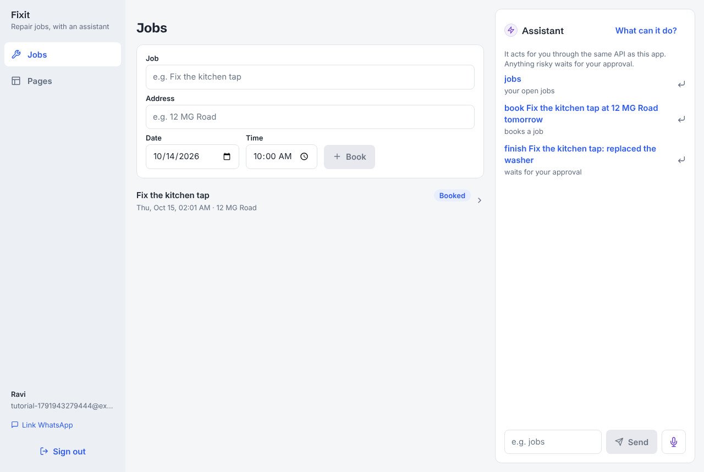
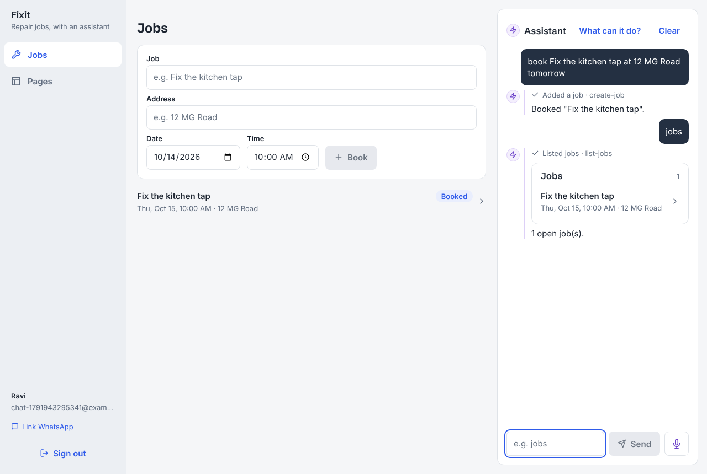

# Build a new application on Basecamp

This tutorial builds a new product on the framework from scratch: **Fixit**, a small repair
business. A person books repair jobs, sees what is coming up, and records each job as done.
An assistant can do all of that too, in the app, on WhatsApp or by voice. When the assistant
completes a job, the person approves it first.

By the end you will have:

- one entity (`job`) and one command (`complete-job`), each declared once;
- REST routes, agent tools, approvals, history and audit, generated from those declarations;
- a WhatsApp reminder an hour before each job;
- the assistant's views (how a job list looks in the chat, on the canvas, in text and in speech);
- a mobile and web app with a Jobs screen and a job screen;
- an end-to-end test and an assistant eval.

Every file below is the real file from a run of this tutorial against the packed framework.
The tests and evals in step 11 passed on it, and the screenshots at the end come from that run.

> This is the "new application" tutorial. To add a feature to the sample application in this
> repository instead, read [tutorial.md](tutorial.md). [DOMAIN.md](../DOMAIN.md) is the
> reference for what each layer must export.

## How an application fits the framework

The framework is the `@hykr/*` packages. Your application is a small pnpm workspace that
depends on them and never reaches inside them. You hand your domain to the framework in exactly
two places:

| Where | What you write | What the framework does with it |
|---|---|---|
| `api/src/server.ts` | `defineServer({ domain, module, views, notifications, agent, channel, migrations })` | Serves the REST API, runs the write path (rules, approvals, audit), builds the assistant and its tools, sends notifications, runs the WhatsApp channel |
| `mobile/src/app/_layout.tsx` | `<AppShell app catalog registry config />` | Renders the shell: sign-in, navigation, the assistant thread, approvals, the canvas, saved pages and voice |

Everything else in your application is one of these:

```
domain/            the domain (one package, several entry points)
  src/contracts/     entity and command specs (Zod)                  → @application/domain/contracts
  src/db/            Drizzle tables, and drizzle/ migrations          → @application/domain/db
  src/server/        Nest module: defineEntity / defineCommand        → @application/domain/server
  src/views/         what tool results look like (defineView)         → @application/domain/views
  src/notifications/ WhatsApp templates and reminders                 → @application/domain/notifications
  src/agent/         persona, rules, scripted-model scripts, evals    → @application/domain/agent
api/               server.ts (defineServer), main.ts, worker.ts, e2e tests
mobile/            Expo app: <AppShell>, your routes and screens, your view components
back-office/       Expo web app for staff; usually unchanged
package.json       the "basecamp" block: where the server and apps are
```

`contracts` and `views` are read by both the server and the app, so they import nothing from
the server side. `pnpm lint:deps` in the Basecamp repository enforces that; it's worth keeping
the same discipline in your own application.

## 0. Before you start

You need:

- Node 24 and pnpm 12 (`corepack enable`);
- Docker, for Postgres, Redis, Mailpit, the WhatsApp emulator and LiveKit.

No model key is needed: `MODEL_MODE=fake` runs the real assistant loop on a scripted model,
and that is what this tutorial uses.

## 1. Create the application

```bash
npm create @hykr/basecamp fixit        # or: pnpm create @hykr/basecamp fixit
cd fixit
pnpm install
cp .env.example .env                    # fill the secrets with `openssl rand -hex 32`;
                                        # set MODEL_MODE=fake and VOICE_MODE=fake
pnpm exec basecamp infra up             # Postgres, Redis, Mailpit, whaloc, LiveKit
```

> **Inside the Basecamp repository** you don't scaffold: `application/` is the application. Run
> the same steps against it, with `pnpm build`, `pnpm db:migrate` and `pnpm dev` at the root.

The scaffold starts as a copy of the sample application (meetings, notes and to-dos). Build it
and run it once, so you know the pieces work before you change anything:

```bash
pnpm -r build
pnpm exec basecamp db migrate
pnpm exec basecamp dev                  # API :3000, app :8081, back office :8082, Studio :4000
```

Sign up at http://localhost:8081, then stop it (Ctrl-C).

## 2. Remove the sample domain

Delete the sample's domain, its screens and its tests. Everything you delete here is
application code; nothing in `node_modules/@hykr` changes.

```bash
rm -rf domain/src/contracts/*.ts domain/src/views/*.ts domain/src/agent/*.ts \
       domain/src/notifications/*.ts domain/src/server/meetings domain/src/server/notes \
       domain/src/server/todos domain/drizzle \
       mobile/src/domain "mobile/src/app/(domain)" \
       api/test/domain api/test/whatsapp api/test/voice
```

Keep these, which you will edit:

- `domain/src/db/schema.ts`
- `domain/src/db/index.ts`
- `domain/src/server/index.ts`
- `domain/src/server/access.ts`
- `api/src/server.ts`
- `mobile/src/app/_layout.tsx`
- `mobile/src/app/pages/*`
- `mobile/src/app/+not-found.tsx`

## 3. Contracts: declare the entity and the command

The spec is the single declaration everything else is generated from. Write it once, in Zod.

`domain/src/contracts/job.ts`:

```ts
import { CreatedBy, commandSpec, entitySpec } from '@hykr/contracts';
import { z } from 'zod';

const title = z.string().min(1).max(200);
const at = z.iso.datetime({ offset: true });

export const JobStatus = z.enum(['booked', 'in_progress', 'done']);
export type JobStatus = z.infer<typeof JobStatus>;

/** A repair job, as the API returns it. */
export const Job = z.object({
  id: z.string(),
  title,
  address: z.string(),
  scheduledFor: z.iso.datetime(),
  status: JobStatus,
  summary: z.string().nullable(),
  createdBy: CreatedBy,
  createdAt: z.iso.datetime(),
});
export type Job = z.infer<typeof Job>;

export const JobSpec = entitySpec({
  name: 'job',
  label: 'job',
  description:
    'Repair jobs: what to fix, where, and when (ISO date-time). Status moves booked → in_progress → done; finish one with complete-job.',
  schemas: {
    read: Job,
    create: z.object({ title, address: z.string().min(1).max(300), scheduledFor: at }),
    update: z
      .object({
        title: title.optional(),
        address: z.string().min(1).max(300).optional(),
        scheduledFor: at.optional(),
        // 'done' and the summary are written by complete-job only (a rule on the entity).
        status: JobStatus.optional(),
        summary: z.string().min(1).max(1000).optional(),
      })
      .refine((v) => Object.values(v).some((x) => x !== undefined), 'Send a field to change'),
  },
  // What people call each field, in every language (approval cards, history, voice).
  fieldLabels: {
    title: { en: 'Job', hi: 'काम', te: 'పని' },
    address: { en: 'Address', hi: 'पता', te: 'చిరునామా' },
    scheduledFor: { en: 'When', hi: 'कब', te: 'ఎప్పుడు' },
    status: { en: 'Status', hi: 'स्थिति', te: 'స్థితి' },
  },
  list: {
    filterable: { status: 'enum', scheduledFor: 'date', title: 'text' },
    sortable: ['scheduledFor', 'createdAt'],
    defaultSort: [['scheduledFor', 'asc']],
    search: ['title', 'address'],
    pageSize: { default: 25, max: 100 },
  },
  // The assistant never deletes a job without the person.
  approval: { delete: (p) => p.actor.kind === 'agent' },
  views: { list: 'job.list', item: 'job.card' },
});

export const CompleteJobSpec = commandSpec({
  name: 'job.complete',
  description:
    'Finish a job: record what was done in one or two sentences and mark it done. Done jobs cannot be reopened.',
  input: z.object({ jobId: z.uuid(), summary: z.string().min(1).max(1000) }),
  output: Job,
  http: { method: 'POST', path: '/api/jobs/:jobId/complete' },
  tool: 'complete-job',
  expose: 'all',
  approvalNote: 'When the assistant calls it, the person approves it first.',
  view: { name: 'job.card', id: (input) => input.jobId },
  verb: { do: 'complete', did: 'completed' },
  touches: ['job'],
});
```

What each part does:

- **`schemas`.** `read` is what the API returns. `create` and `update` are what it accepts. The
  same schemas validate REST bodies, become the assistant's tool parameters, and type the
  app's hooks.
- **`list`.** The list grammar: which fields can be filtered (`?status=booked`,
  `?scheduledFor[gte]=…`), sorted and searched (`?q=`), and the page sizes. The assistant's
  `list-jobs` tool gets the same grammar.
- **`approval`.** When a write waits for a person: here, an assistant's delete.
- **`fieldLabels`.** What approval cards and history call each field, in every language. A
  missing language doesn't compile.
- **`views`.** Which registered views show this entity's results (written in step 6).
- **`commandSpec`.** A named operation beyond plain create, update and delete. It gets a route
  (`POST /api/jobs/:jobId/complete`), a tool (`complete-job`) and a verb for history ("completed").

`domain/src/contracts/index.ts` turns the specs into the domain:

```ts
/**
 * Fixit's domain: repair jobs. The framework reads only `domain`; the server, the views and
 * the app import the specs from here.
 */
import { defineDomain } from '@hykr/contracts';
import { CompleteJobSpec, JobSpec } from './job.js';

export * from './job.js';

export const domain = defineDomain({
  name: 'Fixit',
  entities: { jobs: JobSpec },
  commands: [CompleteJobSpec],
});
```

Entities are keyed by plural (`jobs`). That plural is the route (`/api/jobs`), the query-cache
key, and the name your app uses (`useEntityList('jobs')`).

## 4. The table and its migration

`domain/src/db/schema.ts`:

```ts
/**
 * Fixit's tables. Each needs an id, a tenant and an owner column (customerColumn() too, for
 * records customers have), and created_by/created_at/updated_at: the framework's scoping,
 * provenance and list grammar rely on them.
 */
import { app, customerColumn, id, tenantColumn, user } from '@hykr/db';
import { index, text, timestamp } from 'drizzle-orm/pg-core';

export const jobs = app.table(
  'jobs',
  {
    id: id(),
    tenantId: tenantColumn(),
    ownerId: text('owner_id')
      .notNull()
      .references(() => user.id),
    customerId: customerColumn(),
    title: text('title').notNull(),
    address: text('address').notNull(),
    scheduledFor: timestamp('scheduled_for', { withTimezone: true }).notNull(),
    status: text('status', { enum: ['booked', 'in_progress', 'done'] })
      .notNull()
      .default('booked'),
    summary: text('summary'),
    createdBy: text('created_by', { enum: ['person', 'assistant'] })
      .notNull()
      .default('person'),
    createdAt: timestamp('created_at', { withTimezone: true }).defaultNow().notNull(),
    updatedAt: timestamp('updated_at', { withTimezone: true })
      .defaultNow()
      .$onUpdate(() => new Date())
      .notNull(),
  },
  (t) => [
    index('jobs_owner_scheduled_idx').on(t.ownerId, t.scheduledFor),
    index('jobs_tenant_customer_idx').on(t.tenantId, t.customerId),
  ],
);
```

The framework's scoping, provenance and list grammar rely on these columns:

- `id`
- `tenantColumn()`
- an owner column
- `customerColumn()`, if customers have rows
- `createdBy`, `createdAt` and `updatedAt`

`app`, `id`, `tenantColumn`, `customerColumn` and `user` come from `@hykr/db`.

Generate the migration and apply it:

```bash
pnpm exec basecamp db generate --name jobs   # → domain/drizzle/0000_jobs.sql
pnpm exec basecamp db migrate                # the framework's migrations, then yours
```

The migration contains only your table. The framework's tables (users, businesses, approvals,
channels) ship with `@hykr/db` and run first; the two sets are recorded separately
(`drizzle.__framework_migrations` and `drizzle.__app_migrations`).

## 5. The server: the entity and the command

`defineEntity` binds the spec to the table and adds your business rules. Every REST call and
every assistant tool call goes through the same write path: validate, idempotency, load,
authorize, run or park for approval, and audit.

`domain/src/server/jobs/job.entity.ts`:

```ts
import { defineEntity, deny } from '@hykr/core';
import { JobSpec } from '../../contracts/index.js';
import { jobs } from '../../db/schema.js';
import { BUSINESS_ACCESS } from '../access.js';

/** Jobs: CRUD from the spec, plus the business's rules. */
export const Job = defineEntity(JobSpec, {
  table: jobs,
  owner: (t) => t.ownerId,
  customer: (t) => t.customerId,
  access: BUSINESS_ACCESS,
  rules: [
    // A done job stays done.
    (_p, action, row) =>
      (action === 'update' || action === 'delete') && row?.status === 'done'
        ? deny('done_is_final', 'A done job cannot change')
        : null,
    // Finishing writes a summary, so it goes through complete-job, never a bare PATCH.
    (_p, action, _row, input, ctx) =>
      action === 'update' &&
      (input?.status === 'done' || input?.summary !== undefined) &&
      ctx.via !== 'job.complete'
        ? deny('use_complete_job', 'Finish a job with complete-job, so its summary is recorded')
        : null,
  ],
});
```

> **Fields a command writes must be in the entity's `update` schema.** A command writes through
> `Job.repo.update`, which validates the patch against the public update schema. So `status:
> 'done'` and `summary` are in `update`, and a rule allows them only `via` the command
> (`ctx.via === 'job.complete'`). Leave them out and the command fails with a 500 when it runs.
> The sample's meetings do the same with `status: 'closed'`.

`domain/src/server/jobs/complete-job.command.ts`:

```ts
import { allow, defineCommand, deny, type NamedEvent, needsApproval } from '@hykr/core';
import { CompleteJobSpec } from '../../contracts/index.js';
import { Job } from './job.entity.js';

/** job.completed: a NamedEvent, so a notification can follow it. */
export class JobCompleted implements NamedEvent {
  readonly eventName = 'job.completed';
  constructor(readonly row: unknown) {}
}

/** Finish a job. The assistant may draft it; the person approves before it is written. */
export const CompleteJob = defineCommand(CompleteJobSpec, {
  resource: { type: 'job', id: (input) => input.jobId },
  load: async (tx, p, input) => ({ job: await Job.repo.get(tx, p, input.jobId) }),
  authorize: (p, { job }) => {
    if (job.status === 'done') return deny('done_is_final', 'This job is already done');
    if (p.actor.kind === 'agent') return needsApproval('agent_completes', 'Completing a job');
    return allow('owner_completes');
  },
  summarize: (input, { job }) => `Complete ${job.title}: ${input.summary}`,
  run: async ({ tx, principal, input, loaded: { job }, via }) => {
    const done = await Job.repo.update(
      tx,
      principal,
      job,
      { status: 'done', summary: input.summary },
      via,
    );
    return {
      value: done,
      touched: [{ type: 'job', id: done.id, change: 'updated', before: job, after: done }],
      events: [new JobCompleted(done)],
    };
  },
});
```

A command declares five things:

- **`resource`:** what it acts on.
- **`load`:** what it reads, inside the transaction.
- **`authorize`:** who may run it. It returns allow, deny or `needsApproval`.
- **`summarize`:** what an approval card says.
- **`run`:** what it writes. It returns the value, the rows it touched (for audit) and its events.

`JobCompleted` is a `NamedEvent`, so notifications can follow it (step 7 cancels the reminder on it).

`domain/src/server/jobs/jobs.module.ts` and `domain/src/server/index.ts`:

```ts
import { commandController, commandHandler, entityController, entityHandlers } from '@hykr/core';
import { Module } from '@nestjs/common';
import { CompleteJob } from './complete-job.command.js';
import { Job } from './job.entity.js';

@Module({
  controllers: [entityController(Job), commandController(CompleteJob)],
  providers: [...entityHandlers(Job), commandHandler(CompleteJob)],
})
export class JobsModule {}
```

```ts
/**
 * Fixit's API: each entity and command declared once (defineEntity / defineCommand); the
 * framework generates routes, handlers, agent tools and audit.
 */
import { Module } from '@nestjs/common';
import { JobsModule } from './jobs/jobs.module.js';

@Module({ imports: [JobsModule] })
export class DomainModule {}
```

`domain/src/server/access.ts` (kept from the scaffold) says who reaches which rows:

- the owner their own rows;
- admins and ops the whole business;
- a customer the rows that are theirs.

## 6. Views: what the assistant shows

A tool result doesn't carry markup. It carries a *view*: a name, props and a query. Each
channel renders the view its own way:

- the app draws a component;
- WhatsApp sends the view's `text`;
- a spoken turn says its `speak`.

Views are declared here, once, and bound to components in the app (step 9).

`domain/src/views/job.ts`:

```ts
import { pick, spokenWhen, whenText } from '@hykr/i18n';
import { action, defineView, spokenList, type ViewLabels } from '@hykr/ui-registry';
import { z } from 'zod';
import { Job, JobSpec } from '../contracts/index.js';

const labels = {
  title: { en: 'Jobs', hi: 'काम', te: 'పనులు' },
  empty: { en: 'No jobs.', hi: 'कोई काम नहीं।', te: 'పనులు ఏవీ లేవు.' },
  noun: { en: ['job', 'jobs'], hi: ['काम', 'काम'], te: ['పని', 'పనులు'] },
} satisfies ViewLabels;

const open = action<Job>({ screen: 'job.detail', params: (j) => ({ id: j.id }) });

export const JobListView = defineView({
  name: 'job.list',
  description: 'A list of repair jobs with when and where. Use for any list of jobs.',
  surfaces: ['inline', 'canvas', 'text', 'speech'],
  props: z.object({ title: z.string().max(60).optional(), items: z.array(Job) }),
  source: { entity: JobSpec, into: 'items' },
  actions: { open },
  labels,
  text: (p, ctx) =>
    p.items.length
      ? p.items
          .map((j) => `• ${j.title}, ${whenText(j.scheduledFor, ctx.timeZone, ctx.lang)}`)
          .join('\n')
      : pick(labels.empty, ctx.lang),
  speak: (p, ctx) =>
    spokenList(
      p.items.map((j) => j.title),
      labels,
      ctx,
    ),
});

export const JobCardView = defineView({
  name: 'job.card',
  description: 'One job: what, where, when and its status.',
  surfaces: ['inline', 'canvas', 'text', 'speech'],
  props: z.object({ id: z.string(), item: Job }),
  source: { entity: JobSpec, into: 'item', by: 'id' },
  actions: { open },
  labels: { noun: labels.noun },
  text: (p, ctx) =>
    `${p.item.title} (${p.item.status}), ${whenText(p.item.scheduledFor, ctx.timeZone, ctx.lang)}, ${p.item.address}`,
  speak: (p, ctx) => `${p.item.title}, ${spokenWhen(p.item.scheduledFor, ctx.timeZone, ctx.lang)}.`,
});
```

`domain/src/views/screens.ts` declares a screen the assistant can open on the canvas
(`act('open', job)` opens it):

```ts
import { defineScreen } from '@hykr/ui-registry';
import { z } from 'zod';

/** The job's own screen, which the assistant can open on the canvas. */
export const JobDetailScreen = defineScreen({
  name: 'job.detail',
  title: 'job',
  description: 'One job in full: what, where and when, completing it, and its history.',
  params: z.object({ id: z.uuid() }),
});
```

`domain/src/views/index.ts`:

```ts
/** Fixit's views and screens: what the assistant may show for jobs. */
import type { ScreenDef, ViewDef } from '@hykr/ui-registry';
import { JobCardView, JobListView } from './job.js';
import { JobDetailScreen } from './screens.js';

export * from './job.js';
export * from './screens.js';

export const uiDomain = {
  views: [JobListView, JobCardView] as unknown as readonly ViewDef[],
  screens: [JobDetailScreen] as unknown as readonly ScreenDef[],
};
```

## 7. Notifications: a reminder before each job

Outside a customer's 24-hour window, WhatsApp delivers only approved templates. So anything
your app sends on its own initiative is a template, declared in code:

- **`defineTemplate`:** the words, in every language.
- **`defineNotification`:** when the message goes, to whom, and over which channels.

`domain/src/notifications/index.ts`:

```ts
/** Fixit's templates and notifications: a reminder before each job. */
import { pick, spokenWhen } from '@hykr/i18n';
import { defineNotification, defineTemplate, type Row } from '@hykr/notifications';
import { z } from 'zod';

export const JobReminder = defineTemplate({
  name: 'job_reminder_v1',
  category: 'utility',
  params: z.object({ title: z.string().max(60), time: z.string().max(60) }),
  body: {
    en: 'Reminder: {{title}} at {{time}}.',
    hi: 'रिमाइंडर: {{title}} {{time}} पर है।',
    te: 'రిమైండర్: {{title}} {{time}}కి ఉంది.',
  },
  example: { title: 'Fix the kitchen tap', time: '10:00 am' },
});

type JobRow = Row & {
  title: string;
  scheduledFor: string;
  status: string;
  ownerId: string;
  customerId: string | null;
};

const SOON = { en: 'is in an hour', hi: 'एक घंटे में है', te: 'ఒక గంటలో ఉంది' } as const;

/** An hour before a booked job, to its customer and its owner. A reschedule moves it. */
export const JobReminderNotification = defineNotification<JobRow>({
  key: 'job.reminder',
  topic: 'reminders',
  schedule: {
    on: ['job.created', 'job.updated'],
    at: (j) =>
      j.status === 'booked' ? new Date(new Date(j.scheduledFor).getTime() - 60 * 60_000) : null,
    cancelOn: ['job.deleted', 'job.completed'],
  },
  to: (j) => [...(j.customerId ? [{ customerId: j.customerId }] : []), { userId: j.ownerId }],
  channels: ['whatsapp', 'email'],
  whatsapp: {
    template: JobReminder,
    params: (j, r) => ({ title: j.title, time: spokenWhen(j.scheduledFor, r.timeZone, r.lang) }),
  },
  email: {
    subject: (j) => `Reminder: ${j.title}`,
    body: (j, r) => `${j.title} ${pick(SOON, r.lang)}.`,
  },
  dedupe: (j) => `job.reminder:${j.id}`,
});

export const domainTemplates = [JobReminder];
// biome-ignore lint/suspicious/noExplicitAny: notifications over different rows
export const domainNotifications: ReturnType<typeof defineNotification<any>>[] = [
  JobReminderNotification,
];
```

The framework handles the rest: consent, quiet hours, the person's language, falling back to
email. `pnpm exec basecamp templates sync` registers the template with the provider (whaloc
locally).

## 8. The assistant: persona, rules, scripts and evals

The assistant's tools come from your specs: `list-jobs`, `get-job`, `create-job`, `update-job`,
`delete-job` and `complete-job`. What you add is who the assistant is, the rules of your
business, and, for the scripted model, how it answers.

`domain/src/agent/index.ts`:

```ts
/** What Fixit's assistant knows beyond its tools: who it is, the rules, scripts and evals. */
import type { AgentDomain } from '@hykr/agents/script';
import { evalCases } from './evals.js';
import { domainScripts } from './scripts.js';

export const agentDomain: AgentDomain = {
  persona:
    'You are the assistant of a small repair business. You help book repair jobs, find them, and record them as done.',
  rules: [
    'When the user says a job is finished, draft a complete-job call with a one or two sentence summary of what was done, then tell them to approve it.',
    'Book jobs at the time the user gives; if they give none, ask for it.',
  ],
  help: 'I can book, list and complete repair jobs.',
  scripts: domainScripts,
  evalCases,
};
```

The scripted model (`MODEL_MODE=fake`) runs the real agent loop: real tools, real API calls,
real approvals. Only the "thinking" is a script. That makes tests and evals free and
deterministic. `domain/src/agent/scripts.ts`:

```ts
/**
 * The scripted model's knowledge of Fixit (MODEL_MODE=fake: tests, CI and demos without a key):
 *   jobs                      list-jobs
 *   book <title> at <address> tomorrow   create-job (tomorrow at 10:00)
 *   finish <title>: <summary> list-jobs → complete-job (waits for approval)
 */
import { call, defineScript, items, sameTitle, say, sayIn, written } from '@hykr/agents/script';

export const domainScripts = [
  defineScript({
    name: 'list',
    match: (text) => (/^jobs\??$/i.test(text.trim()) ? true : undefined),
    step: (_, turn) => {
      const r = turn.result('list-jobs');
      if (!r) return [call('list-jobs', { status: { in: ['booked', 'in_progress'] } })];
      const jobs = items(r);
      return [say(jobs.length ? `${jobs.length} open job(s).` : 'No open jobs.')];
    },
  }),
  defineScript({
    name: 'book',
    match: (text) => {
      const m = /^book (.+?) at (.+?) tomorrow$/i.exec(text.trim());
      return m ? { title: m[1], address: m[2] } : undefined;
    },
    step: ({ title, address }, turn) => {
      const r = turn.result('create-job');
      if (r) return [say(written(r, (j: { title: string }) => `Booked "${j.title}".`, turn))];
      const when = new Date(Date.now() + 86_400_000);
      when.setUTCHours(10, 0, 0, 0);
      return [call('create-job', { title, address, scheduledFor: when.toISOString() })];
    },
  }),
  defineScript({
    name: 'finish',
    match: (text) => {
      const m = /^finish (.+?):\s*(.+)$/i.exec(text.trim());
      return m ? { title: m[1], summary: m[2] } : undefined;
    },
    step: ({ title, summary }, turn) => {
      const done = turn.result('complete-job');
      if (done) return [say(written(done, () => `Completed "${title}".`, turn))];
      const list = turn.result('list-jobs');
      if (!list) return [call('list-jobs', { q: title })];
      const job = items(list).find((j) => sameTitle(j.title, title));
      if (!job)
        return [
          sayIn(turn, {
            en: `No job called "${title}".`,
            hi: `"${title}" नाम का कोई काम नहीं।`,
            te: `"${title}" అనే పని లేదు.`,
          }),
        ];
      return [call('complete-job', { jobId: job.id, summary })];
    },
  }),
];
```

`written(...)` words the outcome: what was done, or that it waits for approval.

The eval is one conversation, scored turn by turn: the right tools in order, none of the
forbidden ones, and the reply's words. `domain/src/agent/evals.ts`:

```ts
import type { EvalCase } from '@hykr/agents/script';

/** One conversation, in order: later turns rely on what earlier ones created. */
export const evalCases: EvalCase[] = [
  {
    why: 'books a job',
    input: 'book Fix the kitchen tap at 12 MG Road tomorrow',
    expect: { must: ['create-job'], replyIncludes: 'kitchen tap' },
  },
  {
    why: 'lists open jobs',
    input: 'jobs',
    expect: { must: ['list-jobs'], mustNot: ['create-job', 'complete-job'] },
  },
  {
    why: 'completing looks the job up first, and waits for approval',
    input: 'finish Fix the kitchen tap: replaced the washer',
    expect: { must: ['list-jobs', 'complete-job'], replyIncludes: 'approv' },
  },
];
```

## 9. The server definition

`api/src/server.ts` is where the server meets your domain. Only `channel.does` changes from
the scaffold: it's the sentence the WhatsApp welcome and HELP use for what the assistant does.

```ts
// Fixit, as the server runs it: the domain's entities and commands, the Nest module
// that serves them, its views, its notifications and its assistant. `basecamp dev` and
// `basecamp start` run the API and the worker from this file.

import { agentDomain } from '@application/domain/agent';
import { domain } from '@application/domain/contracts';
import { migrations } from '@application/domain/db';
import { domainNotifications, domainTemplates } from '@application/domain/notifications';
import { DomainModule } from '@application/domain/server';
import { uiDomain } from '@application/domain/views';
import { defineServer } from '@hykr/api';

export const server = defineServer({
  domain,
  module: DomainModule,
  views: uiDomain,
  notifications: { templates: domainTemplates, notifications: domainNotifications },
  agent: agentDomain,
  // On WhatsApp, in the welcome and in HELP.
  channel: {
    does: {
      en: 'I can book your repair jobs, tell you when they are, and record them as done.',
      hi: 'मैं आपके मरम्मत के काम बुक कर सकता हूँ, उनका समय बता सकता हूँ और उन्हें पूरा दर्ज कर सकता हूँ।',
      te: 'నేను మీ రిపేర్ పనులను బుక్ చేయగలను, వాటి సమయం చెప్పగలను, పూర్తయినట్లు నమోదు చేయగలను.',
    },
  },
  migrations: [migrations],
});
```

## 10. The app

The framework ships the whole shell: sign-in, navigation, the assistant, approvals, the
canvas, saved pages and voice. Your app adds two things:

- **your domain:** what the shell needs to know about it;
- **your screens:** the components for your views and your routes.

`mobile/src/domain/index.ts` builds the catalog and registry from your domain, types your
screens, and describes the app to the shell:

```ts
/** Fixit, in the app: the shell reads only what this file exports. */
import { domain } from '@application/domain/contracts';
import { uiDomain } from '@application/domain/views';
import { defineAppDomain } from '@hykr/app';
import { createCatalog } from '@hykr/contracts';
import { createUiRegistry } from '@hykr/ui-registry';
import { bindDomain } from './bindings';

/** Every entity and command this app serves: Fixit's and the framework's. */
export const catalog = createCatalog(domain);
/** Every view and screen the assistant may show here. */
export const registry = createUiRegistry(uiDomain);

// Types entity names and rows in this app's screens: useEntityList('jobs') is Job[].
declare module '@hykr/app' {
  interface Register {
    catalog: typeof catalog;
  }
}

export const appDomain = defineAppDomain({
  title: 'Fixit',
  tagline: 'Repair jobs, with an assistant',
  nav: [
    {
      href: '/',
      label: 'Jobs',
      icon: 'tool',
      match: (p) => p === '/' || p.startsWith('/jobs'),
    },
  ],
  suggestions: [
    { text: 'jobs', what: 'your open jobs' },
    { text: 'book Fix the kitchen tap at 12 MG Road tomorrow', what: 'books a job' },
    { text: 'finish Fix the kitchen tap: replaced the washer', what: 'waits for your approval' },
  ],
  bind: bindDomain,
});
```

The `declare module` block makes `useEntityList('jobs')` return typed `Job` rows, and a typo
like `useEntityList('jbos')` fail to compile. Icons are [Feather](https://feathericons.com)
names.

Bind a component to each view and screen. `bindView` checks the component's props against the
view's schema at compile time. `mobile/src/domain/bindings.tsx`:

```tsx
import { JobCardView, JobDetailScreen, JobListView } from '@application/domain/views';
import { bindScreen, bindView } from '@hykr/ui-registry/react';
import { JobDetail } from './screens/JobDetail';
import { JobCardComponent, JobListComponent } from './views/job';

/** This app's component for each of Fixit's views and screens (props checked at compile time). */
export function bindDomain() {
  bindView(JobListView, JobListComponent);
  bindView(JobCardView, JobCardComponent);
  bindScreen(JobDetailScreen, ({ id }) => <JobDetail id={id} embedded />);
}
```

`mobile/src/domain/views/job.tsx`. This is how `job.list` and `job.card` look in the chat and
on the canvas:

```tsx
import type { JobCardView, JobListView } from '@application/domain/views';
import { OpenRow, Rows, ViewCard, when } from '@hykr/app';
import { Text } from '@hykr/app/ui';
import type { ViewProps } from '@hykr/ui-registry/react';
import { JobStatus } from '../JobStatus';

/** How job.list looks in the chat and on the canvas. */
export function JobListComponent({ title, items, act, words }: ViewProps<typeof JobListView>) {
  return (
    <ViewCard title={title ?? words.title} count={items.length}>
      <Rows items={items} empty={words.empty}>
        {(j) => (
          <OpenRow label={`Open ${j.title}`} onPress={() => act('open', j)}>
            <Text className="font-semibold">{j.title}</Text>
            <Text variant="muted">
              {when(j.scheduledFor)} · {j.address}
            </Text>
          </OpenRow>
        )}
      </Rows>
    </ViewCard>
  );
}

/** How job.card looks. */
export function JobCardComponent({ item, act }: ViewProps<typeof JobCardView>) {
  return (
    <ViewCard title={item.title}>
      <JobStatus status={item.status} />
      <Text variant="muted">
        {when(item.scheduledFor)} · {item.address}
      </Text>
      <OpenRow label={`Open ${item.title}`} onPress={() => act('open', item)}>
        <Text className="font-semibold text-primary">Open the job</Text>
      </OpenRow>
    </ViewCard>
  );
}
```

One status badge, used everywhere a job's status shows (`mobile/src/domain/JobStatus.tsx`):

```tsx
import type { JobStatus as Status } from '@application/domain/contracts';
import { Badge, Text } from '@hykr/app/ui';

const LOOK = {
  booked: { label: 'Booked', variant: 'info' },
  in_progress: { label: 'In progress', variant: 'warn' },
  done: { label: 'Done', variant: 'success' },
} as const;

/** A job's status, the one way the app shows it. */
export function JobStatus({ status }: { status: Status }) {
  const look = LOOK[status];
  return (
    <Badge variant={look.variant} className="self-start">
      <Text>{look.label}</Text>
    </Badge>
  );
}
```

The job's screen. The route and the canvas both show it.
`mobile/src/domain/screens/JobDetail.tsx`:

```tsx
import { CompleteJobSpec } from '@application/domain/contracts';
import {
  Button,
  errorMessage,
  Field,
  History,
  Loading,
  ScreenTitle,
  SectionHeading,
  useCommand,
  useEntity,
  useScreenContext,
  when,
} from '@hykr/app';
import { Text } from '@hykr/app/ui';
import { useState } from 'react';
import { ScrollView, View } from 'react-native';
import { JobStatus } from '../JobStatus';

/** One job: what, where, when; complete it; its history. The route and the canvas show it. */
export function JobDetail({ id, embedded = false }: { id: string; embedded?: boolean }) {
  // The assistant's context: "finish this one" on this screen names this job.
  useScreenContext(embedded ? undefined : { screen: 'job', record: { type: 'job', id } });
  const job = useEntity('jobs', id);
  const complete = useCommand(CompleteJobSpec);
  const [summary, setSummary] = useState('');
  if (!job.data) return <Loading error={job.error} />;
  const j = job.data;
  return (
    <ScrollView contentContainerClassName="gap-5 p-5">
      <ScreenTitle title={j.title} subtitle={`${when(j.scheduledFor)} · ${j.address}`} />
      <JobStatus status={j.status} />
      {j.status === 'done' ? (
        <Text>{j.summary}</Text>
      ) : (
        <View className="gap-2">
          <SectionHeading>Complete the job</SectionHeading>
          <Field
            label="What was done"
            value={summary}
            onChangeText={setSummary}
            placeholder="e.g. Replaced the washer"
          />
          <Button
            title="Mark as done"
            icon="check"
            busy={complete.isPending}
            disabled={!summary.trim()}
            onPress={() => complete.mutate({ jobId: j.id, summary: summary.trim() })}
          />
          {complete.error && <Text className="text-danger">{errorMessage(complete.error)}</Text>}
        </View>
      )}
      <SectionHeading>History</SectionHeading>
      <History type="job" id={j.id} />
    </ScrollView>
  );
}
```

`useScreenContext` tells the assistant what the person is looking at, so "finish this one"
can name this job. `useCommand(CompleteJobSpec)` runs the command as the person. Because a
person is completing it, it runs at once; the same command from the assistant waits for approval.

Your routes live in `mobile/src/app/(domain)/`. The group adds no URL segment, and
`index.tsx` is the home screen. `mobile/src/app/(domain)/index.tsx`:

```tsx
import {
  at,
  Button,
  DateField,
  EmptyState,
  errorMessage,
  Field,
  isValidDate,
  isValidTime,
  LoadError,
  OpenRow,
  ScreenTitle,
  TimeField,
  todayLocal,
  useEntityList,
  useEntityMutation,
  useScreenContext,
  when,
} from '@hykr/app';
import { Text } from '@hykr/app/ui';
import { router } from 'expo-router';
import { useState } from 'react';
import { FlatList, View } from 'react-native';
import { JobStatus } from '@/domain/JobStatus';

/** Book a job: what, where, when. */
function BookJob() {
  const { create } = useEntityMutation('jobs');
  const [title, setTitle] = useState('');
  const [address, setAddress] = useState('');
  const [date, setDate] = useState(todayLocal());
  const [time, setTime] = useState('10:00');
  const valid = title.trim() && address.trim() && isValidDate(date) && isValidTime(time);
  return (
    <View className="gap-2 rounded-card border border-border bg-card p-4">
      <Field
        label="Job"
        value={title}
        onChangeText={setTitle}
        placeholder="e.g. Fix the kitchen tap"
      />
      <Field
        label="Address"
        value={address}
        onChangeText={setAddress}
        placeholder="e.g. 12 MG Road"
      />
      <View className="flex-row flex-wrap items-end gap-3">
        <DateField label="Date" value={date} onChange={setDate} />
        <TimeField label="Time" value={time} onChange={setTime} />
        <Button
          title="Book"
          icon="plus"
          busy={create.isPending}
          disabled={!valid}
          onPress={async () => {
            await create.mutateAsync({
              title: title.trim(),
              address: address.trim(),
              scheduledFor: at(date, time),
            });
            setTitle('');
            setAddress('');
          }}
        />
      </View>
      {create.error && <Text className="text-danger">{errorMessage(create.error)}</Text>}
    </View>
  );
}

/** The home screen: open jobs, soonest first, and a form to book one. */
export default function Jobs() {
  useScreenContext({ screen: 'jobs' });
  const list = useEntityList('jobs', {
    status: { in: ['booked', 'in_progress'] },
    sort: 'scheduledFor',
  });
  return (
    <FlatList
      contentContainerClassName="gap-3 p-5"
      data={list.items}
      keyExtractor={(j) => j.id}
      ListHeaderComponent={
        <View className="gap-4">
          <ScreenTitle title="Jobs" />
          <BookJob />
        </View>
      }
      renderItem={({ item }) => (
        <OpenRow label={`Open ${item.title}`} onPress={() => router.navigate(`/jobs/${item.id}`)}>
          <View className="flex-row items-center justify-between gap-2">
            <Text className="shrink font-semibold">{item.title}</Text>
            <JobStatus status={item.status} />
          </View>
          <Text variant="muted">
            {when(item.scheduledFor)} · {item.address}
          </Text>
        </OpenRow>
      )}
      ListEmptyComponent={
        list.error ? (
          <LoadError what="jobs" onRetry={list.refresh} />
        ) : list.loading ? (
          <Text variant="muted">Loading…</Text>
        ) : (
          <EmptyState
            icon="tool"
            title="No open jobs"
            body="Book one above, or ask the assistant."
          />
        )
      }
      onEndReached={list.loadMore}
    />
  );
}
```

`mobile/src/app/(domain)/jobs/[id].tsx`:

```tsx
import { useLocalSearchParams } from 'expo-router';
import { JobDetail } from '@/domain/screens/JobDetail';

/** /jobs/:id: the job's screen (the canvas shows the same one, bound in domain/bindings.tsx). */
export default function JobRoute() {
  const { id } = useLocalSearchParams<{ id: string }>();
  return <JobDetail id={id} />;
}
```

The saved-pages screen suggests a page the assistant can compose from your views
(`mobile/src/app/pages/index.tsx`):

```tsx
import { PagesScreen } from '@hykr/app';

/** The framework's saved pages, suggesting a page the assistant can compose from Fixit's views. */
export default function Pages() {
  return <PagesScreen ask="show my jobs this week" />;
}
```

`_layout.tsx`, `pages/[id].tsx` and `+not-found.tsx` stay as the scaffold made them. They
render the framework's shell and screens. Rename the app in `mobile/app.json` (`name`, `slug`,
`scheme`, the iOS `bundleIdentifier` and the Android `package`). If you change `scheme`, change
it in `_layout.tsx` too.

## 11. Test it

An end-to-end test boots your compiled API against real Postgres and Redis, with the scripted
model. `@hykr/api/testing` gives you `boot`, a signed-in `Person`, and helpers for the
assistant and the database. `api/test/jobs.e2e.test.ts`:

```ts
// Fixit end to end: the compiled API on real Postgres and Redis, with the scripted model.
import { boot, Person, shutdown } from '@hykr/api/testing';
import { afterAll, beforeAll, describe, expect, it } from 'vitest';
// Compiled, like the app runs: Nest's DI needs the decorator metadata tsc emits.
import { server as application } from '../dist/server.js';

const ana = new Person('Ana');
const tomorrow = () => new Date(Date.now() + 86_400_000).toISOString();

beforeAll(async () => {
  await boot(application);
  await ana.signUp();
});
afterAll(shutdown);

describe('jobs', () => {
  it('a person books a job and lists it', async () => {
    const made = await ana.call('POST', '/api/jobs', {
      title: 'Fix the kitchen tap',
      address: '12 MG Road',
      scheduledFor: tomorrow(),
    });
    expect(made.status).toBe(201);
    expect(made.body.value).toMatchObject({ status: 'booked', createdBy: 'person' });
    const list = await ana.call('GET', '/api/jobs?status=booked');
    expect(list.body.items.map((j: { title: string }) => j.title)).toContain('Fix the kitchen tap');
  });

  it("the assistant's completion waits for the person's approval", async () => {
    await ana.chat('book Paint the gate at 4 Lake View tomorrow');
    const turn = await ana.chat('finish Paint the gate: two coats, done');
    expect(turn.body.reply).toMatch(/approv/i);
    const approvals = (await ana.call('GET', '/api/approvals')).body as {
      id: string;
      action: string;
    }[];
    const parked = approvals.find((a) => a.action === 'job.complete');
    expect(parked).toBeDefined();
    const ok = await ana.call('POST', `/api/approvals/${parked?.id}/approve`);
    expect(ok.body.status).toBe('approved');
    const jobs = (await ana.call('GET', '/api/jobs?q=gate')).body.items;
    expect(jobs[0]).toMatchObject({ status: 'done', summary: 'two coats, done' });
  });

  it('a job is finished with complete-job, not a bare PATCH', async () => {
    const job = (
      await ana.call('POST', '/api/jobs', {
        title: 'Fix the fence',
        address: '3 Park Lane',
        scheduledFor: tomorrow(),
      })
    ).body.value;
    const patch = await ana.call('PATCH', `/api/jobs/${job.id}`, { status: 'done' });
    expect(patch.status).toBe(403);
    expect(patch.body.reason).toMatch(/complete-job/);
  });

  it('the person completes a job directly, and a done job stays done', async () => {
    const job = (
      await ana.call('POST', '/api/jobs', {
        title: 'Clear the drain',
        address: '9 Hill Street',
        scheduledFor: tomorrow(),
      })
    ).body.value;
    const done = await ana.call('POST', `/api/jobs/${job.id}/complete`, {
      jobId: job.id,
      summary: 'Cleared',
    });
    expect(done.body.status).toBe('done');
    const again = await ana.call('PATCH', `/api/jobs/${job.id}`, { title: 'Changed' });
    expect(again.status).toBe(403);
  });
});
```

Build, migrate and run it:

```bash
pnpm -r build                            # domain first: the app and the tests read its dist/
pnpm exec basecamp db migrate
(cd api && pnpm test)                    # 4 tests
```

Then, with the API running (`pnpm exec basecamp start api` in another terminal):

```bash
pnpm exec basecamp eval                  # your three cases: 3/3
pnpm exec basecamp eval whatsapp         # the framework's WhatsApp cases: 2/2
```

## 12. Run it

```bash
pnpm exec basecamp dev
```

Open http://localhost:8081 and sign up:

- **Book a job with the form.** It appears with a "Booked" badge.
- **Ask the assistant** `book Fix the kitchen tap at 12 MG Road tomorrow`. The job appears on
  the Jobs screen without a reload: the assistant wrote through the API, and the app refreshed
  what it touched.
- **Ask** `jobs`. The answer is your `job.list` component, inline in the chat.
- **Ask** `finish Fix the kitchen tap: replaced the washer`. It waits for your approval. Approve
  it in the card, and the job's History shows who asked, who approved, and when.





You also have, without writing them:

- the job's history and the approval cards;
- saved canvas pages built from your views;
- WhatsApp, where the reminder goes an hour before each job and the assistant answers in the
  customer's language;
- voice mode;
- the back office at http://localhost:8082, where staff pick up WhatsApp conversations;
- Mastra Studio at http://localhost:4000, with every assistant run traced.

## Checklist for your own domain

1. **Contracts** (`domain/src/contracts`): an `entitySpec` per entity, a `commandSpec` per
   named operation, and `defineDomain` with entities keyed by plural.
2. **Table** (`domain/src/db/schema.ts`) with the framework's columns. Then
   `basecamp db generate --name …` and `basecamp db migrate`.
3. **Server** (`domain/src/server`): `defineEntity` with `access` and `rules`, `defineCommand`,
   and a Nest module in `DomainModule`. Fields a command writes go in the update schema, with a
   `via` rule.
4. **Views** (`domain/src/views`): `defineView` per entity's list and item (`text` and `speak`
   for channels without a screen), and `defineScreen` for anything `open` shows.
5. **Notifications** (`domain/src/notifications`): `defineTemplate` and `defineNotification`.
   Then `basecamp templates sync`.
6. **Assistant** (`domain/src/agent`): persona, rules, help, scripts, eval cases.
7. **`api/src/server.ts`**: `channel.does` in each language.
8. **App** (`mobile/src`): `defineAppDomain` (title, nav, suggestions, bind), a component per
   view and screen, and routes in `src/app/(domain)`. Rename `app.json`.
9. **Tests and evals**: an e2e test per rule that matters, and `basecamp eval`.

## Things that will trip you up

- **The app and the tests read the domain's compiled output.** Until `domain` is built, the
  mobile app's typecheck reports every `@application/domain/*` import as missing. Run
  `pnpm -r build` (it builds in dependency order); `basecamp dev` keeps it compiled from then on.
- **Fields a command writes must be in the update schema.** See step 5. Without them the command
  fails with a bare 500 rather than a clear error.
- **A refused write answers 403 with the rule's message in `reason`,** for example "Finish a job
  with complete-job…". The rule's code (`use_complete_job`) is in the audit row's `rule` column.
- **The scaffold starts from the sample domain,** so step 2 is a deletion. Do it before you
  start, not as you go, or the sample's types mix with yours.
- **`uiDomain` needs a cast** (`as unknown as readonly ViewDef[]`): each view is typed by its
  own props, and the list holds views of different shapes.
- **The mobile app lists native modules it doesn't import itself** (LiveKit, WebRTC, speech,
  SQLite, secure store) and their plugins in `app.json`. The framework's voice and storage need
  them, and Expo needs native modules installed in the app. Keep them.
